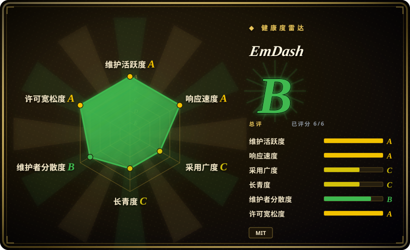
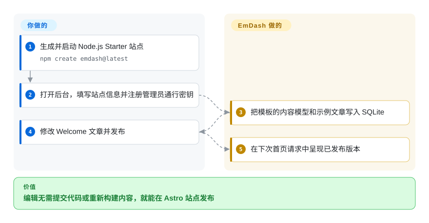
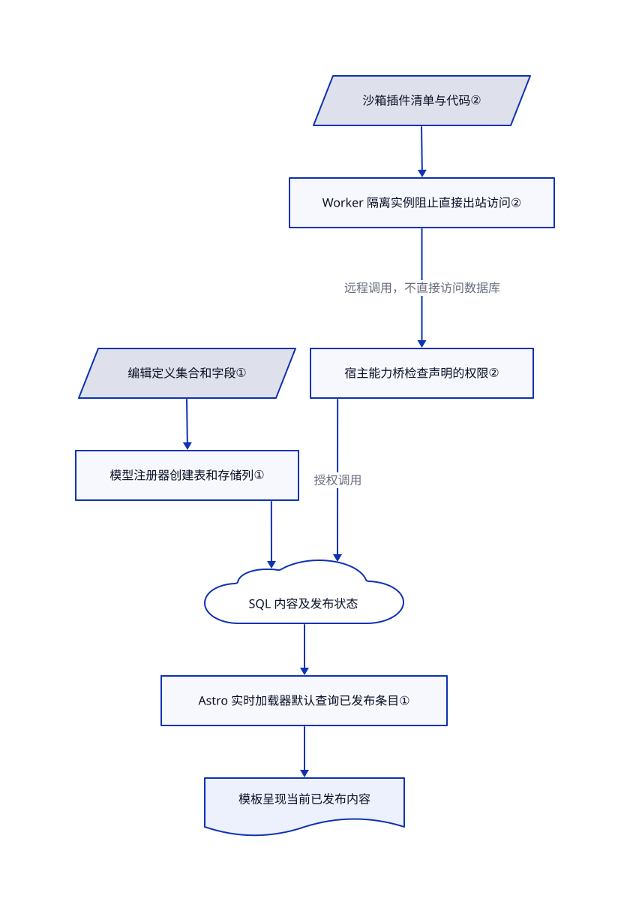

# EmDash

编辑想直接发稿，不想为改标题提交代码。EmDash 在你的 Astro 网站内加入编辑后台，页面从数据库读取已发布内容，不必为每次修改重新构建。

## 何时使用

你维护一份刊物或营销网站，页面已经用 Astro 写好。编辑改一个标题，却要提 Git 请求、等开发合并、再等网站构建。你希望直接给编辑草稿、上传图片和发布按钮，又不想单独运维无头内容后端，也不想把现有模板改写成 WordPress。EmDash 让后台和 Astro 路由共处一个应用；编辑能在后台定义内容集合，你的模板在请求时读取已发布版本。

它也适合有计划的 WordPress 内容迁移，但前提是你能重建主题、抽查导入的内容块。导入器把 Gutenberg 内容转为 Portable Text，即与页面样式分离的富文本 JSON。取舍在于保留 TypeScript 与 Astro，同时接受年轻内容系统和迁移成本；不是让现有 PHP 插件继续运行。

## 何时不用

- **现有 WordPress 主题、短代码或关键插件必须原样工作。** 继续用 [WordPress](https://github.com/WordPress/WordPress)。EmDash 导入内容，不执行 PHP；迁移文档明确说明，动态 Gutenberg 块可能只剩不会显示内容的注释。WXR 导入也不会重建定时发布日期和全部自定义元数据。
- **后台必须嵌入现有 Next.js 应用。** 选 [Payload](https://github.com/payloadcms/payload)，它直接集成到该应用的 `/app` 目录。EmDash 集成的是 Astro，引入它不是给 Next.js 增加后台，而是再引入一种应用框架。
- **内容都由开发者在 Git 里维护，只需静态博客。** 直接用 [Astro](../web-ui/frameworks/site-frameworks/astro.zh.md)。EmDash 会增加可写数据库、后台认证、备份和服务端部署；静态构建不需要这些常驻状态。
- **要求所有扩展都带硬性 CPU 和内存配额，且不能增加基础设施费用。** 不要把 EmDash 当成这种保证；若功能可在构建期完成，选不加载运行时扩展的 Astro。Cloudflare 沙箱插件需要 Workers 付费计划和 Worker Loader 绑定；Node 的 workerd 执行器只限制经过时间，不限制 CPU、内存和子请求数。原生插件及 Node 调试选项 `sandbox: false` 不具备这层隔离。

## 横向对比

| 替代品 | 是否收录 | 我们的评价 | 取舍 |
|---|---|---|---|
| [WordPress](https://github.com/WordPress/WordPress) | 未收录 | 产品依赖现有 PHP 插件和主题时保留 WordPress；能用 Astro 重建展示层时再选 EmDash。 | WordPress 保留既有运行时生态；EmDash 换成 TypeScript 和结构化内容。本次标签批次不新增该替代品。 |
| [Payload](https://github.com/payloadcms/payload) | 未收录 | 编辑后台必须与 Next.js 应用共用框架时选 Payload；需要保留 Astro 时选 EmDash。 | Payload 提供 Next.js 原生后台；把 Astro 站点接入这种集成会改变框架，而非直接补上 Astro 后台。本次标签批次不新增该替代品。 |
| [Astro](../web-ui/frameworks/site-frameworks/astro.zh.md) | ✅ | Git 管内容、静态托管时只选 Astro；编辑需要不经构建直接发布时再加 EmDash。 | Astro 单独使用省去后台服务和内容数据库；EmDash 补齐编辑流程，但要求运维持久化状态。 |

## 快速上手

按[首站教程](https://github.com/emdash-cms/emdash/blob/333abdeae27093db6ef9df9ecb8ae26eeea8dde6/docs/src/content/docs/getting-started.mdx)准备 Node.js 22.22 或更新版本。运行 `npm create emdash@latest`，选择 Node.js 和 Starter 模板，安装依赖后进入生成目录，运行 `npm run dev`。打开 `http://localhost:4321/_emdash/admin/`，填写站点标题、管理员邮箱，再注册通行密钥，即浏览器管理的登录凭证。EmDash 把模板的内容模型写入 SQLite；你修改 Welcome 文章并发布，模板在下次页面加载时读取已发布版本。你负责自定义模板、部署、数据库与上传文件备份，并单独保存 `EMDASH_ENCRYPTION_KEY` 的恢复副本；系统提供编辑器、内容接口和发布状态管理。

<!-- flow-steps:begin (generated from flows/emdash.json by tools/flow_card.py — do not edit) -->

流程文字版

1. **你**：生成并启动 Node.js Starter 站点 — `npm create emdash@latest`
2. **你**：打开后台，填写站点信息并注册管理员通行密钥
3. **EmDash**：把模板的内容模型和示例文章写入 SQLite
4. **你**：修改 Welcome 文章并发布
5. **EmDash**：在下次首页请求中呈现已发布版本

**价值**：编辑无需提交代码或重新构建内容，就能在 Astro 站点发布

<!-- flow-steps:end -->

## 技术要点

<!-- mechanism:begin (generated from mechanisms/emdash.json by tools/mechanism_card.py; do not edit) -->

机制文字版

- 编辑定义集合和字段①
- 模型注册器创建表和存储列①
- SQL 内容及发布状态
- Astro 实时加载器默认查询已发布条目①
- 模板呈现当前已发布内容
- 沙箱插件清单与代码②
- Worker 隔离实例阻止直接出站访问②
- 宿主能力桥检查声明的权限②

- 编辑定义集合和字段① → 模型注册器创建表和存储列①
- 模型注册器创建表和存储列① → SQL 内容及发布状态
- SQL 内容及发布状态 → Astro 实时加载器默认查询已发布条目①
- Astro 实时加载器默认查询已发布条目① → 模板呈现当前已发布内容
- 沙箱插件清单与代码② → Worker 隔离实例阻止直接出站访问②
- Worker 隔离实例阻止直接出站访问② → 宿主能力桥检查声明的权限②（远程调用，不直接访问数据库）
- 宿主能力桥检查声明的权限② → SQL 内容及发布状态（授权调用）

<!-- mechanism:end -->

### 1. 把可编辑集合落成 SQL 表，再实时读取

- **解决：** 内容模型只存在代码文件中时，编辑每加一个字段都要找开发改代码、重新构建网站。
- **做法：** 模型注册器保存集合定义，并为集合创建 SQL 表。普通存储字段会增加带类型的列并刷新生成类型；Astro 的实时加载器查询该表，默认只读已发布状态。
- **边界：** 不是每种字段都占列，关系字段可使用旁表。D1 无法回滚整套模型操作，新增列失败时需要显式清理元数据；实时查询仍依赖数据库可用和正确的页面缓存管理。
- **源码：** [创建集合](https://github.com/emdash-cms/emdash/blob/333abdeae27093db6ef9df9ecb8ae26eeea8dde6/packages/core/src/schema/registry.ts#L517-L629)、[创建字段与补偿](https://github.com/emdash-cms/emdash/blob/333abdeae27093db6ef9df9ecb8ae26eeea8dde6/packages/core/src/schema/registry.ts#L1284-L1428)、[实时加载器](https://github.com/emdash-cms/emdash/blob/333abdeae27093db6ef9df9ecb8ae26eeea8dde6/packages/core/src/loader.ts#L1764-L1799)。

### 2. 用隔离实例和能力桥控制插件权限

- **解决：** 扩展直接加载进内容系统进程，就可能取得进程对站点数据和密钥的全部权限。
- **做法：** Cloudflare 执行器创建 Worker 隔离实例，关闭直接出站访问，只提供能力桥绑定。能力桥收到插件声明的权限和允许访问的主机；接口在访问宿主资源前拒绝缺失的权限。Node 部署则可通过 workerd 子进程运行插件。
- **边界：** 这层隔离针对沙箱插件，不针对原生插件。授权粒度较粗，写内容权限不只允许修改插件自己创建的文章。Cloudflare 限制 CPU 和子请求数，Node 只限制经过时间；两者都不落实单插件内存配额。
- **源码：** [创建隔离实例与绑定](https://github.com/emdash-cms/emdash/blob/333abdeae27093db6ef9df9ecb8ae26eeea8dde6/packages/cloudflare/src/sandbox/runner.ts#L349-L405)、[能力桥检查](https://github.com/emdash-cms/emdash/blob/333abdeae27093db6ef9df9ecb8ae26eeea8dde6/packages/cloudflare/src/sandbox/bridge.ts#L424-L435)、[权限边界](https://github.com/emdash-cms/emdash/blob/333abdeae27093db6ef9df9ecb8ae26eeea8dde6/docs/src/content/docs/plugins/creating-plugins/capabilities.mdx#L234-L279)、[执行器配置](https://github.com/emdash-cms/emdash/blob/333abdeae27093db6ef9df9ecb8ae26eeea8dde6/docs/src/content/docs/deployment/plugin-sandbox.mdx)。

## 技术栈

- TypeScript 与 pnpm 多包仓库；Astro 集成和服务端路由、React 后台、TipTap 编辑器、Portable Text 内容存储。
- Kysely 封装 SQL；支持 SQLite、Cloudflare D1、libSQL／Turso、PostgreSQL。媒体存储支持本地目录、R2 和兼容 S3 的服务。
- WebAuthn 通行密钥、OAuth 集成、REST 接口、命令行和内建模型上下文协议服务，供 AI 工具访问。核心依赖含 MCP SDK；普通发布不需要模型服务商。

## 依赖

- **Node 部署：** 按当前教程使用 Node.js 22.22 或更新版本，配置 Astro 服务端适配器、React 集成和持久化数据库。包清单的较宽下限是 22.16，不应据此覆盖更新教程的要求。
- **持久化数据：** 单机路径用 SQLite 和可写上传目录。多实例应共享远程数据库和适当的媒体存储，不要各自使用独立本地文件。
- **Cloudflare 部署：** 文档默认路径使用 Workers、D1 和 R2。沙箱插件额外需要 Workers 付费计划、`LOADER` 和导出的 `PluginBridge`；Cloudflare 能力桥直接使用 D1，文档明确不支持 Hyperdrive 部署。
- **Node 可选沙箱：** 安装 `@emdash-cms/sandbox-workerd` 和对应平台的 `workerd` 二进制。数据库外单独保存 `EMDASH_ENCRYPTION_KEY`，才能恢复加密的插件设置。

## 运维难度

**中。** 本地 Node／SQLite 模板不需要云账号，但生产环境涉及身份、可变内容、媒体、加密密钥、迁移，以及可选插件子进程。[Node 部署指南](https://github.com/emdash-cms/emdash/blob/333abdeae27093db6ef9df9ecb8ae26eeea8dde6/docs/src/content/docs/deployment/nodejs.mdx)要求验证公开页面、迁移状态、后台发布、上传和插件执行；仅 Astro 返回 `/health` 成功不能证明这些依赖正常。1.3.1 发布说明特别要求在 Workers 上用命令行执行大型待办内容迁移，不要指望首个请求做完。WordPress 切换期间保留可回滚副本，先抽查动态块、草稿、网址和媒体，再切流量。

## 健康度与可持续性

- **维护，截至 2026-10-21：** 仓库未归档，核验当日仍有推送。核心 1.3.0 于 10 月 15 日发布，1.3.1 于 10 月 18 日发布；README 承诺核心包遵守语义版本，第一方插件和插件工具仍处于 0.x。
- **治理与支持：** [治理文件](https://github.com/emdash-cms/emdash/blob/333abdeae27093db6ef9df9ecb8ae26eeea8dde6/GOVERNANCE.md)列出负责人 Matt Kane 和五名人类维护者。Cloudflare 任命负责人，负责人协商后拥有最终裁决权。这是厂商主导治理，不是独立基金会；MIT 许可证版权方为 Cloudflare Inc.
- **可持续性裁决：** [推断：依据是仓库创建时间、近期发布和公开治理]适合由 Astro 团队先行试点，前提是备份与升级验收明确；不能当成长历史耐久性已经成立。仓库创建于 2026-04-01，距核验约七个月；活跃开发和多名维护者不等于多年生产经验。
- **采用与风险：** 13,857 个星标表示关注，不是审计过的部署数量。仓库含单元、浏览器和端到端测试，本次收录没有执行。1.3.1 [发布记录](https://github.com/emdash-cms/emdash/releases/tag/emdash%401.3.1)修复了未发布内容可见性及迁移导致空页面的问题，安全与升级测试仍是实质成本。[安全政策](https://github.com/emdash-cms/emdash/blob/333abdeae27093db6ef9df9ecb8ae26eeea8dde6/SECURITY.md)要求针对当前主分支和最新包私下报告漏洞。

## 存疑（未验证）

- [未验证：本次授权为上游只读，不安装执行]安装、发布、WordPress 转换保真度和沙箱行为均按文档与源码核查，未在部署站点复现。不声称性能、隔离审计结论或负载容量。
- [推断：可持续性裁决依据有日期的发布、年龄和治理信息，不是长期部署研究]有厂商支持、活跃七个月的内容系统可以试点，但长期维护和具体站点的升级工作量仍未证实。
