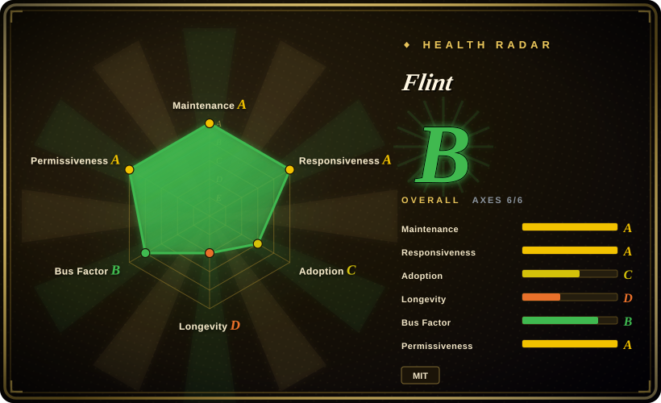
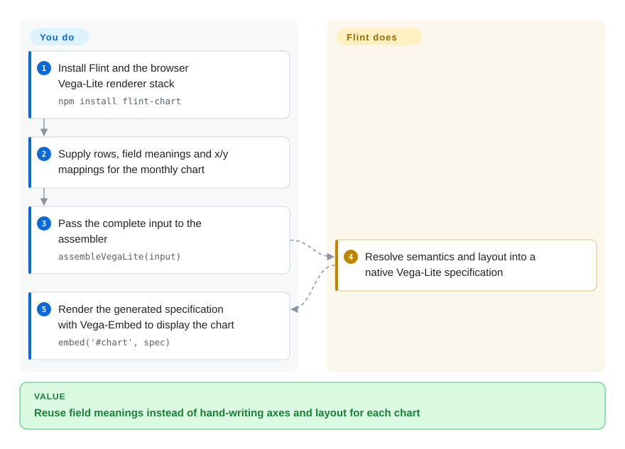
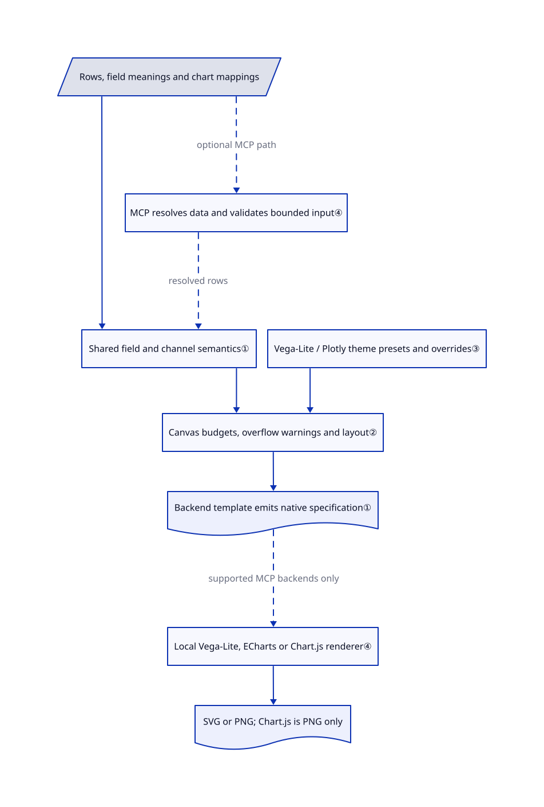

# Flint

Your agent writes a monthly chart, but dates become numbers and each renderer needs different glue. Flint turns field meanings and chart mappings into native chart specifications, with layout decisions made in code rather than another model call.

## When to use

You're building an analytical assistant that repeatedly plots the same table. A field such as `2026-01` must stay a month, not a category guessed differently on each turn; changing a line chart to bars should not require rewriting axes and formatting. You supply field meanings, channel mappings and a chart type. Flint derives the lower-level specification, so the agent edits a smaller, reusable input instead of hand-authoring a different renderer configuration every time.

Choose it over direct Vega-Lite, ECharts or Plotly authoring when that shared input and compiler-selected presentation matter more than access to every backend feature. The same repository offers an optional MCP server — a tool interface for agents — for validation, static images and interactive cards. It is not a database explorer or a replacement for preparing the table.

## When NOT to use

- **You need unrestricted backend features or identical behavior everywhere.** Use Vega-Lite, ECharts or Plotly directly. Formal themes apply only to Vega-Lite and Plotly. Flint interactions and updates run only through Vega-Lite; other backends ignore them and warn that the chart renders static. MCP static rendering supports only Vega-Lite, ECharts and Chart.js, with PNG only for Chart.js.
- **Every input category must appear in a fixed-size export.** Prefer an explicitly paginated table/report, or direct Vega-Lite with a layout you control. Flint's overflow stage can remove categories and their rows to keep the canvas readable; inspect its warnings rather than assuming a complete picture.
- **You need shared SQL exploration, access control and saved business dashboards.** Choose [Metabase](metabase.md) or [Superset](superset.md). You still own queries, joins, data cleaning, authorization and publication around Flint.
- **Confidential rows cannot enter a third-party service.** Use a local Flint library or local MCP process instead of the hosted MCP endpoint. Your agent's own model provider remains a separate data boundary. Also avoid the optional Image-Charts URL backend: opening its generated URL sends encoded chart data to `image-charts.com`.
- **You need standalone workbook generation without Excel.** Choose [XlsxWriter](../office-automation/xlsxwriter.md) for Python workbook-file generation instead. Flint's native Excel rendering requires an Office.js Excel host; compiling an artifact alone does not open or write a workbook.

## Comparison

| Alternative | In index | Our verdict | Tradeoff |
|---|---|---|---|
| [Vega-Lite](https://github.com/vega/vega-lite) | not indexed | Choose direct Vega-Lite for grammar-level composition and explicit encodings; choose Flint when agents should reuse field meanings and delegate layout. | Direct authoring removes a compiler layer but returns scale, formatting and layout work to you; not added in this tab batch. |
| [Apache ECharts](https://github.com/apache/echarts) | not indexed | Choose ECharts directly when application-specific interactive options dominate; choose Flint when one semantic input should target multiple engines. | Native options expose more engine controls; Flint reduces repeated setup but does not apply its formal themes to ECharts; not added in this tab batch. |
| [Plotly.js](https://github.com/plotly/plotly.js) | not indexed | Choose Plotly.js directly for scientific or 3D trace features outside Flint's templates; choose Flint for semantic chart authoring with reusable themes. | Plotly owns rendering and trace configuration; Flint can emit Plotly figures but its MCP renderer cannot export them; not added in this tab batch. |

## Quick start

Install `flint-chart`; for the browser Vega-Lite path, also install `vega`, `vega-lite` and `vega-embed`. Prepare a row table, declare meanings such as `YearMonth` and `Quantity`, and map fields to `x` and `y` in `chart_spec`. The [complete getting-started example](https://github.com/microsoft/flint-chart/blob/a794557384adcc3293a77043f6b9aff1c33d152c/docs/tutorials/getting-started.md#L123-L174) passes that input to `assembleVegaLite(input)`, then gives the returned specification to `embed('#chart', spec)`. You provide the data, page container and renderer dependencies; Flint supplies semantic decisions, layout and the backend specification. For agent-only use, the documented alternative is `npx -y flint-chart-mcp`: read its bundled skill, validate the input, then call `show` in an MCP App-capable host or `render_chart` for a static image; no model key is required by Flint itself.

<!-- flow-steps:begin (generated from flows/flint-chart.json by tools/flow_card.py — do not edit) -->

Text version of the flow

1. **You**: Install Flint and the browser Vega-Lite renderer stack — `npm install flint-chart`
2. **You**: Supply rows, field meanings and x/y mappings for the monthly chart
3. **You**: Pass the complete input to the assembler — `assembleVegaLite(input)`
4. **Flint**: Resolve semantics and layout into a native Vega-Lite specification
5. **You**: Render the generated specification with Vega-Embed to display the chart — `embed('#chart', spec)`

**Value**: Reuse field meanings instead of hand-writing axes and layout for each chart

<!-- flow-steps:end -->

## Key techniques

<!-- mechanism:begin (generated from mechanisms/flint-chart.json by tools/mechanism_card.py; do not edit) -->

Text version of the mechanism

- Rows, field meanings and chart mappings
- Shared field and channel semantics①
- Vega-Lite / Plotly theme presets and overrides③
- Canvas budgets, overflow warnings and layout②
- Backend template emits native specification①
- MCP resolves data and validates bounded input④
- Local Vega-Lite, ECharts or Chart.js renderer④
- SVG or PNG; Chart.js is PNG only

- Rows, field meanings and chart mappings → Shared field and channel semantics①
- Vega-Lite / Plotly theme presets and overrides③ → Canvas budgets, overflow warnings and layout②
- Shared field and channel semantics① → Canvas budgets, overflow warnings and layout②
- Canvas budgets, overflow warnings and layout② → Backend template emits native specification①
- Rows, field meanings and chart mappings → MCP resolves data and validates bounded input④ (optional MCP path) [optional/fallback]
- MCP resolves data and validates bounded input④ → Shared field and channel semantics① (resolved rows) [optional/fallback]
- Backend template emits native specification① → Local Vega-Lite, ECharts or Chart.js renderer④ (supported MCP backends only) [optional/fallback]
- Local Vega-Lite, ECharts or Chart.js renderer④ → SVG or PNG; Chart.js is PNG only

<!-- mechanism:end -->

### 1. Resolve field meaning before backend syntax

- **Problem:** A number used as a rank, quantity or calendar value should not acquire the same axis and formatting rules.
- **How:** The shared analyzer converts temporal data and resolves a backend-neutral record for each mapped field. The resolver combines field annotations with the channel role to derive formats, ordering, scale hints and color decisions; each backend then emits its own chart specification.
- **Limits:** Wrong semantic annotations still produce wrong assumptions. Data preparation and chart choice remain the caller's job; support is bounded by the selected backend's templates.
- **Source:** [Shared analysis](https://github.com/microsoft/flint-chart/blob/a794557384adcc3293a77043f6b9aff1c33d152c/packages/flint-js/src/core/analyze.ts#L133-L168), [channel resolution](https://github.com/microsoft/flint-chart/blob/a794557384adcc3293a77043f6b9aff1c33d152c/packages/flint-js/src/core/resolve-semantics.ts#L612-L754), [Vega-Lite entry](https://github.com/microsoft/flint-chart/blob/a794557384adcc3293a77043f6b9aff1c33d152c/packages/flint-js/src/vegalite/assemble.ts#L931-L936).

### 2. Budget the canvas before filtering and laying out marks

- **Problem:** Hundreds of category labels can turn a small chart into overlapping text.
- **How:** The planner computes channel capacities, applies overflow ordering, then plans the chart around the available frame. Overflow returns kept values, omitted counts and warnings; category viewports let a host move the visible window.
- **Limits:** This is a readability policy, not a guarantee that all data remains visible. Non-color discrete channels can lose rows in the rendered view; color overflow instead limits legend presentation. Consumers must surface the warning and choose a larger frame or another view when completeness matters.
- **Source:** [Budget-to-overflow handoff](https://github.com/microsoft/flint-chart/blob/a794557384adcc3293a77043f6b9aff1c33d152c/packages/flint-js/src/core/plan.ts#L1214-L1255), [filtering and viewports](https://github.com/microsoft/flint-chart/blob/a794557384adcc3293a77043f6b9aff1c33d152c/packages/flint-js/src/core/filter-overflow.ts#L100-L215).

### 3. Reuse a formal theme rather than repeating style settings

- **Problem:** Independently generated charts drift in typography, color and spacing.
- **How:** A theme name resolves to a shipped specification. An object with `extends` merges nested policy objects into that preset, while arrays and scalars replace their defaults. An unknown preset name throws rather than silently dropping the requested theme.
- **Limits:** The package documents theme support for Vega-Lite and Plotly only. Theme names are visual presets, not a license to reuse third-party trademarks or proof of pixel-identical output across engines.
- **Source:** [Preset resolution and merge rules](https://github.com/microsoft/flint-chart/blob/a794557384adcc3293a77043f6b9aff1c33d152c/packages/flint-js/src/core/theme/presets.ts#L64-L92), [backend support](https://github.com/microsoft/flint-chart/blob/a794557384adcc3293a77043f6b9aff1c33d152c/packages/flint-js/README.md#L46-L60).

### 4. Separate spec validation from local rendering

- **Problem:** A plausible generated specification can still be unsupported, too large or unsafe to load from a server's filesystem.
- **How:** MCP tools resolve and validate data before rendering in Node. Validator defaults cap data at 100,000 rows and each input canvas dimension at 4000 pixels; local file references separately accept JSON, CSV or TSV up to 10 MiB. Vega-Lite and ECharts emit SVG; Chart.js uses native canvas. PNG conversion uses local libraries, not a required cloud renderer.
- **Limits:** Input caps do not guarantee final image dimensions or total resource use. Local stdio mode permits referenced files readable by its process; it is not a filesystem sandbox. `--disable-file-reference` blocks those reads, HTTP mode defaults to blocking them, and remote `data.url` fetching is rejected. A hosted MCP server still receives inline rows.
- **Source:** [Validation defaults](https://github.com/microsoft/flint-chart/blob/a794557384adcc3293a77043f6b9aff1c33d152c/packages/flint-js/src/validate/index.ts#L53-L63), [data resolution and file cap](https://github.com/microsoft/flint-chart/blob/a794557384adcc3293a77043f6b9aff1c33d152c/packages/flint-mcp/src/render/data-source.ts#L9-L155), [render dispatch](https://github.com/microsoft/flint-chart/blob/a794557384adcc3293a77043f6b9aff1c33d152c/packages/flint-mcp/src/render/index.ts#L41-L118), [HTTP file default](https://github.com/microsoft/flint-chart/blob/a794557384adcc3293a77043f6b9aff1c33d152c/packages/flint-mcp/src/http.ts#L79-L91).

## Tech stack

- TypeScript compiler library with ESM/CommonJS builds; optional React integration and vanilla JavaScript mounting APIs.
- Shared semantic analysis, canvas planning and templates for Vega-Lite, ECharts, Chart.js, Plotly and native Excel artifacts. The optional Image-Charts export is a separate remote-image URL path.
- Companion MCP server uses the MCP SDK, Zod, Vega, ECharts, Chart.js, `@napi-rs/canvas` and `@resvg/resvg-js`. The repository has Vitest tests, chart fixtures and an Excel visual-evaluation harness.

## Dependencies

- [Manifests](https://github.com/microsoft/flint-chart/blob/a794557384adcc3293a77043f6b9aff1c33d152c/packages/flint-js/package.json) declare Node.js 18+; the library directly depends on `@floating-ui/dom`, `d3-time` and `d3-time-format`. Install only the renderer peers used by your application; React 18+ is optional.
- MCP adds native canvas/rasterization dependencies. Static export needs no Chromium, GPU, database or model download. Excel rendering requires Excel plus Office.js, not just Node.
- No mandatory LLM API or key. An agent drafting the spec may send source data to its configured model. The [hosted MCP option](https://github.com/microsoft/flint-chart/blob/a794557384adcc3293a77043f6b9aff1c33d152c/README.md#L78-L88) is external processing; the [Image-Charts adapter](https://github.com/microsoft/flint-chart/blob/a794557384adcc3293a77043f6b9aff1c33d152c/packages/flint-js/src/image-charts/assemble.ts#L178-L254) encodes chart values into a remote URL, whose use crosses another network boundary.

## Ops difficulty

**Low for library compilation; medium for agent or server deployment.** There is no datastore to operate, but you own renderer compatibility, fonts, warning handling and chart regression checks. Local MCP inherits its process's filesystem permissions; deprecated data-root flags are ignored, so use `--disable-file-reference` when local reads are inappropriate. HTTP mode listens on all interfaces by default; the reviewed handler does not implement application authentication, so put access control, TLS and allowed-host/origin policy around a network deployment. These are deployment responsibilities, not evidence that the hosted service lacks its own controls.

## Health & viability

- **Assessment, 2026-10-23:** promising for controlled adoption, but too young to treat as a long-proven visualization contract. [推断：repository age and contributor concentration, not a runtime trial]
- **Maintenance:** created 2026-05-13 and not archived; the reviewed head is `a794557384adcc3293a77043f6b9aff1c33d152c`, with a 2026-10-22 push. GitHub release `1.0` was published 2026-10-21; both npm packages report `1.0.1`. Dates come from release/API metadata, not the README's announcement date.
- **Governance and Lindy:** Microsoft organization ownership and Microsoft copyright are confirmed. The contributor snapshot is led by accounts with 514 and 133 contributions; a vendor name does not establish a long-term support promise. Five months of history gives little durability evidence despite active work.
- **Adoption:** 4,421 stars and 256 forks at inspection; npm reports 194,829 downloads for the returned 2026-09-19 through 2026-10-18 window. Downloads are distribution activity, not a count of production users.
- **Response and risk:** [issue 149](https://github.com/microsoft/flint-chart/issues/149) records a Plotly theme overriding explicit interpolation; a contributor linked fix PR 152, which the snapshot shows closed. This is a concrete response signal, not proof all backend differences are resolved. Root LICENSE is MIT with Microsoft copyright; roadmap continuity and backend parity remain the selection risks.

## Caveats (unverified)

- [未验证：upstream execution was excluded from this intake] Install behavior, chart appearance, native-library portability, throughput and large-table memory use were not reproduced. Only trusted local atlas diagram generators were run.
- [推断：five-month repository history and concentrated contributions] The cautious durability verdict is a selection judgment, not a claim that Microsoft will abandon the project. No support SLA or independently verified production-user count was established from the inspected sources.
