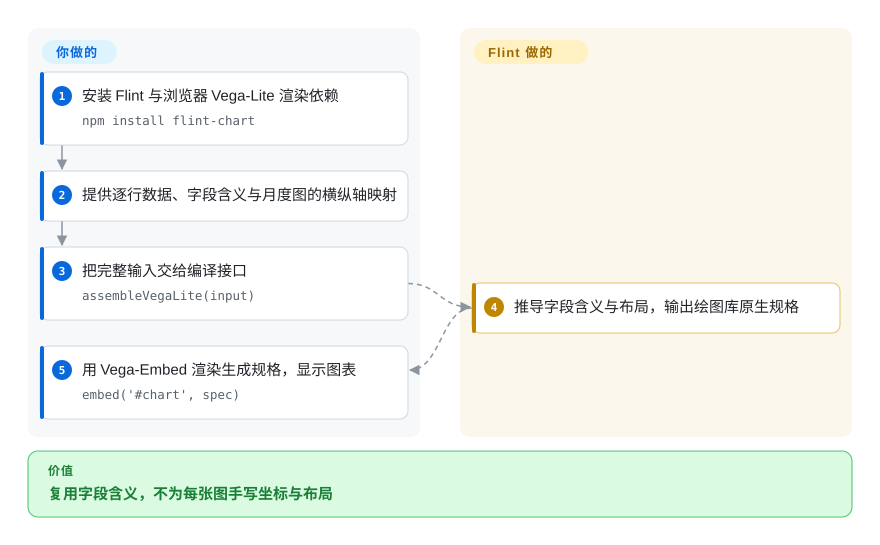
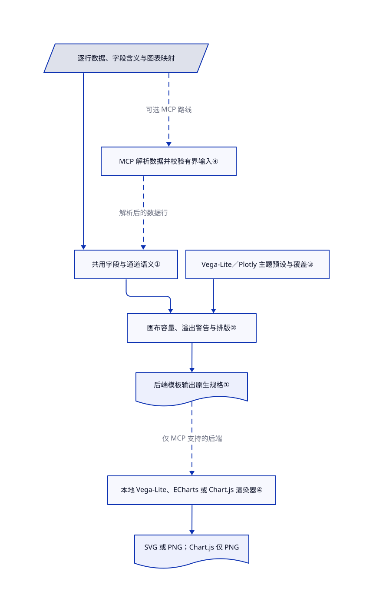

# Flint

你让 agent 画月度曲线，月份却被当成数字，换个绘图库又得重写配置。Flint 接收字段含义和图表映射，用代码决定坐标、格式与布局，输出绘图库原生规格，不再为这些细节多问一轮模型。

## 何时使用

你在做数据分析助手，同一张表要反复换图。`2026-01` 必须一直表示月份，不能每轮重新猜；折线换成柱状图，也不该重写坐标轴和数字格式。你提供字段含义、字段映射和图表类型，Flint 生成底层配置。agent 因而只改一份较小、可复用的输入，不必每次手写不同绘图库的配置。

当你更看重统一输入和自动排版，而不是调用所有底层特性时，选它而非直接写 Vega-Lite、ECharts 或 Plotly。同仓库还提供可选 MCP 服务，即供 agent 调用的工具接口，支持校验、静态图片和交互卡片。它不是数据库探索器，也不替你整理原始表。

## 何时不用

- **你要完整底层能力，或要求所有后端行为一致。** 直接用 Vega-Lite、ECharts 或 Plotly。各后端图表目录不同；正式主题只用于 Vega-Lite 和 Plotly。Flint 的交互与更新只在 Vega-Lite 路线执行，其他后端会忽略这些配置并警告退为静态图。MCP 静态渲染仅支持 Vega-Lite、ECharts 和 Chart.js，后者只能导出 PNG。
- **固定尺寸导出必须展示所有类别。** 改用明确分页的表格报表，或自行控制布局的 Vega-Lite。Flint 为保持可读性，可能裁掉类别及对应数据行。必须读取警告，不能把画出的部分当成全量。
- **你要共享 SQL 探索、访问控制和业务看板。** 选 [Metabase](metabase.zh.md) 或 [Superset](superset.zh.md)。查询、联表、清洗、授权和发布仍由你在 Flint 外完成。
- **敏感数据不得进入第三方服务。** 用本地库或本地 MCP 进程，不要选托管 MCP 地址。agent 自己调用的模型供应商仍是另一条数据边界。也别用可选 Image-Charts URL 后端；打开生成的链接，会把编码后的图表数据发到 `image-charts.com`。
- **你要不依赖 Excel 直接生成工作簿。** 改用 [XlsxWriter](../office-automation/xlsxwriter.zh.md) 在 Python 中写工作簿文件。Flint 原生 Excel 渲染需要提供 Office.js 的 Excel 宿主；编译出图表描述，不等于已打开或写好工作簿。

## 横向对比

| 替代品 | 是否收录 | 我们的评价 | 取舍 |
|---|---|---|---|
| [Vega-Lite](https://github.com/vega/vega-lite) | 未收录 | 需要直接控制图形组合与编码时选 Vega-Lite；希望 agent 复用字段含义、交出排版工作时选 Flint。 | 少一层编译，但坐标、格式与布局回到你手里；本次标签批次不扩收替代品。 |
| [Apache ECharts](https://github.com/apache/echarts) | 未收录 | 交互细节主要取决于应用时直接选 ECharts；一份语义输入要投向多个引擎时选 Flint。 | 原生配置暴露更多引擎选项；Flint 少写重复配置，但不向 ECharts 应用正式主题；本次标签批次不扩收替代品。 |
| [Plotly.js](https://github.com/plotly/plotly.js) | 未收录 | 科学图或三维轨迹超出 Flint 模板时直接选 Plotly.js；想用语义规格和复用主题时选 Flint。 | Plotly 自己负责渲染与轨迹配置；Flint 能生成其配置，但 MCP 渲染器不能导出 Plotly；本次标签批次不扩收替代品。 |

## 快速上手

安装 `flint-chart`；浏览器 Vega-Lite 路线还需安装 `vega`、`vega-lite` 和 `vega-embed`。准备逐行数据，为字段声明 `YearMonth`、`Quantity` 等含义，再在 `chart_spec` 中指定横纵轴字段。[完整入门样例](https://github.com/microsoft/flint-chart/blob/a794557384adcc3293a77043f6b9aff1c33d152c/docs/tutorials/getting-started.md#L123-L174) 把输入交给 `assembleVegaLite(input)`，再将返回规格交给 `embed('#chart', spec)`。你提供数据、页面容器和渲染依赖，Flint 提供语义决策、布局与后端规格。只给 agent 用时，可按文档运行 `npx -y flint-chart-mcp`，先读内置技能并校验输入，再在支持 MCP App 的宿主调用 `show`，或用 `render_chart` 返回静态图；Flint 本身不要求模型密钥。

<!-- flow-steps:begin (generated from flows/flint-chart.json by tools/flow_card.py — do not edit) -->

流程文字版

1. **你**：安装 Flint 与浏览器 Vega-Lite 渲染依赖 — `npm install flint-chart`
2. **你**：提供逐行数据、字段含义与月度图的横纵轴映射
3. **你**：把完整输入交给编译接口 — `assembleVegaLite(input)`
4. **Flint**：推导字段含义与布局，输出绘图库原生规格
5. **你**：用 Vega-Embed 渲染生成规格，显示图表 — `embed('#chart', spec)`

**价值**：复用字段含义，不为每张图手写坐标与布局

<!-- flow-steps:end -->

## 技术要点

<!-- mechanism:begin (generated from mechanisms/flint-chart.json by tools/mechanism_card.py; do not edit) -->

机制文字版

- 逐行数据、字段含义与图表映射
- 共用字段与通道语义①
- Vega-Lite／Plotly 主题预设与覆盖③
- 画布容量、溢出警告与排版②
- 后端模板输出原生规格①
- MCP 解析数据并校验有界输入④
- 本地 Vega-Lite、ECharts 或 Chart.js 渲染器④
- SVG 或 PNG；Chart.js 仅 PNG

- 逐行数据、字段含义与图表映射 → 共用字段与通道语义①
- Vega-Lite／Plotly 主题预设与覆盖③ → 画布容量、溢出警告与排版②
- 共用字段与通道语义① → 画布容量、溢出警告与排版②
- 画布容量、溢出警告与排版② → 后端模板输出原生规格①
- 逐行数据、字段含义与图表映射 → MCP 解析数据并校验有界输入④（可选 MCP 路线）〔可选／兜底〕
- MCP 解析数据并校验有界输入④ → 共用字段与通道语义①（解析后的数据行）〔可选／兜底〕
- 后端模板输出原生规格① → 本地 Vega-Lite、ECharts 或 Chart.js 渲染器④（仅 MCP 支持的后端）〔可选／兜底〕
- 本地 Vega-Lite、ECharts 或 Chart.js 渲染器④ → SVG 或 PNG；Chart.js 仅 PNG

<!-- mechanism:end -->

### 1. 先确定字段含义，再生成后端语法

- **解决：** 排名、数量和日历值即使都存成数字，也不该使用同一套坐标和格式规则。
- **做法：** 共用分析器先转换日期，再为各映射字段生成不依赖绘图库的记录。解析器结合字段注解与所在通道，决定格式、排序、比例尺提示和颜色；最后由各后端生成原生规格。
- **边界：** 字段含义标错，规则仍会跟着错。数据准备和选图由调用方负责；能输出什么，取决于对应后端的模板。
- **源码：** [共用分析](https://github.com/microsoft/flint-chart/blob/a794557384adcc3293a77043f6b9aff1c33d152c/packages/flint-js/src/core/analyze.ts#L133-L168)、[通道解析](https://github.com/microsoft/flint-chart/blob/a794557384adcc3293a77043f6b9aff1c33d152c/packages/flint-js/src/core/resolve-semantics.ts#L612-L754)、[Vega-Lite 入口](https://github.com/microsoft/flint-chart/blob/a794557384adcc3293a77043f6b9aff1c33d152c/packages/flint-js/src/vegalite/assemble.ts#L931-L936)。

### 2. 先算画布容量，再裁剪和排版

- **解决：** 几百个类别挤进小图，标签会叠成一团。
- **做法：** 规划器先算各通道容量，再按溢出排序保留类别，最后围绕可用画框排版。溢出结果包含保留值、省略数和警告；类别窗口让宿主可以移动可见范围。
- **边界：** 这是可读性策略，不保证全量可见。非颜色的离散通道可能裁掉绘图数据行；颜色溢出则限制图例呈现。调用方必须展示警告，需要完整数据时扩大画布或换视图。
- **源码：** [容量与溢出的交接](https://github.com/microsoft/flint-chart/blob/a794557384adcc3293a77043f6b9aff1c33d152c/packages/flint-js/src/core/plan.ts#L1214-L1255)、[裁剪与类别窗口](https://github.com/microsoft/flint-chart/blob/a794557384adcc3293a77043f6b9aff1c33d152c/packages/flint-js/src/core/filter-overflow.ts#L100-L215)。

### 3. 复用正式主题，不逐图重写样式

- **解决：** 独立生成的图表容易在字体、颜色和间距上各走各路。
- **做法：** 主题名先解析成内置规格。带 `extends` 的对象会合并嵌套策略，而数组和标量直接替换默认值。主题名不存在时抛错，不会悄悄丢掉指定样式。
- **边界：** 包文档只承诺 Vega-Lite 和 Plotly 的主题支持。主题名只是视觉预设，不授予第三方商标使用权，也不保证跨引擎逐像素一致。
- **源码：** [主题解析与合并规则](https://github.com/microsoft/flint-chart/blob/a794557384adcc3293a77043f6b9aff1c33d152c/packages/flint-js/src/core/theme/presets.ts#L64-L92)、[后端支持范围](https://github.com/microsoft/flint-chart/blob/a794557384adcc3293a77043f6b9aff1c33d152c/packages/flint-js/README.md#L46-L60)。

### 4. 把规格校验与本地渲染分开

- **解决：** 看起来合理的生成规格，仍可能超出后端能力、尺寸上限，或误读服务端文件。
- **做法：** MCP 工具先读取数据并校验，再在 Node 进程内渲染。校验器默认最多接受十万行，输入画布各维最多 4000 像素；本地引用文件另限 10 MiB，只收 JSON、CSV、TSV。Vega-Lite 与 ECharts 输出 SVG，Chart.js 用原生画布；PNG 转换用本地库，无必选云渲染器。
- **边界：** 输入上限不保证最终图片尺寸或总资源用量。本地标准输入输出模式可读进程权限内被引用的文件，不是文件沙箱。`--disable-file-reference` 能关闭读取，HTTP 模式默认关闭；远程 `data.url` 会被拒绝。选择托管 MCP 仍会把内联数据交给该服务器。
- **源码：** [校验默认上限](https://github.com/microsoft/flint-chart/blob/a794557384adcc3293a77043f6b9aff1c33d152c/packages/flint-js/src/validate/index.ts#L53-L63)、[本地数据解析及文件上限](https://github.com/microsoft/flint-chart/blob/a794557384adcc3293a77043f6b9aff1c33d152c/packages/flint-mcp/src/render/data-source.ts#L9-L155)、[渲染分派](https://github.com/microsoft/flint-chart/blob/a794557384adcc3293a77043f6b9aff1c33d152c/packages/flint-mcp/src/render/index.ts#L41-L118)、[HTTP 文件默认值](https://github.com/microsoft/flint-chart/blob/a794557384adcc3293a77043f6b9aff1c33d152c/packages/flint-mcp/src/http.ts#L79-L91)。

## 技术栈

- TypeScript 编译库，提供 ESM／CommonJS 构建；React 集成与原生 JavaScript 挂载接口均为可选路线。
- 共用语义分析、画布规划与模板，输出 Vega-Lite、ECharts、Chart.js、Plotly 和原生 Excel 图表描述。可选 Image-Charts 导出另走远程图片 URL。
- MCP 服务使用 MCP SDK、Zod、Vega、ECharts、Chart.js、`@napi-rs/canvas` 和 `@resvg/resvg-js`。仓库包含 Vitest 测试、图表数据样例和 Excel 视觉评估工具。

## 依赖

- [清单](https://github.com/microsoft/flint-chart/blob/a794557384adcc3293a77043f6b9aff1c33d152c/packages/flint-js/package.json) 声明 Node.js 18+；库直接依赖 `@floating-ui/dom`、`d3-time` 和 `d3-time-format`。只安装应用实际使用的渲染器配套包；React 18+ 为可选依赖。
- MCP 增加原生画布和栅格化依赖。静态导出不需要 Chromium、GPU、数据库或下载模型。Excel 渲染需要 Excel 和 Office.js，仅有 Node 不够。
- 没有必需的大模型 API 或密钥。起草规格的 agent 仍可能把源数据发给其模型。[托管 MCP 选项](https://github.com/microsoft/flint-chart/blob/a794557384adcc3293a77043f6b9aff1c33d152c/README.md#L78-L88) 属于外部处理；[Image-Charts 适配器](https://github.com/microsoft/flint-chart/blob/a794557384adcc3293a77043f6b9aff1c33d152c/packages/flint-js/src/image-charts/assemble.ts#L178-L254) 把图表值编码进远程 URL，使用时又跨一道网络边界。

## 运维难度

**库编译低，agent 或网络部署中等。** 不用运维数据库，但要管理渲染器兼容性、字体、警告和图表回归。本地 MCP 继承进程的文件权限；旧的数据根目录参数已被忽略，不能当沙箱，不应读文件时请用 `--disable-file-reference`。HTTP 模式默认监听所有网卡；所读处理器未实现应用认证，网络部署要自行增加访问控制、TLS 和主机／来源白名单。这是部署责任，不代表托管服务没有自己的外围控制。

## 健康度与可持续性

- **截至 2026-10-23 的判断：** 适合受控试用，还不能当成长年验证过的图表契约。[推断：依据仓库年龄与贡献集中度，未运行应用]
- **维护：** 2026-05-13 创建，未归档；所读提交为 `a794557384adcc3293a77043f6b9aff1c33d152c`，最近推送为 2026-10-22。GitHub 的 `1.0` 发布于 2026-10-21，两个 npm 包均为 `1.0.1`。这些日期来自发布与 API 元数据，不沿用 README 的公告日期。
- **治理与年龄：** 已确认 Microsoft 组织所有权和微软版权。贡献快照前两名账号分别有 514、133 次贡献；厂商名不等于长期支持承诺。约五个月历史且仍在开发，但耐久性证据有限。
- **使用信号：** 查验时有 4,421 星、256 个分叉；npm 返回的 2026-09-19 至 2026-10-18 窗口有 194,829 次下载。下载代表分发活动，不等于生产用户数。
- **响应与风险：** [问题 149](https://github.com/microsoft/flint-chart/issues/149) 报告 Plotly 主题覆盖显式插值设置，贡献者已链接修复 PR 152，快照显示该 PR 已关闭。这只能证明一次实际响应，不能证明所有后端差异都解决了。根许可证为微软版权的 MIT；路线持续性和后端能力差异仍是选型风险。

## 存疑（未验证）

- [未验证：本批任务明确不运行上游] 未复现安装行为、图表外观、原生库跨平台兼容性、吞吐量和大表内存占用；只运行本仓库受信任的图卡生成器。
- [推断：依据五个月仓库历史与贡献集中度] 谨慎的耐久性评价是选型判断，不代表微软将停止维护；所读材料未建立支持 SLA，也未独立核实生产用户数量。
