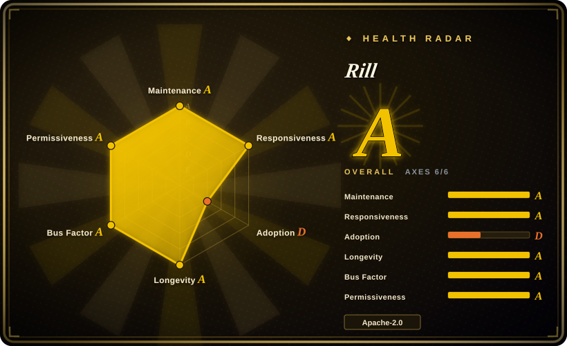
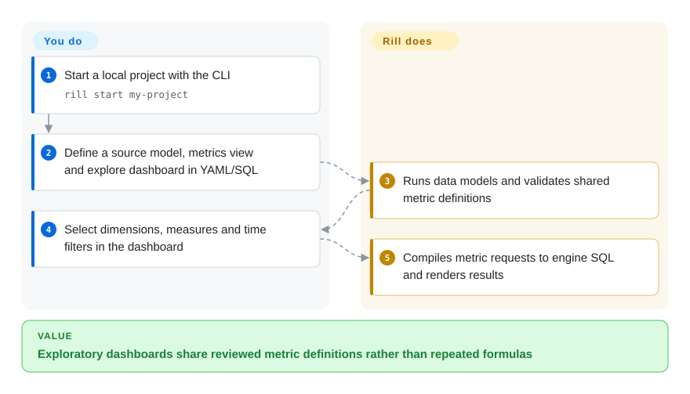
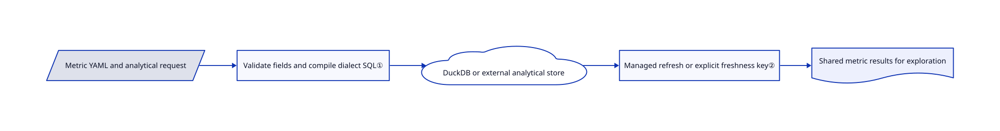

# Rill

Your dashboards calculate revenue differently, and changing one number means editing many GUI cards. Rill defines models, metric meanings and interactive dashboards in YAML/SQL that can be reviewed together in git.

## When to use

You maintain event or cost analytics and want users to explore dimensions and time ranges without inventing a new metric formula in every chart. Choose Rill when a code-owned semantic layer — named dimensions and aggregate measures — plus local DuckDB iteration or an external analytical engine fits your workflow. Compared with a GUI-first BI app, engineers own reviewable files and users explore the resulting metrics; compared with a prose-report renderer, exploratory slicing is central.

## When NOT to use

- Business users must build arbitrary questions without editing YAML/SQL? Choose [Metabase](metabase.md), whose point-and-click question builder is the primary authoring surface.
- Need a broadly deployed, fully self-managed BI portal with many chart types? Choose [Superset](superset.md). Rill's quick start is local Developer, while its documented managed sharing, embedding and conversational product is Rill Cloud; do not equate a local preview with a governed production deployment.
- Need narrative reports with prose around charts? Choose [Evidence](evidence.md); Rill's center is interactive metrics exploration rather than authored Markdown reports.
- Need guaranteed sub-second queries at arbitrary scale? Benchmark your engine and data first. Use a suitable analytical store and schema; no BI frontend can supply that guarantee from a YAML declaration alone.

## Comparison

| Alternative | In index | Our verdict | Tradeoff |
|---|---|---|---|
| [Metabase](metabase.md) | ✅ | Choose Metabase for non-SQL users authoring their own questions; choose Rill when engineers own metric definitions as reviewed files. | GUI self-service versus code-first semantics and a deliberate exploration model. |
| [Apache Superset](superset.md) | ✅ | Choose Superset for a self-managed warehouse BI portal and chart breadth; choose Rill for local-to-managed metrics-as-code workflows. | Larger visualization/SQL-Lab surface and multi-service ops versus a focused metric layer and Cloud deployment path. |
| [Evidence](evidence.md) | ✅ | Choose Evidence for curated narrative reports; choose Rill when users must repeatedly slice shared metrics across dimensions and time. | Markdown storytelling versus a reusable semantic query layer and interactive exploration. |

## Quick start

Obtain the Rill CLI from its release/install documentation and run `rill start my-project` to create/open a local project. Define a data model in SQL/YAML, named dimensions/measures in a `metrics_view`, and an `explore` dashboard pointing at it. Rill runs the model and translates metric requests to SQL; you supply source credentials, correct formulas and access rules. Local DuckDB is an entry path; external analytical engines have their own capacity and cost. `rill deploy` publishes to Rill Cloud, which is a separate service and billing decision, not required for local exploration.

<!-- flow-steps:begin (generated from flows/rill.json by tools/flow_card.py — do not edit) -->

Text version of the flow

1. **You**: Start a local project with the CLI — `rill start my-project`
2. **You**: Define a source model, metrics view and explore dashboard in YAML/SQL
3. **Rill**: Runs data models and validates shared metric definitions
4. **You**: Select dimensions, measures and time filters in the dashboard
5. **Rill**: Compiles metric requests to engine SQL and renders results

**Value**: Exploratory dashboards share reviewed metric definitions rather than repeated formulas

<!-- flow-steps:end -->

## Key techniques

<!-- mechanism:begin (generated from mechanisms/rill.json by tools/mechanism_card.py; do not edit) -->

Text version of the mechanism

- Metric YAML and analytical request
- Validate fields and compile dialect SQL①
- DuckDB or external analytical store
- Managed refresh or explicit freshness key②
- Shared metric results for exploration

- Metric YAML and analytical request → Validate fields and compile dialect SQL①
- Validate fields and compile dialect SQL① → DuckDB or external analytical store
- DuckDB or external analytical store → Managed refresh or explicit freshness key②
- Managed refresh or explicit freshness key② → Shared metric results for exploration

<!-- mechanism:end -->

### 1. Compile shared metrics through engine-aware validation

- **Problem:** Dashboard-specific SQL duplicates definitions and fails differently across engines.
- **How:** The metrics executor validates table, time dimension, measures and referenced policy fields. Query execution checks access, rewrites limits/time/rollups, builds an engine-dialect SQL syntax tree and sends SQL plus arguments to the analytical driver.
- **Limits:** SQL dialect differences remain real: the validator contains ClickHouse-specific alias restrictions. Correct SQL does not prove the business meaning of a metric.
- **Source:** [Metrics validation](https://github.com/rilldata/rill/blob/5bcc9548a42b740bcc0d588b687dbe850b394f16/runtime/metricsview/executor/executor_validate.go#L58-L159), [query compilation](https://github.com/rilldata/rill/blob/5bcc9548a42b740bcc0d588b687dbe850b394f16/runtime/metricsview/executor/executor.go#L339-L431).

### 2. Make cache freshness depend on who owns the table

- **Problem:** Reusing results for externally changing tables can show stale metrics.
- **How:** Managed-table metrics can keep a stable cache key until a resource refresh/edit invalidates it. External/streaming views disable caching by default; configured cache-key SQL or a watermark can supply a freshness identity.
- **Limits:** Operators must choose a trustworthy change indicator. Time-range metadata intentionally ignores row-security filters, so it is not a user-scoped data-range guarantee.
- **Source:** [Cache-key policy and timestamp caveat](https://github.com/rilldata/rill/blob/5bcc9548a42b740bcc0d588b687dbe850b394f16/runtime/metricsview/executor/executor.go#L111-L177).

## Tech stack

Go runtime/CLI, Svelte web clients, SQL/YAML project resources, DuckDB and external OLAP drivers including ClickHouse. The runtime exposes RPC/REST APIs and reconciles declared resources against data infrastructure.

## Dependencies

Local CLI and enough disk/memory for the chosen DuckDB dataset, or credentials/network access to an external analytical store. Source builds use Go 1.26.5 plus the frontend toolchain. Cloud publication adds a Rill Cloud account and remote data/security configuration; optional AI integrations add model-provider dependencies.

## Ops difficulty

**Low for local exploration, medium to high for production.** Local Developer is a CLI plus local state. Shared production adds engine capacity, source freshness, identity and policy testing. Row/field policies live in metric YAML; do not publish sensitive data before verifying every access path with real user attributes.

## Health & viability

- On 2026-10-18, latest release v0.90.5 dated to 2026-10-09; repository push metadata was 2026-10-17. Created 2021-12-09, it has nearly five years of still-active history.
- Rill Data Inc. holds the Apache-2.0 copyright. Multiple leading contributors have hundreds of commits; this is a vendor-led team project, not a one-person wrapper.
- [推断] The age × activity prior is stronger than for recent BI demos, but the commercial Cloud roadmap still shapes the workflow. Distinguish open runtime capabilities from hosted operational convenience.

## Caveats (unverified)

- [未验证] Query latency, billion-row scale and managed service behavior were not benchmarked; no upstream installation or cloud deployment was run.
- [推断] Production self-hosting effort depends on the identity/storage/deployment setup you choose; no end-to-end self-hosted portal was assembled here.
