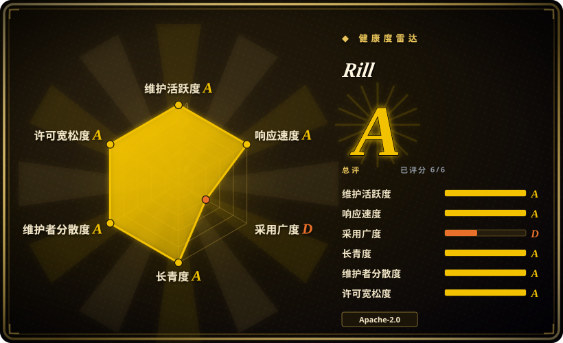
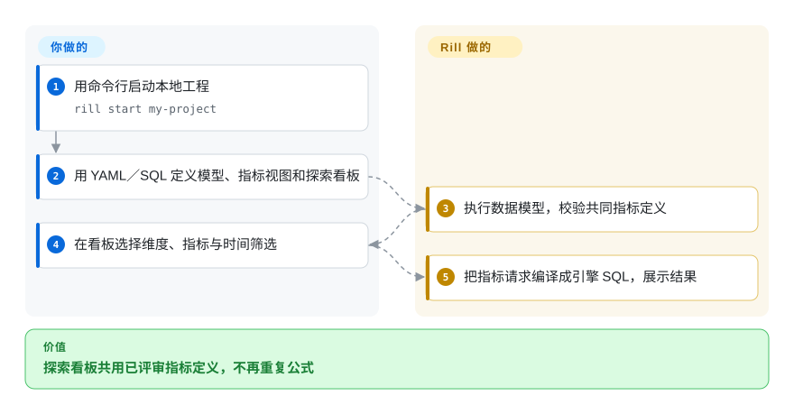
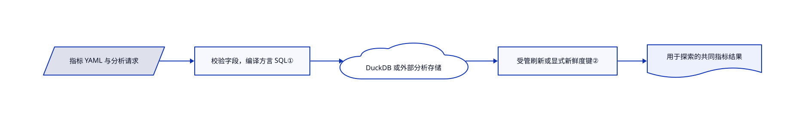

# Rill

几张看板的营收口径各不相同，改一个数字却要逐张点卡片。Rill 把模型、指标口径和交互看板写成 YAML／SQL，一起放进 git 评审。

## 何时使用

你维护事件或成本分析，希望用户自由切维度、时间范围，却不在每张图里重写指标公式。当你接受用代码管理语义层，也就是命名维度和聚合口径，并用本地 DuckDB 或外部分析引擎探索时选 Rill。相比界面优先的商业智能工具，工程师拥有可评审文件，用户探索定义好的指标；相比报告渲染器，它更强调反复切片探索。

## 何时不用

- 业务用户必须不写 YAML／SQL 就能自建任意问题时，选 [Metabase](metabase.zh.md)，它以点选查询为主要创作界面。
- 要图表丰富、成熟的全自管商业智能门户时，选 [Superset](superset.zh.md)。Rill 快速上手面向本地 Developer，文档中的托管分享、嵌入与对话产品是 Rill Cloud，不应把本地预览等同治理完备的生产部署。
- 要用正文串起图表的叙事报告时，选 [Evidence](evidence.zh.md)。Rill 围绕交互指标探索，而非 Markdown 文章。
- 要任意规模都保证亚秒查询时，先测试真实引擎与数据。需要合适的分析存储和模型，前端工具无法凭一份 YAML 保证速度。

## 横向对比

| 替代品 | 是否收录 | 我们的评价 | 取舍 |
|---|---|---|---|
| [Metabase](metabase.zh.md) | ✅ | 非 SQL 用户自己建问题时选 Metabase；工程师用文件评审指标定义时选 Rill。 | 图形界面自助查询，换代码优先的指标口径与专门探索模型。 |
| [Apache Superset](superset.zh.md) | ✅ | 自管数据仓库门户与丰富图表选 Superset；本地到托管的指标即代码流程选 Rill。 | 更广图表和 SQL Lab、更多服务运维，换聚焦的指标层和 Cloud 部署路径。 |
| [Evidence](evidence.zh.md) | ✅ | 精心编排的叙事报告选 Evidence；用户持续按维度与时间切共同指标时选 Rill。 | Markdown 讲述，换复用语义查询层与交互探索。 |

## 快速上手

按发行版或安装文档获取命令行，运行 `rill start my-project` 创建并打开本地工程。用 SQL／YAML 写数据模型，在 `metrics_view` 定义维度和指标，再用 `explore` 看板引用它。Rill 执行模型并把指标请求转成 SQL，你负责来源凭据、正确口径与访问规则。本地 DuckDB 是入口之一，外部分析引擎有自己的容量和成本。`rill deploy` 会发布到 Rill Cloud，属于另一项服务与计费决策，本地探索不要求它。

<!-- flow-steps:begin (generated from flows/rill.json by tools/flow_card.py — do not edit) -->

流程文字版

1. **你**：用命令行启动本地工程 — `rill start my-project`
2. **你**：用 YAML／SQL 定义模型、指标视图和探索看板
3. **Rill**：执行数据模型，校验共同指标定义
4. **你**：在看板选择维度、指标与时间筛选
5. **Rill**：把指标请求编译成引擎 SQL，展示结果

**价值**：探索看板共用已评审指标定义，不再重复公式

<!-- flow-steps:end -->

## 技术要点

<!-- mechanism:begin (generated from mechanisms/rill.json by tools/mechanism_card.py; do not edit) -->

机制文字版

- 指标 YAML 与分析请求
- 校验字段，编译方言 SQL①
- DuckDB 或外部分析存储
- 受管刷新或显式新鲜度键②
- 用于探索的共同指标结果

- 指标 YAML 与分析请求 → 校验字段，编译方言 SQL①
- 校验字段，编译方言 SQL① → DuckDB 或外部分析存储
- DuckDB 或外部分析存储 → 受管刷新或显式新鲜度键②
- 受管刷新或显式新鲜度键② → 用于探索的共同指标结果

<!-- mechanism:end -->

### 1. 经引擎感知校验编译共同指标

- **解决：** 每张看板各写 SQL 会重复口径，也会在不同引擎上以不同方式失败。
- **做法：** 执行器校验底表、时间维度、指标与权限引用字段。查询先检查访问，再改写限制、时间与预聚合，建立对应引擎的 SQL 语法树，最后把 SQL 和参数交给分析驱动。
- **边界：** 方言差异仍存在，校验器含 ClickHouse 专用别名限制。SQL 正确不证明指标业务含义正确。
- **源码：** [指标校验](https://github.com/rilldata/rill/blob/5bcc9548a42b740bcc0d588b687dbe850b394f16/runtime/metricsview/executor/executor_validate.go#L58-L159)、[查询编译](https://github.com/rilldata/rill/blob/5bcc9548a42b740bcc0d588b687dbe850b394f16/runtime/metricsview/executor/executor.go#L339-L431)。

### 2. 根据谁管理底表决定缓存新鲜度

- **解决：** 外部表自行变化时，复用旧结果会显示过期指标。
- **做法：** 受管表可使用稳定缓存键，直到资源刷新或编辑触发失效。外部／流式视图默认不缓存，显式缓存键 SQL 或水位可提供变化身份。
- **边界：** 运维方必须选择可信变化信号。时间范围元数据刻意不套行级安全过滤，因此不保证对应某用户可见数据的范围。
- **源码：** [缓存策略与时间戳限制](https://github.com/rilldata/rill/blob/5bcc9548a42b740bcc0d588b687dbe850b394f16/runtime/metricsview/executor/executor.go#L111-L177)。

## 技术栈

Go 运行时与命令行、Svelte 网页端、SQL／YAML 工程资源、DuckDB 和含 ClickHouse 的外部分析驱动。运行时暴露 RPC／REST 接口，把声明资源与实际数据基础设施对齐。

## 依赖

本地命令行及容纳 DuckDB 数据集的内存和磁盘，或外部分析存储的凭据与网络。源码构建采用 Go 1.26.5 及前端工具链。Cloud 发布增加账号、远程数据和安全配置，可选模型集成再增加提供商依赖。

## 运维难度

**本地低，生产中到高。** 本地 Developer 是命令行加本地状态。共享生产还需引擎容量、来源新鲜度、身份和权限测试。行／字段策略写在指标 YAML 里；发布敏感数据前，要用真实用户属性验证每条访问路径。

## 健康度与可持续性

- 截至 2026-10-18，最新版本 v0.90.5 发布于 2026-10-09，推送记录为 2026-10-17。仓库创建于 2021-12-09，已有近五年且仍活跃的历史。
- Apache-2.0 版权由 Rill Data Inc. 持有，多位主要贡献者各有数百提交。这是厂商主导团队项目，不是单人包装层。
- [推断] 年龄与持续活跃先验强于新近演示项目，但商业 Cloud 路线仍影响流程。应分开看开放运行时能力与托管运维便利。

## 存疑（未验证）

- [未验证] 未测查询延迟、十亿行规模或托管服务行为；未安装上游，也未部署 Cloud。
- [推断] 自托管生产成本取决于身份、存储与部署方案，本次未组装完整自管门户。
