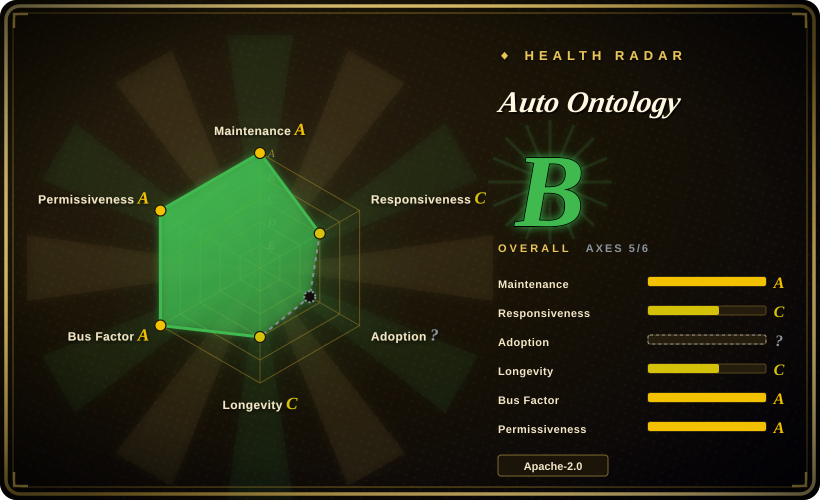
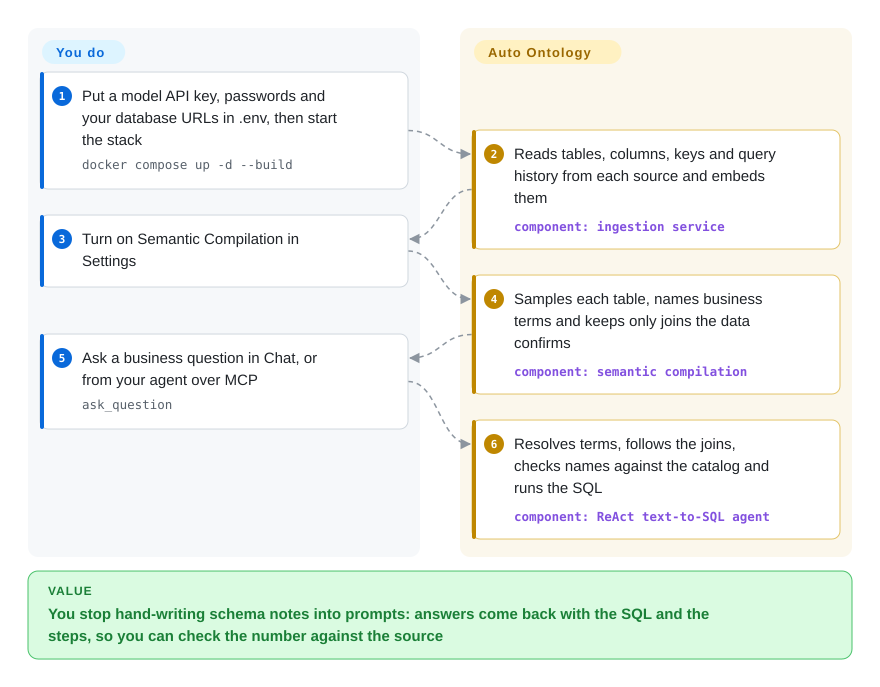
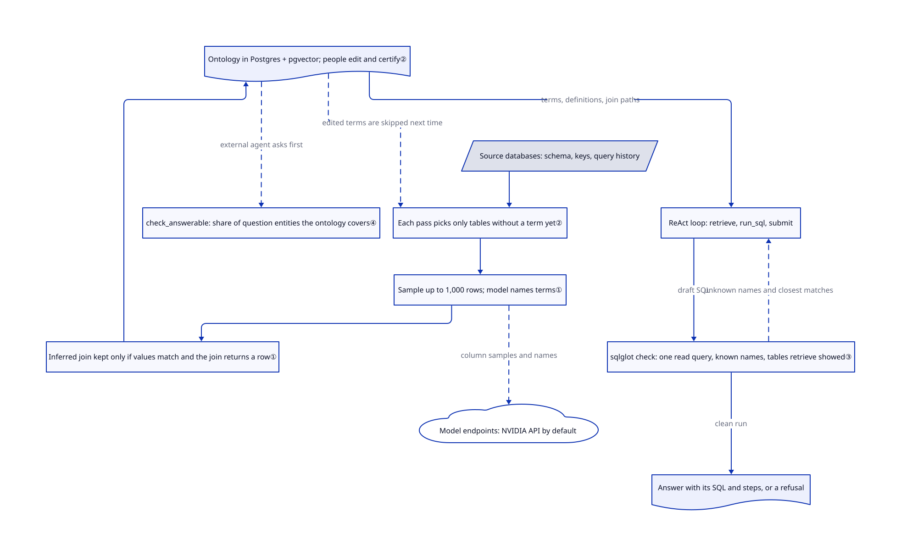

# Auto Ontology

Ask an LLM agent "what was revenue in Pennsylvania last June?" against a warehouse with 400 tables and it guesses which `amount` column is revenue, joins on the wrong key, and returns a confident wrong number. Auto Ontology first builds a map from business words to tables, columns, joins and formulas — drafting it from your schema and sample data, keeping only joins the data confirms — and then lets the agent answer only through that map, returning the SQL with every answer.

## When to use

You run data or platform engineering for a company whose numbers live in several Postgres, Snowflake, Databricks or ClickHouse databases with overlapping tables (`OLD_ORDERS`, `orders_v2`, three `customer` tables). Product and finance people now want to ask an agent business questions, and the first experiments fail the way text-to-SQL usually fails: the model picks `invoices.total` when finance means the sum of `invoicelines.extendedprice`, joins customers on the billing city instead of the delivery city, and nobody can tell which number is right. Writing all of that down by hand — every term, every join, every metric — is months of work nobody has started.

Reach for Auto Ontology when you want that semantic map drafted for you from metadata, reviewed by people, and served to any agent through MCP, CLI or a REST API. It profiles each table, has a model name the business terms and write column descriptions, keeps an inferred join only when the two columns' values overlap and an actual join returns rows, and then answers through a tool loop that rejects SQL naming tables or columns the catalog does not have. The deciding tradeoff against [MCP Toolbox for Databases](mcp-toolbox.md) is generated meaning versus declared queries: Toolbox exposes only the parameterized statements you wrote, with no model in the tool, while Auto Ontology lets the agent compose new SQL over an ontology it built. Against semantic layers such as Cube, it trades metrics-as-code in git for an auto-drafted ontology stored in Postgres and edited in a web UI.

## When NOT to use

- **One well-modeled source and a fixed set of questions.** The README itself says direct SQL may be enough there. Hand the agent a few declared, parameterized queries through [MCP Toolbox for Databases](mcp-toolbox.md) instead of running a seven-container stack.
- **Your data lives in BigQuery, SQL Server, Oracle, Redshift, Athena or MongoDB.** As of 2026-11-18 there are ten connectors (PostgreSQL, MySQL, Databricks, Snowflake, ClickHouse, Trino, Kyuubi, HeavyDB, DuckDB, SQLite); Oracle, Athena and MongoDB are open integration requests (#508, #502, #517). Use [MCP Toolbox](mcp-toolbox.md) (dozens of source types) or WrenAI (20+ sources) instead.
- **Schema, sample values or questions must not leave your network.** By default every model role points at NVIDIA's hosted API (`integrate.api.nvidia.com`), and compilation sends column names and profiled sample values to the model to write descriptions. Either point all four roles at a self-hosted NIM or another OpenAI-compatible endpoint that supports structured output, or use MCP Toolbox, where no model inside the tool sees the data. Enabling predictions also uploads connected tables to the hosted KumoRFM service.
- **You want governed metrics as reviewed code consumed by BI dashboards.** The ontology lives in Postgres and is edited in the UI or REST API, with Ossie YAML import/export; certification is a reviewed-mark in the UI and search results and does not change what the agent retrieves. Use Cube or dbt MetricFlow when metric definitions must go through pull requests and serve dashboards as well as agents.
- **You will run it with Docker Compose on a shared or internet-reachable host.** The README says to keep ports 3001 and 3002 private because the backend trusts the user-id header the frontend forwards and the ingestion service (ingest, delete, reset, compile) has no authentication — yet `docker-compose.yml` publishes both on all host interfaces. Use the Helm chart with network policy, or firewall those ports yourself.
- **You need the agent to ask the user to clarify inside one call.** The built-in ReAct agent never asks clarifying questions; it refuses when its tool budget (24 calls by default) runs out. Clarification happens only when your own agent calls `check_answerable` over MCP first and decides to ask. If you want a chat product that handles ambiguity for business users, evaluate WrenAI.
- **You need a dependency that has proven itself over years.** It is under seven months old; recent open issues include compilation storing placeholder terms silently when an LLM step fails (#533) and a catalog build that finishes damaged at the Postgres connection limit (#553). Pin an NGC release and re-test compilation after each upgrade.

## Comparison

| Alternative | In index | Our verdict | Tradeoff |
|---|---|---|---|
| [MCP Toolbox for Databases](mcp-toolbox.md) | ✅ | Pick MCP Toolbox when agents should only run queries you declared and reviewed, across many engines; pick Auto Ontology when the questions are open-ended and you want the agent to compose SQL over a generated, data-checked map of terms and joins. | Toolbox is one Go server with no model in the tool and 50+ source types, but every query is yours to write; Auto Ontology writes the semantic layer for you but needs Postgres, four model roles and a web stack. |
| WrenAI (`Canner/WrenAI`) | not indexed | Pick WrenAI when business users want a GenBI app that turns questions into charts and dashboards across 20+ sources; pick Auto Ontology when the consumer is your own agent over MCP and you want the semantic layer drafted from metadata and sample data. | WrenAI brings a broader source list and a BI-style front end over a context layer you model; Auto Ontology auto-infers terms and joins but connects to ten engines. Real repo, not added in this tab batch. |
| Cube (`cube-js/cube`) | not indexed | Pick Cube when metrics must be defined as code, versioned in git and served to BI, embedded analytics and AI alike; pick Auto Ontology when nobody has written those definitions yet and you want a first draft generated. | Cube is an established semantic layer serving AI, BI and embedded analytics, but every definition is hand-authored; Auto Ontology drafts definitions automatically but stores them in its own Postgres rather than in your repo. Real repo, not added in this tab batch. |
| Vanna (`vanna-ai/vanna`) | not indexed | Treat Vanna as a pattern source only: it is archived (last push 2026-02-02). For a maintained retrieval-based text-to-SQL path pick Auto Ontology or WrenAI, because fixes and connector updates no longer come from Vanna. | Vanna was a Python library for chatting with a SQL database through agentic retrieval, light to embed; Auto Ontology is a full service with a generated ontology and catalog-checked SQL. Real repo, not added in this tab batch. |

## Quick start

The documented path is Docker Compose: clone the repo, copy `.env.example` to `.env`, and set a model API key (an `nvapi-` key from build.nvidia.com by default), an auth secret, the admin and database passwords, and `CONNECTION_STRINGS` — the URLs of the databases you want it to read. The README demo also clones the separate `auto-ontology-eval` repo to seed Microsoft's Wide World Importers sample into Postgres. `docker compose up -d --build` starts Postgres with pgvector (a vector-search extension), the Python backend and ingestion service, migrations and the Next.js web app; ingestion of each source's catalog runs at startup. You then sign in as the admin, switch on Semantic Compilation — the background job that drafts the ontology — and ask questions in Chat, over the REST endpoint `POST /api/chat/completions` with an API token, or from Cursor, Claude Desktop or another MCP client via the read-only MCP server (`uvx … auto-ontology-mcp`, run separately). Your job is choosing which databases and schemas it may read, paying for or hosting the model endpoints, reviewing and certifying the generated terms and SQL definitions, and keeping the internal ports private; it does the cataloguing, drafting, join checking and SQL generation. For Kubernetes, `DEPLOYMENT.md` installs released images from the NGC Helm repo.

<!-- flow-steps:begin (generated from flows/auto-ontology.json by tools/flow_card.py — do not edit) -->

Text version of the flow

1. **You**: Put a model API key, passwords and your database URLs in .env, then start the stack — `docker compose up -d --build`
2. **Auto Ontology**: Reads tables, columns, keys and query history from each source and embeds them — component: `ingestion service`
3. **You**: Turn on Semantic Compilation in Settings
4. **Auto Ontology**: Samples each table, names business terms and keeps only joins the data confirms — component: `semantic compilation`
5. **You**: Ask a business question in Chat, or from your agent over MCP — `ask_question`
6. **Auto Ontology**: Resolves terms, follows the joins, checks names against the catalog and runs the SQL — component: `ReAct text-to-SQL agent`

**Value**: You stop hand-writing schema notes into prompts: answers come back with the SQL and the steps, so you can check the number against the source

<!-- flow-steps:end -->

## Key techniques

<!-- mechanism:begin (generated from mechanisms/auto-ontology.json by tools/mechanism_card.py; do not edit) -->

Text version of the mechanism

- Source databases: schema, keys, query history
- Each pass picks only tables without a term yet②
- Sample up to 1,000 rows; model names terms①
- Inferred join kept only if values match and the join returns a row①
- Ontology in Postgres + pgvector; people edit and certify②
- Model endpoints: NVIDIA API by default
- check_answerable: share of question entities the ontology covers④
- ReAct loop: retrieve, run_sql, submit
- sqlglot check: one read query, known names, tables retrieve showed③
- Answer with its SQL and steps, or a refusal

- Source databases: schema, keys, query history → Each pass picks only tables without a term yet②
- Each pass picks only tables without a term yet② → Sample up to 1,000 rows; model names terms①
- Sample up to 1,000 rows; model names terms① → Inferred join kept only if values match and the join returns a row①
- Sample up to 1,000 rows; model names terms① → Model endpoints: NVIDIA API by default (column samples and names) [optional/fallback]
- Inferred join kept only if values match and the join returns a row① → Ontology in Postgres + pgvector; people edit and certify②
- Ontology in Postgres + pgvector; people edit and certify② → Each pass picks only tables without a term yet② (edited terms are skipped next time) [optional/fallback]
- Ontology in Postgres + pgvector; people edit and certify② → check_answerable: share of question entities the ontology covers④ (external agent asks first) [optional/fallback]
- Ontology in Postgres + pgvector; people edit and certify② → ReAct loop: retrieve, run_sql, submit (terms, definitions, join paths)
- ReAct loop: retrieve, run_sql, submit → sqlglot check: one read query, known names, tables retrieve showed③ (draft SQL)
- sqlglot check: one read query, known names, tables retrieve showed③ → ReAct loop: retrieve, run_sql, submit (unknown names and closest matches) [optional/fallback]
- sqlglot check: one read query, known names, tables retrieve showed③ → Answer with its SQL and steps, or a refusal (clean run)

<!-- mechanism:end -->

### 1. Keep an inferred join only when the data confirms it

- **Problem:** Warehouses often lack declared foreign keys, and a model guessing joins by column name happily links `customer_id` to an unrelated table whose ids happen to be integers.
- **How:** Each table is profiled from a sample of up to 1,000 rows (a column counts as unique at 95% distinct values). For a foreign-key-like column without a declared key, an embedding search and a model pick a target attribute; the pick is confirmed by comparing the two columns' lowest distinct values, then stored only if an actual join of the two columns returns at least one row (retried with both sides cast to text). A table's own `id` is accepted only on the model's explicit pick, because dense ids "match" almost any integer column.
- **Limits:** `PREVENT_SEMANTIC_FK_DB_QUERIES` turns off the value and join checks, leaving the model's pick unconfirmed. A join that returns rows is evidence the link is plausible, not that it is the business-correct one; every compilation also re-selects the default join per group, so turning one off in the UI does not stick.
- **Source:** [algorithm:5–36](https://github.com/NVIDIA/auto-ontology/blob/7dac5ff7bce3daf42e2115ef392146a542fa15d2/auto_ontology/semantic/semantic_fk.py#L5-L36), [join check before storing:246–262](https://github.com/NVIDIA/auto-ontology/blob/7dac5ff7bce3daf42e2115ef392146a542fa15d2/auto_ontology/semantic/semantic_fk.py#L246-L262), [join probe:753–793](https://github.com/NVIDIA/auto-ontology/blob/7dac5ff7bce3daf42e2115ef392146a542fa15d2/auto_ontology/semantic/semantic_fk.py#L753-L793), [sampling constants:61–77](https://github.com/NVIDIA/auto-ontology/blob/7dac5ff7bce3daf42e2115ef392146a542fa15d2/auto_ontology/semantic/visit_enter.py#L61-L77).

### 2. Recompile only tables that have no term, so human edits survive

- **Problem:** A generator that rewrites the whole ontology every night would erase the descriptions and SQL definitions your experts just corrected.
- **How:** Compilation runs at startup, every 24 hours and on demand, and each pass first asks which tables still lack a term and compiles only those. Edits made in the UI or REST API are re-embedded on save, so the next question uses them. A reset deliberately stops the running pass, waits, deletes, and only then rebuilds, because a pass started mid-delete would see every table as done and compile nothing.
- **Limits:** The same rule means a table that already has a term is not recompiled on its own; picking up structural changes to it is likely to need a reset [推断: from the "only tables without a term" rule; schema-change handling not tested]. The join-default exception in technique 1 still applies.
- **Source:** [compilation schedule:119–123](https://github.com/NVIDIA/auto-ontology/blob/7dac5ff7bce3daf42e2115ef392146a542fa15d2/docs/architecture.md#L119-L123), [edits and certification:184–190](https://github.com/NVIDIA/auto-ontology/blob/7dac5ff7bce3daf42e2115ef392146a542fa15d2/docs/architecture.md#L184-L190), [reset ordering:266–290](https://github.com/NVIDIA/auto-ontology/blob/7dac5ff7bce3daf42e2115ef392146a542fa15d2/auto_ontology/ingestion_service/ingest.py#L266-L290).

### 3. Check every draft query against the catalog before it touches the database

- **Problem:** Text-to-SQL models invent plausible column names and wander onto tables they never looked at, and the database error that comes back rarely tells them what the real name was.
- **How:** `run_sql` and `submit` parse the draft with sqlglot, refuse anything but one side-effect-free read query, list every table or column the catalog lacks with the closest real names, and reject a real table that no `retrieve` result showed ("Not in view … retrieve it first"). Only a clean query runs, read-only and under the configured timeout; errors go back to the model, which is the only model call in the loop.
- **Limits:** This proves names exist and the query runs, not that the arithmetic is right. Budgets are fixed per question (24 tool calls, 10 SQL runs by default), the loop never asks a clarifying question, and an unqualified column that a subquery might supply is deliberately not flagged.
- **Source:** [module contract:1–18](https://github.com/NVIDIA/auto-ontology/blob/7dac5ff7bce3daf42e2115ef392146a542fa15d2/auto_ontology/retrieval/text_to_sql/react/run_sql.py#L1-L18), [unknown names:167–218](https://github.com/NVIDIA/auto-ontology/blob/7dac5ff7bce3daf42e2115ef392146a542fa15d2/auto_ontology/retrieval/text_to_sql/react/run_sql.py#L167-L218), [read-only check and not-in-view rule:251–318](https://github.com/NVIDIA/auto-ontology/blob/7dac5ff7bce3daf42e2115ef392146a542fa15d2/auto_ontology/retrieval/text_to_sql/react/run_sql.py#L251-L318), [stop conditions and limits:260–290](https://github.com/NVIDIA/auto-ontology/blob/7dac5ff7bce3daf42e2115ef392146a542fa15d2/docs/architecture.md#L260-L290).

### 4. Grade whether a question is answerable before writing SQL

- **Problem:** An agent asked about "ad spend" on a sales database will still produce some SQL and some number, unless something tells it the data has no such concept.
- **How:** `check_answerable` (REST `POST /api/question-entity-coverage`) has a model extract the entities the question names, searches pgvector for candidate attributes, definitions and analyses, keeps those a model judges relevant, and reports coverage as the share of entities with a candidate within a distance threshold. The calling agent decides whether to ask the user.
- **Limits:** It is an MCP/REST tool for external agents; Chat and the built-in ReAct loop do not call it. Coverage is a vector-distance heuristic over extracted entities, not a proof the question can be answered correctly.
- **Source:** [answerability flow:304–318](https://github.com/NVIDIA/auto-ontology/blob/7dac5ff7bce3daf42e2115ef392146a542fa15d2/docs/architecture.md#L304-L318), [coverage grade:24–67](https://github.com/NVIDIA/auto-ontology/blob/7dac5ff7bce3daf42e2115ef392146a542fa15d2/auto_ontology/retrieval/entity_coverage/agents/coverage.py#L24-L67).

## Tech stack

Python 3.12–3.13 services built on FastAPI and Uvicorn (a backend with the text-to-SQL agent and catalog/ontology APIs, and a separate ingestion and compilation service), LangChain with `langchain-openai` and `langchain-nvidia-ai-endpoints` for model calls, sqlglot for SQL parsing, SQLAlchemy, psycopg and Alembic for storage, and `langchain-postgres` over PostgreSQL 17 with pgvector. The web app is Next.js with Better Auth and Prisma; the MCP server is a separate FastMCP project under `mcp/`. Packaging uses uv, Docker images and a Helm chart; Ossie YAML conversion comes from a pinned `apache/ossie-converters` commit, and optional predictions use NVIDIA's vendored `kumo-relational` wheels.

## Dependencies

- Docker with Compose v2 (or Kubernetes with Helm for the NGC chart); uv for the MCP server and the sample-data seed script.
- PostgreSQL 17 with pgvector (bundled in Compose and the chart) for the catalog, ontology, app data and embeddings.
- Four model roles — reasoning, non-reasoning, embedding, rerank — on NVIDIA's hosted API by default (an `nvapi-` key), or self-hosted NIM / any OpenAI-compatible endpoint with structured-output support; the same embedding model must serve ingestion and queries.
- Network access and credentials for each source database; query history is used where the engine exposes it (for example Snowflake).
- Optional: HashiCorp Vault for connection credentials, the hosted KumoRFM service for predictions, and `mcp-remote` (Node) to bridge Claude Desktop to the MCP server.

## Ops difficulty

**Medium to high.** A demo is one Compose file, but production means running seven containers (Postgres, pgAdmin, backend, ingestion, two migration jobs, frontend) plus the MCP server, securing ports 3001/3002 that Compose publishes, managing four model endpoints and their cost, and setting up SSO or API tokens. Compilation on a large warehouse makes many model calls (capped at 6 in flight) and source queries; an open issue reports it running about six times slower with the default model's thinking mode on (#526). Day-2 work is reviewing and certifying generated terms, watching for silent placeholder terms after failed LLM steps (#533), and re-testing after upgrades of a fast-moving codebase.

## Health & viability

- **Maintenance (2026-11-18):** very active — 73 commits to `main` since 2026-10-18 and a push on 2026-11-17. Versioned releases ship as NGC container images and a Helm chart (1.3.0 in `pyproject.toml` and chart values) rather than GitHub releases, so the GitHub release list is empty.
- **Governance and bus factor:** owned by the NVIDIA organization; `CODEOWNERS` names four maintainers and the main branch requires a code-owner approval. 15 contributors, with the top five accounting for most commits; PRs from accounts outside `CODEOWNERS` are being opened and merged in mid-November.
- **Age and Lindy:** created 2026-04-27, under seven months old, so the Lindy prior gives little support. Vendor backing raises the odds of continued maintenance but also means one company sets the roadmap and the defaults point at its hosted models.
- **Adoption signals:** about 13.7k stars and 1.2k forks in seven months, which reflects launch attention more than measured production use [推断: star velocity versus age; no public adopter list]. The README's #1 BEAVER / #2 BIRD-Interact badges are self-reported; the BIRD-Interact page source does contain an NVIDIA entry linking this repo, but the rank renders from data not checked here.
- **Measured radar:** B with five of six axes scored. Adoption is `?` because there is no registry package to count downloads or dependents (it ships as containers), not because nobody uses it; responsiveness grades C on a median of about 171 hours to a first response on recent issues, and longevity C reflects the 204-day age.
- **Risk flags:** Apache-2.0 with NVIDIA as copyright holder and SPDX headers on source files; third-party notices list one GPL-2.0-with-FOSS-exception dependency (`mysql-connector-python`). The main risks are operational: data egress to hosted models by default, unauthenticated internal ports, and young-code reliability issues still being filed.

## Caveats (unverified)

- [未验证: no install or execution allowed in this batch] The Compose quick start, compilation, MCP sign-in and answers were read from README, docs and source at `7dac5ff7bce3daf42e2115ef392146a542fa15d2`, not reproduced.
- [推断: from the "compiles only tables without a term" rule] Structural changes to an already-compiled table probably need a reset or manual edits to reach the ontology.
- [推断: star and fork velocity versus a seven-month age] Popularity reflects NVIDIA's launch reach more than verified production adoption.
- [未验证: leaderboard data is rendered client-side] The #1 BEAVER and #2 BIRD-Interact rankings in the README badges were not confirmed; only the presence of an NVIDIA entry linking this repo on the BIRD-Interact page was.
- [未验证: issue reporter's measurement] The roughly six-fold compilation slowdown with thinking enabled comes from issue #526, not a reproduced run.
- [未验证: maintainer affiliations not checked] Which contributors are NVIDIA employees was inferred from account names and `CODEOWNERS`, not confirmed.
