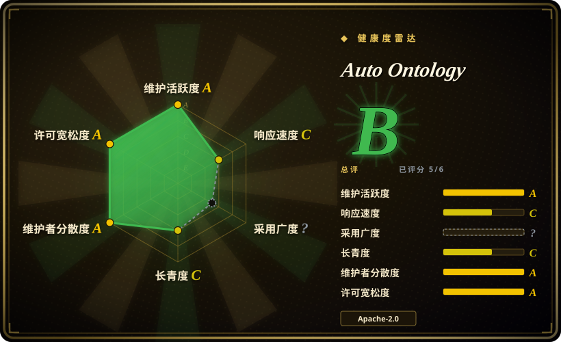
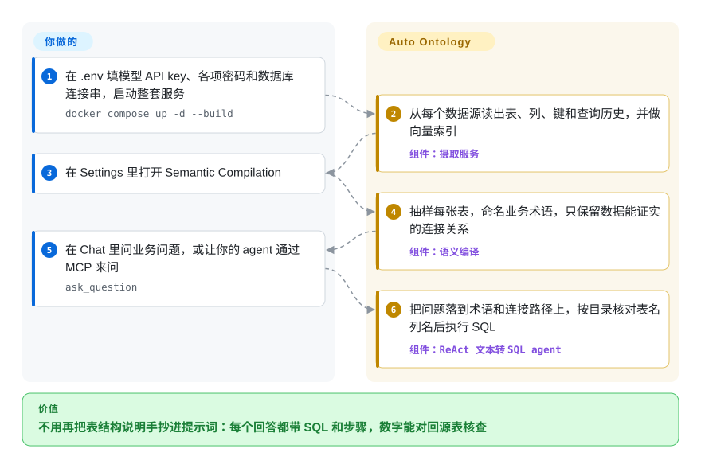
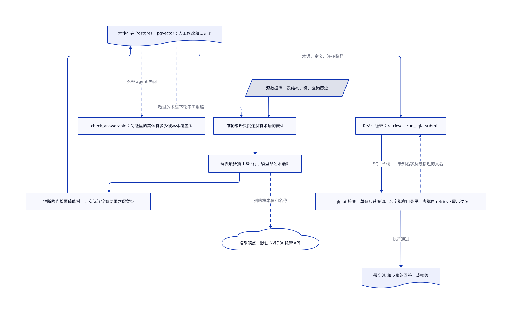

# Auto Ontology

你让大模型 agent 在一个有 400 张表的数仓里回答“去年 6 月宾州的收入是多少”，它会猜哪个 `amount` 列算收入、用错的键做连接，然后很笃定地给你一个错数。Auto Ontology 先搭一张“业务词 → 表、列、连接、公式”的对照图：根据表结构和抽样数据起草，只留下数据能证实的连接；之后 agent 只能沿着这张图回答，每个答案都附上 SQL。

## 何时使用

你负责一家公司的数据或平台工程，业务数据分散在几个 Postgres、Snowflake、Databricks 或 ClickHouse 库里，表还互相重叠（`OLD_ORDERS`、`orders_v2`、三张 `customer` 表）。产品和财务现在想直接问 agent 业务问题，可头几次试验就按文本转 SQL 的老毛病翻车：财务说的收入是 `invoicelines.extendedprice` 之和，模型却挑了 `invoices.total`；客户该按收货城市连，它按账单城市连；最后谁也说不清哪个数对。把这些全手写下来——每个术语、每条连接、每个指标——是好几个月的活，而且没人开始做。

当你希望这张语义对照图由系统根据元数据先起草、再由人审核，并通过 MCP、CLI 或 REST API 提供给任何 agent 时，选 Auto Ontology。它逐表做数据画像，让模型命名业务术语、写列说明；一条推断出来的连接，只有两列的值确实重叠、真的连接后有结果才保留；回答时走一个工具循环，凡是 SQL 里出现目录中不存在的表或列都会被打回。和 [MCP Toolbox for Databases](mcp-toolbox.zh.md) 比，决定性的取舍是“生成的语义”对“声明的查询”：Toolbox 只暴露你写好的参数化语句，工具里没有模型；Auto Ontology 让 agent 在它自己搭的本体上现写 SQL。和 Cube 这类语义层比，它放弃了“指标即代码、放在 git 里”，换来一份自动起草、存在 Postgres、在网页上编辑的本体。

## 何时不用

- **只有一个建模良好的数据源、问题也是固定那几类。** README 自己就说这种情况直接写 SQL 可能就够了。用 [MCP Toolbox for Databases](mcp-toolbox.zh.md) 给 agent 几条声明好的参数化查询，别为此跑一套七个容器的服务。
- **数据在 BigQuery、SQL Server、Oracle、Redshift、Athena 或 MongoDB 里。** 截至 2026-11-18 只有十个连接器（PostgreSQL、MySQL、Databricks、Snowflake、ClickHouse、Trino、Kyuubi、HeavyDB、DuckDB、SQLite）；Oracle、Athena、MongoDB 还是待办的集成请求（#508、#502、#517）。改用 [MCP Toolbox](mcp-toolbox.zh.md)（支持几十种数据源）或 WrenAI（20 多种数据源）。
- **表结构、样本值或问题不能出内网。** 默认四个模型角色都指向 NVIDIA 托管 API（`integrate.api.nvidia.com`），语义编译会把列名和抽样到的样本值发给模型来写列说明。要么把四个角色都换成自建 NIM 或其他支持结构化输出的 OpenAI 兼容端点，要么改用 MCP Toolbox——它的工具里没有模型看数据。打开预测功能还会把已连接的表上传到托管的 KumoRFM 服务。
- **你要的是作为代码审核、同时供 BI 看板使用的受控指标。** 本体存在 Postgres 里，在界面或 REST API 中编辑，支持 Ossie YAML 导入导出；“认证”只是在界面和搜索结果里标记为已审核，不改变 agent 检索什么。指标定义必须走 Pull Request、还要同时服务看板和 agent 时，用 Cube 或 dbt MetricFlow。
- **你打算在共享或公网可达的机器上用 Docker Compose 跑它。** README 要求 3001 和 3002 端口留在内网，因为后端信任前端转发的用户 ID 请求头，摄取服务（摄取、删除、重置、编译）自身没有认证——可 `docker-compose.yml` 把这两个端口发布到了宿主机所有网卡上。用 Helm chart 配网络策略，或者自己用防火墙挡住这两个端口。
- **你需要 agent 在一次调用里主动向用户澄清问题。** 内置的 ReAct agent 从不追问；工具预算（默认 24 次调用）用完就拒答。只有你自己的 agent 先通过 MCP 调 `check_answerable`、再决定去问用户，才有澄清这一步。如果要的是一个替业务用户处理歧义的对话产品，去评估 WrenAI。
- **你需要一个已经经过多年检验的依赖。** 它还不到七个月；最近还开着的问题包括 LLM 步骤失败时编译悄悄写入占位术语（#533），以及在 Postgres 连接数上限时目录构建跑完却是损坏的（#553）。锁定一个 NGC 发布版本，每次升级后重测编译。

## 横向对比

| 替代品 | 是否收录 | 我们的评价 | 取舍 |
|---|---|---|---|
| [MCP Toolbox for Databases](mcp-toolbox.zh.md) | ✅ | 如果 agent 只能跑你声明并审过的查询、又要覆盖很多种引擎，选 MCP Toolbox；如果问题开放、希望 agent 在一张自动生成并经数据核验的术语和连接图上现写 SQL，选 Auto Ontology。 | Toolbox 是一个 Go 服务，工具里没有模型，支持 50 多种数据源，但每条查询都得你自己写；Auto Ontology 替你写语义层，代价是要 Postgres、四个模型角色和一整套网页服务。 |
| WrenAI（`Canner/WrenAI`） | 未收录 | 如果业务用户要一个把问题变成图表和看板、覆盖 20 多种数据源的 GenBI 应用，选 WrenAI；如果使用方是你自己通过 MCP 接入的 agent，并希望语义层根据元数据和样本数据自动起草，选 Auto Ontology。 | WrenAI 数据源更多，还有 BI 式前端，语义要你在它的上下文层里建模；Auto Ontology 自动推断术语和连接，但只连十种引擎。真实仓库，本批标签未收录。 |
| Cube（`cube-js/cube`） | 未收录 | 如果指标必须写成代码、放 git 版本管理，同时服务 BI、嵌入式分析和 AI，选 Cube；如果这些定义还没人写过、想先自动生成一版初稿，选 Auto Ontology。 | Cube 是成熟的语义层，服务 AI、BI 和嵌入式分析，但每条定义都要手写；Auto Ontology 自动起草定义，但定义存在它自己的 Postgres 里，不在你的仓库中。真实仓库，本批标签未收录。 |
| Vanna（`vanna-ai/vanna`） | 未收录 | Vanna 已归档（最后一次推送 2026-02-02），只把它当设计参考；要一条仍在维护、基于检索的文本转 SQL 路线，选 Auto Ontology 或 WrenAI，因为修复和连接器更新已不再来自 Vanna。 | Vanna 是一个通过 agent 式检索和 SQL 数据库对话的 Python 库，嵌入很轻；Auto Ontology 是完整服务，有自动生成的本体和按目录核验的 SQL。真实仓库，本批标签未收录。 |

## 快速上手

文档给的路径是 Docker Compose：克隆仓库，把 `.env.example` 复制成 `.env`，填上模型 API key（默认是 build.nvidia.com 的 `nvapi-` key）、认证密钥、管理员和数据库密码，以及 `CONNECTION_STRINGS`——你想让它读取的数据库连接地址。README 的演示还要另外克隆 `auto-ontology-eval` 仓库，把微软的 Wide World Importers 样例库灌进 Postgres。`docker compose up -d --build` 会启动带 pgvector（向量检索扩展）的 Postgres、Python 后端和摄取服务、数据库迁移任务以及 Next.js 网页应用；各数据源的目录摄取在启动时自动跑。接着用管理员登录，打开 Semantic Compilation（起草本体的后台任务），然后在 Chat 里提问，或带 API token 调 REST 端点 `POST /api/chat/completions`，或通过只读 MCP 服务器（另行运行的 `uvx … auto-ontology-mcp`）从 Cursor、Claude Desktop 等 MCP 客户端提问。你要负责的是：决定它能读哪些库和 schema，为模型端点付费或自建，审核并认证生成的术语和 SQL 定义，把内部端口留在内网；它负责建目录、起草本体、核验连接和生成 SQL。上 Kubernetes 时，`DEPLOYMENT.md` 说明了怎么从 NGC Helm 仓库装发布版镜像。

<!-- flow-steps:begin (generated from flows/auto-ontology.json by tools/flow_card.py — do not edit) -->

流程文字版

1. **你**：在 .env 填模型 API key、各项密码和数据库连接串，启动整套服务 — `docker compose up -d --build`
2. **Auto Ontology**：从每个数据源读出表、列、键和查询历史，并做向量索引 — 组件：`摄取服务`
3. **你**：在 Settings 里打开 Semantic Compilation
4. **Auto Ontology**：抽样每张表，命名业务术语，只保留数据能证实的连接关系 — 组件：`语义编译`
5. **你**：在 Chat 里问业务问题，或让你的 agent 通过 MCP 来问 — `ask_question`
6. **Auto Ontology**：把问题落到术语和连接路径上，按目录核对表名列名后执行 SQL — 组件：`ReAct 文本转 SQL agent`

**价值**：不用再把表结构说明手抄进提示词：每个回答都带 SQL 和步骤，数字能对回源表核查

<!-- flow-steps:end -->

## 技术要点

<!-- mechanism:begin (generated from mechanisms/auto-ontology.json by tools/mechanism_card.py; do not edit) -->

机制文字版

- 源数据库：表结构、键、查询历史
- 每轮编译只挑还没有术语的表②
- 每表最多抽 1000 行；模型命名术语①
- 推断的连接要值能对上、实际连接有结果才保留①
- 本体存在 Postgres + pgvector；人工修改和认证②
- 模型端点：默认 NVIDIA 托管 API
- check_answerable：问题里的实体有多少被本体覆盖④
- ReAct 循环：retrieve、run_sql、submit
- sqlglot 检查：单条只读查询、名字都在目录里、表都由 retrieve 展示过③
- 带 SQL 和步骤的回答，或拒答

- 源数据库：表结构、键、查询历史 → 每轮编译只挑还没有术语的表②
- 每轮编译只挑还没有术语的表② → 每表最多抽 1000 行；模型命名术语①
- 每表最多抽 1000 行；模型命名术语① → 推断的连接要值能对上、实际连接有结果才保留①
- 每表最多抽 1000 行；模型命名术语① → 模型端点：默认 NVIDIA 托管 API（列的样本值和名称）〔可选／兜底〕
- 推断的连接要值能对上、实际连接有结果才保留① → 本体存在 Postgres + pgvector；人工修改和认证②
- 本体存在 Postgres + pgvector；人工修改和认证② → 每轮编译只挑还没有术语的表②（改过的术语下轮不再重编）〔可选／兜底〕
- 本体存在 Postgres + pgvector；人工修改和认证② → check_answerable：问题里的实体有多少被本体覆盖④（外部 agent 先问）〔可选／兜底〕
- 本体存在 Postgres + pgvector；人工修改和认证② → ReAct 循环：retrieve、run_sql、submit（术语、定义、连接路径）
- ReAct 循环：retrieve、run_sql、submit → sqlglot 检查：单条只读查询、名字都在目录里、表都由 retrieve 展示过③（SQL 草稿）
- sqlglot 检查：单条只读查询、名字都在目录里、表都由 retrieve 展示过③ → ReAct 循环：retrieve、run_sql、submit（未知名字及最接近的真名）〔可选／兜底〕
- sqlglot 检查：单条只读查询、名字都在目录里、表都由 retrieve 展示过③ → 带 SQL 和步骤的回答，或拒答（执行通过）

<!-- mechanism:end -->

### 1. 推断出的连接要数据证实才保留

- **解决：** 数仓里常常没声明外键，模型按列名猜连接，会高高兴兴把 `customer_id` 连到另一张恰好也是整数 ID 的无关表上。
- **做法：** 每张表先抽最多 1000 行做画像（95% 的值互不相同就算唯一列）。对没有声明外键的“像外键”的列，先用向量检索加模型挑一个目标属性；再比较两列最小的若干个不同值来确认，最后两列真的做一次连接、至少返回一行才写入（失败时两边都转成文本重试）。指向本表自己 `id` 的连接只接受模型明确挑中的，因为稠密的自增 ID 几乎能“对上”任何整数列。
- **边界：** 设置 `PREVENT_SEMANTIC_FK_DB_QUERIES` 会关掉值比对和连接检查，模型的选择就没人核验了。连接有结果只说明这条关系说得通，不代表它在业务上就是对的；每轮编译还会重选每组的默认连接，在界面里关掉某条不会一直生效。
- **源码：** [算法说明第 5–36 行](https://github.com/NVIDIA/auto-ontology/blob/7dac5ff7bce3daf42e2115ef392146a542fa15d2/auto_ontology/semantic/semantic_fk.py#L5-L36)、[写入前的连接检查第 246–262 行](https://github.com/NVIDIA/auto-ontology/blob/7dac5ff7bce3daf42e2115ef392146a542fa15d2/auto_ontology/semantic/semantic_fk.py#L246-L262)、[连接探测第 753–793 行](https://github.com/NVIDIA/auto-ontology/blob/7dac5ff7bce3daf42e2115ef392146a542fa15d2/auto_ontology/semantic/semantic_fk.py#L753-L793)、[抽样常量第 61–77 行](https://github.com/NVIDIA/auto-ontology/blob/7dac5ff7bce3daf42e2115ef392146a542fa15d2/auto_ontology/semantic/visit_enter.py#L61-L77)。

### 2. 只重编还没有术语的表，人工修改不被覆盖

- **解决：** 如果生成器每晚把整个本体重写一遍，专家刚改好的说明和 SQL 定义就全没了。
- **做法：** 编译在启动时、每 24 小时和按需运行，每轮先查哪些表还没有术语，只编译这些表。在界面或 REST API 里做的修改保存时就重新做向量化，下一个问题马上用上。重置时会先停掉正在跑的编译、等它真正停下、删除、再重建——否则删除途中开始的一轮会以为所有表都编过了，什么也不编。
- **边界：** 同一条规则意味着已经有术语的表不会自己重编；它的结构变化大概要靠重置才能进本体 [推断：依据是“只编没有术语的表”这条规则，未实测结构变更]。技术点 1 里默认连接每轮重选的例外依然成立。
- **源码：** [编译时机第 119–123 行](https://github.com/NVIDIA/auto-ontology/blob/7dac5ff7bce3daf42e2115ef392146a542fa15d2/docs/architecture.md#L119-L123)、[修改与认证第 184–190 行](https://github.com/NVIDIA/auto-ontology/blob/7dac5ff7bce3daf42e2115ef392146a542fa15d2/docs/architecture.md#L184-L190)、[重置顺序第 266–290 行](https://github.com/NVIDIA/auto-ontology/blob/7dac5ff7bce3daf42e2115ef392146a542fa15d2/auto_ontology/ingestion_service/ingest.py#L266-L290)。

### 3. 每份 SQL 草稿碰数据库前先对目录

- **解决：** 文本转 SQL 模型会编出像模像样的列名，或者跑去用它根本没看过的表，而数据库报错很少告诉它真名是什么。
- **做法：** `run_sql` 和 `submit` 用 sqlglot 解析草稿，只放行一条没有副作用的读查询；列出目录里不存在的每个表名或列名，并附上最接近的真名；对没有出现在任何 `retrieve` 结果里的真实表直接拒绝（“Not in view … 先 retrieve 它”）。只有干净的查询才会以只读方式、在配置的超时内执行；报错交回模型——模型本身是这个循环里唯一的模型调用。
- **边界：** 这只能证明名字存在、查询能跑，不能证明算术是对的。每个问题的预算是固定的（默认 24 次工具调用、10 次 SQL 执行），循环从不追问澄清；子查询可能提供的未限定列名被有意放过、不报未知。
- **源码：** [模块约定第 1–18 行](https://github.com/NVIDIA/auto-ontology/blob/7dac5ff7bce3daf42e2115ef392146a542fa15d2/auto_ontology/retrieval/text_to_sql/react/run_sql.py#L1-L18)、[未知名字检查第 167–218 行](https://github.com/NVIDIA/auto-ontology/blob/7dac5ff7bce3daf42e2115ef392146a542fa15d2/auto_ontology/retrieval/text_to_sql/react/run_sql.py#L167-L218)、[只读检查与未展示表规则第 251–318 行](https://github.com/NVIDIA/auto-ontology/blob/7dac5ff7bce3daf42e2115ef392146a542fa15d2/auto_ontology/retrieval/text_to_sql/react/run_sql.py#L251-L318)、[停止条件与上限第 260–290 行](https://github.com/NVIDIA/auto-ontology/blob/7dac5ff7bce3daf42e2115ef392146a542fa15d2/docs/architecture.md#L260-L290)。

### 4. 写 SQL 之前先评估问题能不能答

- **解决：** 在销售库上问“广告花费”，agent 照样会写出某段 SQL、给出某个数，除非有东西告诉它数据里根本没有这个概念。
- **做法：** `check_answerable`（REST 是 `POST /api/question-entity-coverage`）先让模型抽出问题里的实体，再到 pgvector 里找候选属性、定义和分析，留下模型判断相关的，最后把“在距离阈值内有候选的实体占比”作为覆盖度返回。要不要去问用户，由调用它的 agent 决定。
- **边界：** 它是给外部 agent 用的 MCP／REST 工具；Chat 和内置 ReAct 循环都不调用它。覆盖度是基于抽取实体的向量距离启发式，不证明这个问题能被答对。
- **源码：** [可答性流程第 304–318 行](https://github.com/NVIDIA/auto-ontology/blob/7dac5ff7bce3daf42e2115ef392146a542fa15d2/docs/architecture.md#L304-L318)、[覆盖度评分第 24–67 行](https://github.com/NVIDIA/auto-ontology/blob/7dac5ff7bce3daf42e2115ef392146a542fa15d2/auto_ontology/retrieval/entity_coverage/agents/coverage.py#L24-L67)。

## 技术栈

Python 3.12–3.13 服务，基于 FastAPI 和 Uvicorn（一个后端承载文本转 SQL agent 和目录、本体 API，另一个独立服务负责摄取和编译）；模型调用用 LangChain 的 `langchain-openai` 和 `langchain-nvidia-ai-endpoints`，SQL 解析用 sqlglot，存储用 SQLAlchemy、psycopg 和 Alembic，向量检索用 `langchain-postgres` 跑在 PostgreSQL 17 + pgvector 上。网页应用是 Next.js，配 Better Auth 和 Prisma；MCP 服务器是 `mcp/` 下单独的 FastMCP 项目。打包用 uv、Docker 镜像和 Helm chart；Ossie YAML 转换来自锁定提交的 `apache/ossie-converters`，可选的预测功能用 NVIDIA 随仓库附带的 `kumo-relational` wheel 包。

## 依赖

- Docker 和 Compose v2（或 Kubernetes + Helm 装 NGC chart）；MCP 服务器和样例数据灌库脚本需要 uv。
- PostgreSQL 17 + pgvector（Compose 和 chart 已自带），存目录、本体、应用数据和向量。
- 四个模型角色——推理、非推理、向量、重排——默认走 NVIDIA 托管 API（`nvapi-` key），也可以换成自建 NIM 或任何支持结构化输出的 OpenAI 兼容端点；摄取和查询必须用同一个向量模型。
- 能访问每个源数据库的网络和凭据；引擎开放查询历史时（例如 Snowflake）会用上它。
- 可选：HashiCorp Vault 存连接凭据，托管的 KumoRFM 服务做预测，`mcp-remote`（Node）把 Claude Desktop 桥接到 MCP 服务器。

## 运维难度

**中到高。** 演示只要一个 Compose 文件，但生产上要跑七个容器（Postgres、pgAdmin、后端、摄取服务、两个迁移任务、前端）再加 MCP 服务器，要处理 Compose 发布出来的 3001／3002 端口，要管四个模型端点和它们的花费，还要配 SSO 或 API token。在大数仓上编译会发出大量模型调用（同时最多 6 个）和源库查询；有一个未关闭的问题报告默认模型开着思考模式时编译慢了约六倍（#526）。日常工作是审核、认证生成的术语，留意 LLM 步骤失败后悄悄写入的占位术语（#533），以及在这个迭代很快的代码库每次升级后重测。

## 健康度与可持续性

- **维护（2026-11-18）：** 非常活跃——2026-10-18 以来 `main` 上有 73 个提交，最近一次推送在 2026-11-17。版本发布走 NGC 容器镜像和 Helm chart（`pyproject.toml` 和 chart 里都是 1.3.0），不走 GitHub Release，所以 GitHub 的发布列表是空的。
- **治理与巴士系数：** 归 NVIDIA 组织所有；`CODEOWNERS` 列了四位维护者，主分支合并需要一位代码负责人批准。共 15 位贡献者，前五位贡献了绝大部分提交；11 月中旬，`CODEOWNERS` 以外的账号也在提交并合入 PR。
- **年龄与 Lindy：** 2026-04-27 创建，不到七个月，Lindy 先验几乎给不了支撑。有厂商撑腰提高了持续维护的可能，但也意味着路线图由一家公司决定，默认配置也指向它自家的托管模型。
- **采用信号：** 七个月约 1.37 万星、1.2 千 fork，更多反映的是发布声势而非实测的生产使用 [推断：依据是星数增速对比项目年龄，且没有公开的用户名单]。README 里 BEAVER 第 1、BIRD-Interact 第 2 的徽章是自报的；BIRD-Interact 页面源码里确实有一条链接到本仓库的 NVIDIA 条目，但名次由页面数据渲染，这里没有核对。
- **实测雷达：** B，六个轴里评了五个。采用度是 `?`，因为它以容器发布，没有可统计下载量或被依赖数的包，不代表没人用；响应度 C，近期 issue 首次回应的中位时间约 171 小时；寿命 C 反映的是 204 天的年龄。
- **风险信号：** Apache-2.0，版权方是 NVIDIA，源文件带 SPDX 头；第三方声明里有一个 GPL-2.0 加 FOSS 例外的依赖（`mysql-connector-python`）。主要风险在运维层面：默认把数据发往托管模型、内部端口没有认证，以及年轻代码仍在不断报出的可靠性问题。

## 存疑（未验证）

- [未验证：本批不允许安装或运行] Compose 快速上手、编译、MCP 登录和回答都是读 README、文档和源码（提交 `7dac5ff7bce3daf42e2115ef392146a542fa15d2`）得出的，没有复现。
- [推断：依据是“只编没有术语的表”这条规则] 已编译过的表发生结构变化，很可能要重置或手工修改才能反映到本体里。
- [推断：依据是七个月的年龄对比星数和 fork 增速] 热度更多来自 NVIDIA 的发布影响力，而非经过核实的生产采用。
- [未验证：排行榜数据在浏览器端渲染] README 徽章里的 BEAVER 第 1、BIRD-Interact 第 2 没有核实；只确认了 BIRD-Interact 页面上有一条链接到本仓库的 NVIDIA 条目。
- [未验证：问题提交者的测量] 开启思考模式后编译慢约六倍，来自 issue #526，没有复现。
- [未验证：未核对维护者归属] 哪些贡献者是 NVIDIA 员工，是根据账号名和 `CODEOWNERS` 推断的，没有确认。
