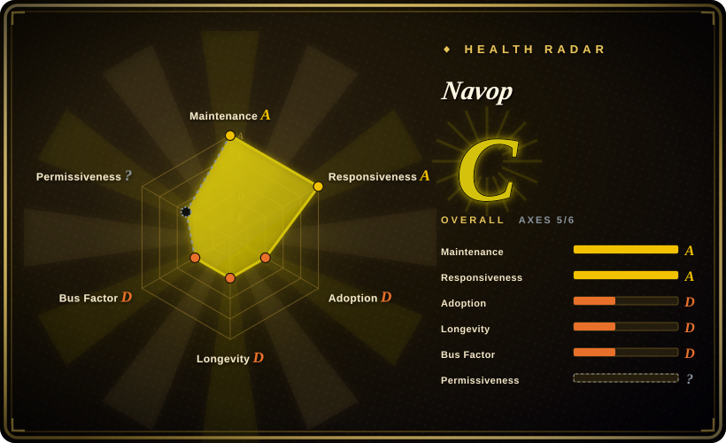
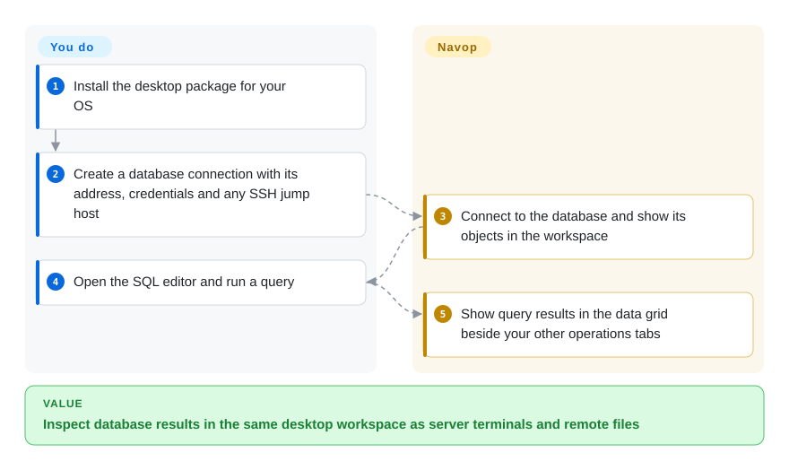
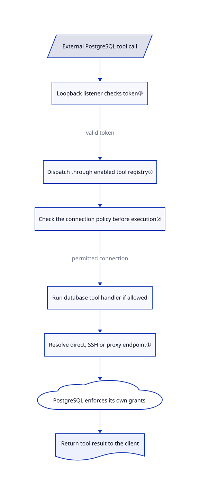

# Navop

You inspect a database row, switch to an SSH terminal, then open another app to fetch a server file. Navop keeps those connections and operations in one native desktop workspace, with an optional bridge for AI tools.

## When to use

You maintain an application whose PostgreSQL database sits behind an SSH jump host. To investigate an order that never completed, you query its row, inspect a server log, and download an attachment; today you copy connection details between three clients. Navop combines a SQL editor and data grid with SSH terminals and remote-file views. Choose it over a database-only client when moving between data and server operations is the actual problem, rather than needing the broadest database administration surface.

You can also expose selected live connections and terminal tools to an external assistant through MCP, a protocol for discovering and calling tools. Navop stays the desktop host for tool exposure, approval and connection policies; it is not a standalone shared database service. Built-in database support and installable extension drivers are distinct: the [README](https://github.com/feigeCode/navop/blob/2db7763a92eab1188139fba6753be767f06010cc/README.md#L55-L89) lists MySQL, PostgreSQL, SQLite, DuckDB, SQL Server and Oracle as built-in, while ClickHouse and several other engines use extensions.

## When NOT to use

- **You must redistribute a paid product or build a competing service from the code.** Prefer [DBeaver Community](dbeaver.md) for an Apache-2.0 database client. Navop adds restrictions on paid redistribution, competing products/services and military use; internal commercial tool use is expressly allowed, but this is not an unrestricted Apache grant. Read the [actual terms](https://github.com/feigeCode/navop/blob/2db7763a92eab1188139fba6753be767f06010cc/NAVOP_LICENSE#L81-L110), not just the Apache file.
- **Production agents should only execute business queries you reviewed.** Prefer [MCP Toolbox](mcp-toolbox.md) with explicitly declared parameterized tools and least-privilege database roles. Navop's general connection and terminal tools deliberately expose a broader interactive operations surface; a read-only tool annotation is not a database-enforced SQL boundary.
- **You only need SSH, file transfers and remote desktops.** Consider electerm instead of taking on Navop's database and extension surfaces. Conversely, choose Navop when the SQL grid and server session belong to the same investigation.
- **You need a long-established relational administration workbench.** Prefer DBeaver when its driver ecosystem and administration workflows outweigh consolidating terminals and files. Navop was created in July 2026; current activity does not establish years of upgrade compatibility.

## Comparison

| Alternative | In index | Our verdict | Tradeoff |
|---|---|---|---|
| [DBeaver Community](dbeaver.md) | Yes | Pick DBeaver for a database-first administration workbench and Apache-only Community licensing; pick Navop when SQL, SSH and remote files need one working context. | DBeaver uses an Eclipse/Java desktop stack and JDBC drivers; Navop uses Rust/GPUI and a mix of built-in and extension drivers, with additional licensing restrictions. |
| [MCP Toolbox for Databases](mcp-toolbox.md) | Yes | Pick Toolbox when a service should expose reviewed parameterized queries to agents; pick Navop when an operator wants to share selected live desktop tools. | Toolbox requires server configuration and deployment; Navop depends on the running desktop and its connection state, and offers broader interactive tools. |
| [electerm](https://github.com/electerm/electerm) | not indexed | Pick electerm for a terminal/file-transfer/remote-desktop client; pick Navop when a database editor and data grid must sit beside those operations. | electerm's documented focus is remote access, not a multi-engine SQL workbench. Not added in this tab batch. |

## Quick start

Download a package for your OS from [Releases](https://github.com/feigeCode/navop/releases), and check the release's `sha256sums.txt`; source developers can follow the platform prerequisites and run `cargo run -p main` from the repository. Create a database connection with its address and credentials, including an SSH jump host when needed, then open the SQL editor and run a query to view the result grid. Navop opens the connection and presents results; you supply network access, database privileges and safe statements. For external assistants, separately enable the MCP server and required tool groups in settings, choose its permission mode, and configure the external CLI or MCP bridge described in the [README](https://github.com/feigeCode/navop/blob/2db7763a92eab1188139fba6753be767f06010cc/README.md#L87-L100). That optional integration does not remove your responsibility for credentials, approvals or model-provider charges; installation and runtime behavior were not tested here.

<!-- flow-steps:begin (generated from flows/navop.json by tools/flow_card.py — do not edit) -->

Text version of the flow

1. **You**: Install the desktop package for your OS
2. **You**: Create a database connection with its address, credentials and any SSH jump host
3. **Navop**: Connect to the database and show its objects in the workspace
4. **You**: Open the SQL editor and run a query
5. **Navop**: Show query results in the data grid beside your other operations tabs

**Value**: Inspect database results in the same desktop workspace as server terminals and remote files

<!-- flow-steps:end -->

## Key techniques

<!-- mechanism:begin (generated from mechanisms/navop.json by tools/mechanism_card.py; do not edit) -->

Text version of the mechanism

- External PostgreSQL tool call
- Loopback listener checks token③
- Dispatch through enabled tool registry②
- Check the connection policy before execution②
- Run database tool handler if allowed
- Resolve direct, SSH or proxy endpoint①
- PostgreSQL enforces its own grants
- Return tool result to the client

- External PostgreSQL tool call → Loopback listener checks token③
- Loopback listener checks token③ → Dispatch through enabled tool registry② (valid token)
- Dispatch through enabled tool registry② → Check the connection policy before execution②
- Check the connection policy before execution② → Run database tool handler if allowed (permitted connection)
- Run database tool handler if allowed → Resolve direct, SSH or proxy endpoint①
- Resolve direct, SSH or proxy endpoint① → PostgreSQL enforces its own grants
- PostgreSQL enforces its own grants → Return tool result to the client

<!-- mechanism:end -->

### 1. Resolve database traffic through a shared connection tunnel

- **Problem:** Each database driver otherwise needs its own SSH and proxy plumbing.
- **How:** The database adapter converts saved connection parameters into a shared resolver. It returns the direct address or a local endpoint backed by an SSH/proxy tunnel, retaining a tunnel guard with the result.
- **Limits:** This routes TCP traffic; it does not grant database permissions. SSH creation has a configured timeout, and authentication/network failure still fails the connection.
- **Source:** [Database adapter:41-60](https://github.com/feigeCode/navop/blob/2db7763a92eab1188139fba6753be767f06010cc/crates/db/src/ssh_tunnel.rs#L41-L60), [target resolution and SSH setup:238-309](https://github.com/feigeCode/navop/blob/2db7763a92eab1188139fba6753be767f06010cc/crates/connection_tunnel/src/lib.rs#L238-L309), [PostgreSQL driver call:961-986](https://github.com/feigeCode/navop/blob/2db7763a92eab1188139fba6753be767f06010cc/crates/db/src/postgresql/connection.rs#L961-L986).

### 2. Apply connection policy at tool execution, not just discovery

- **Problem:** Hiding a connection from a tool list does not stop a client calling a known tool with its name or ID.
- **How:** The desktop merges enabled tool registries and reattaches a connection access guard. Before a handler runs, the guard resolves connection/session references and checks allowed, read-only or denied access; policy-read errors reject the operation.
- **Limits:** The connection guard relies on tool annotations; the query handler separately checks the statement kind, which still is not a database grant. Old empty policy values remain allowed; local terminal sessions without an associated connection do not inherit a connection restriction. Use database grants as the hard data boundary.
- **Source:** [Registry wiring:124-157](https://github.com/feigeCode/navop/blob/2db7763a92eab1188139fba6753be767f06010cc/main/src/public_mcp_runtime/tool_registry.rs#L124-L157), [pre-handler check:196-215](https://github.com/feigeCode/navop/blob/2db7763a92eab1188139fba6753be767f06010cc/crates/tool_runtime/src/registry.rs#L196-L215), [target mapping and errors:58-183](https://github.com/feigeCode/navop/blob/2db7763a92eab1188139fba6753be767f06010cc/main/src/public_mcp_runtime/access_guard.rs#L58-L183), [legacy values and annotations:60-83](https://github.com/feigeCode/navop/blob/2db7763a92eab1188139fba6753be767f06010cc/crates/tool_runtime/src/access.rs#L60-L83), [query prefilter:105-128](https://github.com/feigeCode/navop/blob/2db7763a92eab1188139fba6753be767f06010cc/crates/navop_runtime/src/database_tools.rs#L105-L128).

### 3. Keep external tool calls attached to the desktop host

- **Problem:** An external assistant needs the desktop's live tools without a public unauthenticated listener.
- **How:** The runtime generates a 32-byte random token, binds a dynamic IPv4 loopback port and writes a discovery document. A token line is checked before MCP starts; on Unix the discovery file is set to mode `0600`. The protocol dispatches through the host's current registry and approval context.
- **Limits:** This is not a remotely hosted shared gateway. Token possession grants access to the exposed tool surface; the inspected token-line reader has no explicit size or time bound. The external stdio bridge and CLI are separate distributions, not this repository's desktop binary.
- **Source:** [Runtime creation and token:81-132](https://github.com/feigeCode/navop/blob/2db7763a92eab1188139fba6753be767f06010cc/crates/public_mcp/src/runtime.rs#L81-L132), [loopback bind:19-32](https://github.com/feigeCode/navop/blob/2db7763a92eab1188139fba6753be767f06010cc/crates/public_mcp/src/server.rs#L19-L32), [token check:101-126](https://github.com/feigeCode/navop/blob/2db7763a92eab1188139fba6753be767f06010cc/crates/public_mcp/src/server.rs#L101-L126), [file permissions:113-150](https://github.com/feigeCode/navop/blob/2db7763a92eab1188139fba6753be767f06010cc/crates/public_mcp/src/discovery.rs#L113-L150), [dispatch:141-158](https://github.com/feigeCode/navop/blob/2db7763a92eab1188139fba6753be767f06010cc/crates/public_mcp/src/protocol.rs#L141-L158).

## Tech stack

- Rust 2024 workspace; native GPUI-based interface, Tokio async runtime and Alacritty terminal components.
- Native database libraries include PostgreSQL, MySQL, SQLite, DuckDB and SQL Server connectors; russh/russh-sftp handle SSH and SFTP. Some UI and networking dependencies are pinned vendor forks in [Cargo.toml](https://github.com/feigeCode/navop/blob/2db7763a92eab1188139fba6753be767f06010cc/Cargo.toml#L53-L86).
- Extensions supply additional database drivers and other workbenches. Built-in support is not a promise that every optional driver works without separate installation.

## Dependencies

- A supported macOS, Windows or Linux workstation; GPU-capable native desktop environment. Building requires Rust and platform libraries; the Linux bootstrap invokes system package managers with `sudo`.
- Reachable target services and credentials; SSH tunneling additionally needs access to the jump host. Oracle client/driver setup depends on the chosen path described in the upstream installation guide.
- Optional AI needs your configured provider or external agent. Optional public MCP needs a running desktop plus its separately packaged bridge/client; cloud synchronization and team services are not required for the basic local database-query path.

## Ops difficulty

**Low for a local query session; medium for a credential-bearing operations workstation.** There is no server to deploy for the basic desktop workflow. You still maintain client/driver versions, saved credentials, SSH trust and least-privilege database accounts. Enabling external tools, extensions or synchronization adds permission and data-egress decisions; keep production write authority separate from the convenience of a shared UI.

## Health & viability

- **Maintenance, 2026-10-28:** the reviewed default-branch commit releases v0.22.0; the repository is not archived. Releases and recent fixes show active iteration, not a long-term stability guarantee.
- **Backing and governance:** the repository is user-owned; its README explicitly calls it independently maintained. Do not assume foundation support or a contractual support team.
- **Age/Lindy:** created 2026-07-10, less than four months before verification. [推断：recent activity is confirmed, but the short history cannot establish upgrade durability] Treat it as a young operations tool to evaluate against disposable connections before production use.
- **Adoption and license:** 1,982 GitHub stars are a dated interest signal, not production-user evidence. The source is Apache-2.0 **plus** the Navop Supplementary License for Navop-authored parts; third-party components keep their own licenses. The Apache file retains Longbridge attribution, so neither a permissive badge nor a health score settles full-codebase rights.
- **Radar coverage:** the generated aggregate is C with 5 of 6 axes scored. The license axis remains `?` with reason `license_unparsed`: the scorer cannot classify these terms, not evidence that no license exists or that its restrictions are harmless.

## Caveats (unverified)

- [未验证：no upstream application was run] Package installation, GPU rendering, driver compatibility, remote-desktop behavior and end-to-end tool enforcement were reviewed from documentation/source, not exercised on live services.
- [推断：the project is under four months old and active] Long-term compatibility and sustained maintainer capacity remain unproven; stars and current release activity cannot establish either.
- [未验证：no full transitive-rights audit] The Apache text and supplementary restrictions were read, but all vendored assets and dependencies were not independently cleared. This page describes software and its stated constraints; it does not grant usage or redistribution rights.
