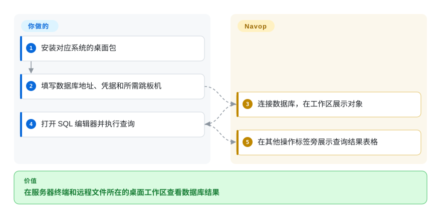
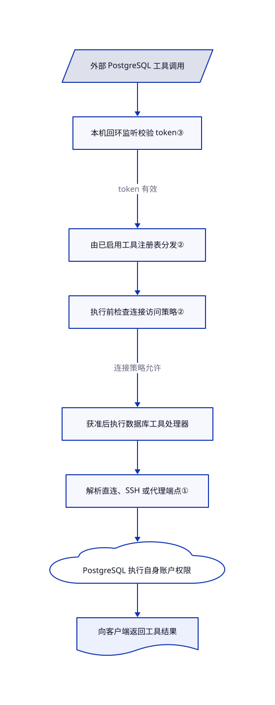

# Navop

查完数据库记录，还得切到 SSH 终端，再开另一个应用下载服务器文件。Navop 把这些连接与操作放进同一个原生桌面工作区，也能按需接入 AI 工具。

## 何时使用

你维护的应用把 PostgreSQL 放在 SSH 跳板机后。排查一笔未完成的订单，要查数据库记录、读服务器日志、下载附件，现在却得在三个客户端之间复制连接信息。Navop 将 SQL 编辑器、数据表格、SSH 终端与远程文件视图放在一起。与数据库专用客户端相比，选择它的理由是减少数据与服务器操作之间的切换，而不是追求最完整的数据库管理功能。

你也可以通过 MCP（让外部助手发现并调用工具的协议）开放选定的连接和终端工具。Navop 桌面端仍负责工具开放范围、审批和连接策略，它不是独立部署的共享数据库服务。内置数据库与扩展驱动应分开看：[README](https://github.com/feigeCode/navop/blob/2db7763a92eab1188139fba6753be767f06010cc/README.md#L55-L89) 将 MySQL、PostgreSQL、SQLite、DuckDB、SQL Server 和 Oracle 列为内置，ClickHouse 等引擎则通过扩展提供。

## 何时不用

- **要收费分发产品，或基于源码创建竞争服务。** 数据库客户端可优先选 Apache-2.0 的 [DBeaver Community](dbeaver.zh.md)。Navop 附加限制覆盖收费再分发、竞争产品或服务，以及军事用途；它明确允许企业内部作为商业工具使用，但不是无限制 Apache 授权。应读[实际条款](https://github.com/feigeCode/navop/blob/2db7763a92eab1188139fba6753be767f06010cc/NAVOP_LICENSE#L81-L110)，不能只看 Apache 文件。
- **生产 agent 只能执行你审过的业务查询。** 优先选 [MCP Toolbox](mcp-toolbox.zh.md)，显式声明参数化工具，并使用最小权限数据库账户。Navop 的通用连接和终端工具面向交互运维，开放面更大；工具的只读注解不等于数据库强制的 SQL 权限边界。
- **只需要 SSH、文件传输和远程桌面。** 可以考虑 electerm，不必同时承担 Navop 的数据库与扩展功能面。反之，若一次排查要同时使用 SQL 表格和服务器会话，Navop 更贴合这个工作过程。
- **需要有长期积累的关系数据库管理工作台。** 驱动生态和管理流程比整合终端文件更重要时，优先 DBeaver。Navop 创建于 2026 年 7 月；当前活跃不等于已经证明多年升级兼容性。

## 横向对比

| 替代品 | 是否收录 | 我们的评价 | 取舍 |
|---|---|---|---|
| [DBeaver Community](dbeaver.zh.md) | 已收录 | 数据库管理优先、且需要社区版单纯 Apache 授权时选 DBeaver；SQL、SSH 和远程文件需要同一工作上下文时选 Navop。 | DBeaver 使用 Eclipse／Java 桌面栈和 JDBC 驱动；Navop 使用 Rust／GPUI，混合内置与扩展驱动，但另有许可限制。 |
| [MCP Toolbox for Databases](mcp-toolbox.zh.md) | 已收录 | 要通过服务向 agent 提供审过的参数化查询时选 Toolbox；操作者想共享桌面实时工具时选 Navop。 | Toolbox 要配置并部署服务；Navop 依赖运行中的桌面端和连接状态，提供更宽的交互工具面。 |
| [electerm](https://github.com/electerm/electerm) | 未收录 | 终端、文件传输和远程桌面优先时选 electerm；还要把数据库编辑器和表格放在旁边时选 Navop。 | electerm 文档重点是远程访问，而不是多引擎 SQL 工作台。本批未增补此替代品。 |

## 快速上手

从 [Releases](https://github.com/feigeCode/navop/releases) 下载对应系统的安装包，并核对该版本的 `sha256sums.txt`；源码开发者可按平台前置要求，在仓库内运行 `cargo run -p main`。创建数据库连接，填写地址和凭据，需要时配置 SSH 跳板机，再打开 SQL 编辑器执行查询，查看结果表格。Navop 负责建立连接和呈现结果，你负责网络可达性、数据库权限和语句安全。接外部助手时，另在设置中开启 MCP 服务和所需工具组，选择权限模式，再按 [README](https://github.com/feigeCode/navop/blob/2db7763a92eab1188139fba6753be767f06010cc/README.md#L87-L100) 配置独立的 CLI 或 MCP 桥接包。这项可选集成不会替你承担凭据管理、审批和模型费用；本页没有实测安装或运行效果。

<!-- flow-steps:begin (generated from flows/navop.json by tools/flow_card.py — do not edit) -->

流程文字版

1. **你**：安装对应系统的桌面包
2. **你**：填写数据库地址、凭据和所需跳板机
3. **Navop**：连接数据库，在工作区展示对象
4. **你**：打开 SQL 编辑器并执行查询
5. **Navop**：在其他操作标签旁展示查询结果表格

**价值**：在服务器终端和远程文件所在的桌面工作区查看数据库结果

<!-- flow-steps:end -->

## 技术要点

<!-- mechanism:begin (generated from mechanisms/navop.json by tools/mechanism_card.py; do not edit) -->

机制文字版

- 外部 PostgreSQL 工具调用
- 本机回环监听校验 token③
- 由已启用工具注册表分发②
- 执行前检查连接访问策略②
- 获准后执行数据库工具处理器
- 解析直连、SSH 或代理端点①
- PostgreSQL 执行自身账户权限
- 向客户端返回工具结果

- 外部 PostgreSQL 工具调用 → 本机回环监听校验 token③
- 本机回环监听校验 token③ → 由已启用工具注册表分发②（token 有效）
- 由已启用工具注册表分发② → 执行前检查连接访问策略②
- 执行前检查连接访问策略② → 获准后执行数据库工具处理器（连接策略允许）
- 获准后执行数据库工具处理器 → 解析直连、SSH 或代理端点①
- 解析直连、SSH 或代理端点① → PostgreSQL 执行自身账户权限
- PostgreSQL 执行自身账户权限 → 向客户端返回工具结果

<!-- mechanism:end -->

### 1. 数据库流量复用共享连接隧道

- **解决：** 如果每种数据库驱动自行处理 SSH 与代理，会重复实现网络连接逻辑。
- **做法：** 数据库适配器把保存的连接参数交给共享解析器。解析器返回直连地址，或 SSH／代理隧道对应的本地端点，并在返回值中保留隧道守卫对象。
- **边界：** 这是 TCP 流量路由，不会授予数据库权限。SSH 建立过程有配置的超时，认证或网络失败仍会使连接失败。
- **源码：** [数据库适配第 41–60 行](https://github.com/feigeCode/navop/blob/2db7763a92eab1188139fba6753be767f06010cc/crates/db/src/ssh_tunnel.rs#L41-L60)、[目标解析及 SSH 建立第 238–309 行](https://github.com/feigeCode/navop/blob/2db7763a92eab1188139fba6753be767f06010cc/crates/connection_tunnel/src/lib.rs#L238-L309)、[PostgreSQL 驱动调用第 961–986 行](https://github.com/feigeCode/navop/blob/2db7763a92eab1188139fba6753be767f06010cc/crates/db/src/postgresql/connection.rs#L961-L986)。

### 2. 执行工具前校验连接策略，不只隐藏工具

- **解决：** 从列表隐藏连接，挡不住客户端拿已知名称或 ID 直接调用工具。
- **做法：** 桌面端合并已启用的工具注册表，再挂回连接访问守卫。处理器执行前，守卫解析连接或会话引用，检查允许、只读或禁止级别；读取策略失败就拒绝操作。
- **边界：** 连接守卫依赖工具注解；查询处理器另行检查语句类型，但仍不等于数据库权限。旧数据的空策略仍按允许处理；没有关联连接的本地终端不会继承连接限制。数据硬边界仍应由数据库账户权限提供。
- **源码：** [注册表接线第 124–157 行](https://github.com/feigeCode/navop/blob/2db7763a92eab1188139fba6753be767f06010cc/main/src/public_mcp_runtime/tool_registry.rs#L124-L157)、[执行前检查第 196–215 行](https://github.com/feigeCode/navop/blob/2db7763a92eab1188139fba6753be767f06010cc/crates/tool_runtime/src/registry.rs#L196-L215)、[目标映射与错误处理第 58–183 行](https://github.com/feigeCode/navop/blob/2db7763a92eab1188139fba6753be767f06010cc/main/src/public_mcp_runtime/access_guard.rs#L58-L183)、[旧值及注解判定第 60–83 行](https://github.com/feigeCode/navop/blob/2db7763a92eab1188139fba6753be767f06010cc/crates/tool_runtime/src/access.rs#L60-L83)、[查询预检查第 105–128 行](https://github.com/feigeCode/navop/blob/2db7763a92eab1188139fba6753be767f06010cc/crates/navop_runtime/src/database_tools.rs#L105-L128)。

### 3. 外部工具调用仍由桌面宿主管理

- **解决：** 外部助手需要桌面端的实时工具，但不应因此开放未认证的公网监听。
- **做法：** 运行时生成 32 字节随机 token，绑定动态 IPv4 本机回环端口并写发现文件。先校验一行 token，再启动 MCP；Unix 下把发现文件权限设为 `0600`。协议层通过宿主当前注册表和审批上下文分发调用。
- **边界：** 它不是远程托管的共享网关。持有 token 即可访问已开放工具面；所读 token 行解析器没有显式长度或时间上限。外部标准输入输出桥接包与 CLI 独立分发，不是本仓的桌面二进制。
- **源码：** [运行时与 token 第 81–132 行](https://github.com/feigeCode/navop/blob/2db7763a92eab1188139fba6753be767f06010cc/crates/public_mcp/src/runtime.rs#L81-L132)、[回环监听第 19–32 行](https://github.com/feigeCode/navop/blob/2db7763a92eab1188139fba6753be767f06010cc/crates/public_mcp/src/server.rs#L19-L32)、[token 校验第 101–126 行](https://github.com/feigeCode/navop/blob/2db7763a92eab1188139fba6753be767f06010cc/crates/public_mcp/src/server.rs#L101-L126)、[文件权限第 113–150 行](https://github.com/feigeCode/navop/blob/2db7763a92eab1188139fba6753be767f06010cc/crates/public_mcp/src/discovery.rs#L113-L150)、[调用分发第 141–158 行](https://github.com/feigeCode/navop/blob/2db7763a92eab1188139fba6753be767f06010cc/crates/public_mcp/src/protocol.rs#L141-L158)。

## 技术栈

- Rust 2024 工作区；基于 GPUI 的原生界面、Tokio 异步运行时，以及 Alacritty 终端组件。
- 使用 PostgreSQL、MySQL、SQLite、DuckDB、SQL Server 等原生连接库；SSH 与 SFTP 使用 russh／russh-sftp。部分界面和网络依赖锁定在维护者 fork，见 [Cargo.toml](https://github.com/feigeCode/navop/blob/2db7763a92eab1188139fba6753be767f06010cc/Cargo.toml#L53-L86)。
- 扩展提供额外数据库驱动和其他工作台。内置支持不代表所有可选驱动都无需另装。

## 依赖

- 支持的 macOS、Windows 或 Linux 工作站，以及能运行 GPU 原生桌面的环境。源码构建需要 Rust 和平台库；Linux 引导脚本用 `sudo` 调用系统包管理器。
- 可达的目标服务与凭据；SSH 隧道还需要跳板机访问权。Oracle 客户端或驱动配置取决于上游安装指南中的具体路径。
- 可选 AI 需要配置模型服务或外部 agent。公共 MCP 需要运行中的桌面端和独立分发的桥接或客户端；基础本地数据库查询不要求启用云同步或团队服务。

## 运维难度

**本地查询低，承载凭据的运维工作站中等。** 基础桌面流程无需部署服务器，但仍要维护客户端与驱动版本、保存的凭据、SSH 信任和数据库最小权限账户。开启外部工具、扩展或同步后，会增加权限与数据外发决策。不要因为操作统一到了一个界面，就把生产写权限也交给所有调用方。

## 健康度与可持续性

- **维护，2026-10-28：** 所读默认分支提交发布 v0.22.0，仓库未归档。近期发布与修复表明仍在迭代，不代表长期稳定性保证。
- **支持与治理：** 仓库由个人账户持有，README 明确称独立维护。不能假设有基金会支持或合同化支持团队。
- **年龄与 Lindy：** 创建于 2026-07-10，核验时尚不足四个月。[推断：已确认近期活跃，但历史太短，无法证明升级持久性] 应先用可丢弃的连接评估，再考虑生产操作。
- **采用与许可：** 1,982 个 GitHub 星是有日期的关注信号，不是生产用户证据。Navop 自有部分采用 Apache-2.0 **加上** Navop 附加许可，第三方组件沿用各自授权；Apache 文件保留 Longbridge 署名。因此，宽松许可徽章或健康度评分都不能替代全仓权利核查。
- **雷达覆盖：** 自动总评为 C，六轴中五轴有评分。许可轴保留 `?`，原因为 `license_unparsed`，表示评分器不能归类这些条款，不是没有许可，也不代表限制没有风险。

## 存疑（未验证）

- [未验证：未运行上游应用] 安装包、GPU 渲染、驱动兼容性、远程桌面和端到端工具权限只依据文档与源码，没有连接真实服务验证。
- [推断：项目不足四个月且近期活跃] 长期兼容性和持续维护能力尚无充分历史证据，星数和当前发布节奏不能证明这两点。
- [未验证：未做完整传递权利审计] 已读 Apache 文本和附加限制，但未逐项核清全部 vendored 资产与依赖。本页介绍软件及其声明的限制，不授予使用或再分发权利。
