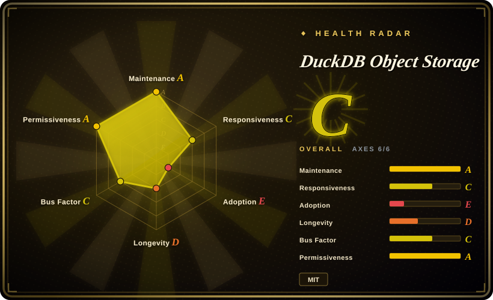
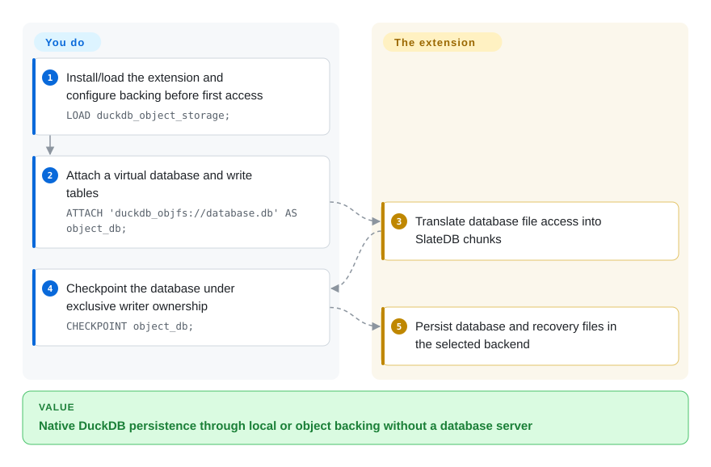
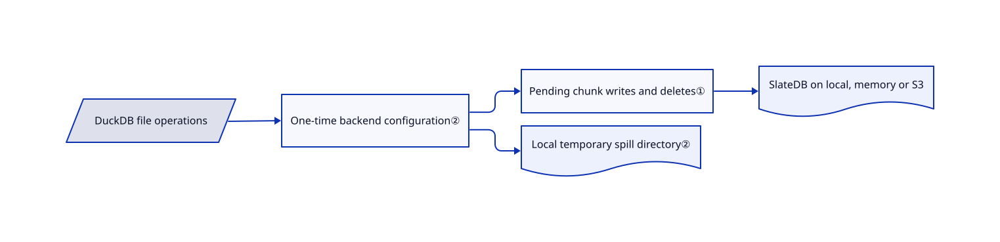

# DuckDB Object Storage

Your DuckDB tables must persist in object storage, not just read Parquet from a bucket. This extension maps DuckDB's database and recovery files onto a SlateDB-backed virtual filesystem while keeping temporary spill files local.

## When to use

You own one analytical writer process and want it to keep a native DuckDB database behind `duckdb_objfs://`, with local, in-memory or S3-compatible backing. You can coordinate writer ownership and accept delayed cross-process read visibility. Choose this over ordinary DuckDB remote-file reads when the database itself, including its recovery files, must live in the backend; choose DuckLake when you want a catalog and interoperable analytical data files instead of virtualizing native database bytes.

## When NOT to use

- **Several processes must write concurrently.** Use DuckLake with an appropriate shared catalog, or [ClickHouse](clickhouse.md) as a server. This extension has no file lock: a second writer can fence out the first and cause later flush/checkpoint failures.
- **You only query remote Parquet or CSV.** Use [DuckDB](duckdb.md) and its remote-file support directly; adding an LSM storage layer buys nothing for that job.
- **Readers must immediately see another process's commit.** Use a shared database service such as [ClickHouse](clickhouse.md), or keep reads in the writer process. Cached read-only SlateDB readers follow manifests roughly every ten seconds, even across detach/reattach.
- **Your memory limit must include every cache automatically.** Prefer ordinary local [DuckDB](duckdb.md), or explicitly budget this extension's caches: default data and metadata caches allow 512 MiB plus 128 MiB independently of DuckDB's buffer limit.

## Comparison

| Alternative | In index | Our verdict | Tradeoff |
|---|---|---|---|
| [DuckDB](duckdb.md) with local database or remote Parquet | ✅ | Choose plain DuckDB when local persistence or direct remote-file queries suffice; add this extension only when native database files must use object backing. | Fewer failure modes versus remote persistence through an extra native/Rust layer. |
| DuckLake | not indexed | Choose DuckLake for catalog-backed shared analytical storage; choose this extension for native DuckDB file semantics under a single externally coordinated writer. | Different storage model and catalog operation; real repository, not added in this tab batch. |
| [ClickHouse](clickhouse.md) | ✅ | Choose ClickHouse for a shared analytical service with concurrent clients; choose this extension for embedding DuckDB into one process without adopting a server. | Service operations and another engine versus single-writer constraints and eventual remote reader visibility. |

## Quick start

Run `INSTALL duckdb_object_storage FROM community;` and `LOAD duckdb_object_storage;` in a compatible DuckDB build. Configure the backend before its first use; the local default writes beneath `.duckdb_objfs`. Attach `duckdb_objfs://database.db`, create or insert tables, then checkpoint. For S3, install/load `cache_httpfs`, create a scope-matching S3 secret and set the backend, bucket and optional prefix before attaching. The extension translates file access and recovery-file placement; you provide storage credentials, enforce one writer, budget caches and retain a local spill directory. Backend/cache settings freeze at first access, so later changes require restarting the database.

<!-- flow-steps:begin (generated from flows/duckdb-object-storage.json by tools/flow_card.py — do not edit) -->

Text version of the flow

1. **You**: Install/load the extension and configure backing before first access — `LOAD duckdb_object_storage;`
2. **You**: Attach a virtual database and write tables — `ATTACH 'duckdb_objfs://database.db' AS object_db;`
3. **DuckDB Object Storage**: Translate database file access into SlateDB chunks
4. **You**: Checkpoint the database under exclusive writer ownership — `CHECKPOINT object_db;`
5. **DuckDB Object Storage**: Persist database and recovery files in the selected backend

**Value**: Native DuckDB persistence through local or object backing without a database server

<!-- flow-steps:end -->

## Key techniques

<!-- mechanism:begin (generated from mechanisms/duckdb-object-storage.json by tools/mechanism_card.py; do not edit) -->

Text version of the mechanism

- DuckDB file operations
- One-time backend configuration②
- Pending chunk writes and deletes①
- SlateDB on local, memory or S3
- Local temporary spill directory②

- DuckDB file operations → One-time backend configuration②
- One-time backend configuration② → Pending chunk writes and deletes①
- Pending chunk writes and deletes① → SlateDB on local, memory or S3
- One-time backend configuration② → Local temporary spill directory②

<!-- mechanism:end -->

### 1. Stage random file writes as chunk batches

- **Problem:** DuckDB's offset-based file updates do not map directly to immutable object writes.
- **How:** The Rust chunk manager splits byte ranges at recorded chunk boundaries, overlays pending writes during reads, and adds pending puts/deletes to a SlateDB write batch. Full-chunk replacement avoids fetching previous bytes.
- **Limits:** Partial writes may read old chunks; LSM compaction and object requests add amplification. A chunk manager is not distributed writer coordination.
- **Source:** [Chunk reads, writes and batches](https://github.com/dentiny/duckdb-object-storage/blob/f096ca13244cb586e04ce04417cadfdd5d18cc0c/rust/src/chunk_manager.rs#L37-L220).

### 2. Freeze backend configuration and keep spill local

- **Problem:** Changing storage settings after file handles exist can mix destinations; analytical spill should not become durable object data.
- **How:** The C++ filesystem initializes its Rust backend once, records the settings snapshot and forwards file operations through a C interface. Before opening an object database it redirects an object-backed temporary directory to a unique local directory.
- **Limits:** Later thread settings do not resize the initialized runtime. Database/WAL files use the virtual backend, while extension binaries, secrets and ordinary local outputs remain outside it.
- **Source:** [Initialization, settings and spill routing](https://github.com/dentiny/duckdb-object-storage/blob/f096ca13244cb586e04ce04417cadfdd5d18cc0c/src/slatedb_file_system.cpp#L78-L180), [documented consistency and writer limits](https://github.com/dentiny/duckdb-object-storage/blob/f096ca13244cb586e04ce04417cadfdd5d18cc0c/README.md#L244-L298).

## Tech stack

C++ DuckDB extension linked to a Rust static library. Rust uses SlateDB 0.17, Tokio, OpenDAL and Protocol Buffers; SlateDB's Foyer adapter supplies caches. CMake drives both DuckDB extension builds and Cargo.

## Dependencies

- Compatible DuckDB and extension binaries; source builds additionally need CMake, C++ and Rust toolchains plus the declared DuckDB/extension-ci-tools submodules.
- Writable local storage or an S3-compatible bucket. The memory backend is ephemeral.
- S3 uses DuckDB Secret Manager; the README loads `cache_httpfs` to register S3 secrets. Local temporary storage remains necessary for spill even with remote persistence.

## Ops difficulty

**Medium to high for durable workloads.** SQL setup is short, but exclusive writer coordination, delayed reader visibility, independent cache budgets and crash-recovery testing are substantial obligations. There is no hosted control plane. Treat missing release tags and native compatibility as deployment constraints rather than assuming the community-install command works for every DuckDB version.

## Health & viability

- **2026-10-18 — active small extension.** Created 2026-01-25, last pushed 2026-10-12; no GitHub releases. The internal Rust crate is 0.1.0, not a compatibility promise for the extension.
- **Governance.** `dentiny` leads a short contributor list, with additional human contributions and dependency automation. The DuckDB Foundation copyright in LICENSE is inherited from extension-template; it does not establish Foundation maintenance of this project.
- **Age and Lindy.** Nine months of activity is encouraging but too short to establish storage-engine durability. SQL tests include checkpoint failures, read-only access, frozen settings and spill behavior; their presence is not proof of recovery correctness.
- **License provenance.** Root LICENSE is byte-identical to DuckDB's MIT extension template; only six root-repository blobs match that template, while the Rust and C++ implementation is distinct in the compared trees. The Rust manifest also declares MIT.

## Caveats (unverified)

- [未验证] Upstream execution was out of scope and no object-storage environment was deployed, so installation, throughput, crash durability and cross-process consistency were not reproduced.
- [推断] Based on template comparison and license text, the retained Foundation notice identifies template provenance, not sponsorship or independent legal clearance of every contribution.
- [未验证] No DuckDB version/platform matrix was tested. Native extension compatibility must be checked for the exact host version and platform.
