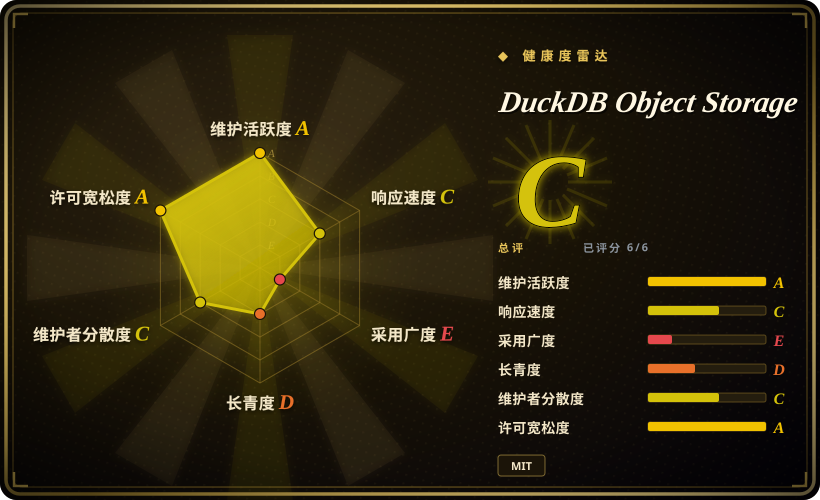
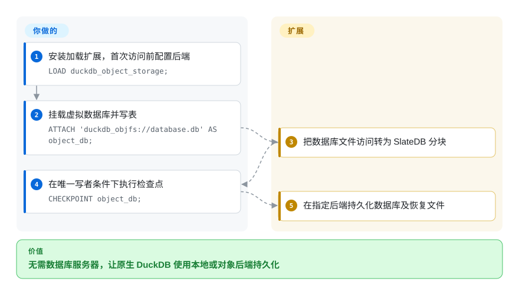
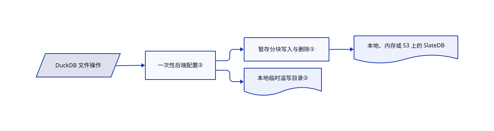

# DuckDB Object Storage

你不只要读取桶里的 Parquet，还要把 DuckDB 数据库本身持久化到对象存储。这个扩展用 SlateDB 虚拟文件系统承接数据库和恢复文件，临时溢写仍留在本地。

## 何时使用

你负责一个分析写入进程，要通过 `duckdb_objfs://` 保存原生 DuckDB 数据库，后端可以是本地、内存或兼容 S3 的对象存储。你能协调唯一写入者，也能接受跨进程读取延迟。需要数据库本身及恢复文件进入后端时，选它而不是普通远程文件查询；要目录服务和可互操作的分析数据文件时，应评估 DuckLake，而不是虚拟化原生数据库字节。

## 何时不用

- **多个进程必须同时写。** 用带合适共享目录的 DuckLake，或服务端 [ClickHouse](clickhouse.zh.md)。本扩展没有文件锁，第二个写入者会隔离掉前者，让其后续刷写、检查点报错。
- **只查远程 Parquet 或 CSV。** 直接用 [DuckDB](duckdb.zh.md) 远程文件支持，不必多加一层日志结构存储。
- **读进程必须立即看到另一进程提交。** 用 [ClickHouse](clickhouse.zh.md) 等共享数据库服务，或把读留在写入进程。缓存的只读 SlateDB 读取器约每十秒跟进清单，重新挂载也会复用缓存。
- **内存上限必须自动覆盖所有缓存。** 优先普通本地 [DuckDB](duckdb.zh.md)，或单独预算本扩展缓存。默认数据缓存 512 MiB、元数据缓存 128 MiB，不计入 DuckDB 缓冲区限制。

## 横向对比

| 替代品 | 是否收录 | 我们的评价 | 取舍 |
|---|---|---|---|
| [DuckDB](duckdb.zh.md) 本地库或远程 Parquet | ✅ | 本地持久化或直接查询远程文件够用时选原版；原生数据库文件必须进入对象后端时才加本扩展。 | 较少故障面，或接受额外原生、Rust 层换取远程持久化。 |
| DuckLake | 未收录 | 共享分析存储与目录服务选 DuckLake；外部协调单写者、保留原生文件语义时选本扩展。 | 存储模型不同，另需管理目录；真实仓库，本批不追加收录。 |
| [ClickHouse](clickhouse.zh.md) | ✅ | 多客户端共享分析服务选 ClickHouse；单进程嵌入 DuckDB、不想部署服务器时选本扩展。 | 服务运维与另一套引擎，或接受单写者和远程读可见性延迟。 |

## 快速上手

在兼容的 DuckDB 中运行 `INSTALL duckdb_object_storage FROM community;` 和 `LOAD duckdb_object_storage;`。首次使用前设置后端，本地默认写到 `.duckdb_objfs`。挂载 `duckdb_objfs://database.db`，建表、写入，再执行检查点。S3 路径需先安装加载 `cache_httpfs`，创建作用域匹配的 S3 凭据，并在挂载前设置后端、桶和可选前缀。扩展负责文件访问转换与恢复文件放置，你负责存储凭据、唯一写者、缓存预算和本地溢写目录。后端与缓存配置在首次访问时冻结，之后修改须重启数据库。

<!-- flow-steps:begin (generated from flows/duckdb-object-storage.json by tools/flow_card.py — do not edit) -->

流程文字版

1. **你**：安装加载扩展，首次访问前配置后端 — `LOAD duckdb_object_storage;`
2. **你**：挂载虚拟数据库并写表 — `ATTACH 'duckdb_objfs://database.db' AS object_db;`
3. **DuckDB Object Storage**：把数据库文件访问转为 SlateDB 分块
4. **你**：在唯一写者条件下执行检查点 — `CHECKPOINT object_db;`
5. **DuckDB Object Storage**：在指定后端持久化数据库及恢复文件

**价值**：无需数据库服务器，让原生 DuckDB 使用本地或对象后端持久化

<!-- flow-steps:end -->

## 技术要点

<!-- mechanism:begin (generated from mechanisms/duckdb-object-storage.json by tools/mechanism_card.py; do not edit) -->

机制文字版

- DuckDB 文件操作
- 一次性后端配置②
- 暂存分块写入与删除①
- 本地、内存或 S3 上的 SlateDB
- 本地临时溢写目录②

- DuckDB 文件操作 → 一次性后端配置②
- 一次性后端配置② → 暂存分块写入与删除①
- 暂存分块写入与删除① → 本地、内存或 S3 上的 SlateDB
- 一次性后端配置② → 本地临时溢写目录②

<!-- mechanism:end -->

### 1. 把随机文件写入暂存为分块批次

- **解决：** DuckDB 按字节偏移更新文件，不能直接对应不可变对象写入。
- **做法：** Rust 分块管理器按元数据记录的边界切分范围，读取时叠加待提交写入，把新增、删除放入 SlateDB 写批次。整块覆盖会跳过旧数据读取。
- **边界：** 部分写入可能读取旧块，存储合并和对象请求会增加放大开销。分块管理不等于分布式写者协调。
- **源码：** [分块读写与批次](https://github.com/dentiny/duckdb-object-storage/blob/f096ca13244cb586e04ce04417cadfdd5d18cc0c/rust/src/chunk_manager.rs#L37-L220)。

### 2. 冻结后端配置，溢写留在本地

- **解决：** 已有文件句柄后改存储配置，可能混用目标；分析溢写也不应变成持久化对象。
- **做法：** C++ 文件系统只初始化一次 Rust 后端，记录设置快照，并通过 C 接口转发操作。打开对象数据库前，若临时目录指向对象路径，就改为唯一的本地目录。
- **边界：** 后续线程设置不会扩缩已初始化运行时。数据库与恢复日志进入虚拟后端，扩展二进制、凭据和普通本地输出仍在后端之外。
- **源码：** [初始化、配置与溢写路由](https://github.com/dentiny/duckdb-object-storage/blob/f096ca13244cb586e04ce04417cadfdd5d18cc0c/src/slatedb_file_system.cpp#L78-L180)、[一致性与写者限制](https://github.com/dentiny/duckdb-object-storage/blob/f096ca13244cb586e04ce04417cadfdd5d18cc0c/README.md#L244-L298)。

## 技术栈

C++ DuckDB 扩展链接 Rust 静态库。Rust 使用 SlateDB 0.17、Tokio、OpenDAL 和 Protocol Buffers，缓存由 SlateDB 的 Foyer 适配器提供。CMake 同时驱动扩展构建和 Cargo。

## 依赖

- 版本匹配的 DuckDB 与扩展二进制；源码构建另需 CMake、C++、Rust，以及声明的 DuckDB、extension-ci-tools 子模块。
- 可写本地存储或兼容 S3 的桶，内存后端退出即丢失。
- S3 使用 DuckDB 凭据管理器，README 通过 `cache_httpfs` 注册 S3 凭据。远程持久化仍需要本地溢写空间。

## 运维难度

**持久化负载为中到高。** SQL 设置不长，但唯一写者协调、读可见性延迟、独立缓存预算和崩溃恢复测试都由你承担。没有托管控制面。未发版本标签和原生兼容性应作为部署约束，不能假设社区安装命令适用于每个 DuckDB 版本。

## 健康度与可持续性

- **2026-10-18：活跃小型扩展。** 创建于 2026-01-25，最近推送为 2026-10-12，没有 GitHub 发布。内部 Rust 包为 0.1.0，不是扩展兼容保证。
- **治理。** `dentiny` 主导，另有少量人工贡献和依赖更新。LICENSE 的基金会署名来自扩展模板，不能据此认定 DuckDB 基金会维护本项目。
- **年龄与林迪判断。** 约九个月仍不足以证明存储耐久性。SQL 测试包含检查点失败、只读访问、配置冻结和溢写，但有测试不等于恢复已被证明正确。
- **许可来源。** 根许可证与 DuckDB 的 MIT 扩展模板逐字节相同，比对树中只有六个文件重合，Rust 和 C++ 实现不同。Rust 清单也声明 MIT。

## 存疑（未验证）

- [未验证：禁止执行上游，未搭建对象存储] 未复现安装可用性、吞吐、崩溃耐久性与跨进程一致性。
- [推断：依据是模板比对与许可内容] 保留基金会声明表示模板来源，不表示赞助，也不是对每项贡献的独立法律认证。
- [未验证：未测试全部 DuckDB 版本] 原生扩展兼容性须按实际宿主版本和平台核对。
