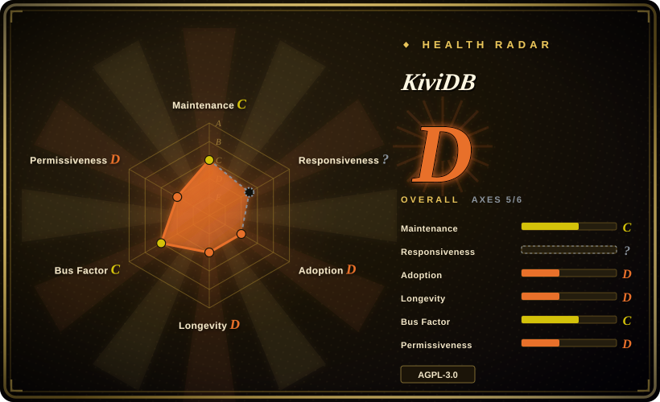
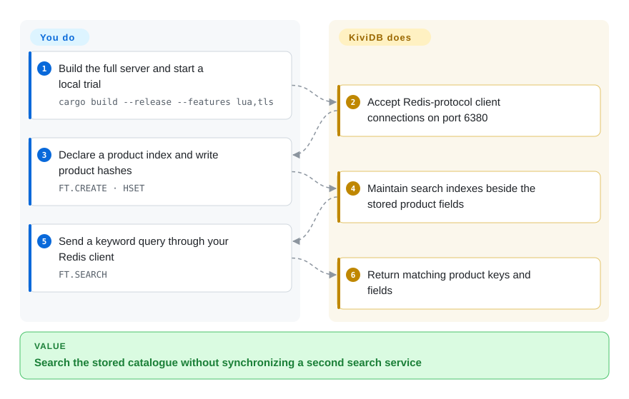
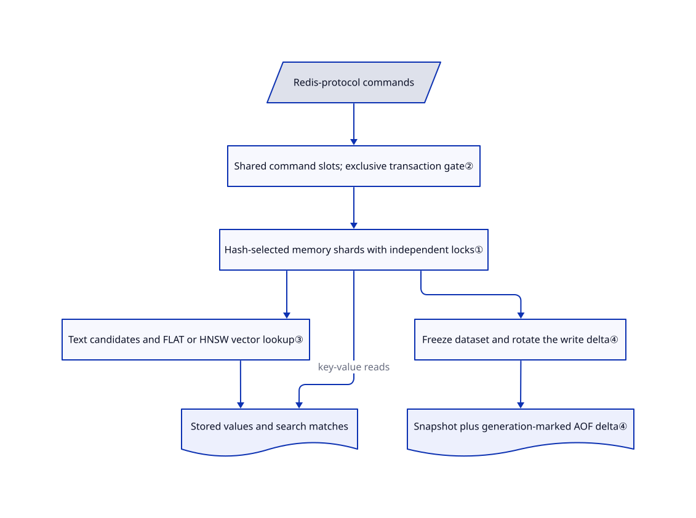

# KiviDB

Your Redis-backed catalogue needs keyword and vector searches, but you also want commands to use several CPU cores without splitting the application across servers. KiviDB combines those operations in one Rust server; its five-day public history makes compatibility testing part of the purchase price.

## When to use

You operate a Redis-client application whose product hashes now need both keyword filtering and nearest-vector lookup. Keeping a separate search copy means updating two stores whenever a product changes. Trial KiviDB beside Redis on port `6380`: declare an `FT.CREATE` index, keep writing hashes, and query the same server with `FT.SEARCH`. Its shared, lock-sharded memory store lets command workers use multiple cores; search needs no separate module or service.

Choose it over Valkey when built-in search and a Rust implementation matter more than BSD licensing and an established operational lineage. This is a pilot choice with a rollback path, not evidence that every Redis framework works unchanged. The [integration tracking issue](https://github.com/kividbio/kividb/issues/33) still requests proof for named AI frameworks.

## When NOT to use

- **You need an unqualified Redis drop-in today.** Use Redis for its own command and dump semantics, or [Valkey](valkey.md) for the established BSD fork. KiviDB documents remaining compatibility failures; its Redis-suite runner explicitly exits successfully even when tests fail. A green CI badge is therefore not full compatibility evidence.
- **Your policy forbids AGPL or vendor-controlled relicensing.** Choose [Valkey](valkey.md). KiviDB uses AGPL-3.0-only plus a commercial offer; contributions require a CLA granting commercial relicensing rights. A separate network client is not the same as distributing or modifying the server; review your actual usage rather than assuming all application code becomes AGPL.
- **The dataset no longer fits in RAM.** Choose [PikiwiDB](pikiwidb.md) for a RocksDB-backed Redis-protocol store. KiviDB snapshots and its write log support recovery; they do not make the working dataset disk-backed.
- **Each acknowledged write must be synchronously durable.** Prefer Redis with an appropriate `appendfsync always` policy and verify failure behavior. KiviDB's current docs say only `everysec` is implemented; `always` and `no` are accepted with warnings but have no effect. Acknowledgement follows queueing, not disk sync.
- **Your reason is only a headline throughput multiple.** Benchmark Dragonfly and Redis on your command mix. KiviDB's own table has Dragonfly ahead on non-pipelined GET/SET and reports higher vector memory usage for KiviDB. Pipelined tiny-value results do not settle your workload.

## Comparison

| Alternative | In index | Our verdict | Tradeoff |
|---|---|---|---|
| [Valkey](valkey.md) | ✅ | Choose Valkey for conservative cache migration where BSD licensing and multi-vendor governance decide; trial KiviDB when integrated search justifies a new implementation. | Valkey carries the Redis lineage and separate search-module ecosystem; KiviDB bundles search but adds AGPL and a very short public track record. |
| [Redis](https://github.com/redis/redis) | not indexed | Choose Redis when exact query, persistence and client behavior outweigh replacing its implementation; choose KiviDB only after replaying your application's commands and recovery scenarios. | Redis 8 offers a built-in query engine under AGPL/RSAL/SSPL choices; KiviDB offers a Rust multi-core implementation, not semantic identity. Redis is not added in this tab batch. |
| [Dragonfly](https://github.com/dragonflydb/dragonfly) | not indexed | Benchmark Dragonfly for vertical multi-core cache scaling; prefer KiviDB if AGPL's obligations fit but Dragonfly's BSL service restrictions do not. | Dragonfly assigns shards to owner threads; KiviDB shares lock-protected shards. Neither architecture proves a universal winner. Dragonfly is not added in this tab batch. |
| [PikiwiDB](pikiwidb.md) | ✅ | Choose PikiwiDB when RAM cost blocks capacity; choose KiviDB when data fits in memory and integrated keyword/vector search is the task. | PikiwiDB adds SSD and compaction work; KiviDB keeps the memory capacity ceiling and requires validation of newer recovery machinery. |

Evidence: [Redis README](https://github.com/redis/redis#readme), [Redis licensing](https://github.com/redis/redis/blob/unstable/LICENSE.txt), [Dragonfly architecture](https://github.com/dragonflydb/dragonfly#design-decisions), [Dragonfly license](https://github.com/dragonflydb/dragonfly/blob/main/LICENSE.md). Existing index pages supply Valkey and PikiwiDB scope.

## Quick start

Use the reviewed [source snapshot](https://github.com/kividbio/kividb/tree/5b7addee851c6f04a4c0728b466d363a6eec2118) with stable Rust; the documented full build is `cargo build --release --features lua,tls`, then `./target/release/kividb`. Bind to loopback for a local trial, keep remote access behind authentication, and connect your Redis client to port `6380`. Follow the [catalogue test](https://github.com/kividbio/kividb/blob/5b7addee851c6f04a4c0728b466d363a6eec2118/tests/e2e/modules/test_fulltext_search.py#L94-L140): create an index over hash fields, write products with `HSET`, and send `FT.SEARCH` queries; for vectors, supply embeddings as binary arrays yourself. KiviDB maintains indexes and returns matches; you own embedding generation, memory sizing, persistence, backup drills and client compatibility tests. The latest published release is still `v1.1.0`; its binaries need not contain every fix described by current master.

<!-- flow-steps:begin (generated from flows/kividb.json by tools/flow_card.py — do not edit) -->

Text version of the flow

1. **You**: Build the full server and start a local trial — `cargo build --release --features lua,tls`
2. **KiviDB**: Accept Redis-protocol client connections on port 6380
3. **You**: Declare a product index and write product hashes — `FT.CREATE · HSET`
4. **KiviDB**: Maintain search indexes beside the stored product fields
5. **You**: Send a keyword query through your Redis client — `FT.SEARCH`
6. **KiviDB**: Return matching product keys and fields

**Value**: Search the stored catalogue without synchronizing a second search service

<!-- flow-steps:end -->

## Key techniques

<!-- mechanism:begin (generated from mechanisms/kividb.json by tools/mechanism_card.py; do not edit) -->

Text version of the mechanism

- Redis-protocol commands
- Shared command slots; exclusive transaction gate②
- Hash-selected memory shards with independent locks①
- Text candidates and FLAT or HNSW vector lookup③
- Stored values and search matches
- Freeze dataset and rotate the write delta④
- Snapshot plus generation-marked AOF delta④

- Redis-protocol commands → Shared command slots; exclusive transaction gate②
- Shared command slots; exclusive transaction gate② → Hash-selected memory shards with independent locks①
- Hash-selected memory shards with independent locks① → Text candidates and FLAT or HNSW vector lookup③
- Hash-selected memory shards with independent locks① → Stored values and search matches (key-value reads)
- Text candidates and FLAT or HNSW vector lookup③ → Stored values and search matches
- Hash-selected memory shards with independent locks① → Freeze dataset and rotate the write delta④
- Freeze dataset and rotate the write delta④ → Snapshot plus generation-marked AOF delta④

<!-- mechanism:end -->

### 1. Share memory through independently locked shards

- **Problem:** One global map lock would make extra command threads wait on the same bottleneck.
- **How:** Key hashing selects a power-of-two shard; the target count is eight shards per available CPU core. Each shard holds a read/write-locked hash map, and expiry uses the same shard index. An atomic expiry count avoids locking an empty expiry shard.
- **Limits:** This is shared-memory sharding, not Dragonfly's shared-nothing thread ownership. A hot key still reaches one shard; the source does not establish linear scaling for arbitrary workloads.
- **Source:** [Shard selection and expiry cells](https://github.com/kividbio/kividb/blob/5b7addee851c6f04a4c0728b466d363a6eec2118/src/store/mod.rs#L12-L179).

### 2. Use a separate gate for transactions and scripts

- **Problem:** Concurrent commands could observe half a transfer even when individual shard operations lock correctly.
- **How:** Ordinary commands acquire a shared gate slot assigned to their thread. `EXEC` and unrestricted scripts take the gate exclusively across active slots, preventing interleaving; eligible quick, single-tag scripts can use narrower tag locking.
- **Limits:** A slow exclusive transaction or script delays other clients. Multi-core execution does not promise all scripts run concurrently, and this gate is distinct from snapshot write coordination.
- **Source:** [Gate implementation](https://github.com/kividbio/kividb/blob/5b7addee851c6f04a4c0728b466d363a6eec2118/src/command_gate.rs#L1-L60), [shared and exclusive entry](https://github.com/kividbio/kividb/blob/5b7addee851c6f04a4c0728b466d363a6eec2118/src/command_gate.rs#L191-L330), [script boundary](https://github.com/kividbio/kividb/blob/5b7addee851c6f04a4c0728b466d363a6eec2118/docs/EXEC_ATOMICITY.md#L8-L37).

### 3. Keep search beside the stored hashes

- **Problem:** Keyword and nearest-vector lookup otherwise require a second service and write path.
- **How:** Text lookup uses an inverted index—a map from words to candidate document keys—and checks current documents before BM25 relevance ranking. Unfiltered vector queries dispatch to FLAT exhaustive search or HNSW graph search; filtered queries first find allowed keys and then run exact nearest-neighbor selection.
- **Limits:** Not every query takes the approximate graph path. Filtered vector searches and fuzzy text queries can scan more data; an HNSW-only benchmark does not price those paths.
- **Source:** [Text candidates and ranking](https://github.com/kividbio/kividb/blob/5b7addee851c6f04a4c0728b466d363a6eec2118/src/commands/search.rs#L649-L744), [vector dispatch and filtered path](https://github.com/kividbio/kividb/blob/5b7addee851c6f04a4c0728b466d363a6eec2118/src/commands/search.rs#L1220-L1259).

### 4. Pair checkpoints with generation-marked write deltas

- **Problem:** A crash between snapshot replacement and log rotation can omit a write or replay it twice.
- **How:** Current master freezes the dataset while writes are held and turns the AOF—the append-only write log—into a new delta tagged with a save generation. It writes the snapshot afterward, keeps the previous log during the transition, and records a generation plus snapshot fingerprint before replacing the snapshot.
- **Limits:** Queueing a record is not durable acknowledgement; only one-second syncing is documented. The README's claim that an AOF replaces snapshot loading conflicts with current persistence docs and source, which use snapshot plus delta. Do not copy recovery files independently across checkpoints.
- **Source:** [Checkpoint implementation](https://github.com/kividbio/kividb/blob/5b7addee851c6f04a4c0728b466d363a6eec2118/src/aof.rs#L574-L752), [recovery and policy](https://github.com/kividbio/kividb/blob/5b7addee851c6f04a4c0728b466d363a6eec2118/docs/PERSISTENCE.md#L15-L85), [acknowledgement limitation](https://github.com/kividbio/kividb/blob/5b7addee851c6f04a4c0728b466d363a6eec2118/docs/PERSISTENCE.md#L226-L232).

## Tech stack

- Rust 2024 edition; Tokio plus Linux-only `tokio-uring` handle networking. `parking_lot`, `ahash` and `compact_str` support shared storage.
- Built-in text/vector indexes; native `dump.kdb` snapshots and optional AOF persistence. No external database.
- Optional vendored Lua 5.4 through `mlua`; optional TLS through Rustls. The default build includes neither Lua nor the TLS listener. [Manifest](https://github.com/kividbio/kividb/blob/5b7addee851c6f04a4c0728b466d363a6eec2118/Cargo.toml).

## Dependencies

- RAM for data, indexes and headroom; writable local storage for recovery files. Provide a Redis client and, for semantic search, an embedding producer.
- Source builds need stable Rust; the README identifies Rust 1.89 as the oldest checked toolchain. Linux uses io_uring when permitted; other platforms and restricted Linux environments use Tokio.
- Replication and Cluster are implemented here, not supplied as a managed availability service. You operate extra nodes and the cluster bus.
- Release builds check GitHub for updates by default. `--update-check no` or `KIVIDB_NO_UPDATE_CHECK=1` disables that egress; the [request code](https://github.com/kividbio/kividb/blob/5b7addee851c6f04a4c0728b466d363a6eec2118/src/update_check.rs#L23-L64) and [request payload](https://github.com/kividbio/kividb/blob/5b7addee851c6f04a4c0728b466d363a6eec2118/src/update_check.rs#L179-L183) show a version-bearing user agent, not stored keys.

## Ops difficulty

**Medium for evaluation; high for a critical migration.** A process is easy to start, but you must qualify command semantics, restart behavior and upgrades against a rapidly changing implementation. Current docs accept Redis `save` directives with a no-effect warning: schedule `BGSAVE` externally or configure AOF instead of assuming Redis's snapshot schedule carries over. Default Docker startup disables protected mode, and the default image omits Lua/TLS: never publish it unauthenticated, and select the variant explicitly. Docker may block io_uring; accept Tokio unless security review approves changing container policy.

## Health & viability

- **Verdict, 2026-10-21:** [推断：based on five days of public history and ongoing compatibility fixes] suitable for a controlled pilot, not a conservative replacement for critical Redis. The repository was created on 2026-10-16 and remains active; age × activity gives almost no positive Lindy evidence yet.
- **Maintenance:** latest release `v1.1.0` dates to 2026-10-16. Master changed on 2026-10-21; the [1.1.1 checklist](https://github.com/kividbio/kividb/issues/40) remains open. [Expired-field recovery](https://github.com/kividbio/kividb/pull/48) was fixed after the release. Separate reviewed-source from packaged behavior.
- **Governance:** organization-owned, copyright KIVIDB PRIVATE LIMITED, with an AGPL/commercial offer. Contributor API results show five humans, dominated by `murtazayusuf` with 78 of 94 human contributions; this does not establish a broad maintainer bench or long company track record.
- **Adoption and safety posture:** 368 stars and 14 forks are early attention, not deployment proof. The [security policy](https://github.com/kividbio/kividb/blob/5b7addee851c6f04a4c0728b466d363a6eec2118/SECURITY.md) contains response-time placeholders; the [CLA](https://github.com/kividbio/kividb/blob/5b7addee851c6f04a4c0728b466d363a6eec2118/CLA.md#L1-L6) labels itself an unreviewed template.
- **Compatibility:** [the Redis-suite report](https://github.com/kividbio/kividb/blob/5b7addee851c6f04a4c0728b466d363a6eec2118/docs/REDIS_TEST_SUITE.md#L26-L59) describes incomplete coverage, skipped replication/cluster/persistence tests, and a measurement job that exits zero regardless of failures. Historical failure counts are not a current compatibility percentage.

## Caveats (unverified)

- [未验证：upstream execution was excluded from this intake] No server, benchmark, framework integration or crash-recovery test was run. Throughput claims remain author measurements, not independently reproduced results.
- [推断：five-day public history, concentrated contributions and continuing semantic fixes] The pilot-only recommendation is a risk judgment, not proof of production failure or a prediction of abandonment.
- [未验证：no deployment references or financial records were established from the reviewed repository/API] Production adoption, support capacity and long-term funding are not established by stars, binaries or organization ownership.
