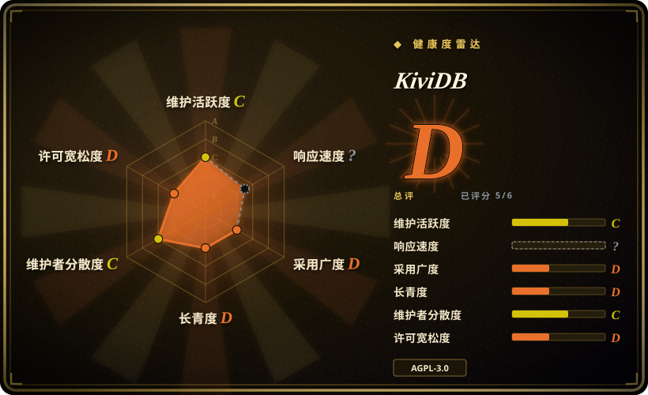
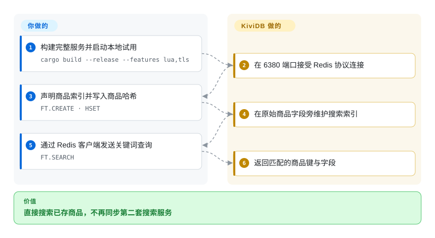
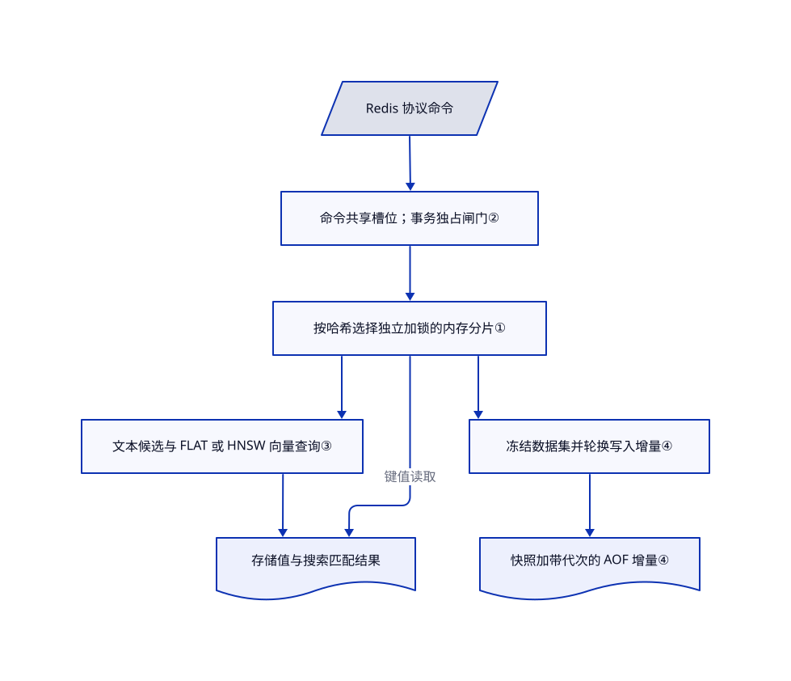

# KiviDB

商品已经存进 Redis，关键词和向量检索却还得同步另一份数据。KiviDB 用一个 Rust 服务处理存储与检索，并让命令利用多个核心；但它公开仅五天，兼容性验证不能省。

## 何时使用

你维护一个使用 Redis 客户端的商品服务。商品哈希现在既要按关键词筛选，也要查相近向量；每次修改商品，都得同步第二套搜索存储。你可以在 `6380` 端口旁路试用 KiviDB：用 `FT.CREATE` 声明索引，继续写哈希，再用 `FT.SEARCH` 查同一服务。它通过带锁的内存分片并发执行命令，搜索无需另起服务或加载模块。

当内置搜索和 Rust 实现，比 BSD 许可及成熟运维历史更重要时，才考虑用它替代 Valkey。这是带回退路径的试点，不等于所有 Redis 框架都能直接替换。[集成跟踪问题](https://github.com/kividbio/kividb/issues/33)仍在要求验证具名 AI 框架。

## 何时不用

- **今天就需要完全等价的 Redis 替代品。** 要原版命令与数据格式，选 Redis；要有既有代码血统的 BSD 分支，选 [Valkey](valkey.zh.md)。KiviDB 文档列出了兼容性失败项，而且 Redis 测试任务明确在测试失败时仍成功退出。上游 CI 全绿不代表完全兼容。
- **政策禁止 AGPL，或不能接受厂商控制再许可。** 选 [Valkey](valkey.zh.md)。KiviDB 采用 AGPL-3.0-only，并提供商业许可；贡献者须签署允许商业再许可的 CLA。独立客户端通过网络访问，与分发或修改服务端不是一回事，不能直接推成“整个应用都要开源”。
- **全量数据已经装不进内存。** 选用 RocksDB 落盘的 [PikiwiDB](pikiwidb.zh.md)。KiviDB 的快照和写入日志用于恢复，不会把工作数据集变成磁盘数据库。
- **每条已确认写入都必须同步持久化。** 优先评估 Redis 的 `appendfsync always` 策略，并测试故障行为。KiviDB 当前文档只承诺实现 `everysec`；`always` 和 `no` 虽能配置，却只报警告而不生效。写入入队不等于同步落盘。
- **迁移理由只有跑分标题。** 先用自己的命令组合比较 Dragonfly 与 Redis。KiviDB 自己的表格中，无流水线 GET／SET 是 Dragonfly 更快，向量内存也是 KiviDB 更多。小值批量请求的倍数不能代表你的负载。

## 横向对比

| 替代品 | 是否收录 | 我们的评价 | 取舍 |
|---|---|---|---|
| [Valkey](valkey.zh.md) | ✅ | 缓存迁移重视 BSD 许可和多厂商治理时选 Valkey；集成搜索值得承担新实现风险时，再试 KiviDB。 | Valkey 延续 Redis 代码血统，搜索走独立模块生态；KiviDB 集成搜索，但采用 AGPL，公开历史极短。 |
| [Redis](https://github.com/redis/redis) | 未收录 | 精确查询、持久化和客户端行为优先时选 Redis；只有回放过应用命令与恢复场景后，才考虑换成 KiviDB。 | Redis 8 内置查询引擎，可选 AGPL／RSAL／SSPL；KiviDB 换来 Rust 多核实现，不承诺语义相同。not added in this tab batch。 |
| [Dragonfly](https://github.com/dragonflydb/dragonfly) | 未收录 | 单机多核缓存扩容时应实测 Dragonfly；若能接受 AGPL，却不能接受 BSL 的服务限制，再优先考虑 KiviDB。 | Dragonfly 将分片交给所属线程；KiviDB 共享带锁分片。两种架构都不能证明任何负载下一定更快。not added in this tab batch。 |
| [PikiwiDB](pikiwidb.zh.md) | ✅ | 内存费用挡住容量扩展时选 PikiwiDB；数据装得进内存，而且需要集成关键词与向量检索时，才选 KiviDB。 | PikiwiDB 增加 SSD 与压缩整理运维；KiviDB 保留内存容量上限，较新的恢复机制也需要验证。 |

对比依据：[Redis 说明](https://github.com/redis/redis#readme)、[Redis 许可](https://github.com/redis/redis/blob/unstable/LICENSE.txt)、[Dragonfly 架构](https://github.com/dragonflydb/dragonfly#design-decisions)、[Dragonfly 许可](https://github.com/dragonflydb/dragonfly/blob/main/LICENSE.md)。Valkey 与 PikiwiDB 的边界来自已打开的索引页。

## 快速上手

使用已审阅的[源码快照](https://github.com/kividbio/kividb/tree/5b7addee851c6f04a4c0728b466d363a6eec2118)，准备稳定版 Rust；文档中的完整构建命令是 `cargo build --release --features lua,tls`，然后启动 `./target/release/kividb`。本地试用时绑定回环地址，远程访问先配置认证，再把 Redis 客户端指向 `6380`。照着[商品目录测试](https://github.com/kividbio/kividb/blob/5b7addee851c6f04a4c0728b466d363a6eec2118/tests/e2e/modules/test_fulltext_search.py#L94-L140)给哈希字段建索引，用 `HSET` 写商品，再调用 `FT.SEARCH`；向量搜索所需的嵌入数值和二进制编码由你提供。KiviDB 维护索引并返回匹配项；你负责生成嵌入、规划内存、配置持久化、演练备份，以及测试客户端兼容性。最新发布版本仍是 `v1.1.0`，不能假设其二进制已经包含当前主分支的所有修复。

<!-- flow-steps:begin (generated from flows/kividb.json by tools/flow_card.py — do not edit) -->

流程文字版

1. **你**：构建完整服务并启动本地试用 — `cargo build --release --features lua,tls`
2. **KiviDB**：在 6380 端口接受 Redis 协议连接
3. **你**：声明商品索引并写入商品哈希 — `FT.CREATE · HSET`
4. **KiviDB**：在原始商品字段旁维护搜索索引
5. **你**：通过 Redis 客户端发送关键词查询 — `FT.SEARCH`
6. **KiviDB**：返回匹配的商品键与字段

**价值**：直接搜索已存商品，不再同步第二套搜索服务

<!-- flow-steps:end -->

## 技术要点

<!-- mechanism:begin (generated from mechanisms/kividb.json by tools/mechanism_card.py; do not edit) -->

机制文字版

- Redis 协议命令
- 命令共享槽位；事务独占闸门②
- 按哈希选择独立加锁的内存分片①
- 文本候选与 FLAT 或 HNSW 向量查询③
- 存储值与搜索匹配结果
- 冻结数据集并轮换写入增量④
- 快照加带代次的 AOF 增量④

- Redis 协议命令 → 命令共享槽位；事务独占闸门②
- 命令共享槽位；事务独占闸门② → 按哈希选择独立加锁的内存分片①
- 按哈希选择独立加锁的内存分片① → 文本候选与 FLAT 或 HNSW 向量查询③
- 按哈希选择独立加锁的内存分片① → 存储值与搜索匹配结果（键值读取）
- 文本候选与 FLAT 或 HNSW 向量查询③ → 存储值与搜索匹配结果
- 按哈希选择独立加锁的内存分片① → 冻结数据集并轮换写入增量④
- 冻结数据集并轮换写入增量④ → 快照加带代次的 AOF 增量④

<!-- mechanism:end -->

### 1. 用独立锁分片共享内存

- **解决：** 全局映射只用一把锁，会让增加的命令线程继续互相等待。
- **做法：** 按键哈希选择二次幂数量的分片，目标数量是每个可用核心八片。每片都有自己的读写锁与哈希表，过期时间使用相同分片编号。原子计数允许命令跳过空过期分片的加锁。
- **边界：** 这是共享内存分片，不是 Dragonfly 的线程独占分片。热点键仍落入同一片；源码不能证明任意负载都能线性扩展。
- **源码：** [分片选择与过期单元](https://github.com/kividbio/kividb/blob/5b7addee851c6f04a4c0728b466d363a6eec2118/src/store/mod.rs#L12-L179)。

### 2. 事务与脚本另设执行闸门

- **解决：** 即便单片操作正确加锁，并发命令仍可能看到只完成一半的转账。
- **做法：** 普通命令获取分配给线程的共享闸门槽位。`EXEC` 和不限制键范围的脚本独占所有活跃槽位，避免其他命令穿插。已验证足够快、且只访问同一哈希标签的脚本，可以改用范围更小的标签锁。
- **边界：** 慢事务或独占脚本会拖住其他客户端。支持多核不等于所有脚本都能并行，事务闸门也不同于快照的写入协调。
- **源码：** [闸门实现](https://github.com/kividbio/kividb/blob/5b7addee851c6f04a4c0728b466d363a6eec2118/src/command_gate.rs#L1-L60)、[共享与独占入口](https://github.com/kividbio/kividb/blob/5b7addee851c6f04a4c0728b466d363a6eec2118/src/command_gate.rs#L191-L330)、[脚本边界](https://github.com/kividbio/kividb/blob/5b7addee851c6f04a4c0728b466d363a6eec2118/docs/EXEC_ATOMICITY.md#L8-L37)。

### 3. 在原始哈希旁维护搜索

- **解决：** 关键词与相近向量检索通常要增加第二个服务和第二条写入路径。
- **做法：** 文本查询通过倒排索引，即从词到候选文档键的映射，缩小范围；再检查当前文档，并用 BM25 计算相关性。无过滤的向量查询进入 FLAT 全量比较或 HNSW 图搜索；带过滤时先找出允许的键，再精确选最近向量。
- **边界：** 不是所有查询都走近似图搜索。带过滤的向量查询和模糊文本查询可能扫描更多数据，只测 HNSW 无法代表这些路径。
- **源码：** [文本候选与排序](https://github.com/kividbio/kividb/blob/5b7addee851c6f04a4c0728b466d363a6eec2118/src/commands/search.rs#L649-L744)、[向量分发与过滤路径](https://github.com/kividbio/kividb/blob/5b7addee851c6f04a4c0728b466d363a6eec2118/src/commands/search.rs#L1220-L1259)。

### 4. 用代次配对快照与增量日志

- **解决：** 替换快照和轮换日志之间崩溃，可能漏掉写入或重复回放。
- **做法：** 当前主分支先暂停写入，冻结数据集，并把 AOF，即只追加写入日志，轮换为带保存代次的新增量。随后继续写入并输出快照，过渡期保留旧日志；快照正式替换前，先落盘保存代次及快照指纹。
- **边界：** 日志记录入队不是持久化确认，文档只承诺每秒同步。README 称有 AOF 时不加载快照，但当前持久化文档与源码使用“快照加增量”。不能跨检查点分别拷贝恢复文件。
- **源码：** [检查点实现](https://github.com/kividbio/kividb/blob/5b7addee851c6f04a4c0728b466d363a6eec2118/src/aof.rs#L574-L752)、[恢复与策略](https://github.com/kividbio/kividb/blob/5b7addee851c6f04a4c0728b466d363a6eec2118/docs/PERSISTENCE.md#L15-L85)、[写入确认限制](https://github.com/kividbio/kividb/blob/5b7addee851c6f04a4c0728b466d363a6eec2118/docs/PERSISTENCE.md#L226-L232)。

## 技术栈

- Rust 2024 版，网络使用 Tokio 与仅限 Linux 的 `tokio-uring`。共享存储使用 `parking_lot`、`ahash`、`compact_str`。
- 内置文本和向量索引，原生 `dump.kdb` 快照，可选 AOF 持久化。不需要外部数据库。
- 可选 `mlua` 内嵌 Lua 5.4，可选 Rustls 加密连接。默认构建没有 Lua，也没有 TLS 监听器。见[依赖清单](https://github.com/kividbio/kividb/blob/5b7addee851c6f04a4c0728b466d363a6eec2118/Cargo.toml)。

## 依赖

- 内存要容纳数据、索引和运行余量，本地磁盘要能写入恢复文件。你还需提供 Redis 客户端；语义检索另需嵌入生成器。
- 源码构建需要稳定版 Rust，README 称最低验证版本为 Rust 1.89。Linux 获许可时可用 io_uring，其他平台及受限 Linux 环境使用 Tokio。
- 仓库实现了复制和集群，但不提供托管可用性服务。额外节点、集群总线和拓扑仍由你运维。
- 发布构建默认访问 GitHub 检查更新。用 `--update-check no` 或 `KIVIDB_NO_UPDATE_CHECK=1` 可关闭外联；[请求开关](https://github.com/kividbio/kividb/blob/5b7addee851c6f04a4c0728b466d363a6eec2118/src/update_check.rs#L23-L64)与[请求内容](https://github.com/kividbio/kividb/blob/5b7addee851c6f04a4c0728b466d363a6eec2118/src/update_check.rs#L179-L183)表明其发送版本用户代理，不发送存储键。

## 运维难度

**试用中等，关键迁移高。** 单进程易启动，但必须针对快速变化的实现，验证命令语义、重启恢复与升级。当前文档接受 Redis 的 `save` 配置却只报警告，不执行定时快照；应自行调度 `BGSAVE`，或配置 AOF。Docker 默认启动参数关闭保护模式，默认镜像还缺少 Lua／TLS，不能裸露到公网，构建变体也必须明确选择。Docker 可能阻止 io_uring；除非安全审查批准修改容器策略，否则接受 Tokio 路径即可。

## 健康度与可持续性

- **判断，截至 2026-10-21：** [推断：依据是五天公开历史和持续兼容性修复] 适合受控试点，还不能作为关键 Redis 部署的保守替代。仓库创建于 2026-10-16，仍活跃；年龄与持续活跃合看，尚未积累正面的林迪证据。
- **维护：** 最新发布的 `v1.1.0` 为 2026-10-16，主分支在 2026-10-21 更新，[1.1.1 清单](https://github.com/kividbio/kividb/issues/40)仍开放。例如[过期字段恢复问题](https://github.com/kividbio/kividb/pull/48)是在发布后修复，必须区分源码与已发布安装包。
- **治理：** 仓库由组织持有，版权归 KIVIDB PRIVATE LIMITED，提供 AGPL 与商业双许可。贡献者接口显示五名人类贡献者，其中 `murtazayusuf` 占人类贡献计数的 78／94；这些证据不能证明维护团队广泛，也不能证明厂商具有长期经营记录。
- **采用与安全流程：** 368 星、14 个分叉只是早期关注，不是部署证明。[安全政策](https://github.com/kividbio/kividb/blob/5b7addee851c6f04a4c0728b466d363a6eec2118/SECURITY.md)仍有响应时间占位符，[CLA](https://github.com/kividbio/kividb/blob/5b7addee851c6f04a4c0728b466d363a6eec2118/CLA.md#L1-L6)也自称未经律师审阅的模板。
- **兼容性：** [上游 Redis 测试说明](https://github.com/kividbio/kividb/blob/5b7addee851c6f04a4c0728b466d363a6eec2118/docs/REDIS_TEST_SUITE.md#L26-L59)明确存在覆盖缺口，跳过部分复制、集群和持久化测试，而且测量任务无论失败多少都返回零。历史失败数量不是当前兼容率。

## 存疑（未验证）

- [未验证：本次任务禁止执行上游代码] 未运行服务、基准、框架集成或崩溃恢复测试。吞吐量仍是作者测量，不是独立复现结果。
- [推断：依据是五天公开历史、贡献集中和持续语义修复] 仅建议试点是风险判断，不是生产故障证明，也不是项目必将停更的预测。
- [未验证：已读仓库与接口未建立部署引用或财务证据] 星数、发布二进制和组织所有权，不能证明生产采用规模、支持能力与厂商长期资金。
