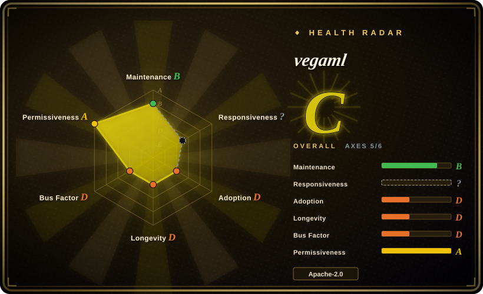
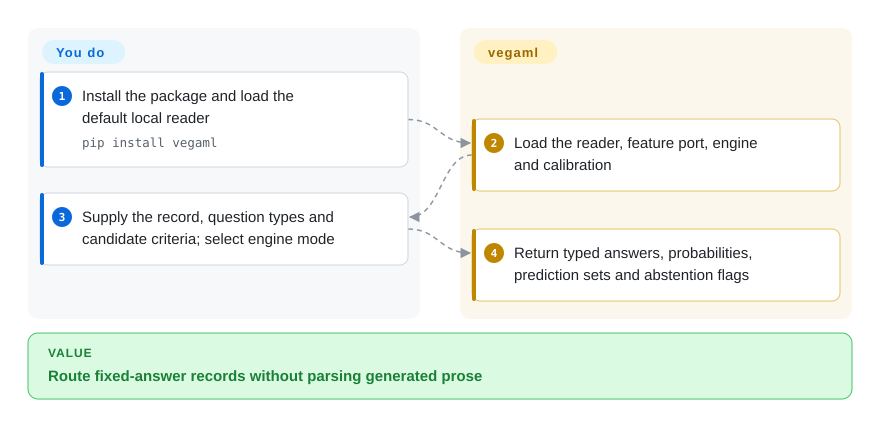
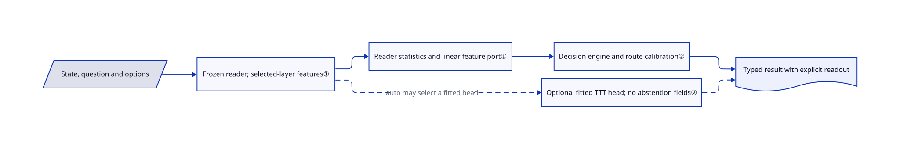

# vegaml

You only need to route an invoice to one of three teams, but a chat model writes a paragraph that your code must parse. vegaml reads the record with a frozen local model and returns predefined choices or scores, with an engine path that also reports uncertainty.

## When to use

You are building a local support router or document triage service. The output vocabulary is known, such as `billing`, `technical` and `sales`, and uncertain cases should go to a person. You want probabilities and an explicit abstention signal rather than generated JSON whose syntax is valid but confidence is opaque. Choose vegaml for this fixed-answer experiment; choose a grammar-constrained generator when you need arbitrary nested records or free text. You still supply the candidate definitions, local model capacity and held-out evaluation data.

## When NOT to use

- You need arbitrary JSON, summaries or tool arguments. Use [XGrammar](../llm-inference/structured-generation/xgrammar.md) with a generative model; vegaml selects from declared answer spaces rather than generating text.
- You have labelled examples and need an established few-shot text-classification baseline. Compare SetFit first; vegaml was created nine days before this verification and adds a novel decision engine, calibration and checkpoint surface to validate.
- You cannot host model weights or install PyTorch. Use a hosted structured-output API; the small decision engine still depends on a much larger frozen reader.
- Every answer must carry `prediction_set` and `abstain`. Explicitly use `mode="engine"` and validate its calibration; after fitting, default `auto` can route questions to a TTT head that omits those fields. Use an application-level review policy rather than assuming every typed answer is calibrated.
- A wrong probability would cause an irreversible action. Keep human review and evaluate on your own distribution; `calibrate` reports fitting-set calibration error and does not itself establish held-out risk guarantees.

## Comparison

| Alternative | In index | Our verdict | Tradeoff |
|---|---|---|---|
| [XGrammar](../llm-inference/structured-generation/xgrammar.md) | ✅ | Choose vegaml for finite choices with an uncertainty-aware engine; choose XGrammar when the task needs generated structures rather than classification. | No decoding loop in vegaml, but narrower answer types; XGrammar controls syntax, not confidence or semantic correctness. |
| SetFit | not indexed | Choose SetFit when labelled few-shot classification and an established baseline matter; try vegaml when questions and criteria must be supplied at inference time without task-specific fitting. | Different training and evaluation burden; SetFit is a real Hugging Face repository, not added in this tab batch. |
| [Kev](kev.md) | ✅ | Choose Kev when you want to fine-tune a decision adapter on your labels; choose vegaml when you want to keep the reader frozen and experiment with a separate decision engine. | Both require local weights and domain validation; adapter training and reader-specific feature ports impose different maintenance work. |
| [Laya](laya.md) | ✅ | Choose Laya when a smaller text encoder and a domain fine-tune fit your deployment; choose vegaml when its frozen-reader feature ports and explicit engine abstention are the mechanism you need to test. | Laya's encoder route is smaller, while vegaml's decision engine still pays for its larger reader. Neither project's confidence replaces held-out validation. |

## Quick start

Install `pip install vegaml` in an isolated Python environment and call `vegaml.load()` to load the default vega-U checkpoint and its 0.8B reader. Supply a string or dictionary as the state and a question map containing `type`, `instructions` and candidate `criteria`. Call `v.decide(state, questions, mode="engine")` and read the answer's choice, probabilities, prediction set and abstention flag. The library loads weights and runs local inference; you own the model downloads, memory budget, question definitions and the policy for rejected or uncertain cases. The default device preference is CUDA, then available MPS, then CPU; upstream calls MPS experimental.

<!-- flow-steps:begin (generated from flows/vegaml.json by tools/flow_card.py — do not edit) -->

Text version of the flow

1. **You**: Install the package and load the default local reader — `pip install vegaml`
2. **vegaml**: Load the reader, feature port, engine and calibration
3. **You**: Supply the record, question types and candidate criteria; select engine mode
4. **vegaml**: Return typed answers, probabilities, prediction sets and abstention flags

**Value**: Route fixed-answer records without parsing generated prose

<!-- flow-steps:end -->

## Key techniques

<!-- mechanism:begin (generated from mechanisms/vegaml.json by tools/mechanism_card.py; do not edit) -->

Text version of the mechanism

- State, question and options
- Frozen reader; selected-layer features①
- Reader statistics and linear feature port①
- Decision engine and route calibration②
- Optional fitted TTT head; no abstention fields②
- Typed result with explicit readout

- State, question and options → Frozen reader; selected-layer features①
- Frozen reader; selected-layer features① → Reader statistics and linear feature port①
- Reader statistics and linear feature port① → Decision engine and route calibration②
- Frozen reader; selected-layer features① → Optional fitted TTT head; no abstention fields② (auto may select a fitted head) [optional/fallback]
- Decision engine and route calibration② → Typed result with explicit readout
- Optional fitted TTT head; no abstention fields② → Typed result with explicit readout [optional/fallback]

<!-- mechanism:end -->

### 1. Reuse a decision engine behind reader-specific feature ports

- **Problem:** Different frozen readers produce different feature widths and statistics, so replacing a reader would otherwise change the decision engine's input space.
- **How:** Forward hooks capture selected model layers and stop after the deepest required layer. Universal checkpoints standardize these pooled features using reader-specific statistics and apply linear maps into the shared engine space; option and chunk features use the deepest layer's map.
- **Limits:** A reader needs a matching published port and calibration. Naming an arbitrary backbone is not automatic support for it, and avoiding token generation does not avoid the reader's memory or forward-pass cost.
- **Source:** [Frozen perception](https://github.com/NandhaKishorM/vegaml/blob/37012fb3ef583163df1b695394233e5ae14627b4/vegaml/_common.py#L329-L387), [universal port](https://github.com/NandhaKishorM/vegaml/blob/37012fb3ef583163df1b695394233e5ae14627b4/vegaml/_universal.py), [reader selection](https://github.com/NandhaKishorM/vegaml/blob/37012fb3ef583163df1b695394233e5ae14627b4/vegaml/hub.py#L125-L150).

### 2. Keep calibrated engine answers distinct from fitted heads

- **Problem:** A useful predicted label and a trustworthy confidence estimate are different requirements.
- **How:** The engine applies route-specific temperature scaling and stored conformal thresholds to produce probabilities, candidate sets, abstention and an out-of-distribution distance flag. Optional fitted TTT heads use cross-validation; `auto` selects one only when its measured accuracy beats chance and marks the selected readout.
- **Limits:** Beating chance does not mean beating the engine. TTT answers lack the engine's abstention fields, and missing checkpoint calibration leaves raw probabilities. Local recalibration fits temperature and a threshold on the same supplied examples; validate coverage independently on held-out traffic.
- **Source:** [Engine result and calibration](https://github.com/NandhaKishorM/vegaml/blob/37012fb3ef583163df1b695394233e5ae14627b4/vegaml/_api.py#L170-L267), [head selection](https://github.com/NandhaKishorM/vegaml/blob/37012fb3ef583163df1b695394233e5ae14627b4/vegaml/__init__.py#L169-L295), [local calibration fitting](https://github.com/NandhaKishorM/vegaml/blob/37012fb3ef583163df1b695394233e5ae14627b4/vegaml/calibrate.py#L163-L216).

## Tech stack

Python 3.10+, PyTorch, Transformers, NumPy, safetensors and Hugging Face Hub. Optional extras expose HTTP, MCP, Pydantic, vision, ONNX and MLX surfaces; an MLX engine extra does not imply a PyTorch-free frozen reader.

## Dependencies

The package declares `torch>=2.4` and `transformers>=5.17`. The default checkpoint comes from `nandakishorm/vega-U`; its model card declares Apache-2.0, while reader weights retain their own licences and access requirements. Alternative Gemma readers need Hub approval and a token. CPU is supported but memory and latency must be measured for the chosen reader and context length. Initial model acquisition requires network access unless weights are supplied locally.

## Ops difficulty

**Medium.** There is no database or mandatory server for the Python API, but model downloads, accelerator compatibility, memory use and calibration drift remain your responsibility. Pin the package, checkpoint revision and reader. Treat the optional server as an additional service to secure, not as production readiness supplied by the core library.

## Health & viability

- **2026-10-18:** Created 2026-10-09, active, not archived; PyPI and GitHub both publish v0.11.0. Three releases appeared on October 17. This is a rapidly changing beta, not an API with a long stability record.
- Contributions are led by `NandhaKishorM`, with several smaller contributors. The repository has tests, CI, examples and Apache-2.0 text; these are concrete maintenance assets, not evidence of production validation.
- At nine days old, age and activity do not supply a Lindy durability prior. The key adoption decision is whether you can independently validate typed answers, model costs and calibration, not its star count or author-run benchmark board.

## Caveats (unverified)

- [未验证：任务禁止运行上游代码或下载执行权重] Installation, model inference, device support, latency and memory requirements were not reproduced.
- [未验证：未运行作者评测] Published accuracy, context-length and calibration results are upstream reports; benchmark readers use different evaluation sample sizes, so their headline numbers are not a controlled comparison here.
- [未验证：没有本地业务标注数据] Calibration and prediction-set coverage on your traffic remain unmeasured; the fitting-set report does not establish them.
