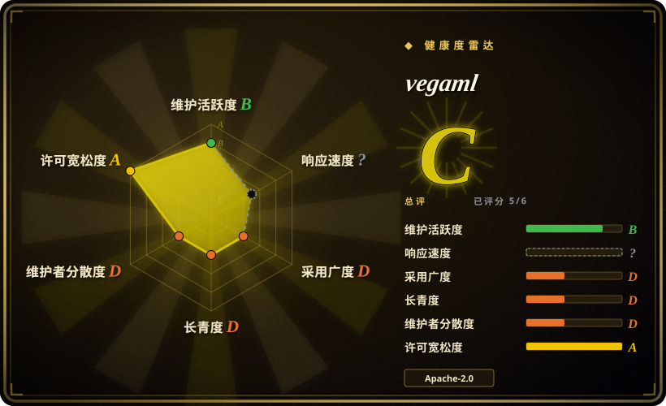
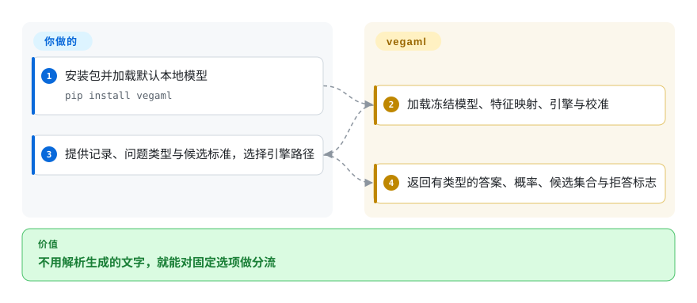

# vegaml

你只想把发票分给三个团队之一，聊天模型却写出一段解释，还得另写解析器。vegaml 用冻结的本地模型读材料，直接返回预先规定的选项或分数；其中引擎路径还会报告不确定性。

## 何时使用

你在做本地客服分流或文档初筛。答案已经限定为 `billing`、`technical`、`sales`，而不确定的记录要交给人。你需要概率和明确的拒答信号，而不只是语法合法、可信程度不明的 JSON。固定答案的实验选 vegaml；任意嵌套记录或自由文本则选受语法约束的生成器。候选项定义、本地模型算力与独立评估数据仍由你提供。

## 何时不用

- 要任意 JSON、摘要或工具参数，选 [XGrammar](../llm-inference/structured-generation/xgrammar.zh.md) 配合生成模型。vegaml 从既定答案空间选答案，不生成文本。
- 已有标注数据，希望先用成熟的小样本文本分类基线，先比较 SetFit。vegaml 在本次核验前九天才创建，还要验证新的决策引擎、校准和权重格式。
- 无法托管模型权重或安装 PyTorch，选托管结构化输出 API。小决策引擎背后仍有大得多的冻结模型。
- 每个答案都必须有 `prediction_set` 和 `abstain`，明确使用 `mode="engine"` 并验证校准。拟合后，默认 `auto` 会把部分问题送到缺少这些字段的 TTT 分类头。拒答政策应由应用明确制定，不能把有类型的答案一律当成已校准。
- 错误概率会触发不可逆操作，保留人工复核，并在自己的数据分布上评估。`calibrate` 报告的是拟合数据上的校准误差，本身不能证明独立数据上的风险保证。

## 横向对比

| 替代品 | 是否收录 | 我们的评价 | 取舍 |
|---|---|---|---|
| [XGrammar](../llm-inference/structured-generation/xgrammar.zh.md) | ✅ | 有限选项与不确定性引擎选 vegaml；要生成结构而不是分类，选 XGrammar。 | vegaml 没有逐词生成循环，但答案类型较窄；XGrammar 约束语法，不保证置信度或语义正确。 |
| SetFit | 未收录 | 有标注、重视成熟小样本基线，选 SetFit；想在推理时直接给问题和标准、先不做任务拟合，可试 vegaml。 | 训练和验证负担不同；SetFit 是 Hugging Face 的真实仓库，本次标签批次未收录。 |
| [Kev](kev.zh.md) | ✅ | 希望用自己的标注微调决策适配器，选 Kev；希望冻结底座、另测决策引擎，选 vegaml。 | 都需要本地权重与业务验证；适配器训练和底座专属特征映射带来不同的维护工作。 |
| [Laya](laya.zh.md) | ✅ | 希望用更小的文本编码器并做领域微调，选 Laya；要验证冻结模型特征映射与引擎明确拒答，选 vegaml。 | Laya 编码器更小；vegaml 的小引擎仍承担更大底座的成本，两者置信度都不能代替独立数据验证。 |

## 快速上手

在隔离的 Python 环境运行 `pip install vegaml`，调用 `vegaml.load()` 加载默认 vega-U 权重及其 0.8B 冻结模型。把字符串或字典作为状态，再提供包含 `type`、`instructions` 和候选 `criteria` 的问题映射。调用 `v.decide(state, questions, mode="engine")`，读取选项、概率、候选集合和拒答标志。库负责加载权重和本地推理；你负责模型下载、内存预算、问题定义，以及拒答和不确定记录的处置。默认优先 CUDA，其次是可用的 MPS，最后是 CPU；上游把 MPS 标为实验支持。

<!-- flow-steps:begin (generated from flows/vegaml.json by tools/flow_card.py — do not edit) -->

流程文字版

1. **你**：安装包并加载默认本地模型 — `pip install vegaml`
2. **vegaml**：加载冻结模型、特征映射、引擎与校准
3. **你**：提供记录、问题类型与候选标准，选择引擎路径
4. **vegaml**：返回有类型的答案、概率、候选集合与拒答标志

**价值**：不用解析生成的文字，就能对固定选项做分流

<!-- flow-steps:end -->

## 技术要点

<!-- mechanism:begin (generated from mechanisms/vegaml.json by tools/mechanism_card.py; do not edit) -->

机制文字版

- 记录、问题与候选项
- 冻结模型；指定层特征①
- 模型统计量与线性特征映射①
- 决策引擎与路由校准②
- 可选 TTT 分类头；没有拒答字段②
- 标明实际路径的有类型结果

- 记录、问题与候选项 → 冻结模型；指定层特征①
- 冻结模型；指定层特征① → 模型统计量与线性特征映射①
- 模型统计量与线性特征映射① → 决策引擎与路由校准②
- 冻结模型；指定层特征① → 可选 TTT 分类头；没有拒答字段②（自动模式可能选择已拟合分类头）〔可选／兜底〕
- 决策引擎与路由校准② → 标明实际路径的有类型结果
- 可选 TTT 分类头；没有拒答字段② → 标明实际路径的有类型结果〔可选／兜底〕

<!-- mechanism:end -->

### 1. 用模型专属特征接口复用决策引擎

- **解决：** 不同冻结模型的特征宽度和分布不同，直接换模型会改变决策引擎的输入空间。
- **做法：** 前向钩子捕获指定层，并在最深的所需层结束计算。通用权重先用该模型的统计量标准化特征，再通过线性映射进入共享空间；选项与分块特征使用最深层的映射。
- **边界：** 每种模型都需要匹配的已发布接口权重和校准。随便指定模型名称并不代表支持；省掉文本生成，也没有省掉模型内存和前向计算。
- **源码：** [冻结特征提取](https://github.com/NandhaKishorM/vegaml/blob/37012fb3ef583163df1b695394233e5ae14627b4/vegaml/_common.py#L329-L387)、[通用映射](https://github.com/NandhaKishorM/vegaml/blob/37012fb3ef583163df1b695394233e5ae14627b4/vegaml/_universal.py)、[模型选择](https://github.com/NandhaKishorM/vegaml/blob/37012fb3ef583163df1b695394233e5ae14627b4/vegaml/hub.py#L125-L150)。

### 2. 区分已校准引擎与拟合分类头

- **解决：** 预测标签有用，与置信度值得相信，是两项不同要求。
- **做法：** 引擎按路由应用温度缩放和已存储的保形阈值，输出概率、候选集合、拒答，以及距离异常标志。可选的 TTT 分类头经过交叉验证；`auto` 只选测得准确率超过随机基线的分类头，并标记实际路径。
- **边界：** 超过随机基线不代表超过原引擎。TTT 答案缺少引擎的拒答字段，权重缺少校准时返回原始概率。本地再校准用同一批样例拟合温度和阈值，覆盖率必须在独立数据上验证。
- **源码：** [引擎结果与校准](https://github.com/NandhaKishorM/vegaml/blob/37012fb3ef583163df1b695394233e5ae14627b4/vegaml/_api.py#L170-L267)、[分类头选择](https://github.com/NandhaKishorM/vegaml/blob/37012fb3ef583163df1b695394233e5ae14627b4/vegaml/__init__.py#L169-L295)、[本地校准拟合](https://github.com/NandhaKishorM/vegaml/blob/37012fb3ef583163df1b695394233e5ae14627b4/vegaml/calibrate.py#L163-L216)。

## 技术栈

Python 3.10+、PyTorch、Transformers、NumPy、safetensors 与 Hugging Face Hub。可选扩展提供 HTTP、MCP、Pydantic、图像、ONNX 和 MLX 接口；存在 MLX 决策引擎扩展，不代表冻结模型也不需要 PyTorch。

## 依赖

包声明 `torch>=2.4` 与 `transformers>=5.17`。默认权重来自 `nandakishorm/vega-U`，模型卡声明 Apache-2.0；冻结模型仍受各自许可和访问要求约束。Gemma 选项需要在 Hub 接受许可并提供令牌。支持 CPU，但应按模型和上下文长度实测内存与延迟。除非已提供本地权重，首次获取模型需要网络。

## 运维难度

**中。** Python API 不要求数据库或独立服务，但模型下载、加速器兼容、内存和校准漂移仍由你管理。固定包版本、权重修订和冻结模型。可选服务端需要额外部署和安全配置，不能把它的存在当作核心库已经可生产使用。

## 健康度与可持续性

- **截至 2026-10-18：** 仓库于 2026-10-09 创建，活跃且未归档，PyPI 与 GitHub 均发布 v0.11.0。10 月 17 日连续发布三版。这是快速变化的测试版，不是经过长期验证的稳定 API。
- 贡献以 `NandhaKishorM` 为主，也有少量其他贡献者。仓库有测试、CI、样例与 Apache-2.0 正文，这些是维护资产，不是生产验证证据。
- 只有九天历史，活跃度还不能构成长寿先验。选型关键是能否独立验证答案、模型成本和校准，而不是 star 或作者自己的评测图。

## 存疑（未验证）

- [未验证：任务禁止执行上游代码和权重] 安装、模型推理、设备支持、延迟和内存要求均未复现。
- [未验证：没有运行作者评测] 准确率、上下文长度和校准结果来自上游报告；各模型的评测样本数不同，不能把摘要数字当成本次受控对照。
- [未验证：没有本地业务标注数据] 实际流量上的概率校准与候选集合覆盖率尚未测量，拟合集报告不能证明这些指标。
