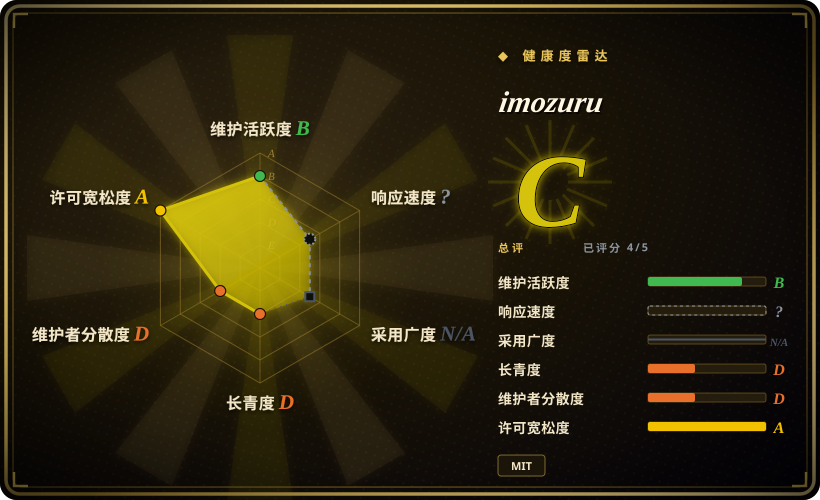
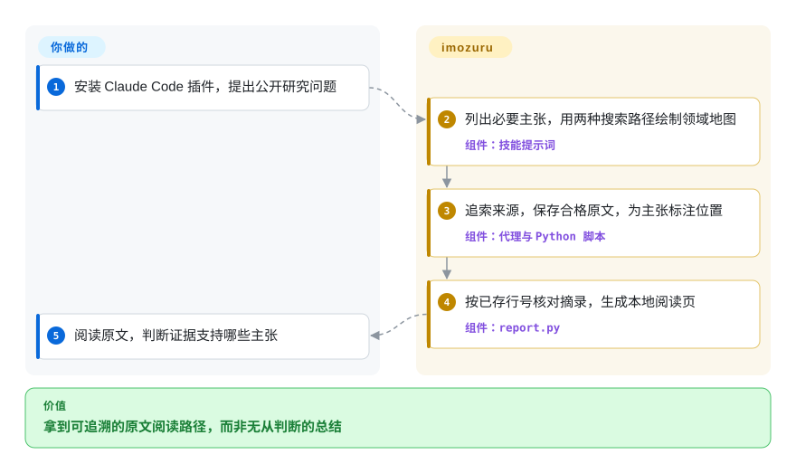
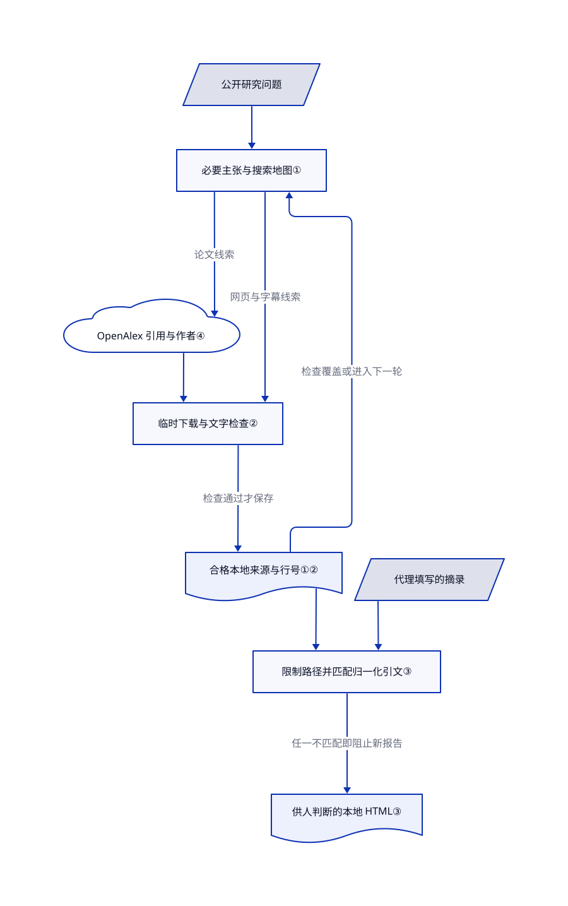

# imozuru

你搜到的解读总在引用别人的解读，却找不到支撑判断的原文。imozuru 沿引用和作者追索，保存资料，再按本地行号核对摘录，不替你先下结论。

## 何时使用

你正在补一个陌生技术或创作领域，搜索结果却总是那几篇入门文章。你还不知道行内术语、核心作者和资料聚集的地方。你已经使用 Claude Code，希望先找到这些线索，再追到具体判断背后的论文、亲历记录或视频字幕。imozuru 维护研究地图和逐轮日志，沿引用与作者查找，最后交付按主张排列的原文摘录页。

当你要自己读证据、自己判断，而不是让研究代理直接写结论时，选它。它的交付物是“主张对应哪个文件、哪几行”的阅读路径。代价是日文指令和页面标签、宿主模型与搜索费用，以及由你判断摘录是否真的支持主张。

## 何时不用

- **你要成稿结论或嵌入应用的研究接口。** 选 [GPT Researcher](gpt-researcher.zh.md)，它能写带引用的报告并提供 Python 接口；imozuru 默认停在摘录，只有另行要求才写总结。
- **问题涉及机密或个人资料。** 不要通过该技能发出：搜索词会离开本机。考虑 [Local Deep Research](local-deep-research.zh.md)，并明确配置本地推理、审计检索外发；自托管不等于公开网页查询不会泄密。
- **你要审查来源是否真正证明句子。** 选 [Hyperresearch](hyperresearch.zh.md) 的批评与引文检查流程。imozuru 只检查文字是否出现，不检查推论、译文或来源本身是否正确。
- **本地服务不能暴露给不可信网址。** 不要把它当沙箱。所读默认分支会先检查 DNS 地址，但没有把连接锁定到检查过的地址；截至 2026-10-23，[修复 PR #13](https://github.com/MaryCache/imozuru/pull/13) 仍未关闭。改用独立限制网络的抓取代理，或人工批准的公开来源清单。不要为了消掉报错就启用 `IMOZURU_ALLOW_PRIVATE=1`。
- **你必须读付费全文，或要经过英文请求验证的开箱流程。** 受限论文应走图书馆授权和人工阅读；该技能记录无法取得的来源，禁止绕过付费墙。英文报告生成优先看 GPT Researcher；上游只声称试过日文请求。

## 横向对比

| 替代品 | 是否收录 | 我们的评价 | 取舍 |
|---|---|---|---|
| [GPT Researcher](gpt-researcher.zh.md) | ✅ | 要成稿简报或可调用研究引擎，选 GPT Researcher；要保留原文、自己下结论，选 imozuru。 | 应用部署与服务商配置换来接口和报告导出；imozuru 借用 Claude Code 和本地文件，但不替你综合结论。 |
| [Hyperresearch](hyperresearch.zh.md) | ✅ | 高风险报告需要对抗式引文审查，选 Hyperresearch；需要可机械核对摘录文字的原文阅读路径，选 imozuru。 | 批评流程能质疑解释，但工作流更重；文字匹配较窄，不能证明摘录推出了主张。 |
| [Local Deep Research](local-deep-research.zh.md) | ✅ | 模型托管和检索外发必须自己控制，选 Local Deep Research；已经接受 Claude Code 和公开搜索，选 imozuru。 | 本地推理和可配置检索需要维护应用栈；复制技能更轻，却不能消除查询外发。 |

## 快速上手

上游插件安装路径是先运行 `/plugin marketplace add MaryCache/imozuru`，再运行 `/plugin install imozuru@imozuru`；也可手动把 `skills/imozuru/` 复制进 Claude Code 的技能目录。给宿主一个公开研究问题，例如 README 中追索 Gaussian Splatting 论文与解读的请求。你提供问题、批准必要工具权限、承担模型和搜索费用，并阅读结果；技能指导代理绘制领域地图、保存来源，再写 `extracts.json`。脚本只依赖 Python 3.10+ 标准库，但 PDF 文字需要 `pdftotext`，扫描件还需要 `pdftoppm`、Tesseract 和语言数据，字幕需要 `yt-dlp`，HTML 可选用 `ax`。核对后的摘录输出为 `~/research/<topic>/report.html`，旁边保留 `map.md`、`log.md` 和 `sources/`；可选 watch 模式只在请求时拉 RSS，不会安装定时任务。本页只核对安装与使用说明，没有执行安装或端到端研究。

<!-- flow-steps:begin (generated from flows/imozuru.json by tools/flow_card.py — do not edit) -->

流程文字版

1. **你**：安装 Claude Code 插件，提出公开研究问题
2. **imozuru**：列出必要主张，用两种搜索路径绘制领域地图 — 组件：`技能提示词`
3. **imozuru**：追索来源，保存合格原文，为主张标注位置 — 组件：`代理与 Python 脚本`
4. **imozuru**：按已存行号核对摘录，生成本地阅读页 — 组件：`report.py`
5. **你**：阅读原文，判断证据支持哪些主张

**价值**：拿到可追溯的原文阅读路径，而非无从判断的总结

<!-- flow-steps:end -->

## 技术要点

<!-- mechanism:begin (generated from mechanisms/imozuru.json by tools/mechanism_card.py; do not edit) -->

机制文字版

- 公开研究问题
- 必要主张与搜索地图①
- OpenAlex 引用与作者④
- 临时下载与文字检查②
- 合格本地来源与行号①②
- 代理填写的摘录
- 限制路径并匹配归一化引文③
- 供人判断的本地 HTML③

- 公开研究问题 → 必要主张与搜索地图①
- 必要主张与搜索地图① → OpenAlex 引用与作者④（论文线索）
- OpenAlex 引用与作者④ → 临时下载与文字检查②
- 必要主张与搜索地图① → 临时下载与文字检查②（网页与字幕线索）
- 临时下载与文字检查② → 合格本地来源与行号①②（检查通过才保存）
- 合格本地来源与行号①② → 必要主张与搜索地图①（检查覆盖或进入下一轮）
- 合格本地来源与行号①② → 限制路径并匹配归一化引文③
- 代理填写的摘录 → 限制路径并匹配归一化引文③
- 限制路径并匹配归一化引文③ → 供人判断的本地 HTML③（任一不匹配即阻止新报告）

<!-- mechanism:end -->

### 1. 依据主张覆盖率停搜，而非模型自信

- **解决：** 代理可能只收集容易找到的事实，就忽略原问题的关键条件而宣布完成。
- **做法：** 提示词要求列出 3–6 项必要主张，至少一项保留用户条件，过半必须读实质内容才能回答。两种搜索路径建图；主张配齐原文位置，或达到饱和、四轮、来源不可达、约定预算时停止，并记录缺口。
- **边界：** 这是宿主代理要遵守的指令，不是机器强制的状态引擎。已知来源达到七成的饱和阈值明确只是暂定值；匹配到文字也不能证明覆盖完整。
- **源码：** [主张构造与逐轮裁决](https://github.com/MaryCache/imozuru/blob/ecb82c71b611872a0f49e783eda3bec987c80d91/skills/imozuru/SKILL.md#L51-L123)。

### 2. 先验证下载，再替换已存原文

- **解决：** 登录墙、过短的提取结果或刷新失败，可能把有用原文覆盖成废内容。
- **做法：** 抓取器在目标目录内建立临时目录，下载并提取文字，检查长度和拦截页特征，再移动合格文件。HTTP 网址及重定向经过公网地址检查；PDF 转换有时间和页数上限，OCR 还要求足够识别置信度。
- **边界：** 长度检查可能误拒真实短文，也不能证明资料真实。所读提交仍存在 DNS 重绑定缺口；`IMOZURU_ALLOW_PRIVATE=1` 会取消地址过滤，外部字幕工具的连接也不等于网络沙箱。
- **源码：** [网址和重定向检查](https://github.com/MaryCache/imozuru/blob/ecb82c71b611872a0f49e783eda3bec987c80d91/skills/imozuru/scripts/fetch.py#L77-L206)、[暂存与正式保存](https://github.com/MaryCache/imozuru/blob/ecb82c71b611872a0f49e783eda3bec987c80d91/skills/imozuru/scripts/fetch.py#L695-L863)。

### 3. 摘录不匹配，就拒绝生成新报告

- **解决：** 流畅的改写可能冒充逐字引文，还附上虚构位置。
- **做法：** 渲染器把引用文件限制在该主题的来源目录，检查正数行号范围，再在前后两行余量内，按顺序匹配归一化空白后的引文片段。任一不匹配就先报错，不写新报告；合格文字经过 HTML 转义，页面内容策略禁止外部资源。
- **边界：** 这是归一化后的子串匹配，不是字节一致性或语义事实核查。省略号允许删节，译文不参与验证；重建失败会保留旧报告，读者不能把旧文件当成本次成功输出。
- **源码：** [引用路径校验与匹配](https://github.com/MaryCache/imozuru/blob/ecb82c71b611872a0f49e783eda3bec987c80d91/skills/imozuru/scripts/report.py#L35-L110)、[失败门禁与报告原子替换](https://github.com/MaryCache/imozuru/blob/ecb82c71b611872a0f49e783eda3bec987c80d91/skills/imozuru/scripts/report.py#L145-L206)。

### 4. 不熟悉术语，也能沿引用关系找论文

- **解决：** 不知道行内术语时，关键词搜索容易漏掉相关论文。
- **做法：** OpenAlex 辅助脚本解析 DOI、作品编号或标题，再查参考文献、引用它的论文或作者作品。输出按制表符分列，重定向限制在 OpenAlex 接口同源，终端控制字符会被清理。
- **边界：** 标题解析和作者姓名查询会选排名首项，必须人工消歧。新论文或不完整记录可能缺失关系。2026-10-23 的公开无凭证探测成功，但响应说明免费预算按出口 IP 共享，并非无限额度。
- **源码：** [接口传输与标题解析](https://github.com/MaryCache/imozuru/blob/ecb82c71b611872a0f49e783eda3bec987c80d91/skills/imozuru/scripts/chain.py#L25-L124)、[引用与作者遍历](https://github.com/MaryCache/imozuru/blob/ecb82c71b611872a0f49e783eda3bec987c80d91/skills/imozuru/scripts/chain.py#L153-L189)。

## 健康度与可持续性

- **维护，截至 2026-10-23：** 仓库创建于 2026-10-13，默认分支最近修改于 2026-10-21。没有标签或 GitHub release，插件元数据没有版本号，上游把 main 提交当版本。可复现使用应固定已审查提交。
- **治理：** 个人账号持有仓库，公开贡献者响应有六人；列出的 31 次提交中，MaryCache 占 26 次。目录树未出现治理、贡献指南、安全政策或持续集成工作流文件。已关闭议题 #11 中，作者和报告者描述了 OCR 修复及后续 Windows 测试；这是上游报告，不是本页实测。
- **年龄与采用：** 十天历史、1129 星和 50 个 fork 代表关注度，不代表长期存活或生产部署。尚无有意义的林迪证据。仓库有四个 Python 辅助脚本、五个测试模块和可供运行的摘录页示例，不只是提示词文章。
- **权利与风险：** MIT 实文署名 MaryCache。该许可证覆盖仓库，不覆盖下载的论文、博客和字幕：上游明确只供本地阅读，禁止再分发。公开来源抓取及提示注入仍需防范；PR #13 尚未合入本页所读源码。

## 存疑（未验证）

- [未验证：未安装或执行上游代码] 未复现研究质量、跨语言效果、实时 PDF 与字幕提取，以及完整 Claude Code 工作流。英文 README 明确只报告日文请求试用。
- [未验证：未进行独立受控研究] 引用的信息探索文献与作者试用，不能证明该流程提高研究完整性；七成饱和规则是上游承认的经验阈值。
- [未验证：公开资料未提供部署证据] 星数和 fork 不能证明生产采用、机构支持或长期维护承诺。
- [推断：依据源码的检查后连接流程，未做攻击复现] 网址过滤只能作为纵深防御，不能隔离恶意来源；已知 DNS 重绑定缺口及外部工具行为需要独立网络策略。
