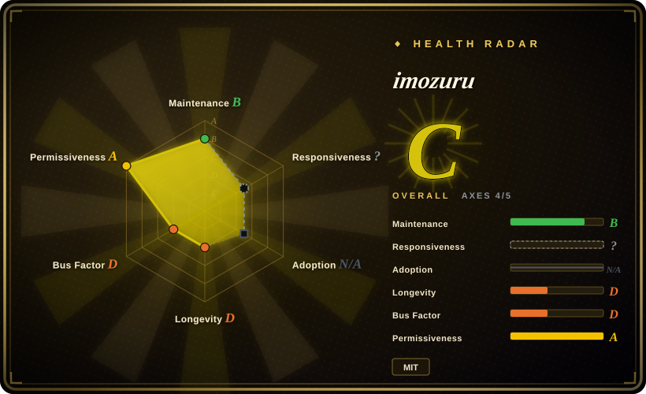
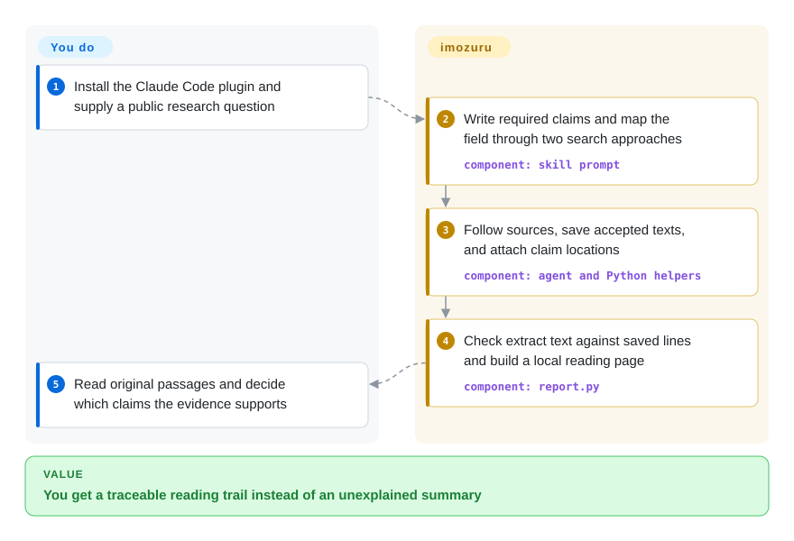
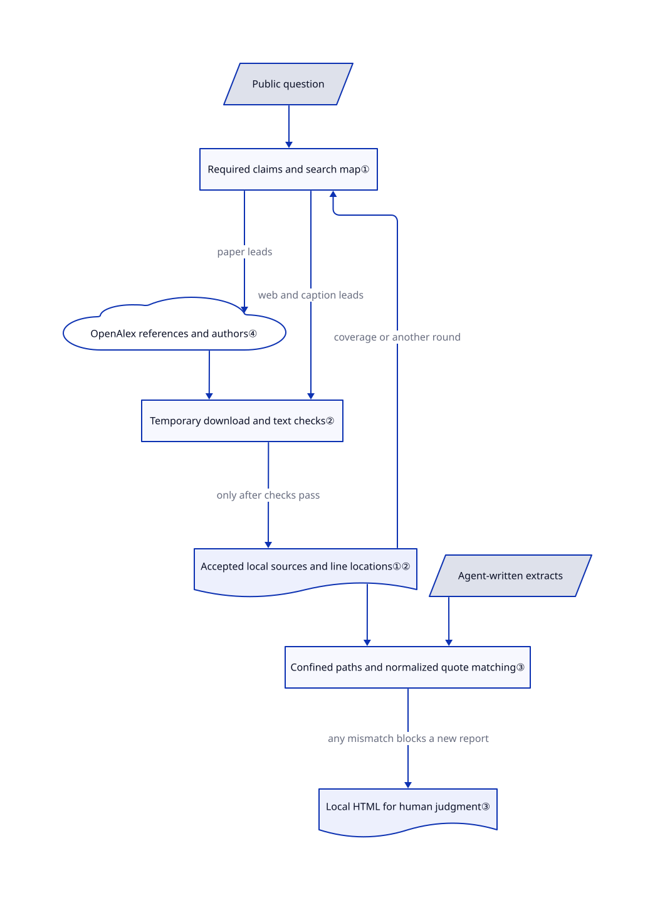

# imozuru

You keep finding explainers that cite other explainers, but cannot locate the passage behind a claim. imozuru follows references and authors, saves source texts, and checks quoted passages against local line numbers instead of writing the conclusion for you.

## When to use

You are learning an unfamiliar technical or creative field and your searches keep returning the same introductory posts. You do not yet know its vocabulary, central researchers, or useful publication venues. Inside Claude Code, you want a map of those terms and people, then the original papers, personal accounts, or video captions behind specific claims. imozuru keeps a research map and round log, follows citation and author links, and produces a local page of checked extracts.

Choose it over report-writing research agents when you want to read the evidence and decide for yourself. Its distinctive deliverable is a claim-to-file-and-line reading trail, not a synthesized recommendation. You accept Japanese instructions and report labels, Claude Code usage costs, and responsibility for judging whether a quotation actually supports the claim.

## When NOT to use

- **You need a written conclusion or an embedded research API.** Choose [GPT Researcher](../gpt-researcher.md), which writes cited reports and exposes a Python integration surface; imozuru deliberately stops at extracts unless asked to summarize later.
- **The question contains confidential or personal information.** Do not send it through this skill: its search terms leave the machine. Consider [Local Deep Research](../local-deep-research.md) with local inference and an explicitly audited retrieval configuration; self-hosting alone does not make public-web queries private.
- **You require adversarial checking of whether each source proves the sentence.** Choose [Hyperresearch](hyperresearch.md) for its critic and citation-checking workflow. imozuru checks textual occurrence, not entailment, translation accuracy, or the truth of the source.
- **You cannot expose local services to untrusted URLs.** Do not treat this as a sandbox. The reviewed default branch checks DNS results before connecting but explicitly does not pin the connection against DNS rebinding; [PR #13](https://github.com/MaryCache/imozuru/pull/13) remained open on 2026-10-23. Use a separately restricted fetch proxy or a manually approved public-source list instead. Never enable `IMOZURU_ALLOW_PRIVATE=1` merely to make an error disappear.
- **You need paywalled full texts or an English-tested turnkey workflow.** Use your library's authorized access and manual reading for restricted papers; this skill reports unreachable sources and forbids paywall circumvention. For English report generation, prefer GPT Researcher; the upstream README says requests have only been tried in Japanese.

## Comparison

| Alternative | In index | Our verdict | Tradeoff |
|---|---|---|---|
| [GPT Researcher](../gpt-researcher.md) | ✅ | Choose GPT Researcher when the deliverable is a composed brief or a callable research engine; choose imozuru when you want original passages without an agent deciding the conclusion. | An application and provider configuration buy integration and report export; imozuru reuses Claude Code and local files but leaves synthesis to you. |
| [Hyperresearch](hyperresearch.md) | ✅ | Choose Hyperresearch for a high-stakes report with adversarial citation review; choose imozuru for a source-reading trail whose quotation text is checked mechanically. | Critics can challenge interpretation, at the cost of a larger workflow; exact quotation matching is narrower and cannot establish that a claim follows. |
| [Local Deep Research](../local-deep-research.md) | ✅ | Choose Local Deep Research when controlling model hosting and retrieval configuration decides the choice; choose imozuru when you already accept Claude Code and public searches. | Local inference and configurable retrieval require an application stack; copying imozuru's skill is lighter but does not remove query egress. |

## Quick start

The upstream plugin route is `/plugin marketplace add MaryCache/imozuru`, then `/plugin install imozuru@imozuru`; manual installation copies `skills/imozuru/` into your Claude Code skills directory. Give Claude Code a public research question, for example the README's request to dig through Gaussian Splatting papers and explainers. You provide the question, approve any necessary tool access, pay for model/search usage, and read the result; the skill directs the agent to map the field, save sources, and write `extracts.json`. Its Python 3.10+ scripts use the standard library; PDF text needs `pdftotext`, scanned PDFs additionally need `pdftoppm` and Tesseract language data, captions need `yt-dlp`, and HTML optionally uses `ax`. The checked extracts become `~/research/<topic>/report.html` beside `map.md`, `log.md`, and `sources/`; optional watch mode fetches RSS only when requested, not through an installed scheduler. These are source-verified instructions, not an installation or end-to-end run performed for this entry.

<!-- flow-steps:begin (generated from flows/imozuru.json by tools/flow_card.py — do not edit) -->

Text version of the flow

1. **You**: Install the Claude Code plugin and supply a public research question
2. **imozuru**: Write required claims and map the field through two search approaches — component: `skill prompt`
3. **imozuru**: Follow sources, save accepted texts, and attach claim locations — component: `agent and Python helpers`
4. **imozuru**: Check extract text against saved lines and build a local reading page — component: `report.py`
5. **You**: Read original passages and decide which claims the evidence supports

**Value**: You get a traceable reading trail instead of an unexplained summary

<!-- flow-steps:end -->

## Key techniques

<!-- mechanism:begin (generated from mechanisms/imozuru.json by tools/mechanism_card.py; do not edit) -->

Text version of the mechanism

- Public question
- Required claims and search map①
- OpenAlex references and authors④
- Temporary download and text checks②
- Accepted local sources and line locations①②
- Agent-written extracts
- Confined paths and normalized quote matching③
- Local HTML for human judgment③

- Public question → Required claims and search map①
- Required claims and search map① → OpenAlex references and authors④ (paper leads)
- OpenAlex references and authors④ → Temporary download and text checks②
- Required claims and search map① → Temporary download and text checks② (web and caption leads)
- Temporary download and text checks② → Accepted local sources and line locations①② (only after checks pass)
- Accepted local sources and line locations①② → Required claims and search map① (coverage or another round)
- Accepted local sources and line locations①② → Confined paths and normalized quote matching③
- Agent-written extracts → Confined paths and normalized quote matching③
- Confined paths and normalized quote matching③ → Local HTML for human judgment③ (any mismatch blocks a new report)

<!-- mechanism:end -->

### 1. Stop on claim coverage rather than model confidence

- **Problem:** An agent can declare success after collecting easy facts while missing the condition in the actual question.
- **How:** The prompt asks for 3–6 required claims, at least one preserving the user's condition and over half requiring substantive reading. Two search approaches build a map; each claim receives a source location, or the agent stops for saturation, four rounds, inaccessible sources, or an agreed budget and records the gap.
- **Limits:** These are instructions to the host agent, not a machine-enforced state engine. The 70% known-source saturation threshold is explicitly provisional, and a matched passage does not prove coverage or completeness.
- **Source:** [Claim construction and round decisions](https://github.com/MaryCache/imozuru/blob/ecb82c71b611872a0f49e783eda3bec987c80d91/skills/imozuru/SKILL.md#L51-L123).

### 2. Validate a download before replacing the saved source

- **Problem:** A login wall, short extraction, or failed refresh can replace a useful source with unusable content.
- **How:** The fetcher downloads into a temporary directory inside the destination, extracts text, checks length and wall patterns, then moves accepted files into place. HTTP URLs and redirects receive public-address checks; PDF conversion has time and page limits, while OCR requires sufficient recognition confidence.
- **Limits:** Length checks can reject real short texts and cannot prove authenticity. DNS rebinding remains possible on the reviewed commit; `IMOZURU_ALLOW_PRIVATE=1` disables address filtering, and external caption-tool connections are not an equivalent network sandbox.
- **Source:** [URL and redirect checks](https://github.com/MaryCache/imozuru/blob/ecb82c71b611872a0f49e783eda3bec987c80d91/skills/imozuru/scripts/fetch.py#L77-L206), [staging and promotion](https://github.com/MaryCache/imozuru/blob/ecb82c71b611872a0f49e783eda3bec987c80d91/skills/imozuru/scripts/fetch.py#L695-L863).

### 3. Refuse a new report when an extract does not match

- **Problem:** Fluent paraphrases can be presented as exact quotations with invented locations.
- **How:** The renderer resolves each referenced file within the topic's source directory, validates positive line ranges, and matches whitespace-normalized quote pieces in order within a two-line margin. Any mismatch returns an error before writing a new report; accepted text is HTML-escaped and the HTML denies external resources through its content policy.
- **Limits:** This is normalized substring matching, not byte identity or semantic fact-checking. Ellipses permit omissions, translations are not verified, and a failed rebuild leaves any previous report in place, which the reader must not mistake for fresh output.
- **Source:** [Reference validation and matching](https://github.com/MaryCache/imozuru/blob/ecb82c71b611872a0f49e783eda3bec987c80d91/skills/imozuru/scripts/report.py#L35-L110), [failure gate and atomic report replacement](https://github.com/MaryCache/imozuru/blob/ecb82c71b611872a0f49e783eda3bec987c80d91/skills/imozuru/scripts/report.py#L145-L206).

### 4. Follow a citation graph without needing the field's vocabulary

- **Problem:** Keyword search misses relevant papers when you do not know the terminology.
- **How:** The OpenAlex helper resolves a DOI, work ID, or title, then follows references, citing works, or an author's publications. It prints tab-separated bibliographic rows, restricts redirects to the OpenAlex API origin, and sanitizes terminal control characters.
- **Limits:** Title resolution and author-name lookup choose the first ranked candidate; you must disambiguate. Recent or incomplete OpenAlex records can omit links. A public unauthenticated probe succeeded on 2026-10-23 and reported a shared IP-based free budget, not an unlimited allowance.
- **Source:** [API transport and title resolution](https://github.com/MaryCache/imozuru/blob/ecb82c71b611872a0f49e783eda3bec987c80d91/skills/imozuru/scripts/chain.py#L25-L124), [citation and author traversal](https://github.com/MaryCache/imozuru/blob/ecb82c71b611872a0f49e783eda3bec987c80d91/skills/imozuru/scripts/chain.py#L153-L189).

## Health & viability

- **Maintenance, 2026-10-23:** The repository was created on 2026-10-13 and its latest default-branch change is 2026-10-21. There are no tags or GitHub releases; plugin metadata has no version, and upstream treats main commits as versions. Pin the reviewed commit for repeatability.
- **Governance:** This is a personal-account repository with six contributors in the public contributor response; MaryCache accounts for 26 of the 31 listed commits. The tree has no governance, contribution, security-policy, or CI-workflow file. Owner and reporter comments on closed issue #11 describe an OCR fix and subsequent Windows testing; these are upstream reports, not this entry's tests.
- **Age and adoption:** Ten days of history, 1129 stars, and 50 forks show attention, not long-term survival or production deployment. There is no meaningful Lindy evidence yet. The repository includes four Python helpers, five test modules, and a runnable-shaped extract-page example rather than only a prompt essay.
- **Rights and risk:** The actual MIT text names MaryCache as copyright holder. That license covers the repository, not downloaded papers, blog posts, or captions: upstream explicitly limits saved copies to local reading and forbids redistribution. Public-source retrieval and prompt-injection exposure remain operational risks; PR #13 is not merged into the reviewed source.

## Caveats (unverified)

- [未验证: upstream code was not installed or executed] Research quality, cross-language behavior, live PDF/caption extraction, and the complete Claude Code workflow were not reproduced. The English README explicitly reports Japanese-request trials only.
- [未验证: no independent controlled study was conducted] The cited information-seeking literature and the author's trials do not establish that this workflow improves research completeness; the 70% saturation rule is an admitted heuristic.
- [未验证: public sources supplied no deployment evidence] Stars and forks do not establish production adoption, organizational backing, or long-term maintenance commitments.
- [推断: based on the check-then-connect source path, without an attack reproduction] URL filtering is useful defense in depth, not isolation from hostile sources; the known DNS-rebinding gap and external-tool behavior require a separate network policy.
