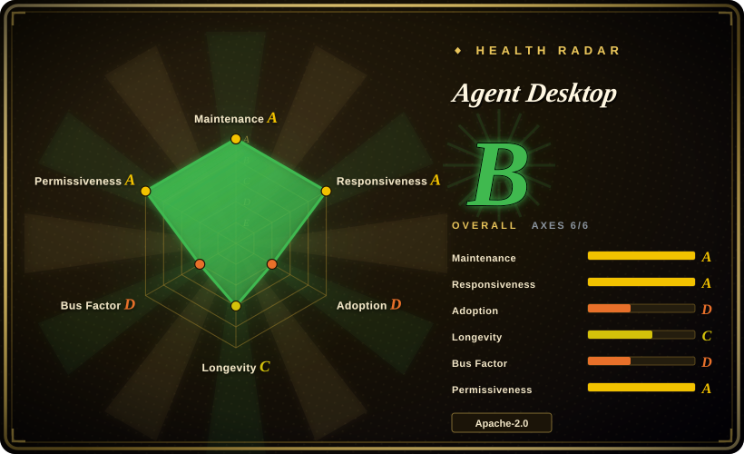
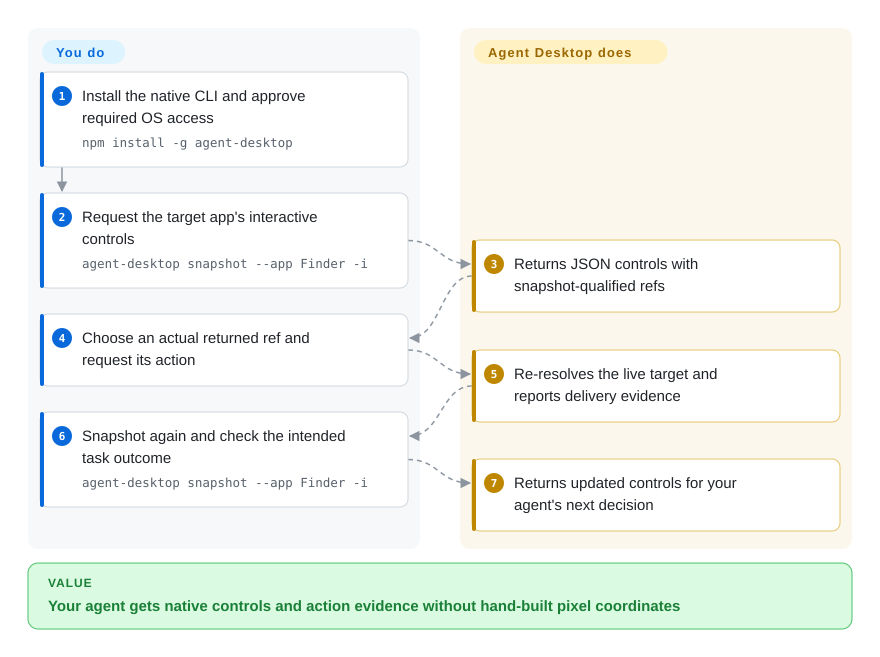
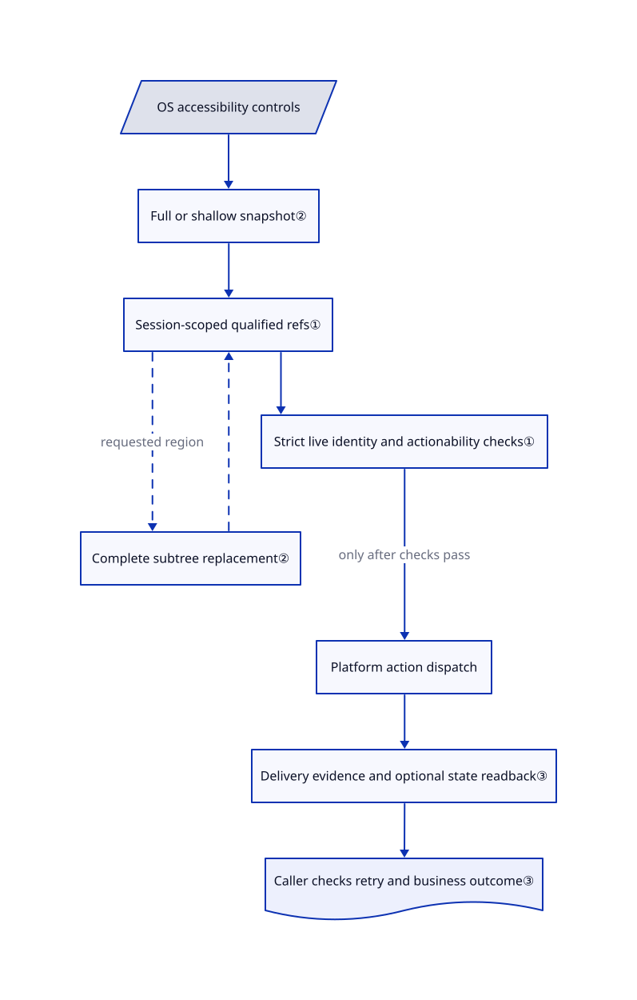

# Agent Desktop

Your agent knows which desktop button it needs, but a moved window makes its old click coordinates useless. Agent Desktop reads the operating system's description of controls and returns snapshot-qualified references instead of asking the agent to guess pixels.

## When to use

You are connecting an existing coding agent to a native desktop client with no useful API. The task says “select this row and export it”, but rows move and several windows have the same title. You want a command-line tool that returns actual controls as JSON, rejects an obsolete reference, and leaves your existing agent to decide the next step. Choose Agent Desktop over coordinate scripts when the application exposes a useful accessibility tree, the structured description screen readers use.

The deciding tradeoff is a native CLI and C library across macOS, Windows and Linux, rather than a complete model-powered agent or virtual-machine platform. You keep planning, approvals and model choice. It supplies observation and actions, including background semantic actions by default; platform coverage is not identical. The [reviewed README](https://github.com/vercel-labs/agent-desktop/blob/9eb9b296192fcb70bda25e918cd6dd66abfa3d0d/README.md#L12-L16) also describes a persistent macOS command host, so CLI does not mean every invocation is stateless.

## When NOT to use

- **Actions must be isolated from your real account.** Choose [Cua](cua.md) with a separately configured disposable desktop. The background policy restricts focus and physical input; it is not a VM, application allowlist or authorization boundary. A semantic click can still delete real data.
- **The entire task is a web-page test.** Choose [Playwright](../web-automation/playwright-family/playwright.md) for browser locators, assertions and browser-context isolation. OS accessibility access does not replace DOM, network or multi-browser test APIs.
- **The target exposes only a canvas or image.** Choose [PyAutoGUI](pyautogui.md) if you accept explicit pixel scripting and visible input. Agent Desktop's reference advantage depends on exposed controls; its screenshot command does not supply visual reasoning.
- **You need a ready-made Windows MCP server.** Choose [Windows-MCP](windows-mcp.md), after reviewing its broader tools and telemetry. Agent Desktop documents CLI plus bundled skills or C-ABI integration, not an MCP server or an embedded planning loop.
- **You require identical mouse and window operations on every Linux desktop.** For fixed X11 coordinates use PyAutoGUI; for a browser task use Playwright. Agent Desktop primarily targets Ubuntu 24.04+ and GNOME 46. Its [installation contract](https://github.com/vercel-labs/agent-desktop/blob/9eb9b296192fcb70bda25e918cd6dd66abfa3d0d/docs/install.md#L73-L90) refuses application pointer input on Wayland and does not support native window control there.
- **Tool success must prove that a payment or save completed.** Prefer the application's transactional API when available; otherwise add explicit task-level checks in your harness. Verified element state is not proof of application persistence, and uncertain delivery must not be blindly replayed.

## Comparison

| Alternative | In index | Our verdict | Tradeoff |
|---|---|---|---|
| [Cua](cua.md) | indexed | Choose Cua when provisioning a disposable computer is the requirement; choose Agent Desktop when an existing agent needs native controls on an authorized desktop. | Cua adds sandbox and agent infrastructure; Agent Desktop leaves that infrastructure and cost to you. |
| [Windows-MCP](windows-mcp.md) | indexed | Choose Windows-MCP for a Windows-only MCP client; choose Agent Desktop for native CLI/C integration across three operating systems. | MCP reduces integration glue but brings a Python server and broader tools; the native CLI needs a caller-owned loop. |
| [PyAutoGUI](pyautogui.md) | indexed | Choose PyAutoGUI for a known pixel-only script; choose Agent Desktop when identifying a live named control matters more than reaching an arbitrary pixel. | Pixel scripts can address canvas content but depend on layout; refs provide identity evidence but depend on application accessibility. |
| [Playwright](../web-automation/playwright-family/playwright.md) | indexed | Choose Playwright for repeatable browser tests with assertions; choose Agent Desktop when the task leaves the browser for native apps or OS surfaces. | Playwright supplies browser testing and isolation, not general native-app control. |

## Quick start

Install with `npm install -g agent-desktop`, or use a matching native release archive and keep its helper beside it. On macOS, the operator must approve Accessibility access; screenshots need separate Screen Recording permission, and this review performed neither grant. Read `agent-desktop skills get desktop` and `agent-desktop skills get platform`, then request `agent-desktop snapshot --app Finder -i`; substitute your target app and select an explicit window if ambiguity is reported. Pass an actual qualified ref from that response to `click`, then snapshot again and check the task result; `@s8f3k2p9:e8` in the README is an example, not a reusable ref. You supply the agent, approvals, model costs and privacy handling; the CLI returns observations and action reports without requiring a model service. These instructions were [source-checked](https://github.com/vercel-labs/agent-desktop/blob/9eb9b296192fcb70bda25e918cd6dd66abfa3d0d/README.md#L18-L106), not tested on a live desktop.

<!-- flow-steps:begin (generated from flows/agent-desktop.json by tools/flow_card.py — do not edit) -->

Text version of the flow

1. **You**: Install the native CLI and approve required OS access — `npm install -g agent-desktop`
2. **You**: Request the target app's interactive controls — `agent-desktop snapshot --app Finder -i`
3. **Agent Desktop**: Returns JSON controls with snapshot-qualified refs
4. **You**: Choose an actual returned ref and request its action
5. **Agent Desktop**: Re-resolves the live target and reports delivery evidence
6. **You**: Snapshot again and check the intended task outcome — `agent-desktop snapshot --app Finder -i`
7. **Agent Desktop**: Returns updated controls for your agent's next decision

**Value**: Your agent gets native controls and action evidence without hand-built pixel coordinates

<!-- flow-steps:end -->

## Key techniques

<!-- mechanism:begin (generated from mechanisms/agent-desktop.json by tools/mechanism_card.py; do not edit) -->

Text version of the mechanism

- OS accessibility controls
- Full or shallow snapshot②
- Session-scoped qualified refs①
- Complete subtree replacement②
- Strict live identity and actionability checks①
- Platform action dispatch
- Delivery evidence and optional state readback③
- Caller checks retry and business outcome③

- OS accessibility controls → Full or shallow snapshot②
- Full or shallow snapshot② → Session-scoped qualified refs①
- Session-scoped qualified refs① → Complete subtree replacement② (requested region) [optional/fallback]
- Complete subtree replacement② → Session-scoped qualified refs① [optional/fallback]
- Session-scoped qualified refs① → Strict live identity and actionability checks①
- Strict live identity and actionability checks① → Platform action dispatch (only after checks pass)
- Platform action dispatch → Delivery evidence and optional state readback③
- Delivery evidence and optional state readback③ → Caller checks retry and business outcome③

<!-- mechanism:end -->

### 1. Bind refs to a snapshot and recheck live identity

- **Problem:** A row number or reused accessibility identifier can point to another control after a UI change.
- **How:** Refs encode a snapshot ID and element number. Dispatch strictly resolves the stored target again, checks actionability, then calls the platform adapter. On macOS, a command host retains native accessibility objects; a retained-object token must still match rather than selecting a lookalike.
- **Limits:** Refs belong to a session namespace, not permanent selectors. A removed object or exited owner requires a new snapshot. Identity checks do not certify that a business action is appropriate.
- **Source:** [Ref parser:19–59](https://github.com/vercel-labs/agent-desktop/blob/9eb9b296192fcb70bda25e918cd6dd66abfa3d0d/crates/core/src/refs/ref_token.rs#L19-L59), [live dispatch:60–166](https://github.com/vercel-labs/agent-desktop/blob/9eb9b296192fcb70bda25e918cd6dd66abfa3d0d/crates/core/src/ref_action/mod.rs#L60-L166), [retained identity:107–153](https://github.com/vercel-labs/agent-desktop/blob/9eb9b296192fcb70bda25e918cd6dd66abfa3d0d/crates/macos/src/tree/resolve/retained.rs#L107-L153), [host:8–53](https://github.com/vercel-labs/agent-desktop/blob/9eb9b296192fcb70bda25e918cd6dd66abfa3d0d/src/command_host/mod.rs#L8-L53).

### 2. Read a shallow map, then replace one complete subtree

- **Problem:** Sending every control in a dense app overwhelms the agent's context.
- **How:** Skeleton mode limits initial depth to three. A root-ref drill-down strictly resolves one region, observes it completely, then updates that region's refs in the existing snapshot. A full snapshot can instead return a partial tree with `complete: false` and truncation fields.
- **Limits:** A partial full snapshot is still `ok: true`; callers must inspect completeness. Partial drill-down fails instead of replacing the stored region. Neither mode repairs missing accessibility information in the application.
- **Source:** [Skeleton options:34–50](https://github.com/vercel-labs/agent-desktop/blob/9eb9b296192fcb70bda25e918cd6dd66abfa3d0d/crates/core/src/commands/snapshot.rs#L34-L50), [partial response:125–150](https://github.com/vercel-labs/agent-desktop/blob/9eb9b296192fcb70bda25e918cd6dd66abfa3d0d/crates/core/src/commands/snapshot.rs#L125-L150), [subtree replacement:30–130](https://github.com/vercel-labs/agent-desktop/blob/9eb9b296192fcb70bda25e918cd6dd66abfa3d0d/crates/core/src/snapshot/snapshot_ref.rs#L30-L130).

### 3. Separate delivery evidence from permission to retry

- **Problem:** A timeout after a click can make an agent repeat a mutation that already landed.
- **How:** Results carry delivery and retry dispositions separately. Only proven non-delivery maps to safe retry; delivered, unverified or uncertain delivery maps to unsafe retry. Stateful ref actions execute once and read back fresh element state, distinguishing missing evidence from a supported postcondition.
- **Limits:** Unknown delivery is not safe retry. Physical text mismatches can remain explicitly unverified; verified text still reports `application_commit: not_verified`. The caller must check the business outcome, not treat `ok: true` as an exactly-once transaction guarantee.
- **Source:** [Delivery mapping:5–54](https://github.com/vercel-labs/agent-desktop/blob/9eb9b296192fcb70bda25e918cd6dd66abfa3d0d/crates/core/src/actions/delivery_semantics.rs#L5-L54), [execution and readback:6–138](https://github.com/vercel-labs/agent-desktop/blob/9eb9b296192fcb70bda25e918cd6dd66abfa3d0d/crates/core/src/actions/post_action.rs#L6-L138), [JSON contract:61–111](https://github.com/vercel-labs/agent-desktop/blob/9eb9b296192fcb70bda25e918cd6dd66abfa3d0d/docs/json-output.md#L61-L111).

## Tech stack

- Rust 2024 workspace: shared core, three platform adapters, CLI and C-ABI library. Reviewed version 1.0.2 requires Rust 1.89 minimum.
- Clap parses commands; Serde/serde_json encode JSON; tracing handles diagnostics. Native adapters use OS accessibility interfaces, including AT-SPI on Linux.
- npm is a distribution wrapper, not the engine. Its manifest requires Node 18+; native archives avoid the JavaScript launcher. Sources: [workspace](https://github.com/vercel-labs/agent-desktop/blob/9eb9b296192fcb70bda25e918cd6dd66abfa3d0d/Cargo.toml#L1-L23), [npm manifest](https://github.com/vercel-labs/agent-desktop/blob/9eb9b296192fcb70bda25e918cd6dd66abfa3d0d/npm/package.json#L1-L24).

## Dependencies

- A supported OS and access to the target graphical session. “Headless” means no focus-stealing or physical input by default, not a graphical-session-free server.
- macOS 13+ and Accessibility permission; Screen Recording for capture and Automation for opening Notification Center. The command host requires a current-user-owned `0700` temporary directory and exits after 15 idle minutes.
- Windows apps at the caller's integrity level; input to elevated apps needs an elevated caller. The install guide warns that the binary is unsigned and Windows security products may block it.
- Linux: `at-spi2-core`, user session bus/display environment and glibc 2.35+. Wayland clipboard needs `wl-clipboard`; Wayland keys need GNOME Mutter RemoteDesktop, while X11 keys need XTEST.
- No database or mandatory model endpoint. Your agent can still transmit observations to its provider; the optional repository JEV helper explicitly sends goals and screen descriptions to a configured model service.

## Ops difficulty

**Medium.** Packaging is lighter than a VM platform, but permissions, app accessibility quirks and unequal platform support need ongoing attention. Keep binary/helper versions aligned, pin the JSON contract and preserve session scope. The [installer](https://github.com/vercel-labs/agent-desktop/blob/9eb9b296192fcb70bda25e918cd6dd66abfa3d0d/npm/scripts/postinstall.js#L260-L377) links bundled binaries or downloads release artifacts and checksums; it was not run here. Checksums are not independent origin proof; the install guide provides a separate attestation-verification command.

Treat snapshots, clipboard, debug HTML and traces as private data. The [privacy guide](https://github.com/vercel-labs/agent-desktop/blob/9eb9b296192fcb70bda25e918cd6dd66abfa3d0d/docs/faq.md#L74-L80) warns that redaction does not sanitize screenshots or all evidence artifacts. Removing the CLI or ending the host cannot undo application actions; approve irreversible operations separately and verify effects in the application.

## Health & viability

- **Maintenance, checked 2026-11-02:** latest release v1.0.2 was published 2026-10-30; v1.0.1 on 2026-10-28. The reviewed default-branch commit is dated 2026-11-01. Active releases do not establish stable OS behavior.
- **Governance:** Vercel Labs organization ownership, with concentrated public contributions: leading account 214 contributions, next non-bot account 14. The [contribution guide](https://github.com/vercel-labs/agent-desktop/blob/9eb9b296192fcb70bda25e918cd6dd66abfa3d0d/CONTRIBUTING.md#L59-L90) documents platform-scoped tests, native E2E and security checks; this review did not execute them.
- **Age and Lindy:** created 2026-02-19, under nine months old. [Inference: based on repository age and concentrated contributions] Treat it as an active vendor-owned young tool, not a long-lived reliability prior or a guaranteed Vercel support commitment.
- **Adoption and license:** metadata shows 8,350 stars, an attention signal rather than production evidence. The automated 2026-11-02 score records 2,941 npm downloads in the last month and a D adoption grade; downloads do not establish distinct users. Actual root LICENSE is Apache-2.0; workspace/npm manifests and contribution terms agree. Dependencies retain their own terms. [Security reporting](https://github.com/vercel-labs/agent-desktop/blob/9eb9b296192fcb70bda25e918cd6dd66abfa3d0d/SECURITY.md#L3-L15) uses GitHub private vulnerability reports.

## Caveats (unverified)

- [Unverified: desktop execution and permission changes were outside authorization] No install, upstream tests, live accessibility calls or cross-platform latency/reliability measurements were run. Source checks do not establish safe control of your desktop.
- [Inference: based on creation date, recent releases and contribution counts] Development is active, but durability and effective maintainer redundancy remain uncertain; organization ownership is not an SLA.
- [Unverified: root license, manifests, contribution terms and selected implementation only] Apache-2.0 is the declared project license, not a complete dependency and asset provenance audit.
