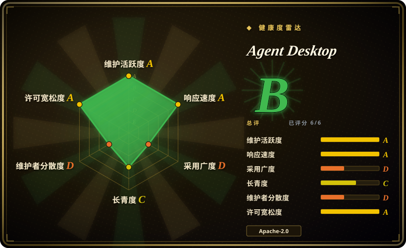
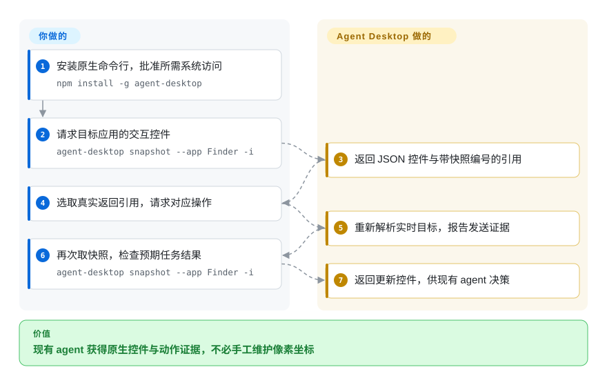
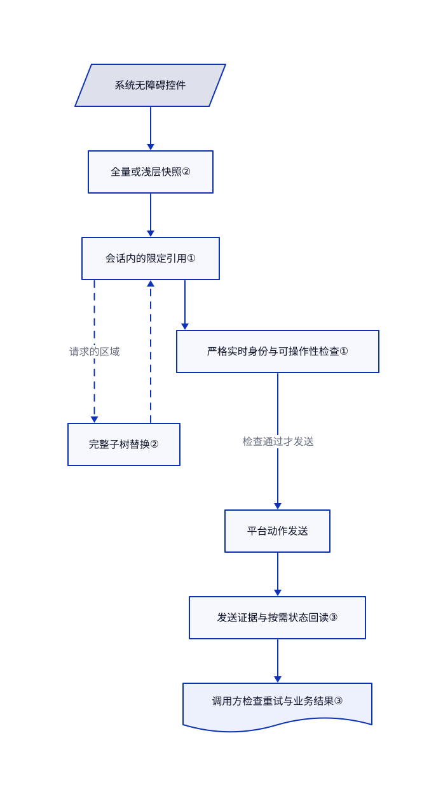

# Agent Desktop

窗口一移动，agent 记住的按钮坐标就失效。Agent Desktop 读取系统控件结构，返回带快照编号的引用，让 agent 不用猜像素位置。

## 何时使用

你要把现有编程 agent 接到没有合适 API 的桌面客户端。任务是“选中这一行，再导出”，但列表行会移动，几个窗口还可能同名。你需要命令行工具把真实控件转成 JSON，拒绝过期引用，让现有 agent 决定下一步。应用能提供有效无障碍树时，选它而非坐标脚本；无障碍树就是屏幕阅读器使用的控件结构。

关键取舍是跨 macOS、Windows、Linux 的原生命令行和 C 库，而非完整的模型 agent 或虚拟机平台。你保留规划循环、审批和模型选择，它负责观察与操作，默认使用后台语义动作。各平台能力并不相同。[固定版本说明](https://github.com/vercel-labs/agent-desktop/blob/9eb9b296192fcb70bda25e918cd6dd66abfa3d0d/README.md#L12-L16)还说明 macOS 会保留命令宿主，因此命令行不等于每次调用都无状态。

## 何时不用

- **必须与真实账号隔离。** 选 [Cua](cua.zh.md)，另行配置可丢弃桌面。后台策略限制抢焦点与物理输入，不是虚拟机、应用白名单或授权边界。语义点击仍能删除真实数据。
- **全程只是网页测试。** 选 [Playwright](../web-automation/playwright-family/playwright.zh.md)，使用浏览器定位器、断言和独立上下文。系统无障碍接口不能替代 DOM、网络与多浏览器测试接口。
- **目标只有画布或图像。** 接受显式像素脚本与前台输入时选 [PyAutoGUI](pyautogui.zh.md)。引用式操作依赖应用暴露控件；截图命令不会自动提供视觉推理。
- **需要现成 Windows MCP 服务。** 选 [Windows-MCP](windows-mcp.zh.md)，先检查更广的工具权限与遥测。Agent Desktop 的文档路线是命令行加内置技能，或 C ABI，不含 MCP 服务或规划循环。
- **要求所有 Linux 桌面的鼠标与窗口操作一致。** 固定 X11 坐标任务选 PyAutoGUI；网页任务选 Playwright。Agent Desktop 主要面向 Ubuntu 24.04+ 与 GNOME 46。[安装契约](https://github.com/vercel-labs/agent-desktop/blob/9eb9b296192fcb70bda25e918cd6dd66abfa3d0d/docs/install.md#L73-L90)明确拒绝 Wayland 应用指针输入，也不支持其原生窗口控制。
- **工具成功必须证明付款或保存完成。** 有事务 API 时优先使用；否则在宿主增加明确的业务结果检查。已验证控件状态不代表应用持久化，发送结果不确定时不能直接重放。

## 横向对比

| 替代品 | 是否收录 | 我们的评价 | 取舍 |
|---|---|---|---|
| [Cua](cua.zh.md) | 已收录 | 核心需求是配置可丢弃电脑时选 Cua；已有 agent 只需在获授权桌面读取原生控件时选 Agent Desktop。 | Cua 增加沙箱与 agent 基础设施；本项目把这些设施和成本留给调用方。 |
| [Windows-MCP](windows-mcp.zh.md) | 已收录 | 仅在 Windows 上通过 MCP 接工具时选 Windows-MCP；要跨三种系统接原生命令行或 C 库时选 Agent Desktop。 | MCP 减少接口胶水，但增加 Python 服务和更广工具面；命令行仍需调用方提供循环。 |
| [PyAutoGUI](pyautogui.zh.md) | 已收录 | 已知的纯像素脚本选 PyAutoGUI；更重视识别实时控件，而非任意像素时选 Agent Desktop。 | 像素脚本能操作画布，但依赖布局；无障碍引用提供身份依据，但依赖应用的无障碍实现。 |
| [Playwright](../web-automation/playwright-family/playwright.zh.md) | 已收录 | 要带断言的可重复网页测试时选 Playwright；任务离开浏览器、进入原生应用或系统界面时再选 Agent Desktop。 | Playwright 提供浏览器专用测试与隔离，不提供通用原生应用控制。 |

## 快速上手

通过 `npm install -g agent-desktop` 安装，或下载匹配的原生发布包，把辅助程序留在可执行文件旁。macOS 需要操作者批准辅助功能权限，截图另需屏幕录制权限，本次没有执行这些授权。先读 `agent-desktop skills get desktop` 与 `agent-desktop skills get platform`，再用 `agent-desktop snapshot --app Finder -i` 请求快照；替换成目标应用，遇到歧义时明确选择窗口。把返回的真实限定引用交给 `click`，再取快照检查结果；说明中的 `@s8f3k2p9:e8` 只是示例，不能复用。你负责 agent、审批、模型费用和隐私，命令行无需模型服务即可返回观察与动作报告。这些步骤已核对[上游说明](https://github.com/vercel-labs/agent-desktop/blob/9eb9b296192fcb70bda25e918cd6dd66abfa3d0d/README.md#L18-L106)，不是桌面实跑记录。

<!-- flow-steps:begin (generated from flows/agent-desktop.json by tools/flow_card.py — do not edit) -->

流程文字版

1. **你**：安装原生命令行，批准所需系统访问 — `npm install -g agent-desktop`
2. **你**：请求目标应用的交互控件 — `agent-desktop snapshot --app Finder -i`
3. **Agent Desktop**：返回 JSON 控件与带快照编号的引用
4. **你**：选取真实返回引用，请求对应操作
5. **Agent Desktop**：重新解析实时目标，报告发送证据
6. **你**：再次取快照，检查预期任务结果 — `agent-desktop snapshot --app Finder -i`
7. **Agent Desktop**：返回更新控件，供现有 agent 决策

**价值**：现有 agent 获得原生控件与动作证据，不必手工维护像素坐标

<!-- flow-steps:end -->

## 技术要点

<!-- mechanism:begin (generated from mechanisms/agent-desktop.json by tools/mechanism_card.py; do not edit) -->

机制文字版

- 系统无障碍控件
- 全量或浅层快照②
- 会话内的限定引用①
- 完整子树替换②
- 严格实时身份与可操作性检查①
- 平台动作发送
- 发送证据与按需状态回读③
- 调用方检查重试与业务结果③

- 系统无障碍控件 → 全量或浅层快照②
- 全量或浅层快照② → 会话内的限定引用①
- 会话内的限定引用① → 完整子树替换②（请求的区域）〔可选／兜底〕
- 完整子树替换② → 会话内的限定引用①〔可选／兜底〕
- 会话内的限定引用① → 严格实时身份与可操作性检查①
- 严格实时身份与可操作性检查① → 平台动作发送（检查通过才发送）
- 平台动作发送 → 发送证据与按需状态回读③
- 发送证据与按需状态回读③ → 调用方检查重试与业务结果③

<!-- mechanism:end -->

### 1. 引用绑定快照，再核验实时身份

- **解决：** 界面变化后，行号或复用的无障碍标识可能指向另一控件。
- **做法：** 引用包含快照编号和元素编号。发送前严格重新解析存储目标，检查可操作性，再调用平台适配器。macOS 命令宿主保留原生无障碍对象；保留对象令牌必须继续匹配，不能退回相似对象。
- **边界：** 引用受选定会话命名空间约束，不是永久选择器。对象消失或持有进程退出后需重新快照。身份检查不证明业务操作合理。
- **源码：** [引用解析第 19–59 行](https://github.com/vercel-labs/agent-desktop/blob/9eb9b296192fcb70bda25e918cd6dd66abfa3d0d/crates/core/src/refs/ref_token.rs#L19-L59)、[实时发送第 60–166 行](https://github.com/vercel-labs/agent-desktop/blob/9eb9b296192fcb70bda25e918cd6dd66abfa3d0d/crates/core/src/ref_action/mod.rs#L60-L166)、[保留身份第 107–153 行](https://github.com/vercel-labs/agent-desktop/blob/9eb9b296192fcb70bda25e918cd6dd66abfa3d0d/crates/macos/src/tree/resolve/retained.rs#L107-L153)、[宿主第 8–53 行](https://github.com/vercel-labs/agent-desktop/blob/9eb9b296192fcb70bda25e918cd6dd66abfa3d0d/src/command_host/mod.rs#L8-L53)。

### 2. 先读浅层地图，再替换完整子树

- **解决：** 密集应用的全部控件会淹没 agent 的关注区域。
- **做法：** 骨架模式把初始深度限制为三层。按根引用下钻时，严格解析区域，完整观察，再仅替换现有快照内该区域的引用。全量快照允许返回部分树，以 `complete: false` 和截断字段说明缺口。
- **边界：** 部分全量快照仍可返回 `ok: true`，调用方必须检查完整性。部分下钻会失败，不会覆盖已存区域。两种模式都不能补出应用未提供的无障碍信息。
- **源码：** [骨架选项第 34–50 行](https://github.com/vercel-labs/agent-desktop/blob/9eb9b296192fcb70bda25e918cd6dd66abfa3d0d/crates/core/src/commands/snapshot.rs#L34-L50)、[部分响应第 125–150 行](https://github.com/vercel-labs/agent-desktop/blob/9eb9b296192fcb70bda25e918cd6dd66abfa3d0d/crates/core/src/commands/snapshot.rs#L125-L150)、[子树替换第 30–130 行](https://github.com/vercel-labs/agent-desktop/blob/9eb9b296192fcb70bda25e918cd6dd66abfa3d0d/crates/core/src/snapshot/snapshot_ref.rs#L30-L130)。

### 3. 分开发送证据与重试许可

- **解决：** 点击后超时，会让 agent 重复执行已经生效的修改。
- **做法：** 结果分别报告发送状态与重试状态。只有证实未发送才映射为可安全重试；已发送、已发送未验证或发送不确定均不可直接重试。有状态的引用动作执行一次，再回读实时控件状态，区分缺少证据与已支持的后置条件。
- **边界：** 发送状态未知不代表可安全重试。物理输入文本不符时可明确保留为未验证；已验证文本仍报告 `application_commit: not_verified`。调用方必须检查业务结果，不能把 `ok: true` 当作事务恰好执行一次的保证。
- **源码：** [发送映射第 5–54 行](https://github.com/vercel-labs/agent-desktop/blob/9eb9b296192fcb70bda25e918cd6dd66abfa3d0d/crates/core/src/actions/delivery_semantics.rs#L5-L54)、[执行与回读第 6–138 行](https://github.com/vercel-labs/agent-desktop/blob/9eb9b296192fcb70bda25e918cd6dd66abfa3d0d/crates/core/src/actions/post_action.rs#L6-L138)、[输出契约第 61–111 行](https://github.com/vercel-labs/agent-desktop/blob/9eb9b296192fcb70bda25e918cd6dd66abfa3d0d/docs/json-output.md#L61-L111)。

## 技术栈

- Rust 2024 工作区，包含共享核心、三种平台适配器、命令行和 C ABI 库。所读版本为 1.0.2，最低 Rust 1.89。
- Clap 解析命令，Serde 与 serde_json 编码输出，tracing 记录诊断。原生适配器调用系统无障碍接口，包括 Linux 的 AT-SPI。
- npm 是分发包装，不是引擎。清单要求 Node 18+；原生发布包可避开 JavaScript 启动器。参见[工作区清单](https://github.com/vercel-labs/agent-desktop/blob/9eb9b296192fcb70bda25e918cd6dd66abfa3d0d/Cargo.toml#L1-L23)与[npm 清单](https://github.com/vercel-labs/agent-desktop/blob/9eb9b296192fcb70bda25e918cd6dd66abfa3d0d/npm/package.json#L1-L24)。

## 依赖

- 支持的系统与目标图形会话。“无头”指默认不抢焦点、不合成物理输入，不是无需图形会话的服务器。
- macOS 13+ 与辅助功能权限；采集屏幕需要屏幕录制权限，打开通知中心需要自动化权限。命令宿主要求临时目录归当前用户所有，权限为 `0700`，空闲十五分钟后退出。
- Windows 目标应与调用方处于同一完整性级别；向提权应用输入需要调用方也提权。安装说明警告二进制未签名，系统安全产品可能阻止它。
- Linux 需要 `at-spi2-core`、用户会话总线与显示环境，以及 glibc 2.35+。Wayland 剪贴板需要 `wl-clipboard`，按键需要 GNOME Mutter RemoteDesktop；X11 按键需要 XTEST。
- 不需要数据库或强制模型端点。外部 agent 仍可能把观察发给模型服务商；可选仓库 JEV 辅助工具明确会发送目标与屏幕描述。

## 运维难度

**中等。** 包装比虚拟机平台轻，但权限、应用无障碍差异和平台能力不一致都要持续维护。保持二进制与辅助程序版本一致，锁定 JSON 契约，传递引用时保留会话范围。[安装脚本](https://github.com/vercel-labs/agent-desktop/blob/9eb9b296192fcb70bda25e918cd6dd66abfa3d0d/npm/scripts/postinstall.js#L260-L377)链接随包二进制，或下载发布产物与校验值，本次没有执行。校验值不能独立证明来源，安装说明另给了产物证明核验命令。

把快照、剪贴板、调试 HTML 和追踪文件当私密数据处理。[隐私说明](https://github.com/vercel-labs/agent-desktop/blob/9eb9b296192fcb70bda25e918cd6dd66abfa3d0d/docs/faq.md#L74-L80)明确指出，脱敏不能清理截图及所有证据产物。删除命令行或结束宿主不会撤销应用操作；不可逆操作需单独审批，并在应用内验证结果。

## 健康度与可持续性

- **维护，核验于 2026-11-02：** 最新发布 v1.0.2 为 2026-10-30，v1.0.1 为 2026-10-28，所读默认分支提交日期为 2026-11-01。发布活跃不证明系统行为稳定。
- **治理：** 仓库归 Vercel Labs 组织所有。公开贡献快照较集中，首位账号贡献 214 次，下一位非机器人账号为 14 次。[贡献指南](https://github.com/vercel-labs/agent-desktop/blob/9eb9b296192fcb70bda25e918cd6dd66abfa3d0d/CONTRIBUTING.md#L59-L90)列出按平台运行的测试、原生端到端与安全检查，本次没有执行。
- **年龄与林迪效应：** 创建于 2026-02-19，核验时不足九个月。[推断：依据仓库年龄与集中贡献] 应把它当作积极开发、厂商持有的年轻工具，而非经过长期验证的可靠性先验，也不能当作 Vercel 的支持承诺。
- **采用与许可：** 元数据中 8,350 个星标代表关注，不代表生产成功。2026-11-02 自动评分记录上月 npm 下载 2,941 次，采用维度为 D；下载数不等于独立用户。已读根 LICENSE 为 Apache-2.0，工作区、npm 清单及贡献条款一致。依赖保留自身条款。[安全报告](https://github.com/vercel-labs/agent-desktop/blob/9eb9b296192fcb70bda25e918cd6dd66abfa3d0d/SECURITY.md#L3-L15)使用 GitHub 私密漏洞报告。

## 存疑（未验证）

- [未验证：本次授权禁止执行桌面操作和改权限] 未安装、运行上游测试、调用真实无障碍接口，或测量跨平台延迟与可靠性。源码核验不证明能安全控制你的桌面。
- [推断：依据创建日期、近期发布和贡献数量] 开发活跃，但长期持续性与实际维护者冗余仍不确定；组织所有权不是服务等级承诺。
- [未验证：仅检查根许可、清单、贡献条款与选定实现] Apache-2.0 是声明的项目许可，不是依赖与素材来源的完整权利审计。
