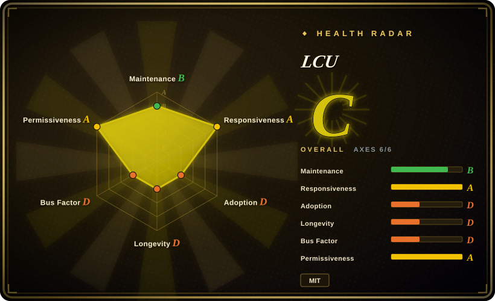
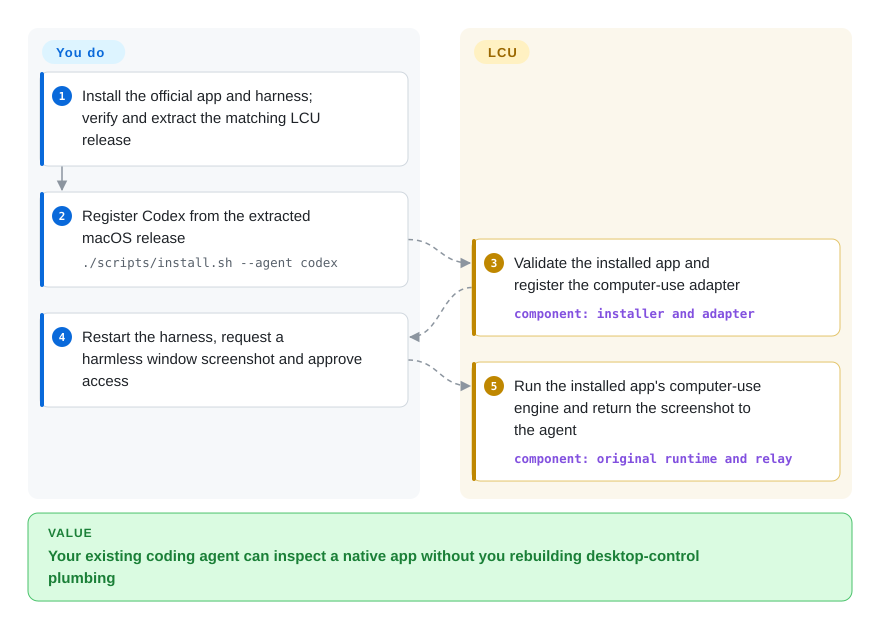
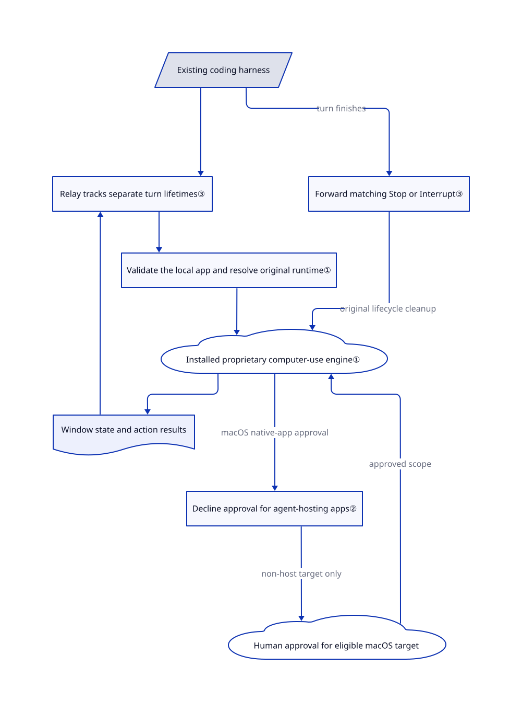

# LCU

Your coding agent can edit files but cannot click a native app's export dialog. LCU connects that agent to the computer-control runtime already inside your installed ChatGPT app, rather than making you change agents.

## When to use

You maintain a Claude Code, Codex CLI or Pi workflow, and a task ends at a desktop window: export a document, inspect a native application's controls, or copy a value from a GUI with no API. You already have the official ChatGPT desktop app on Apple Silicon macOS or an X11 Linux desktop. LCU supplies adapters that deliver window state, screenshots and input actions to your existing agent. It does not supply the model or require Codex authentication; your harness still needs its own model access.

Choose LCU over [Cua](cua.md) when reusing OpenAI's installed runtime and your existing agent is more important than choosing an independent desktop driver or provisioning disposable machines. Choose it over [PyAutoGUI](pyautogui.md) when you want an agent to inspect controls instead of writing coordinate scripts. This is an integration layer, not an open-source replacement for the proprietary runtime.

## When NOT to use

- **You must redistribute a fully open desktop-control stack.** Use [Cua](cua.md) and review the selected components' licenses. LCU's MIT license covers its integration code, not the locally installed OpenAI app, runtime or instructions; those retain their own terms ([provenance](https://github.com/amontlabs/lcu/blob/99d0759a7610e38251037759a69fcdbef816a8c2/docs/PROVENANCE.md)).
- **You need a disposable machine or a locked-down unattended desktop.** Use Cua's sandbox path. LCU does not create a VM, and Linux has no runtime-level per-app approval. If bubblewrap cannot start, its JavaScript also runs without confinement. Keep tool approval enabled and use a dedicated desktop account or VM.
- **The task stays inside a web page.** Prefer [Playwright MCP](../web-automation/playwright-family/playwright-mcp.md). It avoids LCU's installed desktop-app dependency and native-host lifecycle integration.
- **You only need a repeatable macro on a fixed screen.** Prefer PyAutoGUI when Python coordinate scripting suffices, while accounting for its quiet maintenance since 2023. LCU adds a harness, runtime selection and model-call costs that such a macro may not need.
- **You need supported Intel macOS, native Wayland, musl Linux or current Windows delivery.** LCU excludes the first three and defers Windows as a candidate. Use Cua for an independently supported desktop driver; for Windows specifically, evaluate [Windows-MCP](windows-mcp.md). Check each substitute's platform contract before adopting it.
- **You expect any MCP client to preserve approvals and cleanup automatically.** Prefer Playwright MCP for browser-only work, or Cua's driver for an independent desktop surface. LCU's custom-client contract includes original instructions, images, approval requests and turn completion; OpenCode and Goose experiments are not advertised release adapters.

## Comparison

| Alternative | In index | Our verdict | Tradeoff |
|---|---|---|---|
| [Cua](cua.md) | ✅ | Choose Cua when an independently packaged driver or disposable desktops decide the task; choose LCU when your existing harness should reuse the installed OpenAI engine. | Cua adds driver and optional sandbox infrastructure; LCU avoids rebuilding that integration but inherits a proprietary app's private layout and behavior. |
| [PyAutoGUI](pyautogui.md) | ✅ | Choose PyAutoGUI for a fixed Python macro with known coordinates; choose LCU for agent-directed control based on window state and screenshots. | PyAutoGUI needs no model but owns neither semantic targeting nor agent lifecycle; its default branch has been quiet since 2023. |
| [Playwright MCP](../web-automation/playwright-family/playwright-mcp.md) | ✅ | Choose Playwright MCP when all targets are browser pages; choose LCU when the same task must inspect native application windows. | Playwright exposes browser automation without OpenAI desktop-app coupling; LCU reaches desktop apps but requires platform permissions and its runtime host. |

## Quick start

Install the official ChatGPT desktop app and your chosen, authenticated harness first. Download your platform's LCU release archive and matching checksum, verify it, and extract it; the automatic GitHub source archive is not an installable bundle. On Apple Silicon macOS, run `./scripts/install.sh --agent codex` from that extracted directory, then restart Codex and run `~/.local/share/lcu/current/bin/lcu doctor` from the desktop session. Ask the agent to screenshot a harmless TextEdit window and answer the app and OS permission prompts yourself. LCU registers the adapter and returns the runtime's results; you provide the model, approve access and validate the outcome. Chrome and audio are separate opt-ins, and the installer does not add `lcu` to `PATH` ([installation](https://github.com/amontlabs/lcu/blob/99d0759a7610e38251037759a69fcdbef816a8c2/docs/INSTALLATION.md)).

<!-- flow-steps:begin (generated from flows/lcu.json by tools/flow_card.py — do not edit) -->

Text version of the flow

1. **You**: Install the official app and harness; verify and extract the matching LCU release
2. **You**: Register Codex from the extracted macOS release — `./scripts/install.sh --agent codex`
3. **LCU**: Validate the installed app and register the computer-use adapter — component: `installer and adapter`
4. **You**: Restart the harness, request a harmless window screenshot and approve access
5. **LCU**: Run the installed app's computer-use engine and return the screenshot to the agent — component: `original runtime and relay`

**Value**: Your existing coding agent can inspect a native app without you rebuilding desktop-control plumbing

<!-- flow-steps:end -->

## Key techniques

<!-- mechanism:begin (generated from mechanisms/lcu.json by tools/mechanism_card.py; do not edit) -->

Text version of the mechanism

- Existing coding harness
- Relay tracks separate turn lifetimes③
- Validate the local app and resolve original runtime①
- Installed proprietary computer-use engine①
- Decline approval for agent-hosting apps②
- Human approval for eligible macOS target
- Window state and action results
- Forward matching Stop or Interrupt③

- Existing coding harness → Relay tracks separate turn lifetimes③
- Relay tracks separate turn lifetimes③ → Validate the local app and resolve original runtime①
- Validate the local app and resolve original runtime① → Installed proprietary computer-use engine①
- Installed proprietary computer-use engine① → Decline approval for agent-hosting apps② (macOS native-app approval)
- Decline approval for agent-hosting apps② → Human approval for eligible macOS target (non-host target only)
- Human approval for eligible macOS target → Installed proprietary computer-use engine① (approved scope)
- Installed proprietary computer-use engine① → Window state and action results
- Window state and action results → Relay tracks separate turn lifetimes③
- Existing coding harness → Forward matching Stop or Interrupt③ (turn finishes)
- Forward matching Stop or Interrupt③ → Installed proprietary computer-use engine① (original lifecycle cleanup)

<!-- mechanism:end -->

### 1. Reuse a checked local runtime rather than ship it

- **Problem:** A harness needs the app's computer-control API without distributing another copy of OpenAI's application.
- **How:** Runtime selection validates the installed app, resolves its bundled Node and original CUA entry point, and sets the original surface/environment switches. The launcher starts that entry point and the macOS lifecycle host instead of implementing a replacement computer-control engine.
- **Limits:** Supported structure and signer checks do not freeze the upstream API. macOS launches may reuse a recorded deep-signature check; Linux checks ownership and structure rather than authenticating the app's contents.
- **Source:** [Runtime selection:25–60](https://github.com/amontlabs/lcu/blob/99d0759a7610e38251037759a69fcdbef816a8c2/lcu/runtime.mjs#L25-L60), [surface configuration:210–264](https://github.com/amontlabs/lcu/blob/99d0759a7610e38251037759a69fcdbef816a8c2/lcu/runtime.mjs#L210-L264), [launch:538–568](https://github.com/amontlabs/lcu/blob/99d0759a7610e38251037759a69fcdbef816a8c2/lcu/runtime.mjs#L538-L568).

### 2. Refuse control of the app hosting the agent

- **Problem:** An agent allowed to click its own approval UI could approve its own next action.
- **How:** The shared guard identifies macOS ancestor app bundles and combines them with a static set of agent hosts and terminals. It declines matching native-app approval requests before forwarding them to the harness or user.
- **Limits:** Failed ancestor discovery falls back to the static list. Linux does not issue these per-app requests; this is not a Linux desktop sandbox. An explicit testing environment switch disables the guard.
- **Source:** [Ancestor discovery and refusal:74–150](https://github.com/amontlabs/lcu/blob/99d0759a7610e38251037759a69fcdbef816a8c2/adapters/host-guard.mjs#L74-L150), [known hosts:20–39](https://github.com/amontlabs/lcu/blob/99d0759a7610e38251037759a69fcdbef816a8c2/adapters/host-guard.mjs#L20-L39).

### 3. Give subagents distinct turn identities

- **Problem:** A subagent finishing must not terminate its parent's still-running desktop-control turn.
- **How:** The Claude relay hashes the agent and prompt identifiers into a distinct upstream turn id. It tracks each turn's lifetime and forwards completion or interruption to the original runtime; cleanup removes state only if it still belongs to that lifetime.
- **Limits:** Cross-turn use is off by default and enabling it changes parent-stop behavior. Tracking is bounded, and shutdown drains cleanup for two seconds before closing the connection; this is not proof of cleanup after every host failure.
- **Source:** [Identity and bounds:43–99](https://github.com/amontlabs/lcu/blob/99d0759a7610e38251037759a69fcdbef816a8c2/adapters/claude.mjs#L43-L99), [lifetime cleanup:221–290](https://github.com/amontlabs/lcu/blob/99d0759a7610e38251037759a69fcdbef816a8c2/adapters/claude.mjs#L221-L290).

## Tech stack

- JavaScript ES modules for CLI, validation and MCP relays; TypeScript for Pi and Claude approval UI; Python for Hermes integration and development tests.
- MCP SDK `1.30.0` is pinned in [the adapter manifest](https://github.com/amontlabs/lcu/blob/99d0759a7610e38251037759a69fcdbef816a8c2/adapters/package.json). Setup tooling pins `add-mcp` `2.4.0` and `skills` `1.7.0`; vendored Acorn retains its MIT license.
- Computer-control execution comes from the installed OpenAI runtime and native helper, not from an LCU model or database.

## Dependencies

- Official ChatGPT desktop app, already installed; LCU does not acquire it. Its bundled Node runs the installer and installed commands; Python is not a normal installation requirement.
- Apple Silicon macOS with Accessibility and screen-recording permissions, or Ubuntu 24.04-compatible glibc Linux on ARM64/x86-64 with an active X11 desktop and D-Bus. Linux setup can install system libraries; bubblewrap availability determines JavaScript confinement.
- Your installed harness and paid or self-hosted model access. Codex CLI must support `mcp_tool` hooks. Pi, Codex CLI and Claude Code are maintained adapters; OMP, Hermes and DeepSeek Harness are experimental.
- Chrome control additionally needs the official extension, native-host registration, browser reconnection and site consent. A local audio file reference does not establish that the model received audio bytes.

## Ops difficulty

**Medium.** No database or model server is bundled, but installation crosses desktop permissions, harness hooks, the app's private runtime layout and optional browser native messaging. Pin a known LCU/app/harness combination and check `doctor` after app updates. `status` and browser discovery are not evidence of a successful GUI action. Review local diagnostic logs for approval and turn-end failures; uninstall removes harness registrations, hooks, the approval mod and optional browser relay, not just one binary. The [adapter contract](https://github.com/amontlabs/lcu/blob/99d0759a7610e38251037759a69fcdbef816a8c2/docs/ADAPTERS.md) records a Claude `StopFailure` fixture that did not reach original Interrupt cleanup.

## Health & viability

- **Maintenance, 2026-10-21:** v0.12.0 was released that day, after v0.11.8, v0.11.7 and v0.11.6 on October 21, 20 and 19. Recent fixes address approvals, app-update restarts and repeated Hermes prompt injection; active maintenance also means integration churn ([releases](https://github.com/amontlabs/lcu/releases)).
- **Governance:** the repository belongs to Amont Labs. The contributor API reports 483 contributions for `0xpolarzero` and 1–2 each for four other listed contributors; work is concentrated despite organization ownership ([contributors](https://api.github.com/repos/amontlabs/lcu/contributors?per_page=10)).
- **Age and durability:** created 2026-09-22, only 29 days before verification. [推断：age and release history support a young-and-active classification, not a durable Lindy record] Treat it as a reversible integration experiment, not a stable platform commitment.
- **Adoption and risk:** 2,025 stars and 128 forks are a dated interest signal, not evidence of production deployments. The current tree contains reusable integration source and an Amont Labs MIT license; OpenAI runtime/instruction terms remain separate. [未验证：this read-only review cannot establish contractual permission for every deployment]
- **Verification scope:** upstream distinguishes real GUI tasks, synthetic-host fixtures and unsupported platforms. The current release adds live macOS-only DSH evidence; it does not turn all adapter/platform combinations into verified paths ([v0.12.0](https://github.com/amontlabs/lcu/releases/tag/v0.12.0)).

## Caveats (unverified)

- [未验证：upstream code was read but not installed or executed] No desktop action, approval UI, isolation behavior or model delivery was reproduced in this intake. Upstream verification records are attributed evidence, not this page's test results.
- [未验证：legal permission depends on the user's terms and deployment] MIT applies to LCU code, not the installed proprietary runtime or extracted local instructions; this review does not establish redistribution or commercial-use permission for those components.
- [推断：created_at and release dates show only 29 days of public history] The recommendation to keep adoption reversible follows limited longevity and concentrated contributions, not a measured future-maintenance guarantee.
