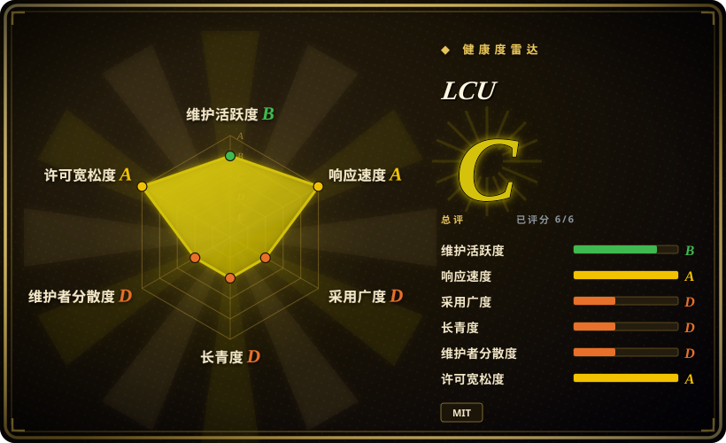
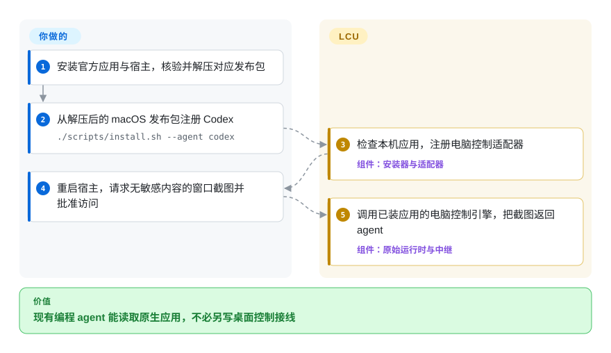
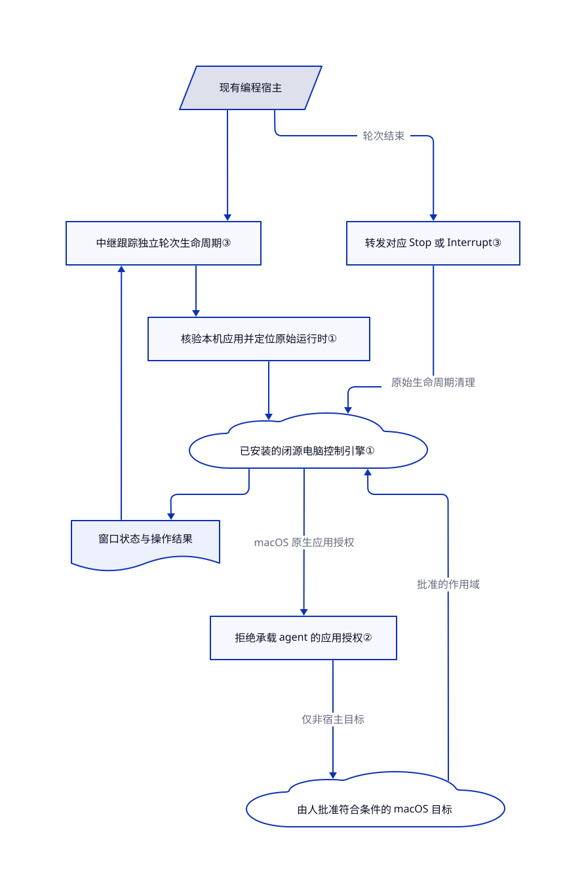

# LCU

你的编程 agent 会改文件，却点不了桌面应用的导出弹窗。LCU 把已安装 ChatGPT 应用里的电脑控制能力接给现有 agent，不必换一套助手。

## 何时使用

你维护 Claude Code、Codex CLI 或 Pi 工作流，任务却卡在桌面窗口：导出文档、读取原生应用控件，或从没有 API 的界面抄一个值。你已有官方 ChatGPT 桌面应用，机器是 Apple Silicon Mac 或运行 X11 的 Linux。LCU 的适配器把窗口状态、截图和输入操作交给现有 agent。它不提供模型，也不要求 Codex 身份认证；宿主仍需自己的模型访问权限。

当“复用已装好的 OpenAI 引擎和现有 agent”比独立驱动、可丢弃机器更重要时，选它而不是 [Cua](cua.zh.md)。当你希望 agent 读取控件后行动，而不是手写坐标脚本时，选它而不是 [PyAutoGUI](pyautogui.zh.md)。它是接线层，不是闭源运行时的开源替代品。

## 何时不用

- **必须再分发完全开源的桌面控制栈。** 选 [Cua](cua.zh.md)，并检查所用组件许可证。LCU 的 MIT 只覆盖接线代码；本机 OpenAI 应用、运行时和指令仍保留各自条款，见[来源说明](https://github.com/amontlabs/lcu/blob/99d0759a7610e38251037759a69fcdbef816a8c2/docs/PROVENANCE.md)。
- **需要可丢弃机器，或严格隔离的无人值守桌面。** 选 Cua 的沙箱路径。LCU 不创建虚拟机，Linux 运行时也没有逐应用授权；bubblewrap 无法启动时，JavaScript 同样没有隔离。保留工具审批，并使用专用桌面账户或虚拟机。
- **任务始终留在网页里。** 优先选 [Playwright MCP](../web-automation/playwright-family/playwright-mcp.zh.md)，避免依赖桌面应用和原生宿主生命周期。
- **只需要固定屏幕上的重复宏。** 坐标脚本足够时选 PyAutoGUI，同时接受其自 2023 年以来维护安静的风险。LCU 额外引入宿主、运行时选择和模型调用费用。
- **需要受支持的 Intel Mac、原生 Wayland、musl Linux 或当前 Windows 交付。** LCU 不支持前三项，Windows 仍是推迟交付的候选。独立桌面驱动看 Cua；Windows 专用需求还可评估 [Windows-MCP](windows-mcp.zh.md)。采用前检查替代品自己的平台合同。
- **以为任意 MCP 客户端都会正确授权和清理。** 纯网页任务选 Playwright MCP，独立桌面控制看 Cua 驱动。LCU 的自定义客户端必须交付原始指令、图片、审批和轮次结束事件；OpenCode、Goose 实验不属于正式宣称的发布适配器。

## 横向对比

| 替代品 | 是否收录 | 我们的评价 | 取舍 |
|---|---|---|---|
| [Cua](cua.zh.md) | ✅ | 当独立打包的驱动或可丢弃桌面决定选型时选 Cua；当现有宿主要复用本机 OpenAI 引擎时选 LCU。 | Cua 增加驱动及可选沙箱设施；LCU 减少重新接线，却继承闭源应用的私有布局和行为。 |
| [PyAutoGUI](pyautogui.zh.md) | ✅ | 固定坐标的 Python 宏选 PyAutoGUI；需要 agent 根据窗口状态和截图决定操作时选 LCU。 | PyAutoGUI 不需要模型，却不负责语义定位和 agent 生命周期；其默认分支自 2023 年起安静。 |
| [Playwright MCP](../web-automation/playwright-family/playwright-mcp.zh.md) | ✅ | 目标全是网页时选 Playwright MCP；同一任务必须读取原生窗口时选 LCU。 | Playwright 不耦合 OpenAI 桌面应用；LCU 能碰桌面程序，但需要平台权限和运行时宿主。 |

## 快速上手

先安装官方 ChatGPT 桌面应用和已完成模型认证的宿主。下载对应平台的 LCU 发布包及校验文件，核验后解压；GitHub 自动生成的源码包不能直接安装。在 Apple Silicon Mac 上，从解压目录运行 `./scripts/install.sh --agent codex`，重启 Codex，再在桌面会话运行 `~/.local/share/lcu/current/bin/lcu doctor`。让 agent 截取空白 TextEdit 窗口，并由你本人处理应用与系统授权。LCU 注册适配器、返回运行时结果；你提供模型、批准访问并核对产物。Chrome、音频单独启用，安装器不把 `lcu` 加进 `PATH`，详见[安装指南](https://github.com/amontlabs/lcu/blob/99d0759a7610e38251037759a69fcdbef816a8c2/docs/INSTALLATION.md)。

<!-- flow-steps:begin (generated from flows/lcu.json by tools/flow_card.py — do not edit) -->

流程文字版

1. **你**：安装官方应用与宿主，核验并解压对应发布包
2. **你**：从解压后的 macOS 发布包注册 Codex — `./scripts/install.sh --agent codex`
3. **LCU**：检查本机应用，注册电脑控制适配器 — 组件：`安装器与适配器`
4. **你**：重启宿主，请求无敏感内容的窗口截图并批准访问
5. **LCU**：调用已装应用的电脑控制引擎，把截图返回 agent — 组件：`原始运行时与中继`

**价值**：现有编程 agent 能读取原生应用，不必另写桌面控制接线

<!-- flow-steps:end -->

## 技术要点

<!-- mechanism:begin (generated from mechanisms/lcu.json by tools/mechanism_card.py; do not edit) -->

机制文字版

- 现有编程宿主
- 中继跟踪独立轮次生命周期③
- 核验本机应用并定位原始运行时①
- 已安装的闭源电脑控制引擎①
- 拒绝承载 agent 的应用授权②
- 由人批准符合条件的 macOS 目标
- 窗口状态与操作结果
- 转发对应 Stop 或 Interrupt③

- 现有编程宿主 → 中继跟踪独立轮次生命周期③
- 中继跟踪独立轮次生命周期③ → 核验本机应用并定位原始运行时①
- 核验本机应用并定位原始运行时① → 已安装的闭源电脑控制引擎①
- 已安装的闭源电脑控制引擎① → 拒绝承载 agent 的应用授权②（macOS 原生应用授权）
- 拒绝承载 agent 的应用授权② → 由人批准符合条件的 macOS 目标（仅非宿主目标）
- 由人批准符合条件的 macOS 目标 → 已安装的闭源电脑控制引擎①（批准的作用域）
- 已安装的闭源电脑控制引擎① → 窗口状态与操作结果
- 窗口状态与操作结果 → 中继跟踪独立轮次生命周期③
- 现有编程宿主 → 转发对应 Stop 或 Interrupt③（轮次结束）
- 转发对应 Stop 或 Interrupt③ → 已安装的闭源电脑控制引擎①（原始生命周期清理）

<!-- mechanism:end -->

### 1. 核验并复用本机运行时，不随包分发

- **解决：** 宿主要使用应用的电脑控制 API，却不应再分发一份 OpenAI 应用。
- **做法：** 选择器检查已安装应用，定位其中的 Node 和原始 CUA 入口，配置原有能力开关与环境。启动器调用该入口和 macOS 生命周期宿主，而非重写电脑控制引擎。
- **边界：** 布局和签名检查不冻结上游 API。macOS 启动可复用已记录的深度验签结果；Linux 检查归属和结构，不认证应用内容。
- **源码：** [运行时选择第 25–60 行](https://github.com/amontlabs/lcu/blob/99d0759a7610e38251037759a69fcdbef816a8c2/lcu/runtime.mjs#L25-L60)、[能力配置第 210–264 行](https://github.com/amontlabs/lcu/blob/99d0759a7610e38251037759a69fcdbef816a8c2/lcu/runtime.mjs#L210-L264)、[启动第 538–568 行](https://github.com/amontlabs/lcu/blob/99d0759a7610e38251037759a69fcdbef816a8c2/lcu/runtime.mjs#L538-L568)。

### 2. 拒绝控制承载 agent 的应用

- **解决：** 能点自己审批界面的 agent，可能自行批准下一次操作。
- **做法：** 共享护栏识别 macOS 祖先进程所属应用，再合并已知 agent 宿主和终端清单。命中时，在转发给宿主或用户前拒绝原生应用授权。
- **边界：** 祖先进程查不到时只靠静态清单。Linux 不发逐应用授权请求，这不是 Linux 桌面沙箱；显式测试环境开关可关闭护栏。
- **源码：** [祖先识别与拒绝第 74–150 行](https://github.com/amontlabs/lcu/blob/99d0759a7610e38251037759a69fcdbef816a8c2/adapters/host-guard.mjs#L74-L150)、[已知宿主第 20–39 行](https://github.com/amontlabs/lcu/blob/99d0759a7610e38251037759a69fcdbef816a8c2/adapters/host-guard.mjs#L20-L39)。

### 3. 给子 agent 独立的轮次身份

- **解决：** 子 agent 结束，不应终止父 agent 仍在进行的电脑控制。
- **做法：** Claude 中继把 agent 与提示轮次标识哈希成独立上游轮次。它跟踪每次生命周期，把完成或中断转发给原始运行时；清理只删除仍属于该生命周期的状态。
- **边界：** 跨轮次使用默认关闭，开启会改变父轮次停止行为。记录有数量上限，关闭连接前只等待两秒清理；这不保证所有宿主故障都完成回收。
- **源码：** [身份与上限第 43–99 行](https://github.com/amontlabs/lcu/blob/99d0759a7610e38251037759a69fcdbef816a8c2/adapters/claude.mjs#L43-L99)、[生命周期清理第 221–290 行](https://github.com/amontlabs/lcu/blob/99d0759a7610e38251037759a69fcdbef816a8c2/adapters/claude.mjs#L221-L290)。

## 技术栈

- JavaScript ES 模块承担命令行、校验和 MCP 中继；TypeScript 承担 Pi 和 Claude 审批界面；Python 用于 Hermes 集成及开发测试。
- [适配器清单](https://github.com/amontlabs/lcu/blob/99d0759a7610e38251037759a69fcdbef816a8c2/adapters/package.json)固定 MCP SDK `1.30.0`。安装工具固定 `add-mcp` `2.4.0`、`skills` `1.7.0`；内置 Acorn 保留 MIT 许可证。
- 电脑控制由本机 OpenAI 运行时和原生辅助进程执行，不是 LCU 自带模型或数据库。

## 依赖

- 已安装的官方 ChatGPT 桌面应用，LCU 不代为获取。安装器与命令使用应用自带 Node，正常安装不需要 Python。
- Apple Silicon macOS 需辅助功能和屏幕录制权限；Linux 需 Ubuntu 24.04 兼容 glibc、ARM64 或 x86-64、活动 X11 桌面及 D-Bus。Linux 安装可配置系统库，bubblewrap 能否运行决定 JavaScript 隔离能力。
- 已安装的宿主，以及付费或自托管模型访问。Codex CLI 必须支持 `mcp_tool` 钩子。Pi、Codex CLI、Claude Code 属维护适配器；OMP、Hermes、DeepSeek Harness 属实验集成。
- Chrome 另需官方扩展、原生宿主注册、浏览器重连和站点授权。音频返回本地文件路径，不代表模型收到了音频字节。

## 运维难度

**中。** 不带数据库或模型服务，但安装横跨桌面权限、宿主钩子、应用私有运行时布局及可选浏览器原生通信。固定已知可用的 LCU、应用、宿主组合，应用升级后检查 `doctor`。`status` 和浏览器发现成功不等于 GUI 动作成功。用本地诊断日志定位审批和轮次清理失败；卸载要移除注册、钩子、审批模块和可选浏览器中继，不是只删二进制。[适配器合同](https://github.com/amontlabs/lcu/blob/99d0759a7610e38251037759a69fcdbef816a8c2/docs/ADAPTERS.md)记录过 Claude 的 `StopFailure` 测试未到达原始 Interrupt 清理。

## 健康度与可持续性

- **维护，2026-10-21：** 当天发布 v0.12.0，前几版 v0.11.8、v0.11.7、v0.11.6 分别在 10 月 21、20、19 日发布。近期修复集中于审批、应用升级重启和 Hermes 指令重复注入；维护活跃也意味着集成变化密集，见[发布记录](https://github.com/amontlabs/lcu/releases)。
- **治理：** 仓库归 Amont Labs。贡献者 API 显示 `0xpolarzero` 有 483 次贡献，另外四位各有 1–2 次；组织名下仍明显集中，见[贡献者](https://api.github.com/repos/amontlabs/lcu/contributors?per_page=10)。
- **年龄与耐久性：** 创建于 2026-09-22，核验时仅 29 天。[推断：依据创建时间与发布记录，属于年轻且活跃，并无长期存续证据] 适合可回退的接入实验，不宜当成稳定平台承诺。
- **采用与风险：** 2,025 星、128 个 fork 是有日期的关注信号，不证明生产部署。当前树包含可复用接线源码及 Amont Labs 的 MIT 许可证；OpenAI 运行时、指令的条款独立。[未验证：只读审阅无法确认每种部署的合同授权]
- **验证边界：** 上游区分真实 GUI 任务、合成宿主测试和不支持平台。本版 DSH 新增的真实验证只覆盖 macOS，不代表所有宿主、平台组合都已打通，见 [v0.12.0](https://github.com/amontlabs/lcu/releases/tag/v0.12.0)。

## 存疑（未验证）

- [未验证：本轮只读上游，未安装或执行] 未复现桌面动作、审批界面、隔离或模型结果交付；上游验证记录是署名证据，不是本页实测。
- [未验证：法律授权取决于用户条款和部署方式] MIT 只覆盖 LCU 代码，不覆盖本机闭源运行时或本地提取的指令；本轮不裁定这些组件的再分发、商用授权。
- [推断：创建和发布时间只显示 29 天公开历史] 建议保持接入可回退，依据是年龄短、贡献集中，不是对未来维护的测量保证。
