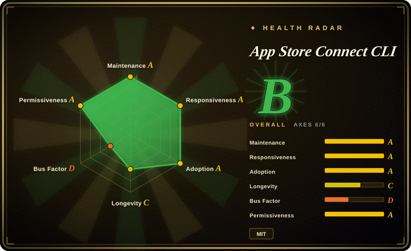
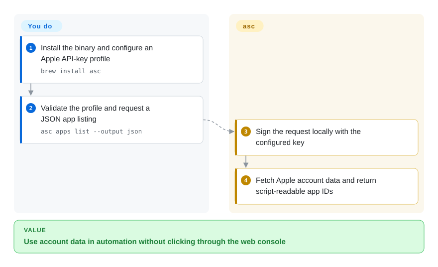
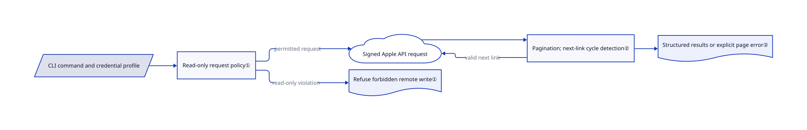

# App Store Connect CLI

Every release means finding the same build, tester group and localization in Apple's web console. `asc` exposes those operations as scriptable commands with JSON output, so CI and agents can inspect and release apps without repeating the clicks.

## When to use

You ship Apple-platform apps and already have a signed build, but release metadata, TestFlight groups and review status still live in manual console steps. You want your script or coding agent to list apps, fetch IDs, stage metadata and submit an explicitly approved release. Choose `asc` when a standalone Go CLI and machine-readable API operations matter more than fastlane's Ruby lanes and plugin ecosystem. Start with account inspection; grant publication authority only to the release stage that needs it.

## When NOT to use

- Your existing fastlane lanes already cover Android and Apple releases with custom plugins. Keep fastlane unless a measured migration benefit justifies replacing that orchestration; `asc` specializes in Apple's surfaces.
- You only release occasionally and do not want to manage API keys. Use the App Store Connect website or Xcode Organizer; they avoid another credential-bearing CLI configuration.
- You need to compile or sign iOS apps on Linux without Apple's toolchain. Use a macOS Xcode runner for the local build steps. A cross-platform API binary does not make Xcode builds cross-platform.
- You need a sandbox for untrusted agent workflows. Use restricted credentials and an isolated runner. `ASC_READ_ONLY=1` guards `asc` requests, not arbitrary shell commands, local writes or telemetry; a workflow step can run another HTTP client.
- You require zero usage telemetry. Set `ASC_TELEMETRY_DISABLED=1` or `DO_NOT_TRACK=1` before running commands, or use Apple's console. Usage events are enabled by default and sent to Rork's collector.

## Comparison

| Alternative | In index | Our verdict | Tradeoff |
|---|---|---|---|
| fastlane | not indexed | Choose `asc` for direct Apple API operations in a self-contained binary; keep fastlane for an existing cross-platform lane and plugin workflow. | No Ruby runtime for released `asc` binaries, but no reason to rewrite a working lane blindly; real repository, not added in this tab batch. |
| App Store Connect website | not a repo | Choose the website for infrequent human-managed releases; choose `asc` when repeatable command output and CI integration remove manual work. | Apple's hosted console avoids CLI setup but is not a scriptable repository or an auditable release script. |
| Xcode Organizer | not a repo | Choose Organizer for a developer's interactive archive-and-upload session; choose `asc` for scripted TestFlight, metadata and review operations after artifacts exist. | Apple's proprietary application supplies local build integration; `asc` supplies automation and still needs Xcode for Xcode-backed steps. |

## Quick start

Install with `brew install asc` or download the release binary; Go is needed only when building from source. Create an App Store Connect API key, then use `asc auth login` with a profile name, key ID, private `.p8` key and issuer ID for a team key; individual keys use `--key-type individual` without an issuer ID. Validate with `asc auth status --validate`, then run `asc apps list --output json`. The CLI signs and sends API requests and formats results; you provide credentials, appropriate Apple roles, app IDs and approved release artifacts. For audit-only sessions, set `ASC_READ_ONLY=1`, and separately disable telemetry if required. Headless CI can use documented config-backed authentication instead of the OS keychain; protect that configuration as a secret.

<!-- flow-steps:begin (generated from flows/app-store-connect-cli.json by tools/flow_card.py — do not edit) -->

Text version of the flow

1. **You**: Install the binary and configure an Apple API-key profile — `brew install asc`
2. **You**: Validate the profile and request a JSON app listing — `asc apps list --output json`
3. **App Store Connect CLI**: Sign the request locally with the configured key
4. **App Store Connect CLI**: Fetch Apple account data and return script-readable app IDs

**Value**: Use account data in automation without clicking through the web console

<!-- flow-steps:end -->

## Key techniques

<!-- mechanism:begin (generated from mechanisms/app-store-connect-cli.json by tools/mechanism_card.py; do not edit) -->

Text version of the mechanism

- CLI command and credential profile
- Read-only request policy①
- Signed Apple API request
- Pagination; next-link cycle detection②
- Structured results or explicit page error②
- Refuse forbidden remote write①

- CLI command and credential profile → Read-only request policy①
- Read-only request policy① → Signed Apple API request (permitted request)
- Read-only request policy① → Refuse forbidden remote write① (read-only violation)
- Signed Apple API request → Pagination; next-link cycle detection②
- Pagination; next-link cycle detection② → Signed Apple API request (valid next link)
- Pagination; next-link cycle detection② → Structured results or explicit page error②

<!-- mechanism:end -->

### 1. Enforce read-only intent before sending requests

- **Problem:** An agent can select a mutating subcommand even when its task was only to inspect an account.
- **How:** The shared read-only package combines the environment variable and root flag with OR semantics. The App Store Connect client checks it before minting a JWT or constructing the outbound request; explicitly marked read-intent requests can pass even when transported as POST.
- **Limits:** This is client policy, not a sandbox or an Apple permission boundary. Local changes, session establishment and telemetry are separate; arbitrary workflow shell commands can bypass the inherited setting. Use least-privilege credentials as well.
- **Source:** [Read-only policy](https://github.com/rorkai/App-Store-Connect-CLI/blob/b9520c3865b54c5c02f905793ac3565fc2885aee/internal/readonly/readonly.go), [API request construction](https://github.com/rorkai/App-Store-Connect-CLI/blob/b9520c3865b54c5c02f905793ac3565fc2885aee/internal/asc/client_http.go#L25-L53), [documented scope](https://github.com/rorkai/App-Store-Connect-CLI/blob/b9520c3865b54c5c02f905793ac3565fc2885aee/concepts/read-only-mode.mdx).

### 2. Treat pagination failures as failures, not complete results

- **Problem:** A script that reads only the first page or follows a cyclic continuation can miss apps or hang indefinitely.
- **How:** Shared pagination helpers aggregate or consume pages, check response types and track canonical next-link identities to detect cycles. The aggregate path returns accumulated data together with a page-specific error; the streaming helper can enforce a caller-supplied page limit.
- **Limits:** Callers still decide whether to request pagination and must propagate errors. A partial aggregate is not a successful full listing, and not every command uses the same consumption mode.
- **Source:** [Aggregation, streaming and cycle detection](https://github.com/rorkai/App-Store-Connect-CLI/blob/b9520c3865b54c5c02f905793ac3565fc2885aee/internal/asc/client_pagination.go#L29-L273), [scriptable workflow examples](https://github.com/rorkai/App-Store-Connect-CLI/blob/b9520c3865b54c5c02f905793ac3565fc2885aee/README.md).

## Tech stack

Go CLI using `ffcli`, ES256 JWT authentication, OS credential storage, JSON and table output, and dedicated Apple API/web clients. The source module retains its original `rudrankriyam` path after transfer to `rorkai`; `go.mod` declares Go 1.27.2.

## Dependencies

An Apple account with the required App Store Connect access, API credentials and network access to Apple services. Released binaries are self-contained; current Go-built macOS releases require macOS 13+. Xcode-backed build, signing and simulator commands require the appropriate Apple toolchain. Some deep validation features require a separate Apple web login and depend on private endpoints. The optional skill installer writes global agent skills and is not required for the CLI.

## Ops difficulty

**Low for read-only workstation use; medium for publishing CI.** The binary needs no database or daemon, but CI owns key storage, profile selection, role restrictions, signing identities, artifact validation and approval. Prefer dry-run or plan commands before remote mutations. Public API automation and private web-session features have different stability and credential risks.

## Health & viability

- **2026-10-18:** Created in January 2026, active and not archived; release 5.15.0 shipped October 17, following several October releases. Version 5 is not five years of operating history.
- Rork owns the repository; the contributor list and MIT copyright identify Rudrank Riyam as its leading individual contributor. There are extensive tests, CI, contribution and security documents, but maintenance remains concentrated.
- Nine months of active work gives some history, not a long Lindy prior. Apple's API changes, private-endpoint drift, credential handling and default telemetry matter more than its roughly eight thousand stars when deciding whether to give it release authority.

## Caveats (unverified)

- [未验证：没有 Apple 账户授权，且任务禁止执行上游代码] Authentication, keychain behaviour, uploads and release submission were source-reviewed, not exercised.
- [未验证：没有逐项运行命令] README coverage is not a guarantee that every Apple endpoint or Windows installation route works on your account and environment.
- [未验证：没有实际流量抓包] The telemetry endpoint and opt-out checks were read in source; runtime payloads were not captured or audited end to end.
