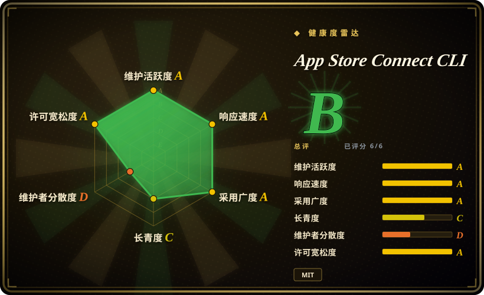
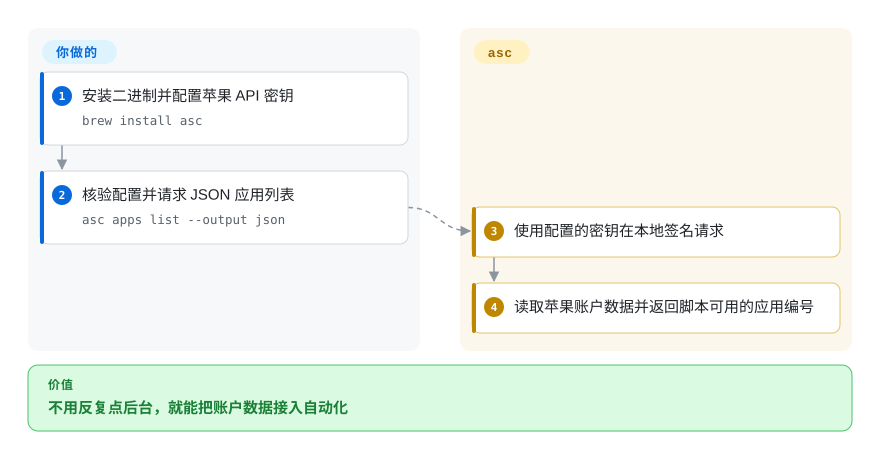
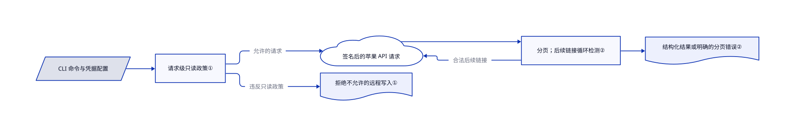

# App Store Connect CLI

每次发版都要在苹果后台重找构建、测试组和本地化文案。`asc` 把这些操作变成能输出 JSON 的命令，让 CI 和 agent 不用重复点击，也能检查应用和执行发布。

## 何时使用

你已经有签名后的苹果平台应用构建，但版本文案、TestFlight 分组和审核状态仍靠手动操作。你想让脚本或编码 agent 列应用、取资源编号、准备元数据，并提交经过批准的版本。比起 fastlane 的 Ruby 任务与插件体系，你更看重独立 Go 二进制和机器可读 API 操作时，选 `asc`。先接只读检查，只把发布权限交给确实需要它的阶段。

## 何时不用

- 已有 fastlane 任务通过自定义插件覆盖 Android 和苹果发布，先保留 fastlane。只有明确的迁移收益，才值得替换现有编排；`asc` 聚焦苹果接口。
- 偶尔发版，不想管理 API 密钥，使用 App Store Connect 网页或 Xcode Organizer，少维护一份带凭据的 CLI 配置。
- 想在 Linux 上脱离苹果工具链编译和签名 iOS 应用，使用 macOS Xcode 执行机。API 二进制跨平台，不代表 Xcode 构建也跨平台。
- 要给不可信 agent 工作流提供沙箱，使用受限凭据和隔离执行机。`ASC_READ_ONLY=1` 管的是 `asc` 请求，不管任意 shell、本地写入或遥测；工作流仍可调用别的 HTTP 客户端。
- 要完全禁止使用遥测，在运行命令前设置 `ASC_TELEMETRY_DISABLED=1` 或 `DO_NOT_TRACK=1`，或改用苹果后台。默认使用事件会发送给 Rork 收集端。

## 横向对比

| 替代品 | 是否收录 | 我们的评价 | 取舍 |
|---|---|---|---|
| fastlane | 未收录 | 要独立二进制直接操作苹果 API，选 `asc`；已有跨平台任务与插件工作流，保留 fastlane。 | 发布版 `asc` 不需要 Ruby，但不应盲目重写能用的任务；真实仓库，本次标签批次未收录。 |
| App Store Connect 网页 | 非仓库 | 人工偶尔发版选网页；重复操作和 CI 需要稳定命令输出时，选 `asc`。 | 苹果托管后台免去 CLI 配置，但不是脚本仓库或可审查的发布脚本。 |
| Xcode Organizer | 非仓库 | 开发者交互式归档上传选 Organizer；产物就绪后，要脚本化管理 TestFlight、文案和审核，选 `asc`。 | 苹果闭源应用提供本地构建集成；`asc` 提供自动化，涉及 Xcode 的步骤仍需要 Xcode。 |

## 快速上手

使用 `brew install asc` 或下载发布版二进制，只有源码构建才需要 Go。创建 App Store Connect API 密钥，再用 `asc auth login` 提供配置名、密钥编号、私钥 `.p8`，团队密钥还需发行者编号；个人密钥使用 `--key-type individual`，不带发行者编号。用 `asc auth status --validate` 核验，再运行 `asc apps list --output json`。CLI 负责签名、发送 API 请求和格式化结果；你负责凭据、苹果角色权限、应用编号和批准过的发布产物。只读审计会话设置 `ASC_READ_ONLY=1`，有隐私要求时另行关闭遥测。无界面 CI 可按文档使用配置文件认证，不依赖系统钥匙串；该配置必须按秘密保护。

<!-- flow-steps:begin (generated from flows/app-store-connect-cli.json by tools/flow_card.py — do not edit) -->

流程文字版

1. **你**：安装二进制并配置苹果 API 密钥 — `brew install asc`
2. **你**：核验配置并请求 JSON 应用列表 — `asc apps list --output json`
3. **App Store Connect CLI**：使用配置的密钥在本地签名请求
4. **App Store Connect CLI**：读取苹果账户数据并返回脚本可用的应用编号

**价值**：不用反复点后台，就能把账户数据接入自动化

<!-- flow-steps:end -->

## 技术要点

<!-- mechanism:begin (generated from mechanisms/app-store-connect-cli.json by tools/mechanism_card.py; do not edit) -->

机制文字版

- CLI 命令与凭据配置
- 请求级只读政策①
- 签名后的苹果 API 请求
- 分页；后续链接循环检测②
- 结构化结果或明确的分页错误②
- 拒绝不允许的远程写入①

- CLI 命令与凭据配置 → 请求级只读政策①
- 请求级只读政策① → 签名后的苹果 API 请求（允许的请求）
- 请求级只读政策① → 拒绝不允许的远程写入①（违反只读政策）
- 签名后的苹果 API 请求 → 分页；后续链接循环检测②
- 分页；后续链接循环检测② → 签名后的苹果 API 请求（合法后续链接）
- 分页；后续链接循环检测② → 结构化结果或明确的分页错误②

<!-- mechanism:end -->

### 1. 发请求前统一检查只读意图

- **解决：** 任务只是检查账户，agent 仍可能误选会修改数据的子命令。
- **做法：** 共用只读包用逻辑或合并环境变量与根参数。App Store Connect 客户端在生成 JWT 和构造请求前检查它；明确标注为读取意图的请求，即便通过 POST 传输，也能放行。
- **边界：** 这是客户端政策，不是沙箱或苹果权限边界。本地修改、建立会话和遥测各有范围；任意工作流 shell 能绕开继承变量，所以仍要最小权限凭据。
- **源码：** [只读政策](https://github.com/rorkai/App-Store-Connect-CLI/blob/b9520c3865b54c5c02f905793ac3565fc2885aee/internal/readonly/readonly.go)、[API 请求构造](https://github.com/rorkai/App-Store-Connect-CLI/blob/b9520c3865b54c5c02f905793ac3565fc2885aee/internal/asc/client_http.go#L25-L53)、[文档边界](https://github.com/rorkai/App-Store-Connect-CLI/blob/b9520c3865b54c5c02f905793ac3565fc2885aee/concepts/read-only-mode.mdx)。

### 2. 分页出错不冒充完整结果

- **解决：** 脚本只读首页会漏应用，重复的后续链接又可能让遍历一直不结束。
- **做法：** 共用分页器支持聚合或逐页消费，检查响应类型，并规范化后续链接身份来识别循环。聚合路径把已取数据和具体页错误一起返回；逐页路径可使用调用方指定的页数上限。
- **边界：** 是否启用分页仍由调用方决定，错误也必须继续向上传递。部分聚合不代表完整列表成功，各命令使用的消费模式也不完全相同。
- **源码：** [聚合、逐页处理与循环检测](https://github.com/rorkai/App-Store-Connect-CLI/blob/b9520c3865b54c5c02f905793ac3565fc2885aee/internal/asc/client_pagination.go#L29-L273)、[脚本工作流样例](https://github.com/rorkai/App-Store-Connect-CLI/blob/b9520c3865b54c5c02f905793ac3565fc2885aee/README.md)。

## 技术栈

使用 `ffcli` 的 Go 命令行、ES256 JWT 认证、系统凭据存储、JSON 和表格输出，以及专用苹果 API／网页客户端。仓库转入 `rorkai` 后，源码模块仍保留原 `rudrankriyam` 路径；`go.mod` 声明 Go 1.27.2。

## 依赖

有对应 App Store Connect 权限的苹果账户、API 凭据与苹果服务网络。发布版二进制自包含，当前 Go 构建的 macOS 版本要求 macOS 13+。涉及 Xcode 的构建、签名和模拟器命令需要苹果工具链。部分深度校验需要单独的苹果网页登录，并依赖私有接口。可选技能安装器会写全局 agent 技能，但不是 CLI 必需项。

## 运维难度

**本机只读使用为低，发布 CI 为中。** 二进制不需要数据库或守护进程，但 CI 要管理密钥、配置选择、权限、签名身份、产物验证和审批。远程修改前优先使用试运行或计划命令。公开 API 自动化和私有网页会话功能的稳定性、凭据风险不同。

## 健康度与可持续性

- **截至 2026-10-18：** 仓库创建于 2026 年 1 月，活跃且未归档，5.15.0 在 10 月 17 日发布，10 月还有多次发布。版本号到五，不代表有五年运行历史。
- 仓库属于 Rork，贡献记录和 MIT 版权均指向主要个人贡献者 Rudrank Riyam。仓库有大量测试、CI、贡献和安全文档，但维护仍集中。
- 约九个月的活跃记录已有一定历史，但还不是强长寿先验。是否授予发布权限，应先看苹果 API 变动、私有接口漂移、凭据处理和默认遥测，而不是约八千 star。

## 存疑（未验证）

- [未验证：没有苹果账户授权，且任务禁止执行上游代码] 认证、钥匙串、上传和提交发布均只读过来源，没有实际操作。
- [未验证：未逐项执行命令] README 的功能覆盖不能保证每个苹果接口或 Windows 安装路径都适配你的账户和环境。
- [未验证：没有运行时抓包] 已读遥测端点和退出检查源码，但没有抓取实际载荷或做端到端审计。
