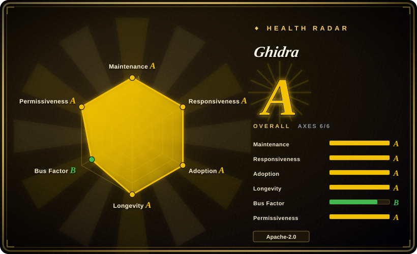
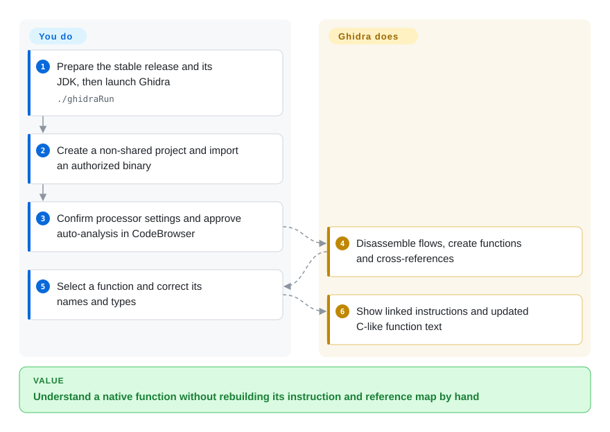
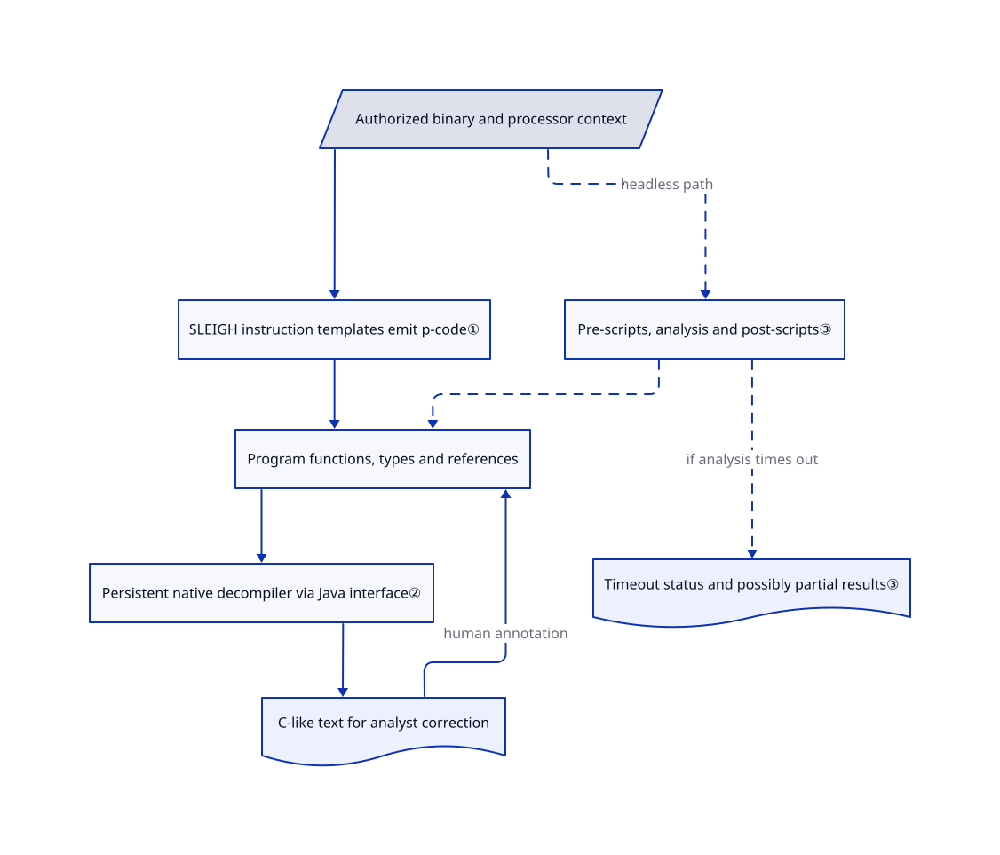

# Ghidra

You have a compiled program but no source, and a screen full of addresses does not explain its behavior. Ghidra connects machine instructions to C-like function views, references and your own annotations in one saved project.

## When to use

You maintain a device or audit a native application you are authorized to inspect. You have an ELF, PE or firmware image, but a call named `FUN_00101230` tells you nothing about its inputs or callers. Choose Ghidra when a human needs to follow those references, correct function signatures and preserve that understanding across sessions. Its integrated decompiler and project model avoid stitching a command-line disassembler to a separate annotation workspace.

You can also reuse the analysis in a headless batch, meaning a run without desktop windows, and add Java or Python scripts. Pick this over an agent bridge such as [REA](rea.md) when you need the underlying native analysis engine rather than an interface that lets an agent operate one. For raw firmware, you still identify the processor, compiler convention and memory layout; import is not automatic reconstruction of missing hardware knowledge.

## When NOT to use

- **You need a few binary queries inside shell scripts.** Choose [radare2](https://github.com/radareorg/radare2) for its command interface and r2pipe integration. Ghidra's Java runtime and project lifecycle add work when persistent human annotations are not useful.
- **Your team already works in the Rizin command ecosystem and wants a Qt desktop.** Choose [Cutter](https://github.com/rizinorg/cutter). It provides that interface and can integrate the Ghidra decompiler; using it does not require adopting Ghidra's whole Java workspace.
- **Your missing component is agent access, not disassembly.** Choose [REA](rea.md) as the orchestration layer and supply its analysis engine separately. Ghidra itself is not REA's evidence ledger or MCP interface.
- **You plan to import unknown files on your everyday workstation and call that safe because the target is not executed.** Use a disposable isolated VM with a patched Ghidra instead. The [published advisories](https://github.com/NationalSecurityAgency/ghidra/security/advisories) include import-time denial of service and Windows analyzer code execution, with fixes in 12.1.4; static analysis is not a sandbox. Target execution, debugging and interception need their own authorization.

## Comparison

| Alternative | In index | Our verdict | Tradeoff |
|---|---|---|---|
| [radare2](https://github.com/radareorg/radare2) | not indexed | Choose radare2 for command-driven binary inspection in an existing shell pipeline; choose Ghidra for a persistent analyst workspace with an integrated C-like view. | Direct commands and r2pipe versus Java projects and linked visual annotations; not added in this tab batch. |
| [Cutter](https://github.com/rizinorg/cutter) | not indexed | Choose Cutter when Rizin compatibility and a Qt interface decide the workflow; choose Ghidra when you want its native project, analysis and scripting APIs together. | Different workspace and plugin ecosystem, not an independent guarantee of decompilation accuracy; Cutter documents Ghidra-decompiler integration. Not added in this tab batch. |
| [REA](rea.md) | ✅ | Choose REA when an agent needs local inspection tools and evidence-bearing results; choose Ghidra when the analyst needs to inspect and annotate native functions directly. | Agent orchestration versus the underlying analysis workspace; REA still needs a separate native engine for deep native inspection. |

## Quick start

For the stable 12.1.4 release, install a 64-bit JDK 21 and extract the official release ZIP into a new directory, not over an older installation; GitHub's source archives are not ready-to-run distributions. Launch `./ghidraRun` on Linux or macOS, or `ghidraRun.bat` on Windows, after preparing any required native components. Create a non-shared project, import an authorized binary, confirm its format and processor, then open it in CodeBrowser and approve auto-analysis. Ghidra finds functions and references and supplies a C-like view; you check the conclusions and correct names, types and boundaries. The [stable installation guide](https://github.com/NationalSecurityAgency/ghidra/blob/Ghidra_12.1.4_build/GhidraDocs/GettingStarted.md) lists macOS and Linux ARM as requiring user-built native components, and the [beginner guide](https://github.com/NationalSecurityAgency/ghidra/blob/b8e9917e4c01959fe97ba94954731ed8cf2d201c/GhidraDocs/GhidraClass/Beginner/Introduction_to_Ghidra_Student_Guide.html#L358-L530) supplies the project/import path. No install, launch or target analysis was performed for this entry.

<!-- flow-steps:begin (generated from flows/ghidra.json by tools/flow_card.py — do not edit) -->

Text version of the flow

1. **You**: Prepare the stable release and its JDK, then launch Ghidra — `./ghidraRun`
2. **You**: Create a non-shared project and import an authorized binary
3. **You**: Confirm processor settings and approve auto-analysis in CodeBrowser
4. **Ghidra**: Disassemble flows, create functions and cross-references
5. **You**: Select a function and correct its names and types
6. **Ghidra**: Show linked instructions and updated C-like function text

**Value**: Understand a native function without rebuilding its instruction and reference map by hand

<!-- flow-steps:end -->

## Key techniques

<!-- mechanism:begin (generated from mechanisms/ghidra.json by tools/mechanism_card.py; do not edit) -->

Text version of the mechanism

- Authorized binary and processor context
- SLEIGH instruction templates emit p-code①
- Program functions, types and references
- Persistent native decompiler via Java interface②
- C-like text for analyst correction
- Pre-scripts, analysis and post-scripts③
- Timeout status and possibly partial results③

- Authorized binary and processor context → SLEIGH instruction templates emit p-code①
- SLEIGH instruction templates emit p-code① → Program functions, types and references
- Program functions, types and references → Persistent native decompiler via Java interface②
- Persistent native decompiler via Java interface② → C-like text for analyst correction
- C-like text for analyst correction → Program functions, types and references (human annotation)
- Authorized binary and processor context → Pre-scripts, analysis and post-scripts③ (headless path) [optional/fallback]
- Pre-scripts, analysis and post-scripts③ → Program functions, types and references [optional/fallback]
- Pre-scripts, analysis and post-scripts③ → Timeout status and possibly partial results③ (if analysis times out) [optional/fallback]

<!-- mechanism:end -->

### 1. Translate processor-specific instructions into shared operations

- **Problem:** Each processor has different instructions, but analysis needs a common description of reads, writes and control flow.
- **How:** SLEIGH, Ghidra's processor-description language, supplies instruction templates. The instruction prototype walks a parsed template and emits p-code, a small common operation vocabulary, resolving relative branches and fall-through before returning it.
- **Limits:** Correct processor specifications and decoding context remain necessary. The reviewed method returns an `UNIMPLEMENTED` operation when it cannot emit usable p-code; broad architecture coverage does not mean every instruction is modeled.
- **Source:** [p-code emission and failure path](https://github.com/NationalSecurityAgency/ghidra/blob/b8e9917e4c01959fe97ba94954731ed8cf2d201c/Ghidra/Framework/SoftwareModeling/src/main/java/ghidra/app/plugin/processors/sleigh/SleighInstructionPrototype.java#L1001-L1038), [processor specification initialization](https://github.com/NationalSecurityAgency/ghidra/blob/b8e9917e4c01959fe97ba94954731ed8cf2d201c/Ghidra/Framework/SoftwareModeling/src/main/java/ghidra/app/plugin/processors/sleigh/SleighLanguage.java#L123-L160).

### 2. Keep a reusable native decompiler behind the Java interface

- **Problem:** Reinitializing a decompiler for each function wastes setup, while a failed native process should not require recreating the entire analysis workspace.
- **How:** `DecompInterface` retains program and option state for repeated function requests. It sends an entry address to the native decompiler with a timeout, returns C markup or a high-level function representation, and can respawn and reinitialize a crashed process on the next request.
- **Limits:** Recovery preserves availability, not correctness. Callers must inspect completion and errors; function signatures and data types supplied by the analyst affect the resulting C-like text, which is not recovered original source.
- **Source:** [persistent interface and result checking](https://github.com/NationalSecurityAgency/ghidra/blob/b8e9917e4c01959fe97ba94954731ed8cf2d201c/Ghidra/Features/Decompiler/src/main/java/ghidra/app/decompiler/DecompInterface.java#L40-L80), [request and timeout handling](https://github.com/NationalSecurityAgency/ghidra/blob/b8e9917e4c01959fe97ba94954731ed8cf2d201c/Ghidra/Features/Decompiler/src/main/java/ghidra/app/decompiler/DecompInterface.java#L761-L834), [annotation effects](https://github.com/NationalSecurityAgency/ghidra/blob/b8e9917e4c01959fe97ba94954731ed8cf2d201c/GhidraDocs/GhidraClass/Beginner/Introduction_to_Ghidra_Student_Guide.html#L1121-L1165).

### 3. Expose analysis as a scriptable pipeline with explicit partial results

- **Problem:** A folder of binaries needs repeatable analysis and extraction without manually opening every program.
- **How:** The headless analyzer runs pre-scripts, invokes the program's analysis manager, then runs post-scripts. Per-file timeouts interrupt analysis but can still hand completed analyzer results to post-scripts; import and existing-project processing are distinct modes.
- **Limits:** A timeout does not mean a complete analysis or stop all later script work. Scripts must check timeout status and failures themselves; `-readOnly` controls project persistence, not OS isolation or script permissions.
- **Source:** [pipeline implementation](https://github.com/NationalSecurityAgency/ghidra/blob/b8e9917e4c01959fe97ba94954731ed8cf2d201c/Ghidra/Features/Base/src/main/java/ghidra/app/util/headless/HeadlessAnalyzer.java#L1007-L1145), [headless options and timeout semantics](https://github.com/NationalSecurityAgency/ghidra/blob/b8e9917e4c01959fe97ba94954731ed8cf2d201c/Ghidra/RuntimeScripts/support/analyzeHeadlessREADME.md).

## Tech stack

- Java desktop and program-analysis APIs, with a native C++ decompiler and SLEIGH processor specifications.
- Gradle multi-project build, Java/Python scripts and optional CPython integration through PyGhidra. The reviewed [build manifest](https://github.com/NationalSecurityAgency/ghidra/blob/b8e9917e4c01959fe97ba94954731ed8cf2d201c/build.gradle#L16-L149) includes Python discovery, native-platform support and test tasks.
- Local project storage for solo work; an optional Ghidra Server supports shared repositories. It is not required for the local static workflow.

## Dependencies

- **Stable 12.1.4:** JDK 21 64-bit; the release guide lists Python 3.9–3.14, with Python integrations and debugger connectors carrying their own packages. The documented hardware minimum is 4 GB RAM and 1 GB installed storage, not a large-binary performance promise.
- **Native components:** official release support includes Windows x86-64 and Linux x86-64 binaries; macOS and Linux ARM require a local native build. The stable guide specifies Gradle 8.5+ and C/C++ tooling for this build.
- **Development branch:** the reviewed master README targets JDK 25, Gradle 9.1.0+ and Python 3.9–3.15. Do not mix its requirements with stable-release instructions.
- No hosted model or external database is required for local static analysis. Server collaboration, debugging and extra plugins add separate configuration and trust boundaries.

## Ops difficulty

**Medium for local analysis; higher for shared or unattended use.** A supported release is extracted rather than installed as a system service, but native builds, Java versions and extension compatibility still matter. Back up the `.gpr` file and `.rep` directory before upgrades: saving an upgraded program can prevent an older Ghidra version from reopening it. Batch owners must budget CPU, memory and partial-result handling; server owners also manage authentication, repository access and backups. Keep untrusted artifacts and scripts away from everyday credentials.

## Health & viability

- **2026-10-22 — active release line.** GitHub reports 12.1.4 released on 2026-09-21, following 12.1.3 in August and 12.1.2 in June; the reviewed default-branch commit is dated 2026-10-20. This is maintained software, not an archived tool.
- **Ownership and continuity.** The public repository dates from March 2019 and belongs to the NSA organization. README attributes creation and maintenance to its Research Directorate; multiple substantial contributors are visible. The [contribution guide](https://github.com/NationalSecurityAgency/ghidra/blob/b8e9917e4c01959fe97ba94954731ed8cf2d201c/CONTRIBUTING.md) reserves merges for committers and warns of a large review backlog, so external patches are not a support SLA.
- **Adoption and durability judgment.** [推断：依据是七年多公开历史、持续发布和多位贡献者] Age combined with current maintenance makes Ghidra a stronger continuity bet than a new decompiler wrapper. Its roughly 92.8k stars, tutorials, extension interfaces and tests signal ecosystem breadth, not target-specific correctness.
- **License and operational risk.** The [LICENSE](https://github.com/NationalSecurityAgency/ghidra/blob/b8e9917e4c01959fe97ba94954731ed8cf2d201c/LICENSE) is Apache-2.0; [NOTICE](https://github.com/NationalSecurityAgency/ghidra/blob/b8e9917e4c01959fe97ba94954731ed8cf2d201c/NOTICE) explains US-government portions, third-party licenses and separate GPL support programs. Security fixes and platform compatibility deserve version pinning; an open analyzer can itself be attacked by crafted inputs.

## Caveats (unverified)

- [未验证：本次仅静态阅读公开源码，未安装或运行] Startup, native builds, analysis accuracy, memory use and throughput were not tested on a target corpus. Source mechanisms are pinned to the reviewed master commit; the usage path is pinned to the stable release guide where requirements differ.
- [推断：依据是公开项目年龄、发布节奏与贡献记录] Continued maintenance is a durability prior, not a guarantee of future NSA resourcing, issue response or support for your processor.
