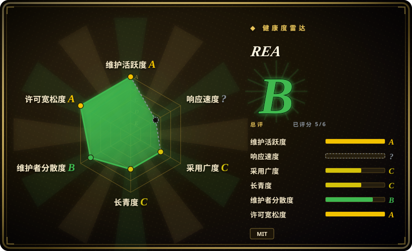
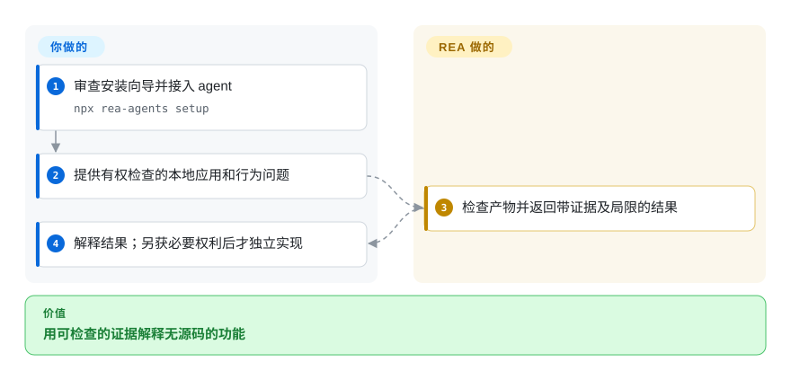
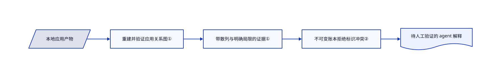

# REA

应用没有源码，你却要解释搜索或剪贴板功能怎么工作。REA 给 agent 提供本地检查工具和证据记录，避免它只看截图猜实现。

## 何时使用

你维护一个应用集成，也有权检查目标应用。Electron 包里有几千个压缩模块，或者关键行为藏在原生二进制里。你希望编程 agent 沿着导入、调用和引用追查，并指出解释来自哪里。当缺口是“把本地分析工具接给 agent”，而不是缺反编译器时，选 REA。MCP 是 agent 调用这些工具的接口。

它也能从终端使用。静态 JavaScript 检查不需要 Hopper、Ghidra 或 IDA，深入检查原生程序则要另配引擎。它提供观察结果，不保证完整还原源码。

## 何时不用

- **你只有检查产物的权限。** 留在 REA 或 Ghidra 的已授权静态检查范围内；检查权限不授权运行、流量拦截、设备修改或结果复用。各项操作及独立实现都须另行取得必要权利，分析报告不授予受保护代码或素材的使用权。[上游声明](https://github.com/morluto/rea/blob/b83b9caf4a5f0241a5fd370792f1aed1bffbb2cf/DISCLAIMER.md#L45-L71)区分这些责任；其[与许可的关系](https://github.com/morluto/rea/blob/b83b9caf4a5f0241a5fd370792f1aed1bffbb2cf/DISCLAIMER.md#L115-L121)明确说明，用途和社区支持边界不修改 MIT，也不新增版权许可条件。
- **需要人工主导的原生分析工作台。** 直接用 Ghidra 做交互式反汇编和标注；REA 是 agent 接入层，不是替代反编译器。
- **只要可脚本化的小型二进制工具。** 考虑 radare2；REA 还带来 Node 运行时、证据契约和大量可选集成。
- **团队依赖成熟商业反编译工作流。** 保留 IDA Pro 及其授权；REA 的 MIT 许可不授予商业工具使用权。
- **结果不能发给托管模型。** 用 Ghidra 等本地引擎及合适的本地工作流。REA 本地分析不阻止 agent 把工具结果发给模型商。
- **目标不可信，且无须运行它。** 优先用 Ghidra 或 REA 的静态检查，不要直接做运行时捕获。捕获会以你的权限启动或操作目标，不是恶意软件沙箱。

## 横向对比

| 替代品 | 是否收录 | 我们的评价 | 取舍 |
|---|---|---|---|
| [reverse-skill](../../agent-skills/security/reverse-skill.zh.md) | ✅ | agent 缺可运行的本地 CLI/MCP 和结构化观察账本时选 REA；缺跨安全领域的调查流程路由时选 reverse-skill。 | 可执行分析适配器与不可变记录，对比技能化调查流程和工具自举；后者见[路由入口](https://github.com/zhaoxuya520/reverse-skill/blob/7e2097fd90d25c2f976f6eba26d6c00aa88051df/skills/SKILL.md#L7-L19)。两者都不授予目标使用权。 |
| [Ghidra](ghidra.zh.md) | ✅ | 人工主导的原生检查选 Ghidra；需要让 agent 拿到带证据的结果时选 REA 接入它。 | 成熟分析工作台与工具编排层的区别；REA 深入检查原生程序仍需另配引擎。 |
| radare2 | 未收录 | 直接从命令行操纵二进制选 radare2；一个 agent 接口要覆盖原生和 Electron 目标时选 REA。 | 直接控制更精简，REA 的适配面和结果契约更广；真实仓库，本次标签批次未收录。 |
| IDA Pro | 非仓库 | 商业分析环境决定工作流时选 IDA Pro；额外需要 agent 接口时才加入 REA。 | 商业产品，另行授权；REA 不附带反编译器及其许可。 |

## 快速上手

准备受支持的 Node.js，运行 `npx rea-agents setup`，选择 agent，审查配置改动后重启。安装向导注册本地工具服务，并安装配套调查指令；你仍要提供有权检查的目标和原生分析引擎，运行或拦截须另有授权。向 agent 提出具体行为问题，要求先给证据再接受解释。静态检查 Electron 时，README 另有 `npx -y rea-agents@latest analyze-javascript-application /absolute/path/to/app --json`。模型和商业工具费用由你承担；另行取得必要权利后才独立实现，不复制受保护代码或素材，结果也由你验证。

<!-- flow-steps:begin (generated from flows/rea.json by tools/flow_card.py — do not edit) -->

流程文字版

1. **你**：审查安装向导并接入 agent — `npx rea-agents setup`
2. **你**：提供有权检查的本地应用和行为问题
3. **REA**：检查产物并返回带证据及局限的结果
4. **你**：解释结果；另获必要权利后才独立实现

**价值**：用可检查的证据解释无源码的功能

<!-- flow-steps:end -->

## 技术要点

<!-- mechanism:begin (generated from mechanisms/rea.json by tools/mechanism_card.py; do not edit) -->

机制文字版

- 本地应用产物
- 重建并验证应用关系图①
- 带散列与明确局限的证据①
- 不可变账本拒绝标识冲突②
- 待人工验证的 agent 解释

- 本地应用产物 → 重建并验证应用关系图①
- 重建并验证应用关系图① → 带散列与明确局限的证据①
- 带散列与明确局限的证据① → 不可变账本拒绝标识冲突②
- 不可变账本拒绝标识冲突② → 待人工验证的 agent 解释

<!-- mechanism:end -->

### 1. 验证并散列静态应用观察结果

- **解决：** 压缩包的解释看似合理，却可能漏掉模块或混入无依据推断。
- **做法：** JavaScript 服务重建产物关系图，验证元数据和跨图绑定，再生成带散列及明确局限的证据。取消时可以保留通过验证的部分观察结果。
- **边界：** 静态关系不能证明运行时行为；证据记录合法，也不代表 agent 后续解释正确。
- **源码：** [JavaScript 分析服务](https://github.com/morluto/rea/blob/b83b9caf4a5f0241a5fd370792f1aed1bffbb2cf/src/application/javascript/JavaScriptApplicationService.ts#L32-L145)。

### 2. 拒绝冲突证据，不静默合并

- **解决：** 重复调用工具或导入调查包，可能给同一证据标识写入不同内容。
- **做法：** 会话账本保存不可变记录，相同内容重复写入不增加记录，冲突内容直接拒绝。整包验证通过后才合并；未知项另有版本，并关联变更证据。
- **边界：** 完整性检查保护记录一致性，不保证底层反编译器或观察本身正确。
- **源码：** [证据账本](https://github.com/morluto/rea/blob/b83b9caf4a5f0241a5fd370792f1aed1bffbb2cf/src/application/investigation/EvidenceLedger.ts#L43-L239)。

## 技术栈

Node.js 上的 TypeScript，Zod 输入和结果校验，命令行与本地 MCP 服务，以及外部分析引擎桥接。清单要求 Node.js `^22.19.0 || ^24.11.0 || >=26.0.0`。

## 依赖

基础是 Node.js 和 npm。原生反编译需要受支持的 Hopper、Ghidra 或 IDA。其他目标各有工具要求，例如 APK 使用 JADX 和 JDK，网站观察使用浏览器。Linux 进程归属检查需要兼容 procps 的 `ps`。静态 JavaScript 分析不需要原生引擎。按[目标要求表](https://github.com/morluto/rea/blob/b83b9caf4a5f0241a5fd370792f1aed1bffbb2cf/README.md#what-you-can-analyze)准备，不必安装所有适配器。

## 运维难度

**中。** 一次性静态检查只需 Node 命令。无人值守的原生分析还要处理引擎版本、商业授权、首次启动弹窗、进程清理和平台要求。接入共享 harness 前固定发布版本，并审查安装向导的配置改动；本次没有执行上游安装器。

## 健康度与可持续性

- **2026-10-18，活跃但年轻。** 仓库建于 2026 年 4 月，默认分支今天仍有更新。即使发布频繁，半年的历史也不能提供强 Lindy 依据。
- **维护归属。** 项目位于个人账号，不是基金会维护的反编译器。成为强制工作流依赖前，要观察贡献者和发布是否持续。
- **许可。** MIT 文件署名 morluto。第三方声明保留引擎与依赖各自的条款，也记录了部分声明缺口；MIT 只覆盖 REA 自有代码。
- **采用信号。** API 显示大量星标和分叉，但关注度不证明分析准确，也不证明无人值守运行安全。

## 存疑（未验证）

- [未验证：未执行上游软件] 分析准确性、启动行为和平台兼容性仅据源码及文档检查，没有用样本二进制复现。
- [推断：依据是项目年龄与活跃记录] 在自己的目标样本上建立可靠性证据前，宜将它作为可选调查桥接；热度不能替代长期维护历史。
