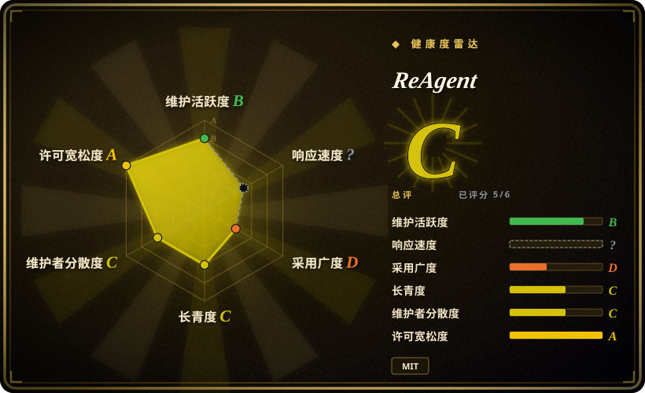
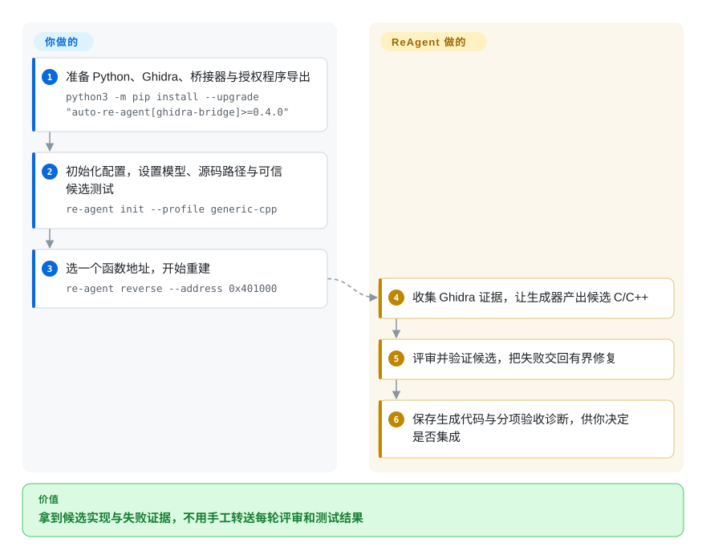
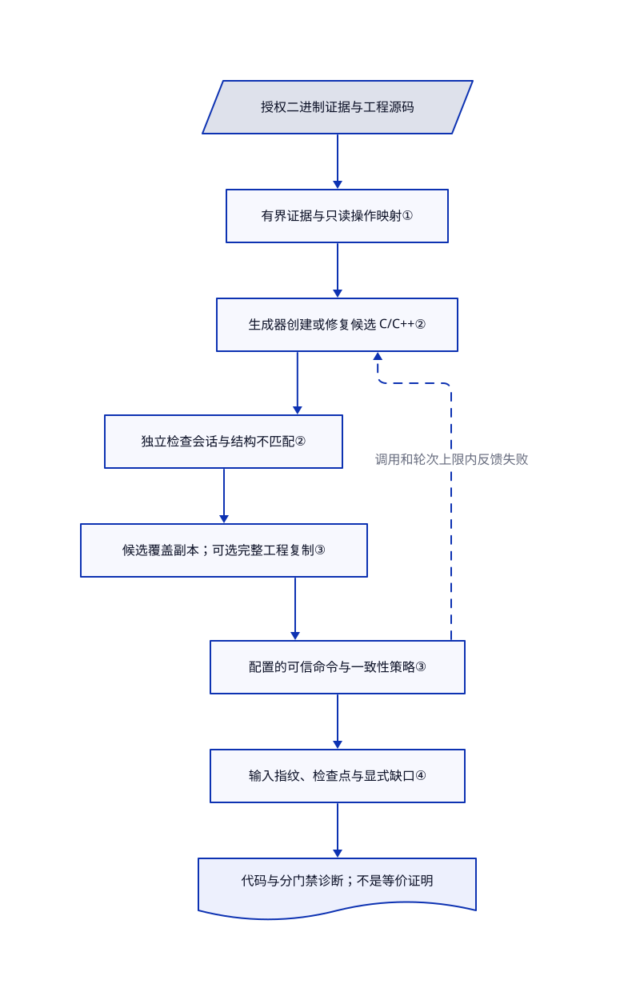

# ReAgent

你有编译后的函数，也有重建到一半的 C/C++ 工程，但复制反编译文本并不能得到可测试的代码。ReAgent 根据 Ghidra 证据生成候选实现，让独立检查会话评审，再把配置的验证失败交回有界修复循环。

## 何时使用

你维护一款有权重建的原生旧程序。源码里还留着 `FUN_00401000` 这样的占位函数，而 Ghidra 已经给出调用关系、类型与大致函数体。你已有能构建的工程，或能提供一个单函数测试适配器。当缺口是反复把这些证据变成候选实现、编译测试，再把失败留给下一轮时，选 ReAgent。

相比手动操作 [Ghidra](ghidra.zh.md)，或让 [REA](rea.zh.md) 逐问检查，你得到的是固定的重建与验证循环，不是通用调查对话。代价是模型调用，以及由你定义有意义的验收命令。先选一个函数；之后可用有界函数清单跨类组织目标，但不能把它称为整个程序的恢复。

## 何时不用

- **你只要解释，不要可执行的替代代码。** 人工标注选 [Ghidra](ghidra.zh.md)，agent 调查选 [REA](rea.zh.md)。仅做调查，不需要 ReAgent 额外的模型评审、候选副本与验证接线。
- **程序证据不能发给托管模型。** 用本地 [Ghidra](ghidra.zh.md)，或另行验证本地兼容 OpenAI 的服务。ReAgent 会把反编译文本与源码上下文交给所选服务商，并保存提示与响应；使用本地 CLI 登录，不代表模型在本地运行。
- **你要不调用模型、不接工程测试的反编译输出。** 可选 [RetDec](https://github.com/avast/retdec)，但要接受其有限维护警告；也可选 Ghidra。ReAgent 默认的已验证路径拒绝未配置或未获信任的验证命令；关掉验证会改变成功的含义。
- **你要求原始行为的证明，或没有执行验证命令的授权。** 留在 Ghidra 静态检查与另行设计的验证流程。结构检查和给定用例一致都不是语义等价证明；临时工程副本也不是隔离任意构建、测试或运行命令的操作系统沙箱。
- **你要求运行不留痕，或跨服务商的硬性金额上限。** 用一次性环境包住 Ghidra，并单独限定模型调用费用。ReAgent 会保留代码、日志、会话历史、图与缓存；单函数调用次数上限不是通用金额上限，临时副本删除还会忽略文件系统错误。

## 横向对比

| 替代品 | 是否收录 | 我们的评价 | 取舍 |
|---|---|---|---|
| [Ghidra](ghidra.zh.md) | ✅ | 分析人员要理解和标注二进制时选 Ghidra；候选源码要反复经过工程验收命令时选 ReAgent。 | ReAgent 消费 Ghidra 证据，不取代其反编译器；另加模型费用与测试集成。 |
| [REA](rea.zh.md) | ✅ | 编码 agent 要跨原生与 Electron 目标做带证据调查时选 REA；要固定的 C/C++ 实现、评审与修复管线时选 ReAgent。 | 更广的调查工具，对比更窄且带候选级门禁的重建循环；两者都不建立源码等价证明。 |
| [RetDec](https://github.com/avast/retdec) | 未收录 | 不要模型评审的传统本地反编译可选 RetDec，但须接受其有限维护状态；工程专属验证决定验收时选 ReAgent。 | RetDec 用基于 LLVM 的反编译器输出高级语言代码；ReAgent 需要 Ghidra、模型与自备验证框架。本批不扩收。 |

## 快速上手

准备 Python 3.10+ 与 Ghidra，按文档执行 `python3 -m pip install --upgrade "auto-re-agent[ghidra-bridge]>=0.4.0"`；无界面的导出还需单独的 `headless` 扩展与可用的 Ghidra 安装。先用桥接工具准备有权处理的程序导出，再在目标工程执行 `re-agent init --profile generic-cpp`，编辑 `re-agent.yaml`，配置模型服务、源码路径与验证命令。若要在临时副本验证，必须明确设置 `validation.copy_project: true`；确认自备命令确实消费并验证候选后，才声明 `trust_configured_commands: true`，因为初始化默认不开复制，也不信任命令。把 `orchestrator.max_llm_calls_per_function` 设小，先用 `re-agent doctor` 查准备状态，再把 `re-agent reverse --address 0x401000` 中的示例地址换成实际目标。ReAgent 返回生成的 C/C++，以及分别列出的模型评审、结构、验证与一致性信号；你支付模型费用、提供测试，并决定是否集成结果。这是[文档路径](https://github.com/Dryxio/reagent/blob/d12cea338c61898b06a86fe8adb25275fa9d5615/README.md#L81-L215)，不是本条目执行过的操作。

<!-- flow-steps:begin (generated from flows/reagent.json by tools/flow_card.py — do not edit) -->

流程文字版

1. **你**：准备 Python、Ghidra、桥接器与授权程序导出 — `python3 -m pip install --upgrade "auto-re-agent[ghidra-bridge]>=0.4.0"`
2. **你**：初始化配置，设置模型、源码路径与可信候选测试 — `re-agent init --profile generic-cpp`
3. **你**：选一个函数地址，开始重建 — `re-agent reverse --address 0x401000`
4. **ReAgent**：收集 Ghidra 证据，让生成器产出候选 C/C++
5. **ReAgent**：评审并验证候选，把失败交回有界修复
6. **ReAgent**：保存生成代码与分项验收诊断，供你决定是否集成

**价值**：拿到候选实现与失败证据，不用手工转送每轮评审和测试结果

<!-- flow-steps:end -->

## 技术要点

<!-- mechanism:begin (generated from mechanisms/reagent.json by tools/mechanism_card.py; do not edit) -->

机制文字版

- 授权二进制证据与工程源码
- 有界证据与只读操作映射①
- 生成器创建或修复候选 C/C++②
- 独立检查会话与结构不匹配②
- 候选覆盖副本；可选完整工程复制③
- 配置的可信命令与一致性策略③
- 输入指纹、检查点与显式缺口④
- 代码与分门禁诊断；不是等价证明

- 授权二进制证据与工程源码 → 有界证据与只读操作映射①
- 有界证据与只读操作映射① → 生成器创建或修复候选 C/C++②
- 生成器创建或修复候选 C/C++② → 独立检查会话与结构不匹配②
- 独立检查会话与结构不匹配② → 候选覆盖副本；可选完整工程复制③
- 候选覆盖副本；可选完整工程复制③ → 配置的可信命令与一致性策略③
- 配置的可信命令与一致性策略③ → 生成器创建或修复候选 C/C++②（调用和轮次上限内反馈失败）〔可选／兜底〕
- 配置的可信命令与一致性策略③ → 输入指纹、检查点与显式缺口④
- 输入指纹、检查点与显式缺口④ → 代码与分门禁诊断；不是等价证明

<!-- mechanism:end -->

### 1. 有界收集二进制证据，不让模型凭空补类型

- **解决：** 仅看反编译文本，容易缺少重建函数所需的被调函数、布局细节与分支。
- **做法：** 生成器预取可用上下文、虚表、控制流图与标准化 p-code，也就是从机器指令转成的通用操作。模型请求的只读操作经过明确映射，返回有长度边界的文本，继续交给模型。
- **边界：** 预取与按需请求分别计数；缺少可选证据时可能省略。耗尽操作预算后仍在索取证据会报错，不生成候选；有界证据包不代表掌握整个程序。
- **源码：** [证据收集与操作分派，reverser.py 第 140–257 行](https://github.com/Dryxio/reagent/blob/d12cea338c61898b06a86fe8adb25275fa9d5615/src/re_agent/agents/reverser.py#L140-L257)。

### 2. 分开模型放行、结构否决与停止条件

- **解决：** 候选遗漏二进制中可见的调用或条件路径时，检查模型仍可能给出通过。
- **做法：** 每轮结合检查会话与非模型比较，核对调用数、控制流、常量返回及可用机器分析产物。两个角色共享调用预算；门禁失败诊断进入修复，候选与诊断的哈希完全重复时停止。
- **边界：** 检查器默认复用生成器的服务配置，不是自动选择不同模型家族。结构证据未知不会单独否决结果，只有强不匹配才失败；轮次与调用上限限制工作量，不保证正确，也不提供跨服务商金额上限。
- **源码：** [评审、成功条件与重复停止，loop.py 第 64–205 行](https://github.com/Dryxio/reagent/blob/d12cea338c61898b06a86fe8adb25275fa9d5615/src/re_agent/agents/loop.py#L64-L205)、[结构验证第 13–145 行](https://github.com/Dryxio/reagent/blob/d12cea338c61898b06a86fe8adb25275fa9d5615/src/re_agent/verification/objective.py#L13-L145)、[共享调用计数第 14–76 行](https://github.com/Dryxio/reagent/blob/d12cea338c61898b06a86fe8adb25275fa9d5615/src/re_agent/llm/observed.py#L14-L76)。

### 3. 验证候选副本，不把命令退出成功当成验证有意义

- **解决：** 未替换原函数的工程即使构建全绿，也不能验证生成的候选。
- **做法：** 覆盖副本替换匹配函数体，遇到歧义重载就拒绝。可选的完整工程副本重映射内部软链、拒绝外部软链；验证命令接收候选路径，并记录超时与退出码。命令成功但未明确获信任时仍判未知；默认验收要求验证通过，并阻断红色一致性信号。
- **边界：** 复制不是数据类或生成模板的默认值，须主动开启。命令继承进程环境，仍能影响宿主；信任是用户声明，不是沙箱。收尾尝试删除临时副本，但压掉删除错误；持久报告与非隔离副本仍保留。
- **源码：** [副本、命令信任与清理，candidate.py 第 33–242 行](https://github.com/Dryxio/reagent/blob/d12cea338c61898b06a86fe8adb25275fa9d5615/src/re_agent/verification/candidate.py#L33-L242)、[软链边界第 312–326 行](https://github.com/Dryxio/reagent/blob/d12cea338c61898b06a86fe8adb25275fa9d5615/src/re_agent/verification/candidate.py#L312-L326)、[验收与收尾清理，single.py 第 118–217 行](https://github.com/Dryxio/reagent/blob/d12cea338c61898b06a86fe8adb25275fa9d5615/src/re_agent/orchestrator/single.py#L118-L217)、[默认值第 123–144 行](https://github.com/Dryxio/reagent/blob/d12cea338c61898b06a86fe8adb25275fa9d5615/src/re_agent/config/schema.py#L123-L144)。

### 4. 把可续跑结果绑定到选定输入，并保留证据缺口

- **解决：** 源码或验收策略改了，仍沿用昨天的成功函数，会悄悄复用过期结果。
- **做法：** 指纹覆盖源码配置、验证、一致性与后端配置，以及选定源码和导出文件。会话重新绑定时，若身份变化便归档旧结果。不调用模型的规划器按深度与数量边界遍历直接调用，记录查询失败及清单外依赖。
- **边界：** 指纹不是完整环境快照，不哈希任意构建工具二进制、模型配置或实时桥接背后的内容。函数清单是有界库存，不是完整调用图；证据缺口仍是结果的一部分。
- **源码：** [指纹输入，identity.py 第 13–43 行](https://github.com/Dryxio/reagent/blob/d12cea338c61898b06a86fe8adb25275fa9d5615/src/re_agent/core/identity.py#L13-L43)、[会话绑定与检查点第 39–92 行](https://github.com/Dryxio/reagent/blob/d12cea338c61898b06a86fe8adb25275fa9d5615/src/re_agent/core/session.py#L39-L92)、[有界规划第 87–160 行](https://github.com/Dryxio/reagent/blob/d12cea338c61898b06a86fe8adb25275fa9d5615/src/re_agent/core/target_plan.py#L87-L160)、[拒绝清单输入漂移第 33–38 行](https://github.com/Dryxio/reagent/blob/d12cea338c61898b06a86fe8adb25275fa9d5615/src/re_agent/cli/cmd_reverse.py#L33-L38)。

## 技术栈

- Python 命令行、YAML 配置与数据类状态；核心依赖是 PyYAML、Anthropic 和 OpenAI SDK，用 Hatchling 打包。
- 子进程调用的 Ghidra 桥接器，或已有 Ghidra JSON 导出的读取器。后端注册表另有固定数据测试后端，不是可替代生产分析引擎。
- 本地 JSON 会话、图与调用日志；生成的 C/C++ 文件和 Markdown／JSON 报告。不需要数据库服务。

## 依赖

- Python 3.10+；完整二进制证据收集需要 Ghidra 与 `ghidra-ai-bridge`，`ghidra-json` 则读预先生成的导出。Java 与原生组件要求属于单独的 Ghidra 安装。
- Claude API、配置好的兼容 OpenAI 服务，或已登录的 Claude／Codex CLI。可单配两个角色；服务商费用与证据披露规则由你负责。
- 目标源码布局、编译与构建工具，以及有意义的工程自备验证命令。可选 Clang 索引需要本地可执行程序与合适的编译数据库；计时器差分示例另需 `pefile`、Unicorn 与 C++ 编译器。
- MIT 许可覆盖 ReAgent 代码，不赋予目标二进制、恢复素材的所有权或执行许可。你须提供有权处理的二进制；计时器示例不附带它。

## 运维难度

**中到高。** Python 命令行安装只是小部分；维护兼容的 Ghidra 导出、解析源码身份、设计可信构建或运行适配器，才是真正集成成本。模型会接收程序证据，逐调用日志可能保留敏感源码与响应。你须为报告、会话与 `.cache/re-agent-parity` 设置留存及访问规则；临时副本清理不会删除这些文件或服务商记录。固定版本，把不可信目标与验证命令隔离在日常凭据之外，分别检查各项判定，不把通过当成等价。

## 健康度与可持续性

- **2026-10-25——早期版本线，未弃置。** 仓库创建于 2026-02-17；可见四个版本从七月的 v0.2.0 到 2026-09-09 的 v0.4.0，默认分支最近提交也在该日。清单明确把包归为 Alpha。
- **维护权集中。** 个人账号仓库的贡献者 API 返回三人，贡献次数分别为 27、11、2。树中没有治理、安全政策或代码所有者文档；仍开放的 IDA 支持及新监控／并行请求，不是默认分支已经具备的能力。
- **持续性判断。** [推断：依据是八个月历史、近期发布与集中的贡献记录] 先把它作为可选、固定版本的重建助手，待自己的样本库验证。近期活跃有帮助，但相较 Ghidra，短期活跃历史的林迪先验较弱；2215 星与 234 个 fork 只衡量关注，不证明恢复成功。
- **许可与证据质量。** 已读的 MIT 正文署名 Dryxio，可见许可历史只有初始提交。仓库提供测试、具体计时器适配器与有限公开实验；该实验只覆盖三个函数和 21 次观测，不代表任意 C/C++ 二进制或全程序等价。

## 存疑（未验证）

- [未验证：本次只读公开源码，按任务约束未安装或运行上游] 未复现安装、Ghidra 集成、重建质量、实际模型费用、运行隔离及清理成功。源码存在与上游测试，不是本条目实际运行的证据。
- [未验证：缺少作者实验环境与其授权参考二进制] 已读公开验证产物中的计时器匹配与反例控制，但未重跑，不能据此推广一般重建准确率。
- [推断：依据是项目年龄、维护记录和贡献集中度] 可选接入与持续性较弱是选型判断，不是弃置预测或支持保证。
