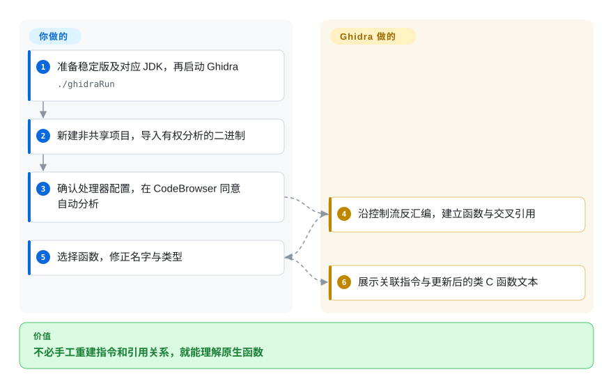
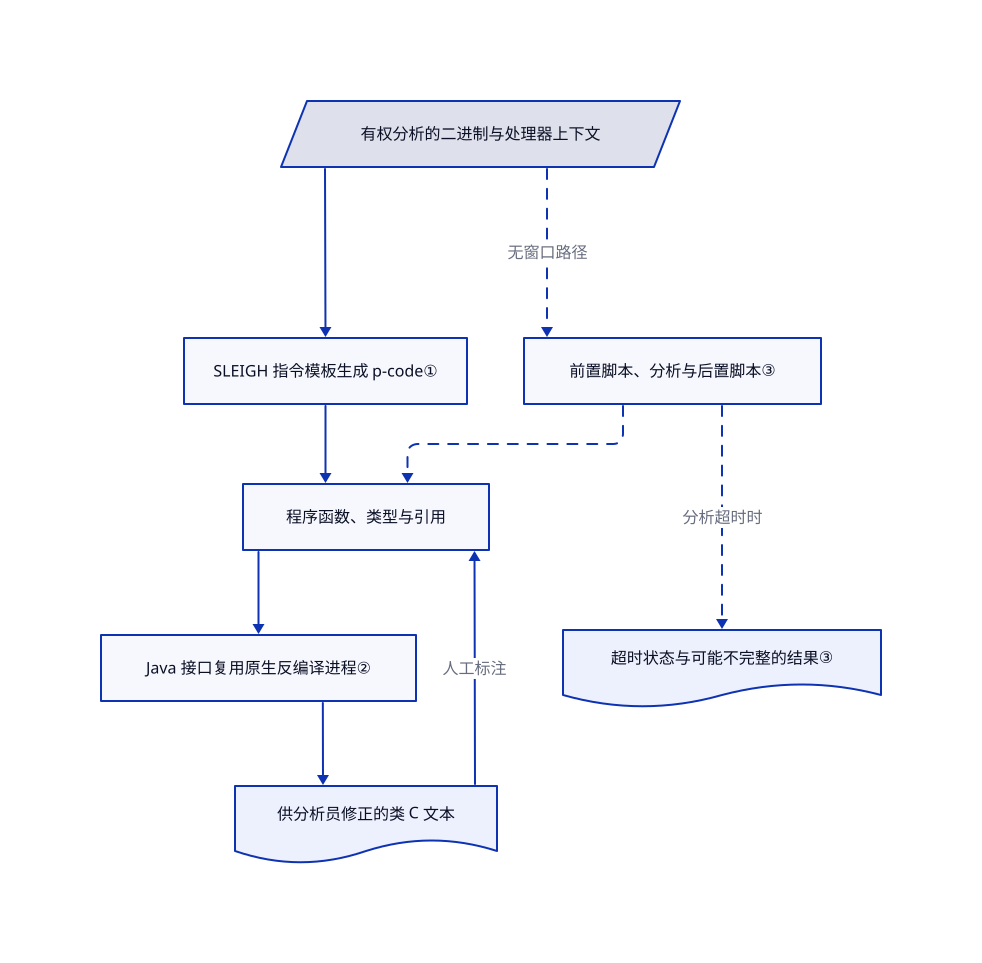

# Ghidra

你只有编译后的程序，满屏地址看不出行为。Ghidra 把机器指令、类 C 函数、引用关系和人工标注放进同一个可保存的项目。

## 何时使用

你在维护设备，或审查有权分析的原生应用。手里只有 ELF、PE 或固件，`FUN_00101230` 这样的名字看不出参数和调用者。需要人工跟进引用、修正函数签名，并跨会话保留理解时，选 Ghidra。它把反编译器和项目工作区放在一起，不必另接命令行反汇编器与标注工具。

它也能无窗口批处理，并运行 Java 或 Python 脚本。需要原生分析引擎本身，而非让 agent 操作引擎的接口时，选它而非 [REA](rea.zh.md)。原始固件仍要由你确定处理器、编译约定和内存布局；导入不会自动补齐硬件知识。

## 何时不用

- **只想在 shell 脚本里查询几处二进制信息。** 选 [radare2](https://github.com/radareorg/radare2) 的命令接口与 r2pipe。若不需要长期人工标注，Ghidra 的 Java 环境和项目管理就是额外负担。
- **团队已使用 Rizin 命令体系，想配一个 Qt 桌面。** 选 [Cutter](https://github.com/rizinorg/cutter)。它提供对应界面，也能集成 Ghidra 反编译器，无须采用整套 Java 工作区。
- **缺的是 agent 接口，不是反汇编能力。** 选 [REA](rea.zh.md) 做编排层，再另配分析引擎。Ghidra 本身不提供 REA 的证据账本或 MCP 接口。
- **打算在日常电脑导入未知文件，并以“不运行目标”为安全保证。** 改用一次性隔离虚拟机中的已修补 Ghidra。[公开安全公告](https://github.com/NationalSecurityAgency/ghidra/security/advisories)包含导入时拒绝服务，以及 Windows 分析器代码执行问题，修补版本列为 12.1.4。静态分析不是沙箱；运行、调试或拦截目标均须另获授权。

## 横向对比

| 替代品 | 是否收录 | 我们的评价 | 取舍 |
|---|---|---|---|
| [radare2](https://github.com/radareorg/radare2) | 未收录 | 现有 shell 流水线需要命令式二进制检查时选 radare2；需要带类 C 视图的长期人工工作区时选 Ghidra。 | 直接命令与 r2pipe，换 Java 项目和关联可视标注；本轮标签批次未添加。 |
| [Cutter](https://github.com/rizinorg/cutter) | 未收录 | Rizin 兼容与 Qt 界面决定工作流时选 Cutter；想统一使用 Ghidra 项目、分析和脚本接口时选 Ghidra。 | 换的是工作区与插件体系，不是独立的反编译准确率保证；Cutter 文档说明可集成 Ghidra 反编译器。本轮标签批次未添加。 |
| [REA](rea.zh.md) | ✅ | agent 需要本地检查工具和带证据的结果时选 REA；分析员要直接检查、标注原生函数时选 Ghidra。 | agent 编排层与底层分析工作区的区别；REA 深入检查原生程序仍需另配引擎。 |

## 快速上手

稳定版 12.1.4 使用 64 位 JDK 21，把官方发布 ZIP 解压到新目录，不要覆盖旧安装；GitHub 源码压缩包不是可直接运行的发行包。准备好所需原生组件后，Linux 或 macOS 用 `./ghidraRun` 启动，Windows 用 `ghidraRun.bat`。新建非共享项目，导入有权分析的二进制，确认格式与处理器，再用 CodeBrowser 打开并同意自动分析。Ghidra 找函数、建引用并提供类 C 视图；你负责核实结论，修正名字、类型和边界。[稳定版安装指南](https://github.com/NationalSecurityAgency/ghidra/blob/Ghidra_12.1.4_build/GhidraDocs/GettingStarted.md)要求 macOS 与 Linux ARM 用户自建原生组件，[入门教程](https://github.com/NationalSecurityAgency/ghidra/blob/b8e9917e4c01959fe97ba94954731ed8cf2d201c/GhidraDocs/GhidraClass/Beginner/Introduction_to_Ghidra_Student_Guide.html#L358-L530)给出项目与导入流程。本次未安装、启动软件或分析目标。

<!-- flow-steps:begin (generated from flows/ghidra.json by tools/flow_card.py — do not edit) -->

流程文字版

1. **你**：准备稳定版及对应 JDK，再启动 Ghidra — `./ghidraRun`
2. **你**：新建非共享项目，导入有权分析的二进制
3. **你**：确认处理器配置，在 CodeBrowser 同意自动分析
4. **Ghidra**：沿控制流反汇编，建立函数与交叉引用
5. **你**：选择函数，修正名字与类型
6. **Ghidra**：展示关联指令与更新后的类 C 函数文本

**价值**：不必手工重建指令和引用关系，就能理解原生函数

<!-- flow-steps:end -->

## 技术要点

<!-- mechanism:begin (generated from mechanisms/ghidra.json by tools/mechanism_card.py; do not edit) -->

机制文字版

- 有权分析的二进制与处理器上下文
- SLEIGH 指令模板生成 p-code①
- 程序函数、类型与引用
- Java 接口复用原生反编译进程②
- 供分析员修正的类 C 文本
- 前置脚本、分析与后置脚本③
- 超时状态与可能不完整的结果③

- 有权分析的二进制与处理器上下文 → SLEIGH 指令模板生成 p-code①
- SLEIGH 指令模板生成 p-code① → 程序函数、类型与引用
- 程序函数、类型与引用 → Java 接口复用原生反编译进程②
- Java 接口复用原生反编译进程② → 供分析员修正的类 C 文本
- 供分析员修正的类 C 文本 → 程序函数、类型与引用（人工标注）
- 有权分析的二进制与处理器上下文 → 前置脚本、分析与后置脚本③（无窗口路径）〔可选／兜底〕
- 前置脚本、分析与后置脚本③ → 程序函数、类型与引用〔可选／兜底〕
- 前置脚本、分析与后置脚本③ → 超时状态与可能不完整的结果③（分析超时时）〔可选／兜底〕

<!-- mechanism:end -->

### 1. 把不同处理器指令转换为共同操作

- **解决：** 处理器指令不同，但分析需要统一描述读写和控制流。
- **做法：** SLEIGH 是 Ghidra 描述处理器的语言，负责提供指令模板。指令原型遍历解析后的模板，生成 p-code，也就是一组共同操作，再解析相对跳转与后继地址。
- **边界：** 仍需正确的处理器规格与解码上下文。所读方法无法生成有效 p-code 时，会返回 `UNIMPLEMENTED` 操作；架构覆盖广不等于每条指令都有模型。
- **源码：** [p-code 生成与失败路径](https://github.com/NationalSecurityAgency/ghidra/blob/b8e9917e4c01959fe97ba94954731ed8cf2d201c/Ghidra/Framework/SoftwareModeling/src/main/java/ghidra/app/plugin/processors/sleigh/SleighInstructionPrototype.java#L1001-L1038)、[处理器规格初始化](https://github.com/NationalSecurityAgency/ghidra/blob/b8e9917e4c01959fe97ba94954731ed8cf2d201c/Ghidra/Framework/SoftwareModeling/src/main/java/ghidra/app/plugin/processors/sleigh/SleighLanguage.java#L123-L160)。

### 2. 在 Java 接口后复用原生反编译进程

- **解决：** 每个函数重新初始化会浪费准备工作，原生进程失败也不应要求重建整个分析工作区。
- **做法：** `DecompInterface` 保留程序和选项状态，支持反复请求函数。它带超时向原生反编译器发送入口地址，返回 C 文本标记或高层函数表示；进程崩溃后，下次请求可重新启动并初始化。
- **边界：** 恢复机制保障可用性，不保障结论正确。调用者须检查完成状态和错误；人工提供的函数签名、数据类型会影响类 C 输出，输出不是还原的原始源码。
- **源码：** [持久接口与结果检查](https://github.com/NationalSecurityAgency/ghidra/blob/b8e9917e4c01959fe97ba94954731ed8cf2d201c/Ghidra/Features/Decompiler/src/main/java/ghidra/app/decompiler/DecompInterface.java#L40-L80)、[请求与超时处理](https://github.com/NationalSecurityAgency/ghidra/blob/b8e9917e4c01959fe97ba94954731ed8cf2d201c/Ghidra/Features/Decompiler/src/main/java/ghidra/app/decompiler/DecompInterface.java#L761-L834)、[标注对输出的影响](https://github.com/NationalSecurityAgency/ghidra/blob/b8e9917e4c01959fe97ba94954731ed8cf2d201c/GhidraDocs/GhidraClass/Beginner/Introduction_to_Ghidra_Student_Guide.html#L1121-L1165)。

### 3. 用脚本流水线处理批量分析与部分结果

- **解决：** 一整目录的二进制需要重复分析和提取，不能逐个手动打开。
- **做法：** 无窗口分析器先跑前置脚本，再调用程序的分析管理器，最后跑后置脚本。逐文件超时会中断分析，但已完成分析器的结果仍可交给后置脚本；导入模式与处理已有项目是两个入口。
- **边界：** 超时不表示分析完成，也不停止全部后续脚本工作。脚本须自行检查超时和失败；`-readOnly` 控制项目是否保存，不隔离操作系统，也不限制脚本权限。
- **源码：** [流水线实现](https://github.com/NationalSecurityAgency/ghidra/blob/b8e9917e4c01959fe97ba94954731ed8cf2d201c/Ghidra/Features/Base/src/main/java/ghidra/app/util/headless/HeadlessAnalyzer.java#L1007-L1145)、[无窗口选项与超时语义](https://github.com/NationalSecurityAgency/ghidra/blob/b8e9917e4c01959fe97ba94954731ed8cf2d201c/Ghidra/RuntimeScripts/support/analyzeHeadlessREADME.md)。

## 技术栈

- Java 桌面与程序分析接口，配原生 C++ 反编译器和 SLEIGH 处理器规格。
- Gradle 多项目构建，Java、Python 脚本，以及通过 PyGhidra 提供的可选 CPython 集成。所读[构建清单](https://github.com/NationalSecurityAgency/ghidra/blob/b8e9917e4c01959fe97ba94954731ed8cf2d201c/build.gradle#L16-L149)包含 Python 探测、原生平台支持和测试任务。
- 单人使用本地项目存储；可选 Ghidra Server 支持共享仓库。本地静态流程不依赖服务器。

## 依赖

- **稳定版 12.1.4。** 64 位 JDK 21；发布指南列出 Python 3.9–3.14，Python 集成与调试连接器另有包依赖。文档最低硬件为 4 GB 内存、1 GB 安装空间，不代表大型二进制的性能保证。
- **原生组件。** 官方发布包含 Windows x86-64、Linux x86-64 二进制；macOS 与 Linux ARM 需要本地构建。稳定版指南要求 Gradle 8.5+ 和 C/C++ 工具链。
- **开发分支。** 所读 master README 已要求 JDK 25、Gradle 9.1.0+ 和 Python 3.9–3.15，不要与稳定版说明混用。
- 本地静态分析不需要托管模型或外部数据库。服务器协作、调试和附加插件会增加配置与信任边界。

## 运维难度

**本地分析中等，共享与无人值守更高。** 支持的平台可以解压运行，不必安装系统服务，但仍须处理原生构建、Java 版本和扩展兼容。升级前备份 `.gpr` 文件与 `.rep` 目录：保存升级后的程序，可能让旧版 Ghidra 无法重新打开。批处理维护者还要安排 CPU、内存和部分结果处理；服务器维护者另管认证、仓库权限和备份。不要让不可信产物与脚本接触日常凭据。

## 健康度与可持续性

- **2026-10-22，发布线活跃。** GitHub 显示 12.1.4 发布于 2026-09-21，前两版分别在八月和六月发布；所读默认分支提交日期为 2026-10-20。项目仍在维护，并非归档工具。
- **归属与延续。** 公开仓库始于 2019 年三月，归 NSA 组织所有。README 说明由其研究部门创建和维护，可见多位有大量提交的贡献者。[贡献指南](https://github.com/NationalSecurityAgency/ghidra/blob/b8e9917e4c01959fe97ba94954731ed8cf2d201c/CONTRIBUTING.md)要求有合入权的维护者批准并合入，并提示评审积压；外部补丁没有支持时限承诺。
- **采用与耐久判断。** [推断：依据是七年多公开历史、持续发布和多位贡献者] 年龄与当前维护同时成立，使其比新生反编译包装层更值得押注延续性。约 9.28 万星、教程、扩展接口与测试说明生态广度，不证明某类目标的分析正确率。
- **许可与运行风险。** [LICENSE](https://github.com/NationalSecurityAgency/ghidra/blob/b8e9917e4c01959fe97ba94954731ed8cf2d201c/LICENSE)为 Apache-2.0；[NOTICE](https://github.com/NationalSecurityAgency/ghidra/blob/b8e9917e4c01959fe97ba94954731ed8cf2d201c/NOTICE)说明美国政府部分、第三方许可和独立 GPL 辅助程序。应固定版本并跟进安全修补与平台兼容；开源分析器本身也会被特制输入攻击。

## 存疑（未验证）

- [未验证：本次仅静态阅读公开源码，未安装或运行] 未用目标语料验证启动、原生构建、分析准确率、内存或吞吐。机制证据固定在所读 master 提交；使用路径按稳定版指南区分不同要求。
- [推断：依据是公开项目年龄、发布节奏与贡献记录] 持续维护只是耐久先验，不保证未来 NSA 资源、问题响应或对你所用处理器的支持。
