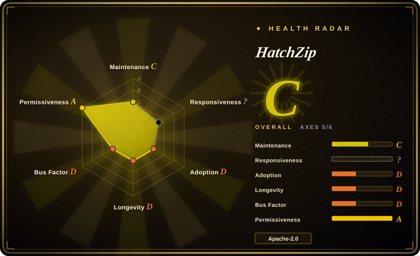
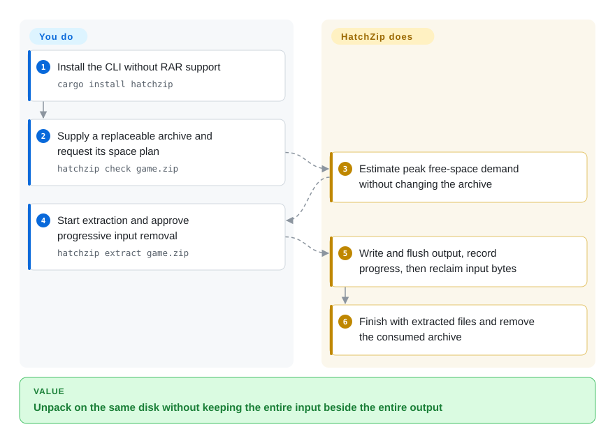
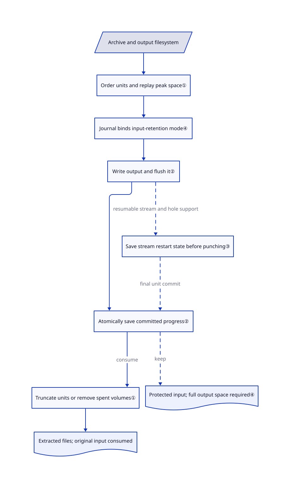

# HatchZip

Your downloaded archive fits on disk, but extracting it runs out of space. HatchZip reuses the archive's space by deleting already-extracted bytes, rather than keeping the whole input beside the output.

## When to use

You are unpacking a large game or dataset on a nearly full local disk. The output would fit after deleting the download, but 7-Zip cannot finish while both copies coexist. Choose HatchZip when you can deliberately consume that download: it plans peak space, extracts independent pieces, and shrinks the archive after recording durable progress. ZIP, multi-block 7z and plain tar can benefit without filesystem hole punching; compressed tar needs that capability to reclaim space before completion.

The deciding tradeoff is lower peak disk demand versus retaining your original archive. This is not a new compression format or a general archive editor. Start with a replaceable download, not your only backup; the project was less than four days old at this verification.

## When NOT to use

- **You must retain the exact original package.** Use 7-Zip or HatchZip's explicit `--keep-archive` mode and budget for all output. Default extraction progressively destroys the input; `restore` only makes the remaining entries readable as an archive, not the original package.
- **One solid 7z block contains nearly everything.** Use 7-Zip with sufficient space or extract to another disk. HatchZip cannot reclaim that block until all its files are out; splitting the archive into volumes does not split its compression block.
- **You expect `.tar.gz` space savings on FAT32/exFAT, or snapshots retain the archive's blocks.** Use bsdtar from libarchive with a roomier destination. Without working hole punching, compressed tar remains allocated until completion; snapshots/clones can prevent reclaimed bytes from becoming free space. A different output filesystem also cannot reuse space freed on the archive's disk.
- **You require arbitrary format editing or compressed-tar coverage.** Choose PeaZip for archive management, or bsdtar for supported streaming formats. HatchZip currently refuses `.tar.xz`, `.tar.zst` and native split ZIP `.z01`; solid RAR requires keeping the archive.
- **You need proven recovery for irreplaceable data or concurrent writers in the destination.** Prefer 7-Zip plus an independently retained source and a dedicated output directory. Resume removes uncommitted output paths; do not replace those files or edit the journal. Once a streaming resume point may have released bytes, `restore` refuses and extraction must continue.

## Comparison

| Alternative | In index | Our verdict | Tradeoff |
|---|---|---|---|
| [7-Zip](https://github.com/ip7z/7zip) | not indexed | Pick 7-Zip when preserving the download or creating archives matters; pick HatchZip only when consuming input is acceptable to reduce peak disk usage. | General archiver rather than a destructive, journaled extraction path; needs room for retained input and output. Not added in this tab batch. |
| [libarchive / bsdtar](https://github.com/libarchive/libarchive) | not indexed | Pick bsdtar for conventional streaming extraction and broader format integration; pick HatchZip when the input's allocated bytes must fund output on the same disk. | C library plus tar/cpio/unzip tools; streaming input alone does not reclaim the existing local archive. Not added in this tab batch. |
| [PeaZip](https://github.com/peazip/PeaZip) | not indexed | Pick PeaZip for browsing, converting and managing many archive types; pick HatchZip for a narrowly scoped, space-constrained unpacking job. | Rich cross-platform archive/file manager instead of progressive input consumption. Not added in this tab batch. |

Comparison sources: [7-Zip source overview](https://github.com/ip7z/7zip/blob/b88c6bc09339de32f7d18bbab900686b244f42ba/DOC/readme.txt), [libarchive overview](https://github.com/libarchive/libarchive/blob/c119b18810ba0b5370a3e213a3705b77d986e53f/README.md), [PeaZip overview](https://github.com/peazip/PeaZip/blob/a6259b90031827887bae6a041db1f1c1787c6825/README.md).

## Quick start

Install the CLI with `cargo install hatchzip`; this default build excludes RAR. Supply a replaceable archive and run `hatchzip check game.zip` to inspect its space plan without changing the archive; planning can create and remove a small filesystem-probe file beside it. After accepting input consumption, run `hatchzip extract game.zip` and confirm the prompt; for hard-to-replace downloads, add `--verify-first` to check all entries before starting. HatchZip writes output to `./game/`, saves progress beside the archive, and removes the archive on successful default extraction; you keep those progress files during interruptions and rerun the same extraction command to resume. Use `hatchzip extract game.zip --keep-archive` instead when the original must remain, accepting full-output space requirements; the commands here were source-reviewed, not executed in this intake.

<!-- flow-steps:begin (generated from flows/hatchzip.json by tools/flow_card.py — do not edit) -->

Text version of the flow

1. **You**: Install the CLI without RAR support — `cargo install hatchzip`
2. **You**: Supply a replaceable archive and request its space plan — `hatchzip check game.zip`
3. **HatchZip**: Estimate peak free-space demand without changing the archive
4. **You**: Start extraction and approve progressive input removal — `hatchzip extract game.zip`
5. **HatchZip**: Write and flush output, record progress, then reclaim input bytes
6. **HatchZip**: Finish with extracted files and remove the consumed archive

**Value**: Unpack on the same disk without keeping the entire input beside the entire output

<!-- flow-steps:end -->

## Key techniques

<!-- mechanism:begin (generated from mechanisms/hatchzip.json by tools/mechanism_card.py; do not edit) -->

Text version of the mechanism

- Archive and output filesystem
- Order units and replay peak space①
- Journal binds input-retention mode④
- Write output and flush it②
- Atomically save committed progress②
- Truncate units or remove spent volumes①
- Save stream restart state before punching③
- Extracted files; original input consumed
- Protected input; full output space required④

- Archive and output filesystem → Order units and replay peak space①
- Order units and replay peak space① → Journal binds input-retention mode④
- Journal binds input-retention mode④ → Write output and flush it②
- Write output and flush it② → Atomically save committed progress②
- Atomically save committed progress② → Truncate units or remove spent volumes① (consume)
- Truncate units or remove spent volumes① → Extracted files; original input consumed
- Write output and flush it② → Save stream restart state before punching③ (resumable stream and hole support) [optional/fallback]
- Save stream restart state before punching③ → Atomically save committed progress② (final unit commit) [optional/fallback]
- Atomically save committed progress② → Protected input; full output space required④ (keep) [optional/fallback]

<!-- mechanism:end -->

### 1. Reclaim independent units from the end

- **Problem:** Ordinary extraction leaves the compressed input allocated while writing the entire output.
- **How:** The engine orders units by descending archive offset and replays their output allocations and reclaimed spans to estimate peak space. Units represent ZIP/tar entries or 7z blocks; storage truncates a committed prefix boundary and deletes volumes beyond it.
- **Limits:** A solid block stays indivisible; savings require output on the same filesystem. Snapshots retaining old blocks break the assumption that shortening the input returns usable capacity.
- **Source:** [Unit ordering:184–217](https://github.com/xevrion/hatchzip/blob/dd4f52f6ae27f80760d293b82cd8468411a29cec/crates/core/src/engine.rs#L184-L217), [space replay:433–469](https://github.com/xevrion/hatchzip/blob/dd4f52f6ae27f80760d293b82cd8468411a29cec/crates/core/src/engine.rs#L433-L469), [same-filesystem plan:356–403](https://github.com/xevrion/hatchzip/blob/dd4f52f6ae27f80760d293b82cd8468411a29cec/crates/core/src/session.rs#L356-L403), [volume truncation:199–223](https://github.com/xevrion/hatchzip/blob/dd4f52f6ae27f80760d293b82cd8468411a29cec/crates/core/src/archive/storage.rs#L199-L223).

### 2. Persist output and progress before deleting input

- **Problem:** A crash between writing output and truncating input could otherwise destroy the only recoverable copy.
- **How:** Initial setup atomically saves the archive tail and journal. Each batch writes and renames files, flushes output, atomically saves the committed boundary, then truncates; resume completes a pending truncation and clears uncommitted output before retrying.
- **Limits:** This is an inspected ordering protocol, not a proof against every filesystem, hardware or decoder failure. The journal and saved tail are essential recovery data, not disposable cache; `restore` rebuilds only the remaining archive's index.
- **Source:** [Initial journal:143–165](https://github.com/xevrion/hatchzip/blob/dd4f52f6ae27f80760d293b82cd8468411a29cec/crates/core/src/journal.rs#L143-L165), [batch commit:825–865](https://github.com/xevrion/hatchzip/blob/dd4f52f6ae27f80760d293b82cd8468411a29cec/crates/core/src/engine.rs#L825-L865), [atomic writes:41–61](https://github.com/xevrion/hatchzip/blob/dd4f52f6ae27f80760d293b82cd8468411a29cec/crates/core/src/fsutil.rs#L41-L61), [resume:130–181](https://github.com/xevrion/hatchzip/blob/dd4f52f6ae27f80760d293b82cd8468411a29cec/crates/core/src/engine.rs#L130-L181), [restore:59–110](https://github.com/xevrion/hatchzip/blob/dd4f52f6ae27f80760d293b82cd8468411a29cec/crates/core/src/restore.rs#L59-L110).

### 3. Free consumed stream bytes only behind a saved checkpoint

- **Problem:** A huge file or front-decoded `.tar.gz` cannot always wait for whole-unit truncation.
- **How:** A scratch-file probe checks actual allocation reduction. On supported paths the engine flushes output, records decoder position and partial-file state, then punches holes only before the restart byte; compressed tar follows a forward stream with recorded decoder/parser state.
- **Limits:** No hole punching means no compressed-tar savings during extraction. Deflate restart boundaries can be far apart; a checkpoint does not ensure a fixed space bound for every encoder. A journaled streamed entry cannot be restored into a normal archive and must finish extracting.
- **Source:** [Measured probe:63–163](https://github.com/xevrion/hatchzip/blob/dd4f52f6ae27f80760d293b82cd8468411a29cec/crates/core/src/fsutil.rs#L63-L163), [checkpoint then punch:1024–1068](https://github.com/xevrion/hatchzip/blob/dd4f52f6ae27f80760d293b82cd8468411a29cec/crates/core/src/engine.rs#L1024-L1068), [compressed-tar path:1074–1289](https://github.com/xevrion/hatchzip/blob/dd4f52f6ae27f80760d293b82cd8468411a29cec/crates/core/src/engine.rs#L1074-L1289), [restore refusal:76–95](https://github.com/xevrion/hatchzip/blob/dd4f52f6ae27f80760d293b82cd8468411a29cec/crates/core/src/restore.rs#L76-L95), [encoder boundary limitation:99–101](https://github.com/xevrion/hatchzip/blob/dd4f52f6ae27f80760d293b82cd8468411a29cec/docs/how-it-works.md#L99-L101).

### 4. Make retained-input mode a persistent storage guard

- **Problem:** Resuming without a repeated flag must not turn a non-destructive run into destructive extraction.
- **How:** `--keep-archive` protects storage mutations, records `keep` in journal version 4, and bypasses truncation. Resume follows the journal's mode; an already-consumed input cannot switch to retained-input mode.
- **Limits:** Retaining input removes the space-saving mechanism. `restore` in this mode discards progress and incomplete output while keeping completed files, rather than undoing all extraction side effects.
- **Source:** [Mode binding:292–304,406–424](https://github.com/xevrion/hatchzip/blob/dd4f52f6ae27f80760d293b82cd8468411a29cec/crates/core/src/session.rs#L292-L424), [journal compatibility:20–29,168–195](https://github.com/xevrion/hatchzip/blob/dd4f52f6ae27f80760d293b82cd8468411a29cec/crates/core/src/journal.rs#L20-L195), [protected-storage tests:509–540](https://github.com/xevrion/hatchzip/blob/dd4f52f6ae27f80760d293b82cd8468411a29cec/crates/core/src/session.rs#L509-L540), [discarding progress:218–239](https://github.com/xevrion/hatchzip/blob/dd4f52f6ae27f80760d293b82cd8468411a29cec/crates/core/src/restore.rs#L218-L239).

## Tech stack

- Rust 2024 workspace: core library, clap CLI, Slint desktop GUI and shell integration. The manifest requires Rust 1.93.
- ZIP and 7z decoding use `zip` and `sevenz-rust2`; tar uses `tar`. Rayon provides parallel independent-unit extraction; the RAR path is serial.
- Resumable deflate uses `libz-rs-sys`; JSON journals use serde. Platform code handles flushing, locks, space queries and hole punching.

## Dependencies

- Local writable archive storage and destination; no database or hosted API is required for extraction. Installers and package downloads do use the network.
- Default Cargo builds omit RAR. Adding `--features rar` compiles UnRAR C++ and requires a C++ compiler; published release builds enable it.
- **License boundary:** core HatchZip is `MIT OR Apache-2.0`. RAR-enabled release artifacts additionally contain restricted UnRAR code; its license permits extraction but forbids using it to develop a RAR-compatible archiver or recreate RAR compression. Do not describe those artifacts as permissively licensed throughout. See [core feature definition](https://github.com/xevrion/hatchzip/blob/dd4f52f6ae27f80760d293b82cd8468411a29cec/crates/core/Cargo.toml#L26-L41), [UnRAR terms](https://github.com/xevrion/hatchzip/blob/dd4f52f6ae27f80760d293b82cd8468411a29cec/LICENSE-UNRAR#L8-L24) and [release packaging](https://github.com/xevrion/hatchzip/blob/dd4f52f6ae27f80760d293b82cd8468411a29cec/.github/workflows/release.yml#L81-L91).
- Linux GUI builds additionally need fontconfig headers. Hole punching is optional for ordinary reverse extraction but determines whether compressed tar can save peak space.

## Ops difficulty

**Medium for safe adoption, low service overhead.** There is no server to operate, but using a destructive extractor needs deliberate source-retention policy, a quiet destination directory and protection of both progress files. The default free-space reserve is `2GB`; another process can still consume disk space during the run. Use `--verify-first` for a fresh archive when early corruption detection matters, but do not treat checksums as an archive-safety audit. Successful default extraction removes source volumes and progress files; interruption intentionally leaves them and may leave `.hatchzip-part` output. No local extraction, crash test or cleanup test was run for this page.

## Health & viability

- **2026-10-25 — active but extremely young:** created October 21; v0.1.3 shipped October 24 after three earlier releases on October 22–23. The reviewed main SHA is dated October 24. Less than four days of activity provide no long-lived Lindy evidence.
- **2026-10-25 — concentrated ownership:** CODEOWNERS explicitly describes one maintainer, `xevrion`; contributors API reports 93 commits from that account versus 4 and 1 from two others. No foundation governance is shown in the reviewed sources.
- **2026-10-25 — attention is not deployment proof:** GitHub reports 1,714 stars and 42 forks. Crash-injection tests exist in the source, but this intake did not execute them or independently reproduce upstream disk-space/speed results.
- **2026-10-25 — selection judgment:** trial with replaceable inputs before relying on destructive extraction. Release 0.1.3 reports fixes for duplicate paths and link/folder collisions; issue reports #10/#11 describe those earlier 0.1.2 failures, while the reviewed engine contains preflight layout checks. Their existence is a reason to pin versions, not claim that every hostile archive is safe.
- **2026-10-25 — automated coverage:** the radar is C with 5/6 axes scored; responsiveness is unknown because its measurement window has no qualifying signal. The automatic license grade uses GitHub's Apache-2.0 detection and does not assess the additional UnRAR restrictions in release artifacts.

## Caveats (unverified)

- [未验证：本次按批次约束不执行上游] Space savings, speed and crash/power-loss recovery were not reproduced locally. Source ordering and upstream tests do not establish universal data-loss immunity or a benchmark win.
- [未验证：未在目标卷做提取实验] Actual free-space return depends on filesystem allocation, snapshots, clones and competing writers. The scratch-file probe does not prove that a separately snapshotted archive will release its blocks.
- [推断：依据是不足四天仓龄、单维护者及刚修复的布局缺陷] Long-term reliability and support continuity remain unproven; stars and rapid releases are not substitutes for operating history.
