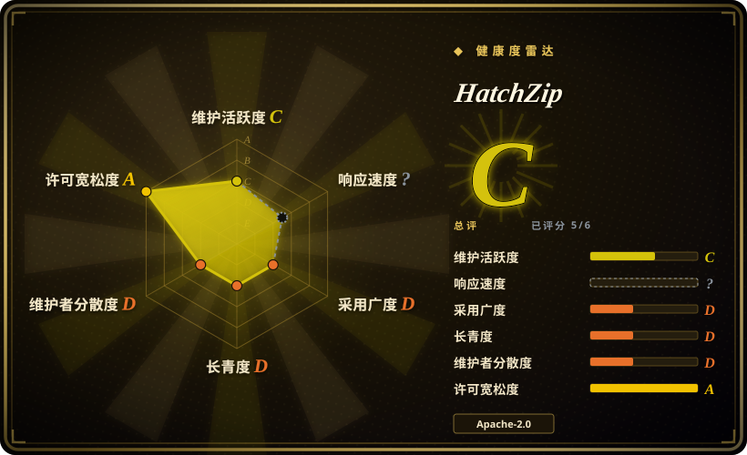
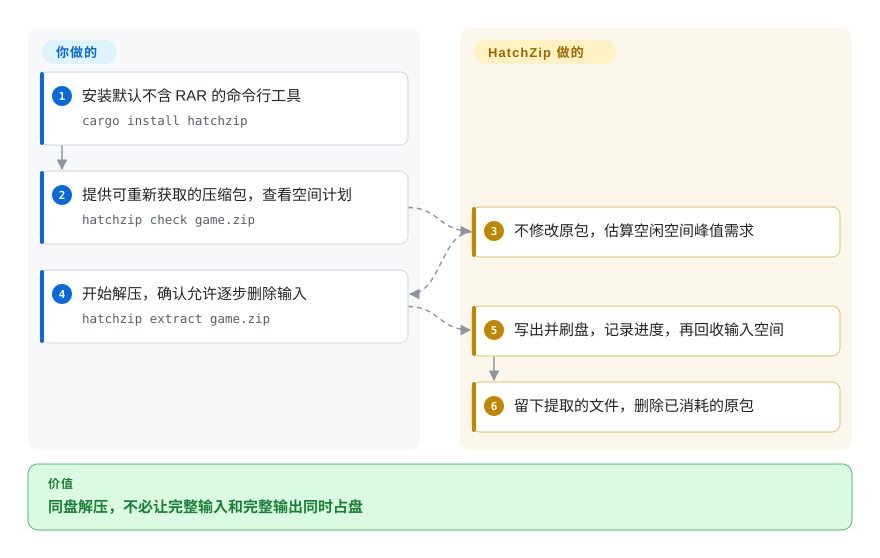
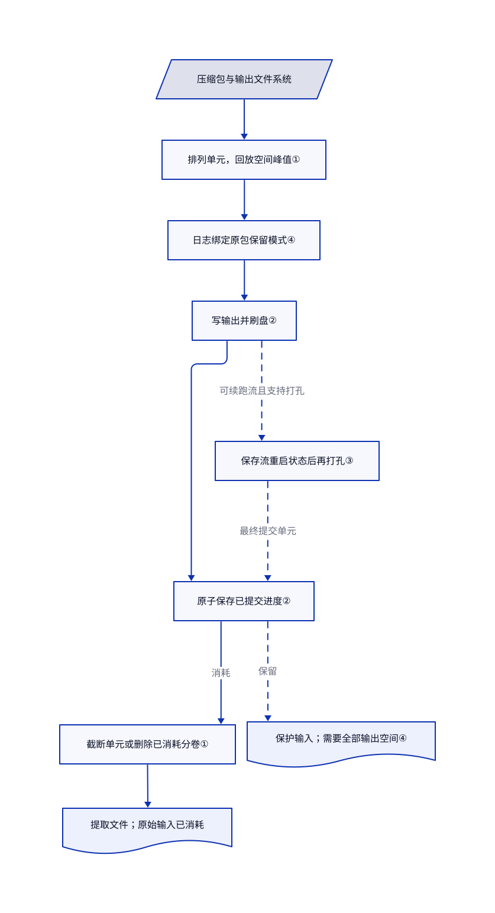

# HatchZip

压缩包下载得下，解压却把磁盘塞满。HatchZip 边解压边删除已处理的压缩数据，让原包腾出的空间接着放输出。

## 何时使用

你要在快满的本地磁盘上解压大型游戏或数据集。删掉下载包后，输出本来放得下；但 7-Zip 必须让原包和输出同时存在，因此中途报空间不足。只有在你明确允许消耗下载包时，才选 HatchZip：它先计算空间峰值，再提取独立片段，持久记录进度后缩短原包。ZIP、多块 7z 和普通 tar 不靠文件系统打孔也能受益；压缩 tar 则需要打孔能力，才能在结束前回收空间。

决定性取舍是降低磁盘峰值，代价是失去原始压缩包。它不是新压缩格式，也不是通用归档编辑器。先用可重新下载的文件试用，不要拿唯一备份上手；本次核验时项目创建不足四天。

## 何时不用

- **必须保留字节一致的原包。** 改用 7-Zip，或显式启用 HatchZip 的 `--keep-archive`，并为全部输出留空间。默认解压逐步破坏输入；`restore` 只把未解压条目重新组成可读归档，不会还原原包。
- **整个 7z 几乎只有一个实心块。** 用 7-Zip，并提供足够空间或换盘输出。HatchZip 必须等该块全部解出后才能回收；把压缩包切成多个分卷，不会拆开压缩块。
- **指望在 FAT32／exFAT 上节省 `.tar.gz` 空间，或快照仍占着原包的数据块。** 用 libarchive 的 bsdtar 输出到空间更大的目标盘。不能有效打孔时，压缩 tar 到结束才释放；快照或克隆也可能阻止数据块变为空闲空间。输出位于另一文件系统时，也用不上原包所在盘释放的空间。
- **需要编辑多种归档或处理其他压缩 tar。** 归档管理用 PeaZip，受支持的流式格式用 bsdtar。HatchZip 当前拒绝 `.tar.xz`、`.tar.zst` 和原生分卷 ZIP `.z01`；实心 RAR 必须保留原包解压。
- **数据不可替代，或有其他程序同时改目标目录。** 选择 7-Zip，另留原包，并使用专用输出目录。续跑会删除未提交输出路径，不要替换这些文件或编辑日志。若流式检查点可能已释放压缩数据，`restore` 会拒绝，必须继续解压。

## 横向对比

| 替代品 | 是否收录 | 我们的评价 | 取舍 |
|---|---|---|---|
| [7-Zip](https://github.com/ip7z/7zip) | 未收录 | 要保留下载包或创建压缩包，选 7-Zip；只有愿意消耗输入来降低磁盘峰值时才选 HatchZip。 | 通用归档器，而非带日志的破坏性解压路径；保留输入需要同时容纳输出。本批标签收录不扩收。 |
| [libarchive／bsdtar](https://github.com/libarchive/libarchive) | 未收录 | 要常规流式解压和更广的格式集成，选 bsdtar；必须让本地原包的占用供给同盘输出时，选 HatchZip。 | 提供 C 库和 tar、cpio、unzip 工具；流式读取本身不会释放已存在的本地压缩包。本批标签收录不扩收。 |
| [PeaZip](https://github.com/peazip/PeaZip) | 未收录 | 要浏览、转换和管理多种归档，选 PeaZip；只解决空间吃紧的解压任务时，选 HatchZip。 | 换来跨平台归档及文件管理功能，而非边解压边消耗输入。本批标签收录不扩收。 |

对比来源：[7-Zip 源码说明](https://github.com/ip7z/7zip/blob/b88c6bc09339de32f7d18bbab900686b244f42ba/DOC/readme.txt)、[libarchive 概览](https://github.com/libarchive/libarchive/blob/c119b18810ba0b5370a3e213a3705b77d986e53f/README.md)、[PeaZip 概览](https://github.com/peazip/PeaZip/blob/a6259b90031827887bae6a041db1f1c1787c6825/README.md)。

## 快速上手

用 `cargo install hatchzip` 安装命令行工具；默认构建不含 RAR。准备可重新获取的压缩包，先运行 `hatchzip check game.zip` 查看空间计划，命令不修改原包，但规划路径可能在旁边创建并删除小型文件系统探测文件。接受消耗输入后，运行 `hatchzip extract game.zip` 并确认提示；难以重新获取的下载包应加 `--verify-first`，在开始前检查全部条目。它把文件写入 `./game/`，在原包旁保存进度，默认成功后删除原包；你负责在中断时保留进度文件，并重跑同一解压命令续跑。必须保留原包时改用 `hatchzip extract game.zip --keep-archive`，同时接受全部输出的空间需求；本次只核对命令来源，没有实际执行。

<!-- flow-steps:begin (generated from flows/hatchzip.json by tools/flow_card.py — do not edit) -->

流程文字版

1. **你**：安装默认不含 RAR 的命令行工具 — `cargo install hatchzip`
2. **你**：提供可重新获取的压缩包，查看空间计划 — `hatchzip check game.zip`
3. **HatchZip**：不修改原包，估算空闲空间峰值需求
4. **你**：开始解压，确认允许逐步删除输入 — `hatchzip extract game.zip`
5. **HatchZip**：写出并刷盘，记录进度，再回收输入空间
6. **HatchZip**：留下提取的文件，删除已消耗的原包

**价值**：同盘解压，不必让完整输入和完整输出同时占盘

<!-- flow-steps:end -->

## 技术要点

<!-- mechanism:begin (generated from mechanisms/hatchzip.json by tools/mechanism_card.py; do not edit) -->

机制文字版

- 压缩包与输出文件系统
- 排列单元，回放空间峰值①
- 日志绑定原包保留模式④
- 写输出并刷盘②
- 原子保存已提交进度②
- 截断单元或删除已消耗分卷①
- 保存流重启状态后再打孔③
- 提取文件；原始输入已消耗
- 保护输入；需要全部输出空间④

- 压缩包与输出文件系统 → 排列单元，回放空间峰值①
- 排列单元，回放空间峰值① → 日志绑定原包保留模式④
- 日志绑定原包保留模式④ → 写输出并刷盘②
- 写输出并刷盘② → 原子保存已提交进度②
- 原子保存已提交进度② → 截断单元或删除已消耗分卷①（消耗）
- 截断单元或删除已消耗分卷① → 提取文件；原始输入已消耗
- 写输出并刷盘② → 保存流重启状态后再打孔③（可续跑流且支持打孔）〔可选／兜底〕
- 保存流重启状态后再打孔③ → 原子保存已提交进度②（最终提交单元）〔可选／兜底〕
- 原子保存已提交进度② → 保护输入；需要全部输出空间④（保留）〔可选／兜底〕

<!-- mechanism:end -->

### 1. 从尾部回收可独立提取的单元

- **解决：** 常规解压写完整份输出前，压缩输入一直占着空间。
- **做法：** 引擎按归档偏移倒序排列单元，并回放输出分配及回收区间，估算空间峰值。单元对应 ZIP／tar 条目或 7z 块；存储层按已提交边界截断，并删除边界后的分卷。
- **边界：** 实心块仍不可拆；节省空间要求输出与原包位于同一文件系统。快照若仍引用旧数据块，缩短输入就不一定返回可用容量。
- **源码：** [单元排序第 184–217 行](https://github.com/xevrion/hatchzip/blob/dd4f52f6ae27f80760d293b82cd8468411a29cec/crates/core/src/engine.rs#L184-L217)、[空间回放第 433–469 行](https://github.com/xevrion/hatchzip/blob/dd4f52f6ae27f80760d293b82cd8468411a29cec/crates/core/src/engine.rs#L433-L469)、[同盘计划第 356–403 行](https://github.com/xevrion/hatchzip/blob/dd4f52f6ae27f80760d293b82cd8468411a29cec/crates/core/src/session.rs#L356-L403)、[分卷截断第 199–223 行](https://github.com/xevrion/hatchzip/blob/dd4f52f6ae27f80760d293b82cd8468411a29cec/crates/core/src/archive/storage.rs#L199-L223)。

### 2. 先持久化输出与进度，再删输入

- **解决：** 写输出与截断输入之间若崩溃，可能破坏唯一可恢复副本。
- **做法：** 初始化先原子保存归档尾部和日志。每批写文件并改名，刷盘后原子记录已提交边界，再截断；续跑先补完待执行截断，并清理未提交输出后重试。
- **边界：** 本次核到的是操作顺序，不是对所有文件系统、硬件或解码器故障的证明。日志与尾部副本是必要恢复数据，不是缓存；`restore` 只重建剩余归档的索引。
- **源码：** [初始化日志第 143–165 行](https://github.com/xevrion/hatchzip/blob/dd4f52f6ae27f80760d293b82cd8468411a29cec/crates/core/src/journal.rs#L143-L165)、[批次提交第 825–865 行](https://github.com/xevrion/hatchzip/blob/dd4f52f6ae27f80760d293b82cd8468411a29cec/crates/core/src/engine.rs#L825-L865)、[原子写入第 41–61 行](https://github.com/xevrion/hatchzip/blob/dd4f52f6ae27f80760d293b82cd8468411a29cec/crates/core/src/fsutil.rs#L41-L61)、[续跑第 130–181 行](https://github.com/xevrion/hatchzip/blob/dd4f52f6ae27f80760d293b82cd8468411a29cec/crates/core/src/engine.rs#L130-L181)、[恢复第 59–110 行](https://github.com/xevrion/hatchzip/blob/dd4f52f6ae27f80760d293b82cd8468411a29cec/crates/core/src/restore.rs#L59-L110)。

### 3. 只释放已保存检查点之前的流数据

- **解决：** 巨型文件或从头解码的 `.tar.gz`，不一定能等整个单元结束再截断。
- **做法：** 先用临时文件测量打孔是否真让分配量下降。支持的路径先刷盘，再记录解码位置和部分文件状态，最后仅对恢复字节之前的范围打孔；压缩 tar 正向解码，并保存解码器和解析器状态。
- **边界：** 无法打孔就没有压缩 tar 的中途空间收益。Deflate 的可重启边界可能相隔很远，检查点不保证任意编码器都满足固定空间上限。日志已有流式检查点时，不能恢复成普通归档，只能继续解压。
- **源码：** [分配量探测第 63–163 行](https://github.com/xevrion/hatchzip/blob/dd4f52f6ae27f80760d293b82cd8468411a29cec/crates/core/src/fsutil.rs#L63-L163)、[先记检查点再打孔第 1024–1068 行](https://github.com/xevrion/hatchzip/blob/dd4f52f6ae27f80760d293b82cd8468411a29cec/crates/core/src/engine.rs#L1024-L1068)、[压缩 tar 路径第 1074–1289 行](https://github.com/xevrion/hatchzip/blob/dd4f52f6ae27f80760d293b82cd8468411a29cec/crates/core/src/engine.rs#L1074-L1289)、[拒绝恢复第 76–95 行](https://github.com/xevrion/hatchzip/blob/dd4f52f6ae27f80760d293b82cd8468411a29cec/crates/core/src/restore.rs#L76-L95)、[编码器边界限制第 99–101 行](https://github.com/xevrion/hatchzip/blob/dd4f52f6ae27f80760d293b82cd8468411a29cec/docs/how-it-works.md#L99-L101)。

### 4. 将保留原包模式写成持久存储保护

- **解决：** 续跑时漏写参数，不应把无损提取变成破坏性解压。
- **做法：** `--keep-archive` 禁止存储修改，将 `keep` 写入第 4 版日志，并跳过截断。续跑服从日志模式；已消耗部分输入的任务不能改成保留原包。
- **边界：** 保留输入就没有节省空间的机制。此模式下的 `restore` 会丢弃进度和未完成输出，但保留已完成文件，并不撤销整个解压任务的副作用。
- **源码：** [模式绑定第 292–304、406–424 行](https://github.com/xevrion/hatchzip/blob/dd4f52f6ae27f80760d293b82cd8468411a29cec/crates/core/src/session.rs#L292-L424)、[日志兼容第 20–29、168–195 行](https://github.com/xevrion/hatchzip/blob/dd4f52f6ae27f80760d293b82cd8468411a29cec/crates/core/src/journal.rs#L20-L195)、[存储保护测试第 509–540 行](https://github.com/xevrion/hatchzip/blob/dd4f52f6ae27f80760d293b82cd8468411a29cec/crates/core/src/session.rs#L509-L540)、[丢弃进度第 218–239 行](https://github.com/xevrion/hatchzip/blob/dd4f52f6ae27f80760d293b82cd8468411a29cec/crates/core/src/restore.rs#L218-L239)。

## 技术栈

- Rust 2024 工作区，包含核心库、clap 命令行、Slint 桌面界面和系统菜单集成。清单要求 Rust 1.93。
- 用 `zip` 和 `sevenz-rust2` 解码 ZIP 与 7z，用 `tar` 处理 tar。Rayon 并发提取独立单元；RAR 路径串行执行。
- 用 `libz-rs-sys` 实现可续跑 Deflate，用 serde 写 JSON 日志。平台代码负责刷盘、文件锁、空间查询和打孔。

## 依赖

- 需要本地可写原包和输出存储；解压不依赖数据库或托管 API。安装器和软件包下载会联网。
- 默认 Cargo 构建不含 RAR。增加 `--features rar` 会编译 UnRAR C++，需要 C++ 编译器；发布构建会启用该功能。
- **许可边界：** 核心 HatchZip 是 `MIT OR Apache-2.0`。支持 RAR 的发布产物额外包含受限 UnRAR 代码；其条款允许解压，但禁止用于开发兼容 RAR 的压缩器或重建 RAR 压缩算法。不能把这类产物整体称为宽松许可。见[核心特性第 26–41 行](https://github.com/xevrion/hatchzip/blob/dd4f52f6ae27f80760d293b82cd8468411a29cec/crates/core/Cargo.toml#L26-L41)、[UnRAR 条款第 8–24 行](https://github.com/xevrion/hatchzip/blob/dd4f52f6ae27f80760d293b82cd8468411a29cec/LICENSE-UNRAR#L8-L24)及[发布打包第 81–91 行](https://github.com/xevrion/hatchzip/blob/dd4f52f6ae27f80760d293b82cd8468411a29cec/.github/workflows/release.yml#L81-L91)。
- Linux 图形界面构建还需要 fontconfig 头文件。常规逆序解压不强制要求打孔，但压缩 tar 的空间峰值收益取决于它。

## 运维难度

**安全采用成本中等，服务运维成本低。** 没有常驻服务，但破坏性解压要求明确原包保留策略，避免并发修改目标目录，并保护两份进度文件。默认保留空闲空间是 `2GB`，其他进程仍可能在运行时抢占磁盘。新任务可用 `--verify-first` 提前发现损坏，但校验和检查不等于归档安全审计。默认成功后删除原包分卷和进度文件；中断则有意保留它们，也可能留下 `.hatchzip-part` 输出。本次没有实跑解压、崩溃或清理测试。

## 健康度与可持续性

- **2026-10-25，活跃但极年轻：** 仓库创建于 10 月 21 日，v0.1.3 于 10 月 24 日发布，前三个版本集中在 10 月 22–23 日。核验的主分支提交日期是 10 月 24 日。不足四天的活跃历史不提供长期林迪证据。
- **2026-10-25，维护权集中：** CODEOWNERS 明说只有维护者 `xevrion`；贡献者 API 显示该账号有 93 次提交，另外两人分别有 4 次和 1 次。所读资料未展示基金会治理。
- **2026-10-25，关注度不等于部署证明：** GitHub 显示 1,714 星和 42 个 fork。源码有崩溃注入测试，但本次未执行，也未独立复现上游的节省空间与速度结果。
- **2026-10-25，选型判断：** 先用可替代输入试用，再考虑依赖破坏性解压。0.1.3 发布说明称修复了重复路径及链接／目录冲突；问题 #10／#11 描述旧版 0.1.2 的失败，核验的引擎已含布局预检。这支持固定版本，不支持宣称所有恶意归档都安全。
- **2026-10-25，自动评分覆盖：** 雷达为 C，六轴中五轴有评分；响应度因测量窗口内没有合格信号而未知。自动许可档位使用 GitHub 检测的 Apache-2.0，不评价发布产物额外包含的 UnRAR 限制。

## 存疑（未验证）

- [未验证：批次约束禁止执行上游] 本次未在本机复现节省空间、速度或崩溃／断电恢复。源码顺序与上游测试不能证明永不丢数据，也不能证明跑分领先。
- [未验证：未在目标卷做提取实验] 实际空间释放受文件系统分配、快照、克隆及并发写入影响。临时文件探测不能证明另一个被快照引用的原包能释放数据块。
- [推断：依据是不足四天仓龄、单维护者及刚修复的布局缺陷] 长期可靠性和维护连续性仍未得到验证；星数与密集发版不能代替运行历史。
