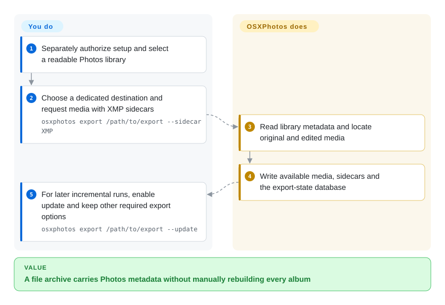
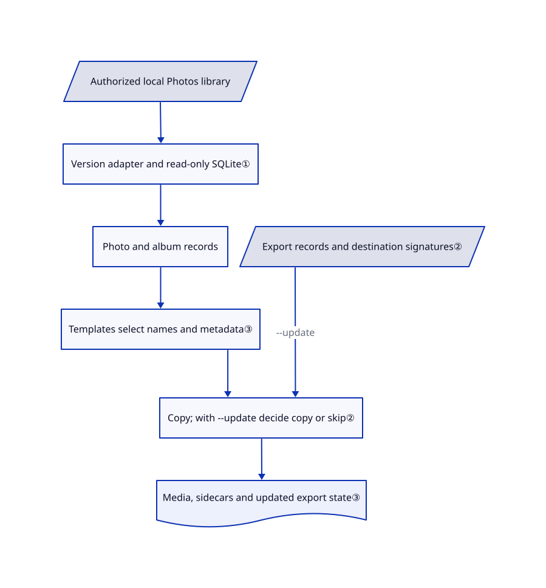

# OSXPhotos

Your Apple Photos albums contain names and keywords that disappear from a plain file copy. OSXPhotos reads the library database and exports media with portable metadata and repeatable folder rules.

## When to use

You are moving years of Apple Photos albums to a folder archive or another photo manager. Copying the originals gives you `IMG_1234.JPG`, but not the album hierarchy or person names you spent years organizing. You choose OSXPhotos over the native export dialog when you need metadata-based directory templates, scripted filtering, both original and edited versions, and incremental reruns. Its Python API also lets your own program query the same library records without maintaining Apple's database queries yourself.

The input is an existing, readable Photos library, not an iCloud username. Linux supports the query/export subset over an accessible library; features that drive Photos or Apple frameworks need macOS. The [README](https://github.com/RhetTbull/osxphotos/blob/27c2f9d68e924770ecdc6cdc902d0737f3a16fee/README.md#supported-operating-systems) and [real API example](https://github.com/RhetTbull/osxphotos/blob/27c2f9d68e924770ecdc6cdc902d0737f3a16fee/examples/count_photos.py#L15-L19) document these two entry paths.

## When NOT to use

- **A few one-off exports:** use Apple Photos' built-in export instead. It already exports unmodified originals and optional IPTC/XMP sidecars; OSXPhotos earns its extra dependency and compatibility burden through repeatable filtering and richer metadata rules.
- **Automatic phone backup and a shared web gallery:** use [Immich](../../document-management/immich.md). OSXPhotos extracts an existing Apple library; it does not provide Immich's phone upload, accounts and server gallery.
- **Already-exported files needing EXIF edits:** use ExifTool directly. It handles file metadata across platforms without requiring an Apple Photos database; OSXPhotos is valuable for the metadata still trapped inside that database.
- **An operation must not change the source library:** prefer native manual export or a separately reviewed, minimal query wrapper. Do not treat the entire CLI as read-only: `query --add-to-album` writes an album, `batch-edit`, `import`, `sync` and `timewarp` alter library state, and `push-exif` explicitly rewrites original files. A plain database query opens SQLite read-only, but that says nothing about optional actions or arbitrary Python supplied to `run`.
- **All originals are cloud-only, or the wrong library is open:** first download originals through Apple Photos. Local export cannot copy missing bytes. Optional download/export paths drive Photos or PhotoKit; [open issue #2280](https://github.com/RhetTbull/osxphotos/issues/2280) documents the mismatch between the selected library, open library and System Photo Library. Linux cannot replace those macOS paths.
- **You need a byte-for-byte, restorable Photos backup:** keep a full library backup with Time Machine or another backup tool. An exported file archive plus metadata is not a promise to reproduce every internal edit, album and cloud relationship. Avoid `--cleanup` in a mixed-use destination: its implementation removes non-hidden files outside the keep set; case-sensitive destinations are explicitly cautioned against in the README.

## Comparison

| Alternative | In index | Our verdict | Tradeoff |
| --- | --- | --- | --- |
| Apple Photos native export | not a repo | Choose native export for a few originals and XMP files; choose OSXPhotos when album-derived paths and incremental scripted exports decide. | Closed Apple application, not a repository. No extra CLI dependency, but less programmable extraction; [Apple's guide](https://support.apple.com/guide/photos/export-photos-videos-and-slideshows-pht6e157c5f/mac) confirms native XMP export. |
| [ExifTool](https://github.com/exiftool/exiftool) | not indexed | Choose ExifTool for standalone image-file metadata; choose OSXPhotos when names and albums exist only in the Photos database. | File-oriented Perl library/CLI rather than an Apple-library reader. Also an optional OSXPhotos dependency for embedding metadata; not added in this tab batch. [Official feature list](https://exiftool.org/). |
| [Immich](../../document-management/immich.md) | indexed | Choose Immich for ongoing household phone backup and browsing; choose OSXPhotos for an Apple-library extraction job without a server. | Immich adds a live server and database to operate. OSXPhotos can prepare an archive for migration, but does not supply that gallery or phone app. |

## Quick start

The upstream documented install path is `uv tool install --python 3.13 osxphotos`; the manifest requires Python 3.10 or newer, while the README lists testing through 3.14. After separate approval for installation and data access, you select an explicitly authorized library and a dedicated destination, then choose an export filter and folder rule. For a first export, upstream documents `osxphotos export /path/to/export --sidecar XMP`, producing media plus sidecars, meaning separate metadata files beside the media; ordinary sidecar generation does not require ExifTool. OSXPhotos copies available originals and edited media and maintains an export-state database; you own permissions, disk capacity, privacy review and independent backups. This page was researched statically: none of these installation, query, export or mutation commands was executed, and their description grants no permission to access a library.

The state database does not enable incremental export by itself. For later runs, explicitly add `--update`: `osxphotos export /path/to/export --sidecar XMP --update` retains this example's sidecar option while enabling update checks. The upstream minimal example is `osxphotos export /path/to/export --update`; keep any other filters and export options you still need. Without `--update`, repeating an ordinary export re-exports the photos rather than automatically skipping unchanged files. [Documented update contract:537–541](https://github.com/RhetTbull/osxphotos/blob/27c2f9d68e924770ecdc6cdc902d0737f3a16fee/README.md#L537-L541).

<!-- flow-steps:begin (generated from flows/osxphotos.json by tools/flow_card.py — do not edit) -->

Text version of the flow

1. **You**: Separately authorize setup and select a readable Photos library
2. **You**: Choose a dedicated destination and request media with XMP sidecars — `osxphotos export /path/to/export --sidecar XMP`
3. **OSXPhotos**: Read library metadata and locate original and edited media
4. **OSXPhotos**: Write available media, sidecars and the export-state database
5. **You**: For later incremental runs, enable update and keep other required export options — `osxphotos export /path/to/export --update`

**Value**: A file archive carries Photos metadata without manually rebuilding every album

<!-- flow-steps:end -->

## Key techniques

<!-- mechanism:begin (generated from mechanisms/osxphotos.json by tools/mechanism_card.py; do not edit) -->

Text version of the mechanism

- Authorized local Photos library
- Version adapter and read-only SQLite①
- Photo and album records
- Templates select names and metadata③
- Export records and destination signatures②
- Copy; with --update decide copy or skip②
- Media, sidecars and updated export state③

- Authorized local Photos library → Version adapter and read-only SQLite①
- Version adapter and read-only SQLite① → Photo and album records
- Photo and album records → Templates select names and metadata③
- Templates select names and metadata③ → Copy; with --update decide copy or skip②
- Export records and destination signatures② → Copy; with --update decide copy or skip② (--update)
- Copy; with --update decide copy or skip② → Media, sidecars and updated export state③

<!-- mechanism:end -->

### 1. Read schema-specific metadata without writing the source database

- **Problem:** Albums, named people and other Photos records do not all live in image-file tags, and Apple's schema changes across releases.
- **How:** `PhotosDB` locates the correct database, selects the legacy or modern processing path and builds indexed Python records. Connections use SQLite `mode=ro`; a locked database can be copied to a temporary directory before reading. The macOS 26 shared-album adapter joins `CollectionShare` records and adapts the owner-role column.
- **Limits:** Read-only database access is not a sandbox for other commands. This is private-schema coupling, not a stable Apple API; the source only copies when needed, despite the README's older blanket description. Shared-album support exists in this commit and v0.77.2 release notes, contradicting the README warning that it cannot read them on macOS 26.
- **Source:** [Database selection:319–450](https://github.com/RhetTbull/osxphotos/blob/27c2f9d68e924770ecdc6cdc902d0737f3a16fee/osxphotos/photosdb/photosdb.py#L319-L450), [read-only SQLite:55–122](https://github.com/RhetTbull/osxphotos/blob/27c2f9d68e924770ecdc6cdc902d0737f3a16fee/osxphotos/sqlite_utils.py#L55-L122), [shared albums:2832–2961](https://github.com/RhetTbull/osxphotos/blob/27c2f9d68e924770ecdc6cdc902d0737f3a16fee/osxphotos/photosdb/photosdb.py#L2832-L2961).

### 2. Decide incremental work from export records before filesystem checks

- **Problem:** Re-exporting an archive needlessly reads and rewrites unchanged files, especially on network storage.
- **How:** Explicit `--update` enables the incremental decision path; the implementation also enters it for `force_update`. The exporter first checks its saved file record, export options, previous errors and edited-version modification date. It then checks hardlink identity and destination signatures; optional ExifTool metadata comparison or a forced-update digest can trigger another export. Separate checks can skip unnecessary downloads of missing originals.
- **Limits:** This is conditional update logic, not content-addressed backup verification. Edited destination files can be replaced on rerun; `--ramdb` loses state on interruption until saved. The export database contains sensitive metadata and must travel with your own backup policy, not automatically with a public photo share.
- **Source:** [Update gate:1377–1392](https://github.com/RhetTbull/osxphotos/blob/27c2f9d68e924770ecdc6cdc902d0737f3a16fee/osxphotos/photoexporter.py#L1377-L1392), [update decisions:692–836](https://github.com/RhetTbull/osxphotos/blob/27c2f9d68e924770ecdc6cdc902d0737f3a16fee/osxphotos/photoexporter.py#L692-L836), [state and RAM tradeoffs:481–483](https://github.com/RhetTbull/osxphotos/blob/27c2f9d68e924770ecdc6cdc902d0737f3a16fee/README.md#L481-L483), [state privacy:747–756](https://github.com/RhetTbull/osxphotos/blob/27c2f9d68e924770ecdc6cdc902d0737f3a16fee/README.md#L747-L756).

### 3. Turn library metadata into file layout and sidecars

- **Problem:** A flat export loses organization, while Photos-only metadata cannot be consumed by another manager directly.
- **How:** A textX-parsed template renders photo fields, defaults, conditionals and multi-valued results into directory and filename strings. Sidecar writers serialize metadata separately; optional ExifTool embeds it into exported files instead.
- **Limits:** A photo in multiple albums can create multiple copies, and target software's sidecar naming expectations differ. Names and locations can leak through folder names, sidecars and the state database; rendering a template is not anonymization. User-supplied code or post-commands must be trusted separately.
- **Source:** [Template rendering:471–632](https://github.com/RhetTbull/osxphotos/blob/27c2f9d68e924770ecdc6cdc902d0737f3a16fee/osxphotos/phototemplate.py#L471-L632), [multi-valued album paths:357–370](https://github.com/RhetTbull/osxphotos/blob/27c2f9d68e924770ecdc6cdc902d0737f3a16fee/README.md#L357-L370), [sidecar usage:523–533](https://github.com/RhetTbull/osxphotos/blob/27c2f9d68e924770ecdc6cdc902d0737f3a16fee/README.md#L523-L533).

## Tech stack

Python package and Click/Rich CLI; SQLite library records and export state; textX templates. On macOS, PyObjC frameworks and photoscript connect optional operations to Apple APIs and AppleScript. The [manifest](https://github.com/RhetTbull/osxphotos/blob/27c2f9d68e924770ecdc6cdc902d0737f3a16fee/pyproject.toml#L62-L121) also declares Mako, requests, filesystem and timezone utilities. A declared HTTP library does not establish that every query sends data away; no blanket offline or no-egress claim is made here.

## Dependencies

- Python 3.10+; upstream recommends an isolated uv tool environment. Linux supports the query/export subset; macOS-only dependencies have platform markers. A copied library still needs accessible media bytes for file export.
- macOS Photos/PhotoKit/AppleScript for their respective interactive or cloud-download features. OS access grants are separate user decisions; the project includes a native permission-responsibility helper, not a permission bypass.
- ExifTool is needed for requested embedded metadata writing and for `{exiftool:...}` templates that read tags from the original file. Ordinary XMP/JSON sidecar generation does not require it, but choosing such a template adds that dependency even in a sidecar workflow. [Template requirement:246–249](https://github.com/RhetTbull/osxphotos/blob/27c2f9d68e924770ecdc6cdc902d0737f3a16fee/osxphotos/phototemplate.py#L246-L249), [actual tag read:1437–1438](https://github.com/RhetTbull/osxphotos/blob/27c2f9d68e924770ecdc6cdc902d0737f3a16fee/osxphotos/phototemplate.py#L1437-L1438). No server database or model service is required for the basic local path.
- Space for exported versions, possible album-based duplicate copies and temporary databases. The README warns that a full development clone exceeds 3 GB due to test libraries; do not clone test media just to use the package.

## Ops difficulty

**Medium.** There is no daemon or server to maintain for local extraction, but schema drift, cloud-only media and macOS permissions require care. Pin a tested version, use a dedicated export destination and inspect reports before trusting a migration. `--cleanup` is deletion, not a harmless housekeeping flag; hardlink exports share file identity with the source, so later writes through either link are not isolated copies. Treat `run` and post-command hooks as arbitrary-code execution, not safe extensions.

To stop using it, stop any scheduled exports and uninstall with the package manager that installed it. Review only its own XDG config/data directories and `osxphotos_crash.log`; preserve media and `.osxphotos_export.db` if incremental updates or audit history are still needed. Deleting that database loses export tracking and may remove sensitive metadata from a share, but does not scrub sidecars, embedded tags or backups. Uninstallation cannot undo album edits, `push-exif` changes or cloud synchronization; restore from an independently verified backup if needed. [Created-file inventory](https://github.com/RhetTbull/osxphotos/blob/27c2f9d68e924770ecdc6cdc902d0737f3a16fee/README.md#L747-L756).

## Health & viability

- **Maintenance, 2026-10-30:** public, not archived; last push 2026-10-29. Latest release v0.77.2 was published 2026-09-27, following v0.77.1; recent issues and PRs show continued compatibility and correctness fixes. [Release notes](https://github.com/RhetTbull/osxphotos/releases/tag/v0.77.2).
- **Governance:** personal repository owned by Rhet Turnbull. The sampled lifetime contributors list is dominated by the owner, with 2531 commits versus 34 for the next non-bot contributor in the first ten. CONTRIBUTING welcomes code and documentation; this is not evidence of foundation backing or a funded support team.
- **Age and judgment:** created 2019-06-16, over seven years old and still maintained. [推断: based on repository age and current releases, not a future-support guarantee] That gives it a stronger continuity prior than a new one-off exporter, while its private-schema dependency and concentrated maintenance remain the deciding risks.
- **Adoption and license:** 3955 GitHub stars on 2026-10-30; these measure attention, not verified successful migrations. The actual root LICENSE is MIT, copyright 2019–2026 Rhet Turnbull, consistent with the manifest. It does not license the user's photos or override dependency licenses.

## Caveats (unverified)

- [未验证: user explicitly authorized static research only] No install, runtime query, export, library modification or OS permission request was performed. Completeness, speed, resource use and exact platform compatibility were not reproduced.
- [未验证: README and release/source disagree, no photo-library reproduction allowed] The README says macOS 26 shared albums cannot be read; v0.77.2 and the reviewed adapter implement support. Treat code presence as evidence of an attempted fix, not proof for every library.
- [推断: age, release cadence and contributor concentration only] The continuity judgment is a prior, not a maintenance commitment or complete governance audit.
