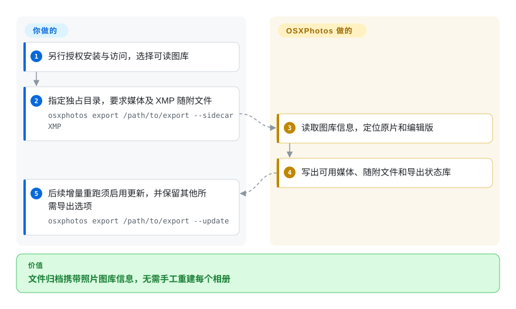
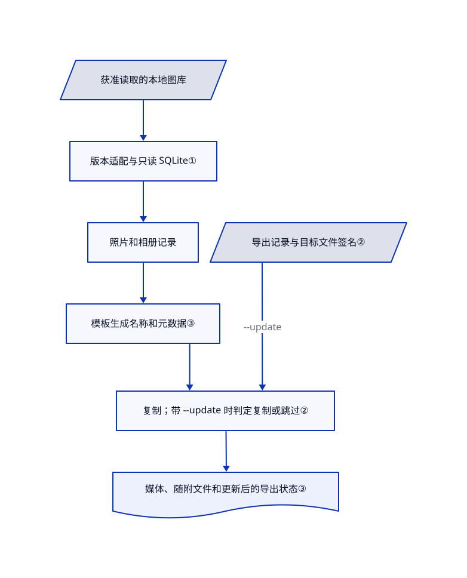

# OSXPhotos

直接复制苹果照片原片，常会丢掉相册、人物名和关键词。OSXPhotos 读取图库数据库，按规则导出媒体和可迁移的元数据。

## 何时使用

你要把多年积累的苹果照片迁到文件归档或另一款图库软件。复制原片后只剩 `IMG_1234.JPG`，相册层级和人物名没有一起走。需要按元数据生成目录、脚本筛选、同时保留原片与编辑版，以及重复增量导出时，选择 OSXPhotos 而非原生导出窗口。它也提供 Python 接口，让你的程序查询图库记录，无需自己维护苹果的数据库查询。

输入是已经存在且有权读取的照片图库，不是 iCloud 账号。Linux 支持查询和导出子集；操作照片应用或苹果框架的功能仍需 macOS。[README](https://github.com/RhetTbull/osxphotos/blob/27c2f9d68e924770ecdc6cdc902d0737f3a16fee/README.md#supported-operating-systems) 与[真实接口示例](https://github.com/RhetTbull/osxphotos/blob/27c2f9d68e924770ecdc6cdc902d0737f3a16fee/examples/count_photos.py#L15-L19)给出了这两类入口。

## 何时不用

- **只导出少量照片：** 用苹果照片自带的导出功能。原生功能已经能导出未修改原片及 IPTC／XMP 随附文件；只有重复筛选和更丰富的元数据规则，才值得承担额外依赖和兼容负担。
- **需要手机自动备份和共享网页图库：** 用 [Immich](../../document-management/immich.zh.md)。OSXPhotos 提取已有苹果图库，不提供手机上传、账号和服务端相册。
- **只需修改已导出文件的 EXIF：** 直接用 ExifTool。它跨平台处理文件元数据，不依赖苹果图库；只有信息仍困在图库数据库里时，OSXPhotos 的价值才突出。
- **绝不允许改动源图库：** 优先用原生手动导出，或单独审核过的最小查询封装。不能把整个命令行当成只读：`query --add-to-album` 会写相册，`batch-edit`、`import`、`sync` 和 `timewarp` 会改图库状态，`push-exif` 明确重写原文件。普通数据库查询用只读连接，但不能据此推及附加动作，更不能推及 `run` 执行的任意 Python。
- **原片只在云端，或打开了错误图库：** 先用苹果照片下载原片。本地导出不能复制不存在的字节。可选下载和导出通道会操作照片应用或 PhotoKit；[未关闭的问题 #2280](https://github.com/RhetTbull/osxphotos/issues/2280)记录了指定图库、当前打开图库和系统照片图库不一致的问题。Linux 不能替代这些 macOS 通道。
- **需要能完整恢复的照片图库备份：** 用时间机器等工具保留整个图库。导出文件和元数据不承诺复原所有内部编辑、相册及云端关系。不要对混放其他文件的目录启用 `--cleanup`，源码会删除保留集外的非隐藏文件；README 也警告大小写敏感目标盘的风险。

## 横向对比

| 替代品 | 是否收录 | 我们的评价 | 取舍 |
| --- | --- | --- | --- |
| 苹果照片原生导出 | 非仓库 | 只取少量原片和 XMP 时选原生导出；要按相册生成路径、重复增量导出时选 OSXPhotos。 | 苹果闭源应用，不是仓库。少装一个工具，但提取规则较难编程；[苹果指南](https://support.apple.com/guide/photos/export-photos-videos-and-slideshows-pht6e157c5f/mac)确认原生支持 XMP。 |
| [ExifTool](https://github.com/exiftool/exiftool) | 未收录 | 处理独立图片文件的元数据选 ExifTool；名字和相册还只在照片数据库里时选 OSXPhotos。 | 面向文件的 Perl 库和命令行，不负责读取苹果图库；也是 OSXPhotos 嵌入元数据的可选依赖。本次标签批次不新增此条目。[官方功能列表](https://exiftool.org/)。 |
| [Immich](../../document-management/immich.zh.md) | 已收录 | 持续家庭手机备份和浏览选 Immich；不想运维服务器、只做苹果图库提取时选 OSXPhotos。 | Immich 需要运行服务器及数据库。OSXPhotos 可准备迁移归档，但不提供网页图库和手机应用。 |

## 快速上手

上游文档推荐用 `uv tool install --python 3.13 osxphotos` 安装；清单要求 Python 3.10 起，README 列出测试至 3.14。另行获得安装和数据访问授权后，你明确选择获准使用的图库、独占导出目录，以及筛选和目录规则。首轮可按上游示例使用 `osxphotos export /path/to/export --sidecar XMP`，产生媒体文件及随附文件，也就是放在媒体旁边的独立元数据文件；普通随附文件生成不需要 ExifTool。OSXPhotos 负责复制可用原片和编辑版，并维护导出状态库；权限、磁盘空间、隐私检查及独立备份由你负责。本页只做静态研究，没有执行安装、查询、导出或修改命令；功能介绍不授予访问图库的权限。

状态库存在并不自动启用增量导出。后续重跑须显式加上 `--update`：`osxphotos export /path/to/export --sidecar XMP --update` 保留本例的随附文件选项，并启用更新检查。上游最小示例是 `osxphotos export /path/to/export --update`；还需保留你所需的其他筛选和导出选项。不带 `--update` 重复普通导出，会重新导出照片，而非自动跳过未变文件。[更新契约第 537–541 行](https://github.com/RhetTbull/osxphotos/blob/27c2f9d68e924770ecdc6cdc902d0737f3a16fee/README.md#L537-L541)。

<!-- flow-steps:begin (generated from flows/osxphotos.json by tools/flow_card.py — do not edit) -->

流程文字版

1. **你**：另行授权安装与访问，选择可读图库
2. **你**：指定独占目录，要求媒体及 XMP 随附文件 — `osxphotos export /path/to/export --sidecar XMP`
3. **OSXPhotos**：读取图库信息，定位原片和编辑版
4. **OSXPhotos**：写出可用媒体、随附文件和导出状态库
5. **你**：后续增量重跑须启用更新，并保留其他所需导出选项 — `osxphotos export /path/to/export --update`

**价值**：文件归档携带照片图库信息，无需手工重建每个相册

<!-- flow-steps:end -->

## 技术要点

<!-- mechanism:begin (generated from mechanisms/osxphotos.json by tools/mechanism_card.py; do not edit) -->

机制文字版

- 获准读取的本地图库
- 版本适配与只读 SQLite①
- 照片和相册记录
- 模板生成名称和元数据③
- 导出记录与目标文件签名②
- 复制；带 --update 时判定复制或跳过②
- 媒体、随附文件和更新后的导出状态③

- 获准读取的本地图库 → 版本适配与只读 SQLite①
- 版本适配与只读 SQLite① → 照片和相册记录
- 照片和相册记录 → 模板生成名称和元数据③
- 模板生成名称和元数据③ → 复制；带 --update 时判定复制或跳过②
- 导出记录与目标文件签名② → 复制；带 --update 时判定复制或跳过②（--update）
- 复制；带 --update 时判定复制或跳过② → 媒体、随附文件和更新后的导出状态③

<!-- mechanism:end -->

### 1. 按版本读数据库，不写源数据库

- **解决：** 相册、人物名等信息并不全在图片标签中，苹果数据库结构也会随版本变化。
- **做法：** `PhotosDB` 定位数据库，选择新旧处理通道，建立可索引的 Python 记录。连接使用 SQLite 的 `mode=ro`；数据库被锁定时可先复制到临时目录。macOS 26 共享相册适配器连接 `CollectionShare` 记录，并适配所有者角色列名。
- **边界：** 数据库只读不等于其他命令被隔离。这依赖私有结构，不是稳定苹果接口；源码按需复制，并非 README 旧描述中的总是复制。当前提交和 v0.77.2 发布说明已有共享相册支持，与 README 的 macOS 26 不支持警告冲突。
- **源码：** [数据库选择第 319–450 行](https://github.com/RhetTbull/osxphotos/blob/27c2f9d68e924770ecdc6cdc902d0737f3a16fee/osxphotos/photosdb/photosdb.py#L319-L450)、[只读连接第 55–122 行](https://github.com/RhetTbull/osxphotos/blob/27c2f9d68e924770ecdc6cdc902d0737f3a16fee/osxphotos/sqlite_utils.py#L55-L122)、[共享相册第 2832–2961 行](https://github.com/RhetTbull/osxphotos/blob/27c2f9d68e924770ecdc6cdc902d0737f3a16fee/osxphotos/photosdb/photosdb.py#L2832-L2961)。

### 2. 先查导出记录，再做文件系统检查

- **解决：** 重复导出会无谓地读取和重写未变化的文件，网络存储尤其明显。
- **做法：** 显式指定 `--update` 才启用增量判定通道；实现也会在 `force_update` 时进入此分支。导出器先检查文件记录、导出选项、上次错误和编辑版修改日期，再检查硬链接关系和目标文件签名。可选 ExifTool 元数据比较，或强制更新时的摘要比较，也能触发导出。缺失原片另有检查，避免不必要的下载。
- **边界：** 这是条件更新，不是按内容寻址的备份完整性验证。再次导出可能覆盖你修改过的目标文件；`--ramdb` 在落盘前被中断会丢状态。状态库含敏感元数据，应服从独立备份策略，不应随公开照片自动分享。
- **源码：** [更新开关第 1377–1392 行](https://github.com/RhetTbull/osxphotos/blob/27c2f9d68e924770ecdc6cdc902d0737f3a16fee/osxphotos/photoexporter.py#L1377-L1392)、[更新判定第 692–836 行](https://github.com/RhetTbull/osxphotos/blob/27c2f9d68e924770ecdc6cdc902d0737f3a16fee/osxphotos/photoexporter.py#L692-L836)、[状态和内存库第 481–483 行](https://github.com/RhetTbull/osxphotos/blob/27c2f9d68e924770ecdc6cdc902d0737f3a16fee/README.md#L481-L483)、[状态库隐私第 747–756 行](https://github.com/RhetTbull/osxphotos/blob/27c2f9d68e924770ecdc6cdc902d0737f3a16fee/README.md#L747-L756)。

### 3. 把图库信息转成目录和随附文件

- **解决：** 平铺导出丢掉组织结构，照片应用内部的信息又不能直接交给其他图库软件。
- **做法：** 模板经 textX 解析，把字段、默认值、条件和多值结果渲染为目录与文件名。随附文件写入器单独序列化元数据；可选 ExifTool 则把信息嵌入导出的文件。
- **边界：** 一张照片属于多个相册时可能导出多份，目标软件对随附文件命名的要求也不同。目录名、随附文件和状态库都可能泄露姓名及位置；模板渲染不是匿名化。用户代码及导出后命令需要单独信任。
- **源码：** [模板渲染第 471–632 行](https://github.com/RhetTbull/osxphotos/blob/27c2f9d68e924770ecdc6cdc902d0737f3a16fee/osxphotos/phototemplate.py#L471-L632)、[多值相册路径第 357–370 行](https://github.com/RhetTbull/osxphotos/blob/27c2f9d68e924770ecdc6cdc902d0737f3a16fee/README.md#L357-L370)、[随附文件用法第 523–533 行](https://github.com/RhetTbull/osxphotos/blob/27c2f9d68e924770ecdc6cdc902d0737f3a16fee/README.md#L523-L533)。

## 技术栈

Python 包与 Click／Rich 命令行；SQLite 保存图库记录和导出状态；textX 解析模板。macOS 可选操作通过 PyObjC 框架及 photoscript 连接苹果接口和 AppleScript。[依赖清单](https://github.com/RhetTbull/osxphotos/blob/27c2f9d68e924770ecdc6cdc902d0737f3a16fee/pyproject.toml#L62-L121)还声明 Mako、requests、文件系统和时区工具。声明 HTTP 库不代表每次查询都会外发数据；本页不作全面离线或零外发保证。

## 依赖

- Python 3.10 起；上游推荐隔离的 uv 工具环境。Linux 支持查询和导出子集，macOS 专用依赖带平台条件。复制来的图库仍需能访问媒体字节，才能导出文件。
- 对应交互或云端下载功能需要 macOS 照片应用、PhotoKit 或 AppleScript。系统访问授权由用户单独决定；项目附带权限归属辅助库，不是权限绕过工具。
- 嵌入元数据，以及用 `{exiftool:...}` 模板读取原文件标签，都需要 ExifTool。普通 XMP／JSON 随附文件生成不需要它；但即使只导出随附文件，选择这类模板也会引入该依赖。[模板要求第 246–249 行](https://github.com/RhetTbull/osxphotos/blob/27c2f9d68e924770ecdc6cdc902d0737f3a16fee/osxphotos/phototemplate.py#L246-L249)、[实际读取第 1437–1438 行](https://github.com/RhetTbull/osxphotos/blob/27c2f9d68e924770ecdc6cdc902d0737f3a16fee/osxphotos/phototemplate.py#L1437-L1438)。基础本地流程不需要服务端数据库或模型服务。
- 导出多版本、多相册副本及临时数据库需要额外空间。README 警告完整开发克隆因测试图库超过 3 GB；只使用软件包时不要顺带克隆测试媒体。

## 运维难度

**中。** 本地提取不用维护常驻服务，但数据库变更、云端原片和 macOS 权限增加了操作负担。固定验证过的版本，使用独占导出目录，检查报告后再信任迁移。`--cleanup` 是删除功能，不是无害整理开关；硬链接导出与源文件共享身份，随后从任一链接写入都不是隔离副本。`run` 和导出后命令能执行任意代码，不能当成安全扩展。

停用时先停掉定时导出，再用原安装管理器卸载。仅审查本工具的 XDG 配置和数据目录，以及 `osxphotos_crash.log`；仍需增量更新或审计时，保留媒体与 `.osxphotos_export.db`。删除状态库会丢失跟踪信息，也可避免把其中敏感数据随照片分享，但不会清除随附文件、嵌入标签和备份中的信息。卸载不会撤销相册编辑、`push-exif` 写入或云端同步，必要时只能从独立验证过的备份恢复。[落地文件清单](https://github.com/RhetTbull/osxphotos/blob/27c2f9d68e924770ecdc6cdc902d0737f3a16fee/README.md#L747-L756)。

## 健康度与可持续性

- **维护，截至 2026-10-30：** 公开且未归档，最近推送为 2026-10-29。最新发布 v0.77.2 于 2026-09-27 发布，前有 v0.77.1；近期问题和合并请求持续处理兼容及正确性修复。[发布说明](https://github.com/RhetTbull/osxphotos/releases/tag/v0.77.2)。
- **治理：** Rhet Turnbull 持有的个人仓库。生命周期贡献者前十名中，仓主有 2531 次提交，下一位非机器人贡献者为 34 次。贡献指南欢迎代码和文档；这不能证明基金会背书或有薪支持团队。
- **年龄与判断：** 仓库创建于 2019-06-16，超过七年且仍维护。[推断：依据仓库年龄与近期发布，不是未来支持保证] 相比一次性新导出器，持续性的先验更强；私有结构依赖与维护集中仍是核心风险。
- **采用与许可：** 2026-10-30 有 3955 个 GitHub 星标，只表示关注度，不是成功迁移的验证。实际根 LICENSE 为 MIT，版权人为 Rhet Turnbull，年份为 2019–2026，与清单一致。它不授权用户照片，也不覆盖依赖自身的许可。

## 存疑（未验证）

- [未验证：用户只授权静态研究] 没有执行安装、运行时查询、导出、图库修改或系统授权申请。未复现完整性、速度、资源消耗及精确平台兼容性。
- [未验证：README 与发布说明及源码冲突，未获照片库复现授权] README 声称不能读 macOS 26 共享相册，但 v0.77.2 与所审适配器已有支持。代码存在只证明实现了修复尝试，不保证适用每个图库。
- [推断：仅依据年龄、发布节奏及贡献集中度] 持续性判断是先验，不是维护承诺或完整治理审计。
