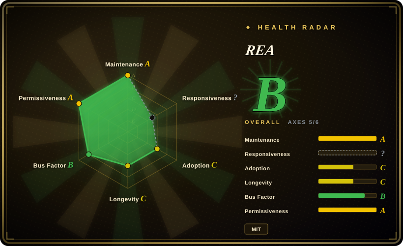
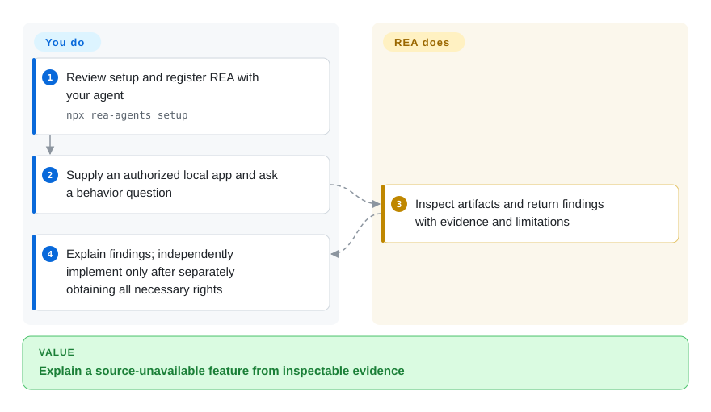
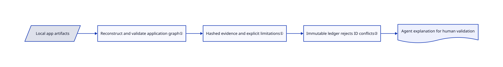

# REA

An app has no source, but you need to explain what its search or clipboard feature actually does. REA gives your agent local inspection tools and evidence records instead of asking it to guess from screenshots.

## When to use

You maintain an integration with an application you are authorized to examine. Its Electron bundle contains thousands of minified modules, or the relevant behavior sits inside a native binary. You want a coding agent to follow imports, calls and references and show where its explanation came from. Choose REA over operating a decompiler alone when the handoff between local analysis tools and an MCP-capable agent is the missing piece. MCP is the interface through which the agent calls those tools.

REA also has a terminal interface. Static JavaScript inspection can run without Hopper, Ghidra or IDA; deeper native inspection uses a separately configured engine. It supplies observations, not a guaranteed source-code recreation.

## When NOT to use

- **You only have permission to inspect the artifact.** Stay within authorized static inspection in REA or Ghidra; inspection permission does not authorize execution, traffic interception, device changes or reuse of results. Obtain the rights needed for each operation and any independent implementation; an analysis report grants no rights to protected code or assets. The [upstream disclaimer](https://github.com/morluto/rea/blob/b83b9caf4a5f0241a5fd370792f1aed1bffbb2cf/DISCLAIMER.md#L45-L71) separates these responsibilities, and its [license relationship](https://github.com/morluto/rea/blob/b83b9caf4a5f0241a5fd370792f1aed1bffbb2cf/DISCLAIMER.md#L115-L121) explicitly says intended-use and community-support boundaries do not amend MIT or add copyright-license conditions.
- **You need a human-led native analysis workspace.** Use Ghidra directly for interactive disassembly and annotation; REA adds agent integration, not a replacement decompiler.
- **You need a small scriptable binary utility without an agent.** Consider radare2; REA brings a Node runtime, evidence contracts and many optional integrations.
- **Your team depends on an established commercial decompiler workflow.** Keep IDA Pro and its licensed decompiler; REA's MIT license does not grant any commercial-tool entitlement.
- **You cannot disclose findings to a hosted model.** Use a local engine such as Ghidra and a suitable local workflow. Local REA analysis does not stop your agent from sending returned results to its model provider.
- **The target is untrusted and execution is unnecessary.** Prefer static Ghidra or REA static inspection over runtime capture. Runtime capture launches or interacts with the target using your permissions; it is not a malware sandbox.

## Comparison

| Alternative | In index | Our verdict | Tradeoff |
|---|---|---|---|
| [reverse-skill](../../agent-skills/security/reverse-skill.md) | ✅ | Choose REA when your agent needs an implemented local CLI/MCP and structured observation ledger; choose reverse-skill when routing investigations across security playbooks is the missing layer. | Executable analysis adapters and immutable records versus skill-based investigation workflows and tool bootstrapping, as documented in its [router](https://github.com/zhaoxuya520/reverse-skill/blob/7e2097fd90d25c2f976f6eba26d6c00aa88051df/skills/SKILL.md#L7-L19); neither grants rights to the target. |
| [Ghidra](ghidra.md) | ✅ | Choose Ghidra for analyst-driven native inspection; choose REA to expose that inspection to an agent with evidence-bearing results. | Mature analysis workspace versus an orchestration layer; REA requires a separate engine for native inspection. |
| radare2 | not indexed | Choose radare2 for direct command-line binary manipulation; choose REA when one agent-facing interface must cover native and Electron targets. | Leaner direct control versus broader adapters and result contracts; real repository, not added in this tab batch. |
| IDA Pro | not a repo | Choose IDA Pro when its commercial analysis environment decides the workflow; add REA only if agent access is also useful. | Commercial product and separate licensing; REA does not include its decompiler or license. |

## Quick start

With a supported Node.js release, run `npx rea-agents setup`, select your agent, review the configuration changes and restart it. Setup registers the local tool server and installs matching investigation instructions; you still supply a target you may inspect and any native analysis engine, with separate authorization for execution or interception. Ask the agent a concrete behavior question and require evidence before accepting an explanation. For a static Electron investigation, the README also documents `npx -y rea-agents@latest analyze-javascript-application /absolute/path/to/app --json`. You pay for the agent's model and commercial tools separately; independently implement only after separately obtaining the necessary rights, without copying protected code or assets, and validate the result yourself.

<!-- flow-steps:begin (generated from flows/rea.json by tools/flow_card.py — do not edit) -->

Text version of the flow

1. **You**: Review setup and register REA with your agent — `npx rea-agents setup`
2. **You**: Supply an authorized local app and ask a behavior question
3. **REA**: Inspect artifacts and return findings with evidence and limitations
4. **You**: Explain findings; independently implement only after separately obtaining all necessary rights

**Value**: Explain a source-unavailable feature from inspectable evidence

<!-- flow-steps:end -->

## Key techniques

<!-- mechanism:begin (generated from mechanisms/rea.json by tools/mechanism_card.py; do not edit) -->

Text version of the mechanism

- Local app artifacts
- Reconstruct and validate application graph①
- Hashed evidence and explicit limitations①
- Immutable ledger rejects ID conflicts②
- Agent explanation for human validation

- Local app artifacts → Reconstruct and validate application graph①
- Reconstruct and validate application graph① → Hashed evidence and explicit limitations①
- Hashed evidence and explicit limitations① → Immutable ledger rejects ID conflicts②
- Immutable ledger rejects ID conflicts② → Agent explanation for human validation

<!-- mechanism:end -->

### 1. Validate and hash static application observations

- **Problem:** A plausible description of a minified bundle can conceal missing modules or unsupported inferences.
- **How:** The JavaScript service reconstructs the artifact graph, validates metadata and cross-graph bindings, then creates hashed evidence with explicit limitations. Cancellation can retain a validated partial observation.
- **Limits:** Static relationships do not establish runtime behavior; a valid evidence record is not proof that an agent's later explanation is correct.
- **Source:** [JavaScript analysis service](https://github.com/morluto/rea/blob/b83b9caf4a5f0241a5fd370792f1aed1bffbb2cf/src/application/javascript/JavaScriptApplicationService.ts#L32-L145).

### 2. Reject conflicting evidence instead of silently merging it

- **Problem:** Repeated tool calls and imported investigation bundles can disagree about the same evidence identifier.
- **How:** The session ledger stores immutable records, makes identical additions idempotent, rejects conflicting content and validates a whole bundle before committing its additions. Unknowns have separate revisions linked to mutation evidence.
- **Limits:** Integrity checks protect record consistency, not the correctness of the underlying decompiler or observation.
- **Source:** [Evidence ledger](https://github.com/morluto/rea/blob/b83b9caf4a5f0241a5fd370792f1aed1bffbb2cf/src/application/investigation/EvidenceLedger.ts#L43-L239).

## Tech stack

TypeScript on Node.js, Zod input/result schemas, a CLI and local MCP server, plus bridges for external analysis engines. The source manifest requires Node.js `^22.19.0 || ^24.11.0 || >=26.0.0`.

## Dependencies

Node.js and npm are the base. Native decompilation needs a supported Hopper, Ghidra or IDA installation. Other targets bring their own tools, such as JADX and a JDK for APKs or a browser for website observation. Linux process ownership checks require a procps-compatible `ps`. Static JavaScript analysis needs no native engine. See the [target requirements](https://github.com/morluto/rea/blob/b83b9caf4a5f0241a5fd370792f1aed1bffbb2cf/README.md#what-you-can-analyze) rather than installing every adapter.

## Ops difficulty

**Medium.** A one-off static inspection is a Node command. Unattended native work adds engine versions, licenses, first-run dialogs, process cleanup and platform-specific prerequisites. Pin a released version and audit setup changes before adding it to a shared harness; no upstream installer was run during this review.

## Health & viability

- **2026-10-18 — active, but young.** The repository was created in April 2026 and its default branch changed today. Six months of history is a weak Lindy prior even with frequent releases.
- **Ownership.** This is a personal-account project, not a foundation-backed decompiler. Inspect contributor and release continuity before making it a mandatory workflow dependency.
- **Licensing.** The MIT file names morluto. The third-party notices preserve separate engine and dependency terms, including documented notice gaps; MIT applies to REA-authored code, not every connected tool.
- **Adoption caution.** The API reports substantial stars and forks; these are attention signals, not evidence of analysis accuracy or safe unattended execution.

## Caveats (unverified)

- [未验证：未执行上游软件] Analysis accuracy, startup behavior and platform compatibility were reviewed from source and docs, not reproduced on sample binaries.
- [推断：依据是项目年龄与活跃记录] Treat REA as an optional investigation bridge until your own target corpus establishes reliability; popularity does not supply a long maintenance history.
