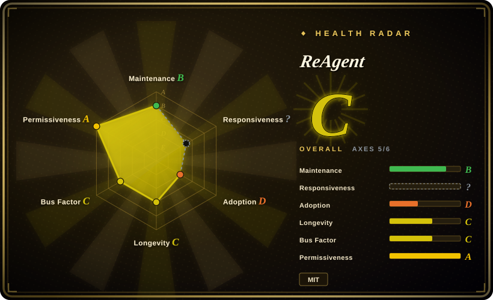
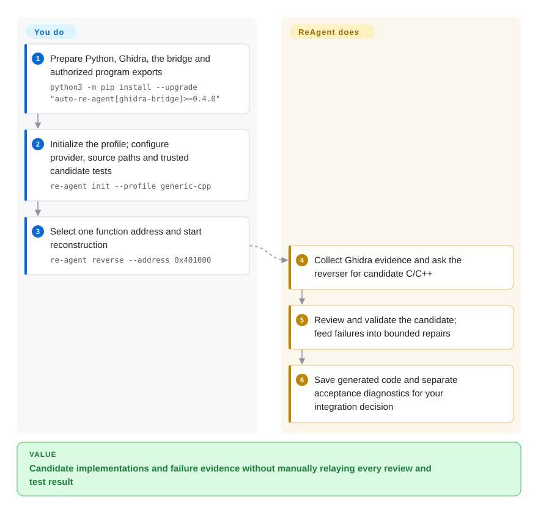
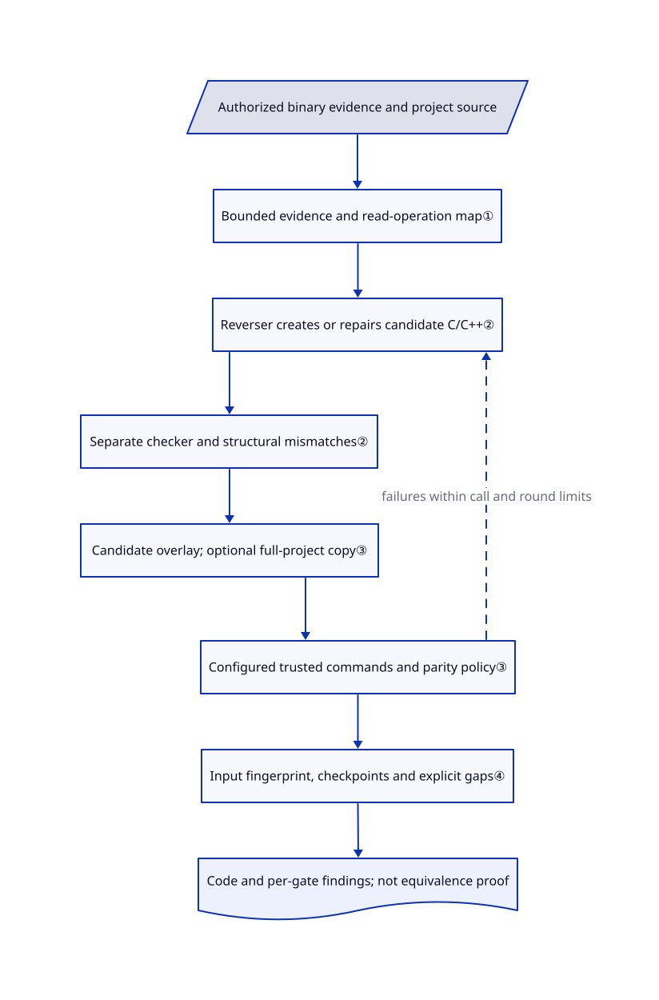

# ReAgent

You have a compiled function and a partly rebuilt C/C++ project, but copying decompiler text does not produce code your project can test. ReAgent generates a candidate from Ghidra evidence, asks a separate checker to review it, and feeds configured validation failures back into bounded repairs.

## When to use

You maintain a legacy native program you are authorized to reconstruct. Your source tree still contains placeholder functions such as `FUN_00401000`, while Ghidra knows their callers, types and approximate bodies. You already have a buildable project or can supply a small function-level test adapter. Choose ReAgent when the missing work is repeatedly turning that evidence into candidate implementations, compiling or testing them, and keeping the failures for the next attempt.

Compared with operating [Ghidra](ghidra.md) yourself or asking [REA](rea.md) one question at a time, you get a fixed reconstruction-and-validation loop rather than a general inspection conversation. You pay for model calls and must define meaningful acceptance commands. Start with one function; a bounded function manifest can later cover targets across classes without claiming whole-program recovery.

## When NOT to use

- **You need an explanation, not executable replacement code.** Choose [Ghidra](ghidra.md) for human annotation or [REA](rea.md) for agent-led inspection. ReAgent adds model review, candidate overlays and validation setup that an investigation alone does not need.
- **You cannot send program evidence to a hosted model.** Use local [Ghidra](ghidra.md), or separately qualify a local OpenAI-compatible endpoint. ReAgent sends decompiled text and source context to the selected provider and persists prompts and responses; a local CLI login does not make its model local.
- **You need decompiler output without model calls or a project test harness.** Consider [RetDec](https://github.com/avast/retdec), subject to its limited-maintenance warning, or Ghidra. ReAgent's default verified path refuses absent or untrusted validation commands; disabling validation changes what success means.
- **You need proof of original behavior, or cannot authorize executing validation commands.** Stay with static Ghidra inspection and a separately designed verification process. Structural checks and matching supplied test cases do not prove semantic equivalence; a temporary project copy is not an OS sandbox for arbitrary build, test or runtime commands.
- **You require a clean, ephemeral run or a hard cross-provider dollar ceiling.** Use a disposable environment around Ghidra and separately budgeted model calls. ReAgent retains code, logs, session history, graph and cache files; its per-function call bound is not a universal cost cap, and temporary-copy deletion ignores filesystem errors.

## Comparison

| Alternative | In index | Our verdict | Tradeoff |
|---|---|---|---|
| [Ghidra](ghidra.md) | ✅ | Choose Ghidra when an analyst must understand and annotate a binary; choose ReAgent when candidate source must repeatedly face your project's acceptance commands. | ReAgent consumes Ghidra evidence rather than replacing its decompiler; it adds model expense and test integration. |
| [REA](rea.md) | ✅ | Choose REA when a coding agent needs evidence-bearing inspection across native and Electron targets; choose ReAgent for a fixed C/C++ implementation, review and repair pipeline. | Broader investigation tools versus a narrower reconstruction loop with candidate-level gates; neither establishes source equivalence. |
| [RetDec](https://github.com/avast/retdec) | not indexed | Choose RetDec for conventional local decompilation without LLM review, only if its declared limited maintenance is acceptable; choose ReAgent when integration with project-specific validation decides acceptance. | RetDec emits high-level code through its LLVM-based decompiler; ReAgent needs Ghidra, models and your validation harness. Not added in this tab batch. |

## Quick start

Install Python 3.10+, Ghidra and the documented package extra with `python3 -m pip install --upgrade "auto-re-agent[ghidra-bridge]>=0.4.0"`; headless export needs the separate `headless` extra and a working Ghidra installation. Prepare authorized program exports with the bridge, then run `re-agent init --profile generic-cpp` in the target project and edit `re-agent.yaml` to select the model provider, source paths and validation commands. Explicitly set `validation.copy_project: true` for temporary-copy validation, and attest `trust_configured_commands: true` only after checking that your commands actually consume and validate the candidate; initialization otherwise keeps copy mode off and command trust false. Set a small `orchestrator.max_llm_calls_per_function`, check setup with `re-agent doctor`, then use `re-agent reverse --address 0x401000`, replacing the example address with your target. ReAgent returns generated C/C++ and separate checker, structural, validation and parity results; you fund the model, supply tests and decide whether to integrate the output. These are [documented instructions](https://github.com/Dryxio/reagent/blob/d12cea338c61898b06a86fe8adb25275fa9d5615/README.md#L81-L215), not a run performed for this entry.

<!-- flow-steps:begin (generated from flows/reagent.json by tools/flow_card.py — do not edit) -->

Text version of the flow

1. **You**: Prepare Python, Ghidra, the bridge and authorized program exports — `python3 -m pip install --upgrade "auto-re-agent[ghidra-bridge]>=0.4.0"`
2. **You**: Initialize the profile; configure provider, source paths and trusted candidate tests — `re-agent init --profile generic-cpp`
3. **You**: Select one function address and start reconstruction — `re-agent reverse --address 0x401000`
4. **ReAgent**: Collect Ghidra evidence and ask the reverser for candidate C/C++
5. **ReAgent**: Review and validate the candidate; feed failures into bounded repairs
6. **ReAgent**: Save generated code and separate acceptance diagnostics for your integration decision

**Value**: Candidate implementations and failure evidence without manually relaying every review and test result

<!-- flow-steps:end -->

## Key techniques

<!-- mechanism:begin (generated from mechanisms/reagent.json by tools/mechanism_card.py; do not edit) -->

Text version of the mechanism

- Authorized binary evidence and project source
- Bounded evidence and read-operation map①
- Reverser creates or repairs candidate C/C++②
- Separate checker and structural mismatches②
- Candidate overlay; optional full-project copy③
- Configured trusted commands and parity policy③
- Input fingerprint, checkpoints and explicit gaps④
- Code and per-gate findings; not equivalence proof

- Authorized binary evidence and project source → Bounded evidence and read-operation map①
- Bounded evidence and read-operation map① → Reverser creates or repairs candidate C/C++②
- Reverser creates or repairs candidate C/C++② → Separate checker and structural mismatches②
- Separate checker and structural mismatches② → Candidate overlay; optional full-project copy③
- Candidate overlay; optional full-project copy③ → Configured trusted commands and parity policy③
- Configured trusted commands and parity policy③ → Reverser creates or repairs candidate C/C++② (failures within call and round limits) [optional/fallback]
- Configured trusted commands and parity policy③ → Input fingerprint, checkpoints and explicit gaps④
- Input fingerprint, checkpoints and explicit gaps④ → Code and per-gate findings; not equivalence proof

<!-- mechanism:end -->

### 1. Gather bounded binary evidence rather than asking the model to invent types

- **Problem:** Decompiled text alone can hide callees, layout details and missing branches needed to rebuild one function.
- **How:** The reverser preloads available context, vtables, control-flow graphs and normalized p-code, meaning common operations derived from machine instructions. It accepts model-requested read operations through an explicit operation map and feeds their bounded text back to the model.
- **Limits:** Preloading and requested actions have separate counters; missing optional evidence may be omitted. Exhausting the action budget while still requesting evidence raises an error rather than yielding a candidate; a bounded evidence bundle is not complete program knowledge.
- **Source:** [Evidence collection and operation dispatch, reverser.py:140–257](https://github.com/Dryxio/reagent/blob/d12cea338c61898b06a86fe8adb25275fa9d5615/src/re_agent/agents/reverser.py#L140-L257).

### 2. Keep model approval separate from structural rejection and stopping rules

- **Problem:** A checker can say PASS even when the candidate dropped calls or conditional paths visible in the binary.
- **How:** Each round combines a checker conversation with non-model comparisons of call counts, control flow, constant returns and available machine-analysis artifacts. Both model roles share a call budget; failed gate diagnostics feed repairs, and identical candidate-plus-diagnostics hashes stop repeated attempts.
- **Limits:** The checker defaults to the same provider configuration as the reverser, not an independently chosen model family. Structural UNKNOWN does not itself reject a result; only strong mismatches return FAIL. Round and call limits bound work, not correctness or a provider-independent dollar spend.
- **Source:** [Review, success condition and repetition stop, loop.py:64–205](https://github.com/Dryxio/reagent/blob/d12cea338c61898b06a86fe8adb25275fa9d5615/src/re_agent/agents/loop.py#L64-L205), [structural verifier:13–145](https://github.com/Dryxio/reagent/blob/d12cea338c61898b06a86fe8adb25275fa9d5615/src/re_agent/verification/objective.py#L13-L145), [shared call counter:14–76](https://github.com/Dryxio/reagent/blob/d12cea338c61898b06a86fe8adb25275fa9d5615/src/re_agent/llm/observed.py#L14-L76).

### 3. Test candidate overlays without mistaking command success for validation meaning

- **Problem:** A green build of untouched source says nothing about the generated replacement function.
- **How:** The overlay substitutes a matching function body and refuses ambiguous overloads. Optional full-project copies remap internal symlinks and reject external ones; commands run with candidate paths, timeouts and recorded exits. Passing commands remain UNKNOWN until explicit command trust; the default acceptance policy requires verified validation and blocks RED parity findings.
- **Limits:** Copy mode is opt-in, not the dataclass or generated-template default. Commands inherit the process environment and can affect the host; trust is a user attestation, not sandboxing. Finally-block cleanup attempts to delete temporary overlays but suppresses removal errors; persistent reports and non-isolated overlays remain.
- **Source:** [Overlay, command trust and cleanup, candidate.py:33–242](https://github.com/Dryxio/reagent/blob/d12cea338c61898b06a86fe8adb25275fa9d5615/src/re_agent/verification/candidate.py#L33-L242), [symlink boundaries:312–326](https://github.com/Dryxio/reagent/blob/d12cea338c61898b06a86fe8adb25275fa9d5615/src/re_agent/verification/candidate.py#L312-L326), [acceptance and finally cleanup, single.py:118–217](https://github.com/Dryxio/reagent/blob/d12cea338c61898b06a86fe8adb25275fa9d5615/src/re_agent/orchestrator/single.py#L118-L217), [defaults:123–144](https://github.com/Dryxio/reagent/blob/d12cea338c61898b06a86fe8adb25275fa9d5615/src/re_agent/config/schema.py#L123-L144).

### 4. Bind resumable results to selected inputs and preserve evidence gaps

- **Problem:** Reusing yesterday's successful function after changing source or acceptance policy can silently reuse an obsolete result.
- **How:** A fingerprint covers source-profile, validation, parity and backend configuration plus selected source/export files. Session rebinding archives previous results on an identity change. Model-free planning walks direct callees within depth and count limits and records failed queries and dependencies outside the selected inventory.
- **Limits:** The fingerprint is not a complete environment snapshot: it does not hash arbitrary build-tool binaries, model configuration or the contents behind a live bridge. A manifest is a bounded inventory, not a complete call graph; evidence gaps remain part of the result.
- **Source:** [Fingerprint inputs, identity.py:13–43](https://github.com/Dryxio/reagent/blob/d12cea338c61898b06a86fe8adb25275fa9d5615/src/re_agent/core/identity.py#L13-L43), [session binding and checkpoints:39–92](https://github.com/Dryxio/reagent/blob/d12cea338c61898b06a86fe8adb25275fa9d5615/src/re_agent/core/session.py#L39-L92), [bounded planning:87–160](https://github.com/Dryxio/reagent/blob/d12cea338c61898b06a86fe8adb25275fa9d5615/src/re_agent/core/target_plan.py#L87-L160), [manifest mismatch rejection:33–38](https://github.com/Dryxio/reagent/blob/d12cea338c61898b06a86fe8adb25275fa9d5615/src/re_agent/cli/cmd_reverse.py#L33-L38).

## Tech stack

- Python CLI with YAML configuration and dataclass state; core dependencies are PyYAML, Anthropic and OpenAI SDKs, built with Hatchling.
- A subprocess-based Ghidra bridge, or a reader for existing Ghidra JSON exports. The backend registry also includes a canned-data test backend, not a production alternative analysis engine.
- Local JSON sessions, graph and call logs; generated C/C++ files and Markdown/JSON reports. No database server is required.

## Dependencies

- Python 3.10+; Ghidra and `ghidra-ai-bridge` for full binary-backed collection, or precomputed exports for `ghidra-json`. Ghidra's Java/native prerequisites belong to that separate installation.
- Claude API, a configured OpenAI-compatible endpoint, or an authenticated Claude/Codex CLI. Separate role configurations are optional; provider billing and evidence-disclosure rules remain yours.
- A target source layout, compiler/build tools and meaningful project-owned validation commands. Optional Clang indexing needs a local Clang executable and suitable compilation database; timer differential examples add `pefile`, Unicorn and a C++ compiler.
- The MIT license covers ReAgent's code, not ownership of target binaries, reconstructed assets or permission to execute them. Supply your own authorized binary; the timer example does not bundle one.

## Ops difficulty

**Medium to high.** Installing the Python CLI is the small part; maintaining compatible Ghidra exports, resolving source identities and designing trustworthy build or runtime adapters is the real integration work. Models receive program evidence, while per-call logs can retain sensitive code and responses. Set retention and access rules for reports, session state and `.cache/re-agent-parity`; temporary-copy cleanup does not erase these or any provider-held records. Pin releases, isolate untrusted targets and validation commands outside your everyday credentials, and inspect each verdict separately instead of treating PASS as equivalence.

## Health & viability

- **2026-10-25 — early release line, not abandoned.** The repository was created on 2026-02-17; four visible releases run from v0.2.0 in July to v0.4.0 on 2026-09-09, also the latest default-branch commit date. The manifest explicitly classifies the package as Alpha.
- **Concentrated ownership.** The personal-account repository lists three contributors with 27, 11 and 2 contributions in the observed API response. The tree contains no governance, security-policy or code-owner document; open requests for IDA support and newer monitoring/parallel features are not implemented default-branch capabilities.
- **Continuity judgment.** [推断：依据是八个月历史、近期发布与集中的贡献记录] Use it as an optional, pinned reconstruction assistant until your own corpus validates it. Recent activity helps, but its short active lifetime provides a weak Lindy prior compared with Ghidra; 2215 stars and 234 forks measure attention, not successful recovery.
- **License and evidence quality.** The reviewed MIT text names Dryxio, and the visible license history has one initial-license commit. The repository supplies tests, a concrete timer adapter and a limited published experiment, but that experiment covers three functions and 21 observations, not arbitrary C/C++ binaries or whole-program equivalence.

## Caveats (unverified)

- [未验证：本次只读公开源码，按任务约束未安装或运行上游] Installation, Ghidra integration, reconstruction quality, real model cost, runtime isolation and successful cleanup were not reproduced. Source presence and upstream tests are not execution evidence from this entry.
- [未验证：缺少作者实验环境与其授权参考二进制] The reported timer matches and benchmark controls were read in the published validation artifacts, not rerun; they do not substantiate general reconstruction accuracy.
- [推断：依据是项目年龄、维护记录和贡献集中度] Optional adoption and weak durability are selection judgments, not a prediction of abandonment or a support guarantee.
