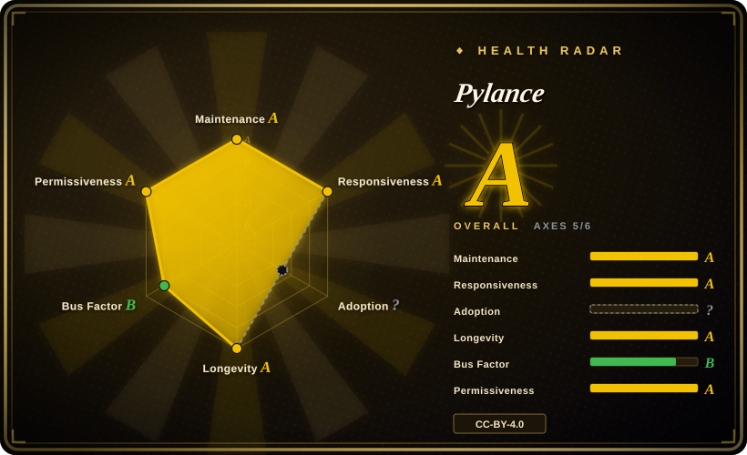
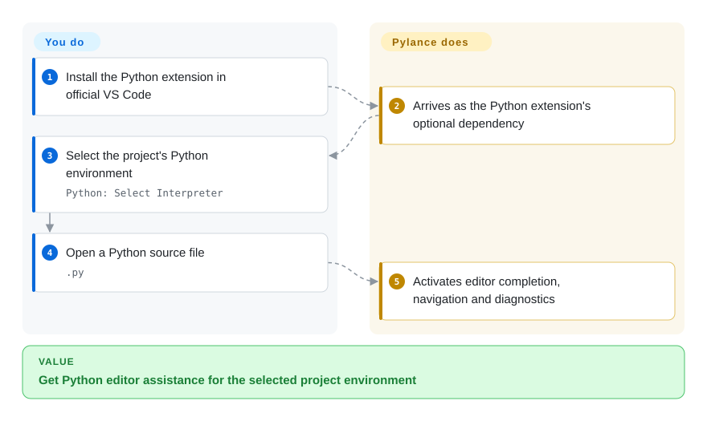
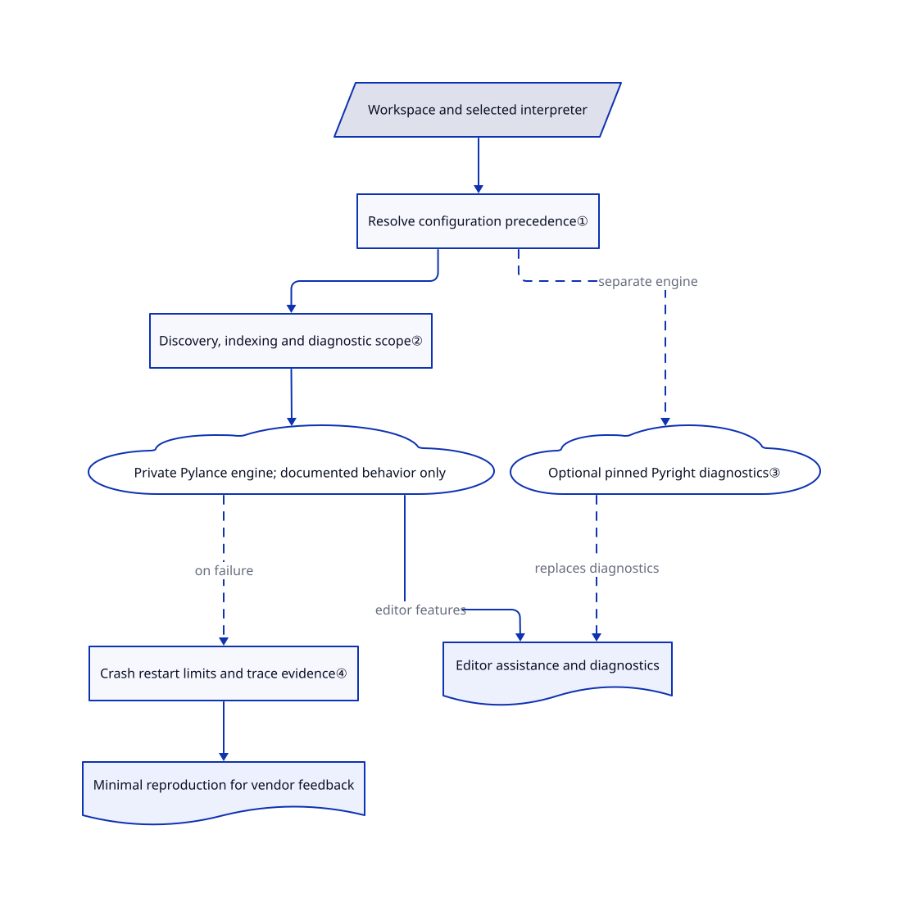

# Pylance

Your Python script runs, but VS Code underlines an import and offers the wrong members. Pylance connects editor assistance to the selected Python environment; this repository documents its configuration and collects feedback, not its closed-source implementation.

**License scope:** the frontmatter records the repository's [CC-BY-4.0 content license](https://github.com/microsoft/pylance-release/blob/f03a84d93009b8a8398658c365f72b46afbb2482/LICENSE), not a grant to redistribute or modify the Pylance binary. The [FAQ](https://github.com/microsoft/pylance-release/blob/f03a84d93009b8a8398658c365f72b46afbb2482/FAQ.md#L5-L17) says the product is closed-source and licensed only for Microsoft products and services, specifically official VS Code builds and GitHub Codespaces. Read the separate [extension terms](https://marketplace.visualstudio.com/items/ms-python.vscode-pylance/license) before deployment; this page does not certify binary-use rights.

## When to use

You maintain a Python project in official VS Code. A package imports at runtime, but the editor says it cannot resolve it, and you need completion, navigation and refactoring against the same environment your project uses. Choose Pylance when its integrated editor features and bundled type declarations matter more than having the whole language server's source available. Use this repository's environment, path and logging guides to distinguish configuration mistakes from a reproducible product defect.

You can also use the documented Pyright bridge when editor diagnostics must follow a separately pinned checker version. That preserves Pylance's editor assistance while replacing its diagnostics; it is not a free performance upgrade or proof of identical CI results.

## When NOT to use

- **You need a forkable language server or a CI command.** Choose Pyright for its public checker implementation and CLI. This repository cannot build Pylance, and an extension installation is not a CI verifier.
- **Your editor is Code OSS, VSCodium or another non-Microsoft host.** Evaluate basedpyright and its Open VSX distribution instead of assuming the repository's CC license authorizes Pylance there. The FAQ explicitly limits Pylance's supported licensed hosts.
- **You need a Python API for completion inside your own application.** Use Jedi's library API rather than embedding the proprietary Pylance distribution. Jedi focuses on completion and navigation, not replacing a standards-based type-checking gate.
- **You require source-reproducible privacy or resource guarantees.** Prefer a reviewed Pyright deployment with controlled packages and runtime. Pylance documents telemetry controls, optional Copilot integrations and automatic downloads, but its private implementation cannot be audited from this repository.

## Comparison

| Alternative | In index | Our verdict | Tradeoff |
|---|---|---|---|
| [Pyright](https://github.com/microsoft/pyright) | not indexed | Choose Pyright for headless CI and source-level changes; choose Pylance for its additional VS Code refactoring and semantic editor features. | Shared checker lineage does not guarantee matching versions, stubs or settings. |
| [basedpyright](https://github.com/DetachHead/basedpyright) | not indexed | Choose basedpyright when an Open VSX distribution and a modifiable Pyright fork outweigh the first-party Pylance integration. | It adds its own typing changes and some Pylance-like features; it is not the Pylance codebase. |
| [Jedi](https://github.com/davidhalter/jedi) | not indexed | Choose Jedi when your application needs a Python completion/navigation API; choose Pylance when the destination is an official VS Code workspace with type diagnostics. | Library integration is your responsibility; Jedi's README now points to Zuban as its author's successor. |

The comparison uses public READMEs, not a feature-parity benchmark: [Pyright](https://github.com/microsoft/pyright/blob/611afe615b8659a154aa9656ee5b8cfddf57cdac/README.md#L3-L7), [basedpyright](https://github.com/DetachHead/basedpyright/blob/5fb7d7afc7e6db49e8317acf5b1bd3262de90494/README.md#L5-L17), [Jedi](https://github.com/davidhalter/jedi/blob/c7ceec72f1876b9f69482fe9427f8fea4c1e5220/README.rst#L5-L32).

## Quick start

In an official VS Code build, install the Microsoft Python extension from the Marketplace; its optional Pylance dependency supplies the language service. Select your project's interpreter with `Python: Select Interpreter`, then open a `.py` file to activate Pylance. If a previous server selection blocks activation, set `python.languageServer` to `Pylance` or `Default`; use `python.analysis.extraPaths` only for additional source roots, not as a substitute for installing dependencies in the selected environment. Pylance supplies completion, navigation and diagnostics while you own the interpreter, packages, workspace configuration and license review. The documented minimum is VS Code 1.107.0; type checking defaults to `off`, and full diagnostics default to open files, so choose a shared project checking policy before treating a quiet editor as a clean build. This is a documentation-verified path, not an installation test ([README](https://github.com/microsoft/pylance-release/blob/f03a84d93009b8a8398658c365f72b46afbb2482/README.md#L11-L16), [FAQ](https://github.com/microsoft/pylance-release/blob/f03a84d93009b8a8398658c365f72b46afbb2482/FAQ.md#L24-L31), [interpreter selection](https://github.com/microsoft/pylance-release/blob/f03a84d93009b8a8398658c365f72b46afbb2482/FAQ.md#L103-L112)).

<!-- flow-steps:begin (generated from flows/pylance-release.json by tools/flow_card.py — do not edit) -->

Text version of the flow

1. **You**: Install the Python extension in official VS Code
2. **Pylance**: Arrives as the Python extension's optional dependency
3. **You**: Select the project's Python environment — `Python: Select Interpreter`
4. **You**: Open a Python source file — `.py`
5. **Pylance**: Activates editor completion, navigation and diagnostics

**Value**: Get Python editor assistance for the selected project environment

<!-- flow-steps:end -->

## Key techniques

<!-- mechanism:begin (generated from mechanisms/pylance-release.json by tools/mechanism_card.py; do not edit) -->

Text version of the mechanism

- Workspace and selected interpreter
- Resolve configuration precedence①
- Discovery, indexing and diagnostic scope②
- Private Pylance engine; documented behavior only
- Optional pinned Pyright diagnostics③
- Editor assistance and diagnostics
- Crash restart limits and trace evidence④
- Minimal reproduction for vendor feedback

- Workspace and selected interpreter → Resolve configuration precedence①
- Resolve configuration precedence① → Discovery, indexing and diagnostic scope②
- Discovery, indexing and diagnostic scope② → Private Pylance engine; documented behavior only
- Private Pylance engine; documented behavior only → Editor assistance and diagnostics (editor features)
- Resolve configuration precedence① → Optional pinned Pyright diagnostics③ (separate engine) [optional/fallback]
- Optional pinned Pyright diagnostics③ → Editor assistance and diagnostics (replaces diagnostics) [optional/fallback]
- Private Pylance engine; documented behavior only → Crash restart limits and trace evidence④ (on failure) [optional/fallback]
- Crash restart limits and trace evidence④ → Minimal reproduction for vendor feedback

<!-- mechanism:end -->

### 1. Resolve configuration ownership before changing a rule

- **Problem:** Editing the user's checking mode can have no effect when project configuration owns the same rule.
- **How:** The documented configuration chain gives project settings priority over overlapping VS Code settings; `pyrightconfig.json` wins over `[tool.pyright]` when both exist. Per-file `# pyright:` directives can override the checking mode and rules for that file.
- **Limits:** This is a documented configuration mechanism, not public implementation code. Do not generalize the precedence to every setting: for example, VS Code extra paths still apply if the project omits its own `extraPaths`.
- **Source:** [Configuration precedence and exceptions](https://github.com/microsoft/pylance-release/blob/f03a84d93009b8a8398658c365f72b46afbb2482/docs/howto/settings-troubleshooting.md#L23-L71).

### 2. Separate discovery, indexing and reported diagnostics

- **Problem:** An editor can look quiet because it never discovered a file, not because that file passed type checking.
- **How:** `light` mode defaults to excluding workspace discovery, disabling indexing and skipping untyped-library source inference. `openFilesOnly` limits full diagnostics, while imported files can still be analyzed; explicit individual settings override the mode's defaults.
- **Limits:** Exclusion is not an isolation boundary: imports can pull excluded files into analysis. `full` removes the user-file indexing cap and can select an automatically downloaded Node runtime in trusted workspaces; more features can cost more memory and network access.
- **Source:** [Mode defaults and limitations](https://github.com/microsoft/pylance-release/blob/f03a84d93009b8a8398658c365f72b46afbb2482/docs/settings/python_analysis_languageServerMode.md#L29-L94), [diagnostic/discovery scope](https://github.com/microsoft/pylance-release/blob/f03a84d93009b8a8398658c365f72b46afbb2482/README.md#L94-L110), [Node runtime controls](https://github.com/microsoft/pylance-release/blob/f03a84d93009b8a8398658c365f72b46afbb2482/docs/settings/python_analysis_nodeExecutable.md#L15-L69).

### 3. Keep editor assistance while replacing diagnostics

- **Problem:** CI and the editor disagree when their checker versions, type declarations or search paths differ.
- **How:** The documented `Pylance + Pyright` setting launches a separate designated Pyright version for diagnostics while Pylance retains its own engine for editor assistance. Shared project configuration aligns checking rules; custom or installed type stubs, files describing package interfaces, can replace bundled fallbacks.
- **Limits:** The guide warns that two engines can double memory and CPU use. Matching a version alone does not align stubs, environment or `.env` behavior; per-package bundled-stub disabling applies only to Pylance, whereas external Pyright requires the all-disabled `true` option.
- **Source:** [Version bridge and settings differences](https://github.com/microsoft/pylance-release/blob/f03a84d93009b8a8398658c365f72b46afbb2482/USING_WITH_PYRIGHT.md#L18-L97), [stub precedence](https://github.com/microsoft/pylance-release/blob/f03a84d93009b8a8398658c365f72b46afbb2482/docs/howto/bundled-stubs.md#L9-L20), [external-provider opt-out boundary](https://github.com/microsoft/pylance-release/blob/f03a84d93009b8a8398658c365f72b46afbb2482/docs/howto/bundled-stubs.md#L114-L126).

### 4. Bound crash recovery and collect a reproducible report

- **Problem:** Repeated server restarts can hide a persistent failure and leave maintainers without the environment needed to reproduce it.
- **How:** Desktop VS Code's documented restart policy stops after five crashes unless the server ran continuously for at least ten minutes between failures; the five-in-three-minutes limit also remains. The issue workflow asks for a full startup log, environment versions and a minimal code example.
- **Limits:** Brief readiness does not reset the counter, and reloading is not a fix. Trace logging has significant overhead; stop it after collecting evidence and review logs before sharing workspace paths or dependency details. The restart algorithm itself is not public here.
- **Source:** [Documented restart behavior](https://github.com/microsoft/pylance-release/blob/f03a84d93009b8a8398658c365f72b46afbb2482/README.md#L784-L792), [trace and reporting workflow](https://github.com/microsoft/pylance-release/blob/f03a84d93009b8a8398658c365f72b46afbb2482/TROUBLESHOOTING.md#L152-L166).

## Tech stack

- **Public repository:** Markdown documentation, diagnostic examples and Python test/sample files; it does not expose the Pylance product's buildable source or dependency manifest.
- **Documented product architecture:** a VS Code language-server extension using Pyright's typing engine, a Node.js runtime and bundled type stubs. The public repository's GitHub language statistic describes its samples, not proof that Pylance is implemented in Python.
- **Evidence boundary:** the four techniques describe documented configuration, diagnostic collaboration and recovery behavior, not independently inspected closed-source algorithms ([repository role](https://github.com/microsoft/pylance-release/blob/f03a84d93009b8a8398658c365f72b46afbb2482/README.md#L5-L7)).

## Dependencies

- Official VS Code 1.107.0+ or the documented GitHub Codespaces host; the usual setup uses Microsoft Python and Python Environments extensions for interpreter integration. The FAQ identifies these as optional extension dependencies, not requirements for every Pylance feature.
- A selected Python environment containing your project dependencies; custom source roots and type declarations remain project configuration.
- VS Code's bundled Node runtime by default. A custom runtime is optional; `nodeExecutable: auto` downloads from nodejs.org, and `full` can choose it implicitly unless explicitly overridden.
- Copilot Chat is required only for the documented AI-assisted actions and docstring translation, not ordinary completion or static diagnostics ([AI options](https://github.com/microsoft/pylance-release/blob/f03a84d93009b8a8398658c365f72b46afbb2482/README.md#L518-L540)). An external diagnostics provider adds its own executable, version and download policy.

## Ops difficulty

**Low for one ordinary workspace; medium for monorepos and controlled environments.** Installation uses the extension ecosystem rather than a server deployment, but interpreter selection, path precedence, stub compatibility and resource policy need maintenance. Start with measured scope changes rather than blindly choosing `full` or enlarging the heap. Optional Pyrefly diagnostics can download directly from PyPI rather than your pip feed; documented download failure switches the diagnostics source back to Pylance, so approved-feed environments must control that route ([provider behavior](https://github.com/microsoft/pylance-release/blob/f03a84d93009b8a8398658c365f72b46afbb2482/README.md#L582-L605)). Use VS Code's documented telemetry controls; do not infer zero network traffic from local type checking.

## Health & viability

- **Maintenance, 2026-10-28:** the repository is not archived; its current default commit is dated 2026-10-22, while metadata records a push on 2026-10-28. GitHub's latest release is prerelease 2026.4.101, published 2026-10-16; the changelog labels it 15 October, so those are different timestamps. The stable changelog entry is 2026.4.1, 23 September. Fix entries are vendor reports, not reproduced fixes on a local installation.
- **Governance and backing:** Microsoft owns this public feedback/documentation repository. Its contributors and commit concentration measure that public surface, not the staffing or bus factor of the private product team. The FAQ routes core typing contributions to Pyright.
- **Longevity and judgment:** created 2020-05-21, the repository is 2351 days old, more than six years, and remains active. [推断：based on dated public history and ongoing releases] This supports continuity of the integration, but cannot guarantee the proprietary product's future license or support policy.
- **Adoption and risk:** 2161 repository stars are a dated interest signal, not an extension installation count. The automated A radar covers five of six axes; adoption is unknown with reason `ambiguous`, not measured success. It scores the public repository and its CC content license, not the proprietary binary's permissiveness. Host restrictions, unavailable implementation source and optional downloads decide the selection more than that aggregate grade.

## Caveats (unverified)

- [未验证：installation and execution were outside this review] Completion quality, resource consumption, restart behavior and external-provider interoperability were read from fixed public documentation, not reproduced. Documentation on current main can describe behavior absent from stable 2026.4.1.
- [未验证：the public tree excludes product implementation and the full extension agreement is separate] This review does not establish closed-source internals, comprehensive data-flow/privacy guarantees or redistribution rights for the binary. The host restriction above is confirmed from the vendor FAQ, not a complete legal interpretation.
- [推断：based on six years of repository history and current release activity] The continuity verdict is a prior, not a vendor support commitment; public contributor counts do not measure the private team's resilience.
