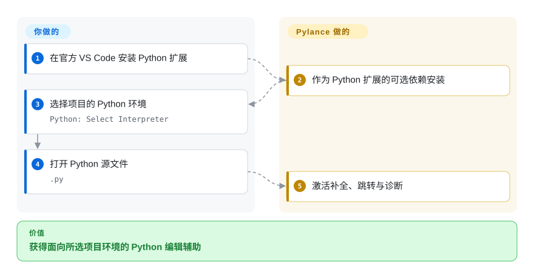
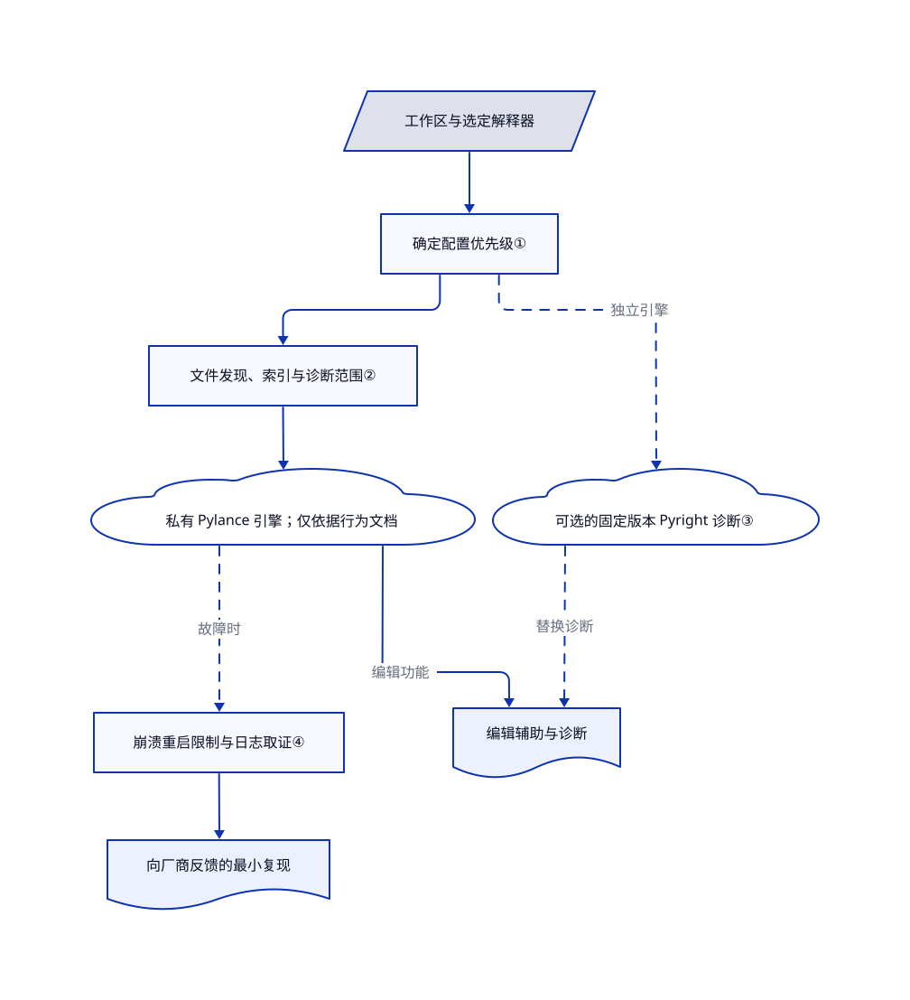

# Pylance

Python 脚本能运行，编辑器却把导入标红，补全也找错成员。Pylance 将编辑辅助关联到选定的 Python 环境；本仓库公开配置文档与反馈入口，不公开产品核心实现。

**许可范围：** frontmatter 记录的是[仓库内容的 CC-BY-4.0](https://github.com/microsoft/pylance-release/blob/f03a84d93009b8a8398658c365f72b46afbb2482/LICENSE)，不是修改或分发 Pylance 二进制的授权。[FAQ](https://github.com/microsoft/pylance-release/blob/f03a84d93009b8a8398658c365f72b46afbb2482/FAQ.md#L5-L17) 明确产品闭源，许可限于微软产品与服务，并列出官方 VS Code 构建及 GitHub Codespaces。部署前应另读[扩展条款](https://marketplace.visualstudio.com/items/ms-python.vscode-pylance/license)；本页不替使用者认证二进制使用权。

## 何时使用

你在官方 VS Code 中维护 Python 项目。程序能导入某个包，编辑器却报找不到；你需要补全、跳转与重构使用项目实际环境。当第一方编辑集成和内置类型声明比完整源码可见性更重要时，选 Pylance。这个仓库的环境、路径和日志指南，能帮你区分配置错误与可复现的产品缺陷。

如果编辑器诊断必须跟随单独固定的检查器版本，也可以使用文档中的 Pyright 桥接。它保留 Pylance 编辑辅助，替换诊断来源；这不是免费的性能升级，也不证明结果必然与 CI 一致。

## 何时不用

- **需要可修改的语言服务器或 CI 命令。** 选公开检查器实现和命令行工具 Pyright。本仓库无法构建 Pylance，安装编辑器扩展也不等于建立 CI 验证器。
- **使用 Code OSS、VSCodium 或其他非微软宿主。** 优先评估 basedpyright 及其 Open VSX 分发，不要把仓库 CC 许可当作在其他宿主运行 Pylance 的授权。FAQ 已明确宿主限制。
- **想在自有程序中嵌入 Python 补全接口。** 选 Jedi 的库接口，不要嵌入专有 Pylance 分发。Jedi 偏重补全与跳转，不替代标准化类型检查门禁。
- **要求从源码复核隐私或资源保证。** 优先选经过审阅、软件包与运行时受控的 Pyright 部署。Pylance 有遥测控制、可选 Copilot 集成与自动下载文档，但不能从本仓库审计私有实现。

## 横向对比

| 替代品 | 是否收录 | 我们的评价 | 取舍 |
|---|---|---|---|
| [Pyright](https://github.com/microsoft/pyright) | 未收录 | 无界面 CI 或修改检查器源码时选 Pyright；需要额外的 VS Code 重构与语义编辑功能时选 Pylance。 | 同源检查器不保证版本、类型声明和配置一致。 |
| [basedpyright](https://github.com/DetachHead/basedpyright) | 未收录 | Open VSX 分发和可修改的 Pyright 分支比第一方集成更重要时，选 basedpyright。 | 它有独立类型检查改动及部分类似 Pylance 的功能，不是 Pylance 源码。 |
| [Jedi](https://github.com/davidhalter/jedi) | 未收录 | 自有程序需要 Python 补全与跳转接口时选 Jedi；目标是官方 VS Code 内的类型诊断时选 Pylance。 | 需要自行集成库；Jedi README 已指向作者的后继项目 Zuban。 |

比较依据是各替代仓库的公开 README，不是功能等价测试：[Pyright](https://github.com/microsoft/pyright/blob/611afe615b8659a154aa9656ee5b8cfddf57cdac/README.md#L3-L7)、[basedpyright](https://github.com/DetachHead/basedpyright/blob/5fb7d7afc7e6db49e8317acf5b1bd3262de90494/README.md#L5-L17)、[Jedi](https://github.com/davidhalter/jedi/blob/c7ceec72f1876b9f69482fe9427f8fea4c1e5220/README.rst#L5-L32)。

## 快速上手

在官方 VS Code 中，从扩展市场安装微软 Python 扩展，其可选依赖 Pylance 提供语言服务。用 `Python: Select Interpreter` 选择项目解释器，再打开 `.py` 文件激活 Pylance。若旧语言服务器选择阻止激活，将 `python.languageServer` 设为 `Pylance` 或 `Default`；`python.analysis.extraPaths` 用于额外源码根目录，不能代替向选定环境安装依赖。Pylance 提供补全、跳转与诊断，你负责解释器、软件包、工作区配置和许可审核。文档最低版本为 VS Code 1.107.0；类型检查默认 `off`，完整诊断默认只覆盖打开文件，因此不能把编辑器无报错直接当作构建通过，应先确定项目共享检查策略。这里核验了文档路径，没有实测安装（[README](https://github.com/microsoft/pylance-release/blob/f03a84d93009b8a8398658c365f72b46afbb2482/README.md#L11-L16)、[FAQ](https://github.com/microsoft/pylance-release/blob/f03a84d93009b8a8398658c365f72b46afbb2482/FAQ.md#L24-L31)、[解释器选择](https://github.com/microsoft/pylance-release/blob/f03a84d93009b8a8398658c365f72b46afbb2482/FAQ.md#L103-L112)）。

<!-- flow-steps:begin (generated from flows/pylance-release.json by tools/flow_card.py — do not edit) -->

流程文字版

1. **你**：在官方 VS Code 安装 Python 扩展
2. **Pylance**：作为 Python 扩展的可选依赖安装
3. **你**：选择项目的 Python 环境 — `Python: Select Interpreter`
4. **你**：打开 Python 源文件 — `.py`
5. **Pylance**：激活补全、跳转与诊断

**价值**：获得面向所选项目环境的 Python 编辑辅助

<!-- flow-steps:end -->

## 技术要点

<!-- mechanism:begin (generated from mechanisms/pylance-release.json by tools/mechanism_card.py; do not edit) -->

机制文字版

- 工作区与选定解释器
- 确定配置优先级①
- 文件发现、索引与诊断范围②
- 私有 Pylance 引擎；仅依据行为文档
- 可选的固定版本 Pyright 诊断③
- 编辑辅助与诊断
- 崩溃重启限制与日志取证④
- 向厂商反馈的最小复现

- 工作区与选定解释器 → 确定配置优先级①
- 确定配置优先级① → 文件发现、索引与诊断范围②
- 文件发现、索引与诊断范围② → 私有 Pylance 引擎；仅依据行为文档
- 私有 Pylance 引擎；仅依据行为文档 → 编辑辅助与诊断（编辑功能）
- 确定配置优先级① → 可选的固定版本 Pyright 诊断③（独立引擎）〔可选／兜底〕
- 可选的固定版本 Pyright 诊断③ → 编辑辅助与诊断（替换诊断）〔可选／兜底〕
- 私有 Pylance 引擎；仅依据行为文档 → 崩溃重启限制与日志取证④（故障时）〔可选／兜底〕
- 崩溃重启限制与日志取证④ → 向厂商反馈的最小复现

<!-- mechanism:end -->

### 1. 先确定规则归属，再修改配置

- **解决：** 项目配置掌管同一条规则时，修改用户级检查模式可能不生效。
- **做法：** 文档规定项目配置优先于重叠的 VS Code 设置；同时存在时，`pyrightconfig.json` 胜过 `[tool.pyright]`。文件头的 `# pyright:` 指令还能覆盖该文件的检查模式与规则。
- **边界：** 这是公开的配置机制，不是公开实现源码。不能把优先级泛化为全部设置，例如项目没有指定 `extraPaths` 时，VS Code 的额外路径仍会生效。
- **源码：** [配置优先级及例外](https://github.com/microsoft/pylance-release/blob/f03a84d93009b8a8398658c365f72b46afbb2482/docs/howto/settings-troubleshooting.md#L23-L71)。

### 2. 区分文件发现、索引与诊断输出

- **解决：** 编辑器安静，可能是未发现文件，不是文件通过了类型检查。
- **做法：** `light` 默认排除工作区文件发现、关闭索引，并停止从无类型声明的库源码推断类型。`openFilesOnly` 限制完整诊断范围，但仍可分析被导入文件；显式单项配置能覆盖模式默认值。
- **边界：** 排除不是隔离，导入仍能把被排除文件带入分析。`full` 取消用户文件索引上限，并可能在可信工作区自动下载 Node 运行时；更多功能需要更多内存与网络访问。
- **源码：** [模式默认值与限制](https://github.com/microsoft/pylance-release/blob/f03a84d93009b8a8398658c365f72b46afbb2482/docs/settings/python_analysis_languageServerMode.md#L29-L94)、[诊断与发现范围](https://github.com/microsoft/pylance-release/blob/f03a84d93009b8a8398658c365f72b46afbb2482/README.md#L94-L110)、[Node 运行时控制](https://github.com/microsoft/pylance-release/blob/f03a84d93009b8a8398658c365f72b46afbb2482/docs/settings/python_analysis_nodeExecutable.md#L15-L69)。

### 3. 保留编辑辅助，单独替换诊断

- **解决：** 检查器版本、类型声明或搜索路径不同，会让 CI 与编辑器报错不一致。
- **做法：** 文档中的 `Pylance + Pyright` 启动指定版本的独立 Pyright 提供诊断，Pylance 自有引擎继续提供编辑辅助。共享项目配置对齐检查规则；本地或已安装的类型存根，即描述包接口的声明文件，可以替换内置后备声明。
- **边界：** 指南警告双引擎可能使 CPU 与内存用量翻倍。只对齐版本不能对齐存根、环境和 `.env` 行为；按包禁用内置存根仅适用于 Pylance，外部 Pyright 要使用全部禁用的 `true` 选项。
- **源码：** [版本桥接与配置差异](https://github.com/microsoft/pylance-release/blob/f03a84d93009b8a8398658c365f72b46afbb2482/USING_WITH_PYRIGHT.md#L18-L97)、[存根优先级](https://github.com/microsoft/pylance-release/blob/f03a84d93009b8a8398658c365f72b46afbb2482/docs/howto/bundled-stubs.md#L9-L20)、[外部诊断禁用边界](https://github.com/microsoft/pylance-release/blob/f03a84d93009b8a8398658c365f72b46afbb2482/docs/howto/bundled-stubs.md#L114-L126)。

### 4. 限制崩溃重启，收集可复现报告

- **解决：** 反复重启会掩盖持续故障，维护者又缺少复现环境。
- **做法：** 桌面 VS Code 的文档策略规定，崩溃五次后停止重启，除非两次故障间连续运行至少十分钟；三分钟五次的限制也仍有效。反馈流程要求完整启动日志、环境版本和最小代码示例。
- **边界：** 短暂就绪不重置计数，重载也不是修复。Trace 日志开销显著，取证后应停止；共享前检查工作区路径和依赖信息。这里没有公开重启算法实现。
- **源码：** [重启行为文档](https://github.com/microsoft/pylance-release/blob/f03a84d93009b8a8398658c365f72b46afbb2482/README.md#L784-L792)、[日志与反馈流程](https://github.com/microsoft/pylance-release/blob/f03a84d93009b8a8398658c365f72b46afbb2482/TROUBLESHOOTING.md#L152-L166)。

## 技术栈

- **公开仓库：** Markdown 文档、诊断示例及 Python 测试和样例文件；没有 Pylance 产品的可构建源码或依赖清单。
- **文档中的产品结构：** 使用 Pyright 类型引擎、Node.js 运行时和内置类型存根的 VS Code 语言服务器扩展。GitHub 对本仓库样例的语言统计，不能证明 Pylance 由 Python 实现。
- **证据边界：** 四组技术点解释文档中的配置、诊断协作和恢复行为，不冒充对闭源算法的独立审阅（[仓库定位](https://github.com/microsoft/pylance-release/blob/f03a84d93009b8a8398658c365f72b46afbb2482/README.md#L5-L7)）。

## 依赖

- 官方 VS Code 1.107.0 以上或文档中的 GitHub Codespaces 宿主。常见安装路径使用微软 Python 与 Python Environments 扩展对接解释器；FAQ 将它们列为可选扩展依赖，不是所有功能的硬要求。
- 装有项目依赖的选定 Python 环境；自定义源码根目录与类型声明仍需项目配置。
- 默认使用 VS Code 内置 Node。外置运行时可选；`nodeExecutable: auto` 会从 nodejs.org 下载，`full` 在未显式覆盖时可能自动选中该设置。
- Copilot Chat 仅是文档中 AI 辅助操作与文档字符串翻译的要求，不是普通补全或静态诊断的前提（[AI 选项](https://github.com/microsoft/pylance-release/blob/f03a84d93009b8a8398658c365f72b46afbb2482/README.md#L518-L540)）。外部诊断提供者另有可执行文件、版本与下载策略。

## 运维难度

**普通单工作区低，单仓多项目与受控环境中等。** 安装靠扩展生态，不需要部署服务器；但仍要维护解释器选择、路径优先级、存根兼容和资源策略。先测量并调整分析范围，不要直接切 `full` 或加大堆内存。可选 Pyrefly 诊断会直接访问 PyPI，而非使用 pip 配置的软件源；文档规定下载失败会把诊断来源切回 Pylance，因此企业软件源环境应管住这条路径（[提供者行为](https://github.com/microsoft/pylance-release/blob/f03a84d93009b8a8398658c365f72b46afbb2482/README.md#L582-L605)）。遥测按 VS Code 文档控制，不能从本地类型检查推出零联网。

## 健康度与可持续性

- **维护，2026-10-28：** 仓库未归档，默认分支当前提交日期为 2026-10-22，元数据的推送日期为 2026-10-28。GitHub 最新发行是预览版 2026.4.101，发布于 2026-10-16；变更日志将其标为 10 月 15 日，两者是不同时间戳。日志中的稳定版为 2026.4.1，日期 9 月 23 日。修复条目是厂商记录，不是本地安装复测。
- **治理与背书：** 微软拥有这个公开反馈与文档仓库。贡献者和提交集中度衡量公开部分，不能代表私有产品团队人数或人员风险。FAQ 将核心类型检查贡献引导到 Pyright。
- **寿命与判断：** 仓库创建于 2020-05-21，已有 2351 天，即六年多历史，且仍活跃。[推断：依据为公开历史日期与持续发布] 这支持集成延续性，但不能保证专有产品未来的许可或支持政策。
- **采用与风险：** 2161 个仓库星标仅代表截至核验日的关注，不是扩展安装量。自动雷达 A 覆盖六轴中的五轴，采用度未知，原因为 `ambiguous`，不代表测得成功。评分针对公开仓库和 CC 内容许可，不评价二进制专有许可的宽松程度。宿主限制、实现不公开与可选下载，比总分更能决定是否采用。

## 存疑（未验证）

- [未验证：本轮未获安装与运行授权] 补全质量、资源消耗、崩溃恢复及外部诊断协作均来自固定公开文档，没有复现。当前 main 文档描述的行为，可能尚未进入稳定版 2026.4.1。
- [未验证：公开树不含产品实现，完整扩展协议另行提供] 本轮不能证明闭源内部机制、完整数据流与隐私保证或二进制分发权。上文宿主限制已由厂商 FAQ 证实，但不等于完整法律解释。
- [推断：依据为六年仓库历史与当前发布活动] 延续性判断只是先验，不是厂商支持承诺；公开贡献者数量不能衡量私有团队韧性。
