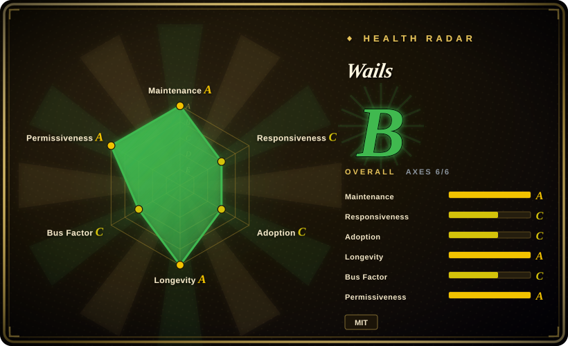
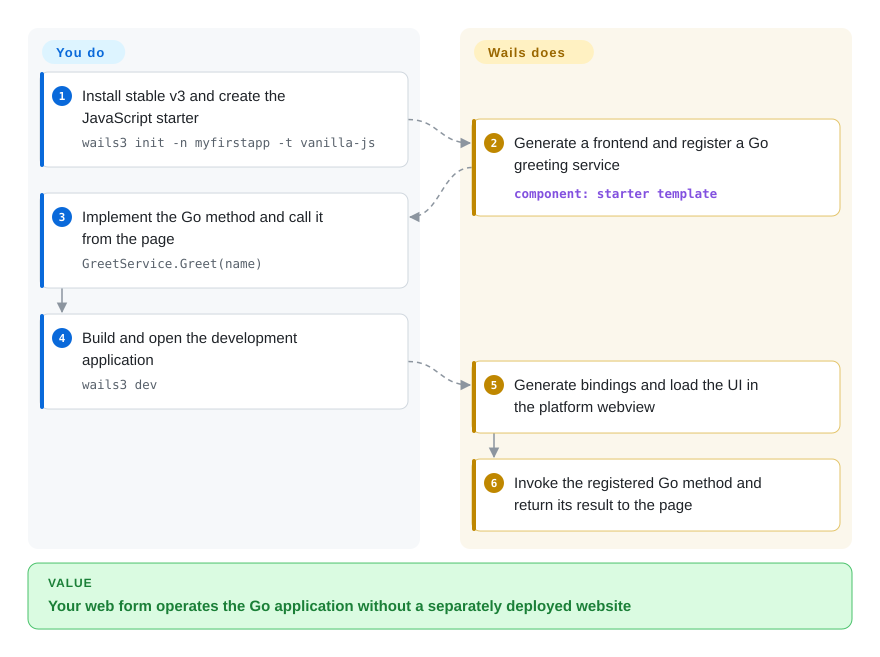
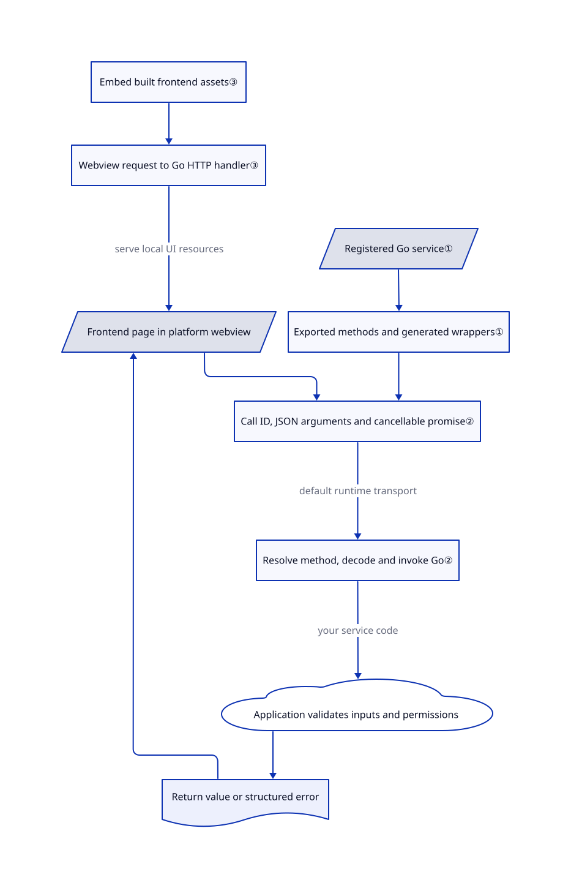

# Wails

Your Go utility works, but users must start a server and open a browser just to use its forms. Wails puts your web interface in a desktop window and connects it to Go methods, without shipping a separate Chromium engine in the ordinary desktop build.

## When to use

You maintain a Go application that imports files, queries a local database or controls a device. Users need a familiar form and table rather than command-line flags, and you already have HTML/CSS/JavaScript skills. Wails lets you keep the business logic in Go, register a service and call its exported methods from generated frontend bindings. You own the UI and application policy; it supplies the window, bridge and build tooling.

Choose it over Electron when keeping Go and using the platform's browser view matter more than a Node.js backend and identical Chromium rendering. Choose it over [Tauri](tauri.md) when Go is the backend language you want to maintain, rather than introducing Rust. This is a desktop-first selection: mobile directories exist, but the starter path and platform contract assessed here are Windows, macOS and Linux.

## When NOT to use

- **You require one Chromium version across platforms or Electron/Node native modules.** Choose Electron instead; Wails relies on platform webviews and a Go backend, so neither CSS behaviour nor Node APIs transfer unchanged.
- **Your main constraint is an explicit per-window capability policy.** Compare [Tauri](tauri.md) rather than treating a Wails service registration as authorization. Wails exposes exported service methods except special lifecycle/HTTP methods; validate inputs and enforce file/account permissions in Go.
- **Your Linux fleet cannot supply the required webview libraries.** Consider Electron's bundled engine, or validate a specifically packaged Wails AppImage. v3 defaults to GTK4/WebKitGTK 6.0; the opt-in GTK3/WebKit2GTK 4.1 path is documented only through v3.0.x, not a permanent compatibility promise.
- **You want a Go UI without an HTML/JavaScript frontend.** Consider Fyne instead; Wails deliberately retains a web frontend and its build dependencies. Native menus and dialogs do not turn its page content into native toolkit widgets.
- **An existing v2 application must remain unchanged.** Keep its v2 CLI and module until you budget a migration; a v3 service example is not an instruction for the v2 `wails` command. Both lines are stable on the verification date, but their APIs and build tooling differ.

## Comparison

| Alternative | In index | Our verdict | Tradeoff |
| --- | --- | --- | --- |
| [Tauri](tauri.md) | indexed | Choose Wails when the maintained native logic is Go; choose Tauri when Rust and its explicit capability configuration fit your application better. | Both avoid bundling Chromium in their ordinary desktop path; both need testing against platform webviews. The backend language and permission integration change. |
| Electron | not indexed | Choose Electron when Node integrations and a consistent bundled Chromium outweigh the extra runtime; choose Wails for a Go backend using the OS webview. | Electron brings its own browser/runtime distribution; Wails transfers rendering and runtime availability to each platform. Not added in this tab batch. |
| Fyne | not indexed | Choose Fyne when you want to author the UI in Go without a web frontend; choose Wails when retaining HTML/CSS and frontend components is the deciding requirement. | Fyne changes the UI programming model; Wails keeps web tooling plus a native Go bridge. Not added in this tab batch. |

## Quick start

Use the stable v3 path: install Go 1.26 or later and the platform prerequisites, then install `go install github.com/wailsapp/wails/v3/cmd/wails3@v3.0.0` and check the environment with `wails3 doctor`. Run `wails3 init -n myfirstapp -t vanilla-js`, enter that generated directory, and edit the Go greeting service and the frontend that calls `GreetService.Greet(name)`; the template registers the service for you. `wails3 dev` builds and opens the development application; `wails3 build` produces the release executable under `bin`, while `wails3 package` runs the platform packaging tasks. Wails generates bindings and transports the return value; you implement useful work, handle errors, protect sensitive methods, test each target webview, and arrange signing and distribution. The JavaScript starter uses npm/Vite, and builds fetch Go/npm dependencies; this source-only assessment did not install or run any of them ([versioned install path](https://github.com/wailsapp/wails/blob/3b1e7926996da34d3fde3d2bd5da0ceb38adb035/README.md#L91-L100), [first application](https://github.com/wailsapp/wails/blob/3b1e7926996da34d3fde3d2bd5da0ceb38adb035/docs/mpress/content/getting-started/your-first-app.md#L15-L170)).

<!-- flow-steps:begin (generated from flows/wails.json by tools/flow_card.py — do not edit) -->

Text version of the flow

1. **You**: Install stable v3 and create the JavaScript starter — `wails3 init -n myfirstapp -t vanilla-js`
2. **Wails**: Generate a frontend and register a Go greeting service — component: `starter template`
3. **You**: Implement the Go method and call it from the page — `GreetService.Greet(name)`
4. **You**: Build and open the development application — `wails3 dev`
5. **Wails**: Generate bindings and load the UI in the platform webview
6. **Wails**: Invoke the registered Go method and return its result to the page

**Value**: Your web form operates the Go application without a separately deployed website

<!-- flow-steps:end -->

## Key techniques

<!-- mechanism:begin (generated from mechanisms/wails.json by tools/mechanism_card.py; do not edit) -->

Text version of the mechanism

- Registered Go service①
- Exported methods and generated wrappers①
- Frontend page in platform webview
- Call ID, JSON arguments and cancellable promise②
- Resolve method, decode and invoke Go②
- Return value or structured error
- Embed built frontend assets③
- Webview request to Go HTTP handler③
- Application validates inputs and permissions

- Registered Go service① → Exported methods and generated wrappers①
- Exported methods and generated wrappers① → Call ID, JSON arguments and cancellable promise②
- Frontend page in platform webview → Call ID, JSON arguments and cancellable promise②
- Call ID, JSON arguments and cancellable promise② → Resolve method, decode and invoke Go② (default runtime transport)
- Resolve method, decode and invoke Go② → Application validates inputs and permissions (your service code)
- Application validates inputs and permissions → Return value or structured error
- Return value or structured error → Frontend page in platform webview
- Embed built frontend assets③ → Webview request to Go HTTP handler③
- Webview request to Go HTTP handler③ → Frontend page in platform webview (serve local UI resources)

<!-- mechanism:end -->

### 1. Bind registered Go services instead of hand-writing every bridge endpoint

- **Problem:** A frontend calling native work otherwise needs a matching request wrapper and backend dispatch entry for every method.
- **How:** A service instance supplies exported methods. Wails records each method's fully qualified name, numeric identifier and reflected parameter types; generated JavaScript wrappers call the identifier and reconstruct returned models when needed.
- **Limits:** Registration exposes methods, not user permissions. One instance per Go service type is allowed; generic service types are rejected, and application-level validation and concurrency control remain your responsibility.
- **Source:** [Method registration and type inspection](https://github.com/wailsapp/wails/blob/3b1e7926996da34d3fde3d2bd5da0ceb38adb035/v3/pkg/application/bindings.go#L133-L293), [generated wrapper](https://github.com/wailsapp/wails/blob/3b1e7926996da34d3fde3d2bd5da0ceb38adb035/v3/examples/binding/assets/bindings/github.com/wailsapp/wails/v3/examples/binding/greetservice.js#L18-L46), [shared service state](https://github.com/wailsapp/wails/blob/3b1e7926996da34d3fde3d2bd5da0ceb38adb035/docs/mpress/content/features/bindings/services.md#L70-L104).

### 2. Carry method calls as asynchronous JSON requests with cancellation

- **Problem:** The page must receive Go results and errors without pretending a native call is synchronous JavaScript.
- **How:** The frontend runtime creates a call identifier and a cancellable promise, then sends the method descriptor and JSON arguments. Its default transport posts to the page origin's `/wails/runtime`; Go resolves the name or identifier, decodes arguments to reflected types, invokes the method and returns a result or structured error.
- **Limits:** Cancellation signals a Go context; service code must cooperate rather than assuming work is forcibly stopped. Correlation identifiers are not authentication credentials. Debug logging includes call arguments and results, so review log levels before passing secrets.
- **Source:** [Promise and cancellation](https://github.com/wailsapp/wails/blob/3b1e7926996da34d3fde3d2bd5da0ceb38adb035/v3/internal/runtime/desktop/@wailsio/runtime/src/calls.ts#L69-L116), [default transport](https://github.com/wailsapp/wails/blob/3b1e7926996da34d3fde3d2bd5da0ceb38adb035/v3/internal/runtime/desktop/@wailsio/runtime/src/runtime.ts#L127-L186), [dispatch and debug logging](https://github.com/wailsapp/wails/blob/3b1e7926996da34d3fde3d2bd5da0ceb38adb035/v3/pkg/application/messageprocessor_call.go#L19-L152), [argument decoding and invocation](https://github.com/wailsapp/wails/blob/3b1e7926996da34d3fde3d2bd5da0ceb38adb035/v3/pkg/application/bindings.go#L340-L389), [identifier boundary](https://github.com/wailsapp/wails/blob/3b1e7926996da34d3fde3d2bd5da0ceb38adb035/v3/internal/runtime/desktop/@wailsio/runtime/src/nanoid.ts#L33-L39).

### 3. Embed built frontend assets while adapting webview requests to Go handlers

- **Problem:** A desktop interface should not need a separately deployed website merely to load its own HTML and JavaScript.
- **How:** The starter embeds `frontend/dist` into the Go binary and registers an asset handler. The webview adapter converts intercepted requests into Go HTTP requests and feeds the same handler machinery; the application opens a window at the local root URL.
- **Limits:** HTTP-shaped requests do not imply a separately operated TCP server in this desktop path. Development servers, custom transports and server-mode builds are different paths. Embedded assets also do not bundle every system library; Linux AppImage packaging may explicitly bundle WebKit and helper processes.
- **Source:** [Embedded assets and window creation](https://github.com/wailsapp/wails/blob/3b1e7926996da34d3fde3d2bd5da0ceb38adb035/v3/internal/templates/_common/main.go.tmpl#L12-L68), [webview request adapter](https://github.com/wailsapp/wails/blob/3b1e7926996da34d3fde3d2bd5da0ceb38adb035/v3/internal/assetserver/assetserver_webview.go#L72-L218), [handler routing](https://github.com/wailsapp/wails/blob/3b1e7926996da34d3fde3d2bd5da0ceb38adb035/v3/internal/assetserver/assetserver.go#L83-L129), [AppImage boundary](https://github.com/wailsapp/wails/blob/3b1e7926996da34d3fde3d2bd5da0ceb38adb035/docs/mpress/content/guides/build/linux.md#L61-L65).

## Tech stack

- Go core, native platform integration and CLI; the reviewed v3 module declares `go 1.26.0` and `toolchain go1.26.10` ([manifest](https://github.com/wailsapp/wails/blob/3b1e7926996da34d3fde3d2bd5da0ceb38adb035/v3/go.mod#L1-L5)).
- JavaScript/TypeScript frontend and runtime; the assessed JavaScript starter uses Vite and `@wailsio/runtime` ([template manifest](https://github.com/wailsapp/wails/blob/3b1e7926996da34d3fde3d2bd5da0ceb38adb035/v3/internal/templates/vanilla-js/frontend/package.json.tmpl#L1-L18)).
- Native webviews rather than an ordinary bundled Chromium runtime; Go embeds the built frontend and the CLI dispatches platform-specific Taskfiles.

## Dependencies

- **Developer:** Go 1.26+, a native C build environment, and the frontend toolchain chosen by the template. macOS needs Xcode command-line tools; Windows needs WebView2. Linux needs GCC plus GTK4/WebKitGTK 6.0 development packages by default ([installation](https://github.com/wailsapp/wails/blob/3b1e7926996da34d3fde3d2bd5da0ceb38adb035/docs/mpress/content/getting-started/installation.md#L8-L67)).
- **Recipient:** platform webview/runtime libraries appropriate to the actual build. The documented desktop baseline includes Windows AMD64/ARM64, a standard macOS build targeting 12.0+, and Ubuntu 24.04 AMD64/ARM64. AppImage contents and host-library requirements need validation; a Go executable is not proof of a dependency-free package.
- **Licensing:** the root MIT text names Lea Anthony and requires retaining its notice. Imported pieces retain separate notices: Harry Phillips' MIT file-dialog code, the ISC WebView loader, Andrey Sitnik's MIT-derived identifier code and the Inter font's OFL-1.1. Root MIT does not replace those notices or the operating system webview's distribution terms ([root](https://github.com/wailsapp/wails/blob/3b1e7926996da34d3fde3d2bd5da0ceb38adb035/LICENSE#L1-L21), [dialog](https://github.com/wailsapp/wails/blob/3b1e7926996da34d3fde3d2bd5da0ceb38adb035/v3/internal/go-common-file-dialog/LICENSE#L1-L21), [loader](https://github.com/wailsapp/wails/blob/3b1e7926996da34d3fde3d2bd5da0ceb38adb035/v3/internal/webview2/webviewloader/LICENSE#L1-L16), [identifier](https://github.com/wailsapp/wails/blob/3b1e7926996da34d3fde3d2bd5da0ceb38adb035/v3/internal/runtime/desktop/@wailsio/runtime/src/nanoid.ts#L1-L22), [font](https://github.com/wailsapp/wails/blob/3b1e7926996da34d3fde3d2bd5da0ceb38adb035/v3/internal/templates/_common/frontend/Inter%20Font%20License.txt#L1-L26)).

## Ops difficulty

**Medium for shipping a desktop product.** There is no required hosted service for the assessed local UI, but you maintain frontend dependencies, Go dependencies, platform builds and webview compatibility. Signing, installers, updates, data migration and recovery remain application work. Review generated tasks before running them: setup can install platform dependencies and configure Docker/signing; packaging invokes external tools rather than merely copying a binary.

Uninstalling the CLI is separate from uninstalling an app built with it. Remove the installed CLI binary from the actual Go binary directory when no longer needed; generated `bin`, frontend build output and dependency directories are separate from source. An app's databases, keychain entries and webview profile/cache need an app-specific retention and removal policy. No complete cross-platform uninstall or data-erasure procedure was exercised here.

## Health & viability

- **Maintenance, 2026-10-27:** v3.0.0 was published on October 26; v2.17.0 on October 18. The default branch already previews v3.1 nightly. Pin CLI, module and frontend runtime versions; do not translate a development-branch fix into a stable-release promise ([releases](https://github.com/wailsapp/wails/releases), [release policy](https://github.com/wailsapp/wails/blob/3b1e7926996da34d3fde3d2bd5da0ceb38adb035/docs/mpress/content/contributing/release-policy.md#L8-L61)).
- **Governance and backing:** the project is community-led under `wailsapp`, with Lea Anthony prominent in the contributor sample and sponsorship advertised in the README. Contributions use MIT without a CLA. This is not a commercial support guarantee ([contribution terms](https://github.com/wailsapp/wails/blob/3b1e7926996da34d3fde3d2bd5da0ceb38adb035/CONTRIBUTING.md#L29-L42)).
- **Age and adoption:** created December 15, 2018; nearly eight years old and still active, with about 36.8k stars. [推断: based on repository age and continuing releases] The maintained project has a stronger longevity prior than a new wrapper, but the one-day-old v3 stable line has not earned the same release-specific history as v2.
- **Security and release risk:** the policy supports 2.x and 3.0.x, not legacy v3 alpha/beta builds; applications built on Wails remain their owners' security responsibility. Open issues are leads for target-platform testing, not independently reproduced failures ([security scope](https://github.com/wailsapp/wails/blob/3b1e7926996da34d3fde3d2bd5da0ceb38adb035/SECURITY.md#L3-L24)).
- **Measured coverage:** the automated radar scores all six applicable axes, with no unknown axis or manual-review flag. Its response sample has a 187.7-hour median first response across 29 qualifying issues; active commits do not promise quick support. Adoption scoring uses the frontend runtime package, not a census of shipped Go applications.

## Caveats (unverified)

- [未验证: upstream execution, installation and GUI use were prohibited] The developer path, binding round trip, packaging and platform compatibility were checked against fixed source, not run. No size, speed or memory saving was measured.
- [推断: based on age and release history, not future funding commitments] The longevity assessment is a selection prior, not a guarantee of maintenance or support.
- [未验证: no complete binary dependency or legal-rights audit was performed] The component notices above are a source-backed sample, not a full third-party inventory or assurance of non-infringement.
- [未验证: no application-specific storage or installed package was created] CLI removal, generated-directory cleanup and application-data deletion are separate responsibilities; complete uninstall and erasure behaviour remain untested.
