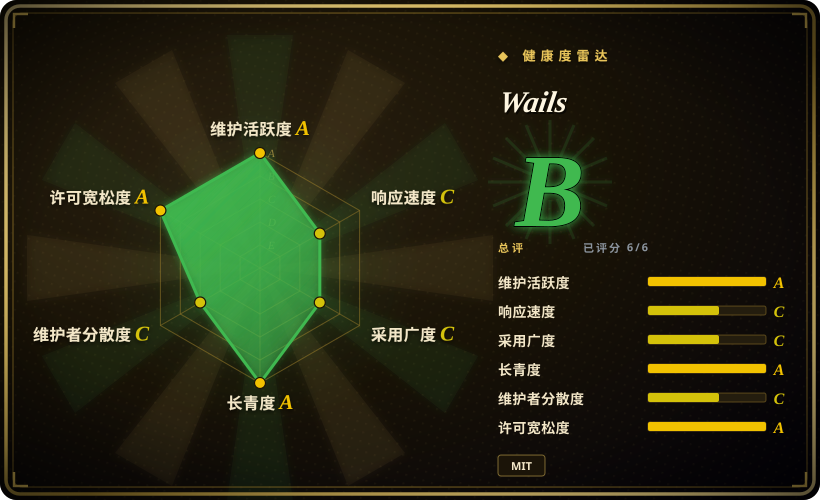
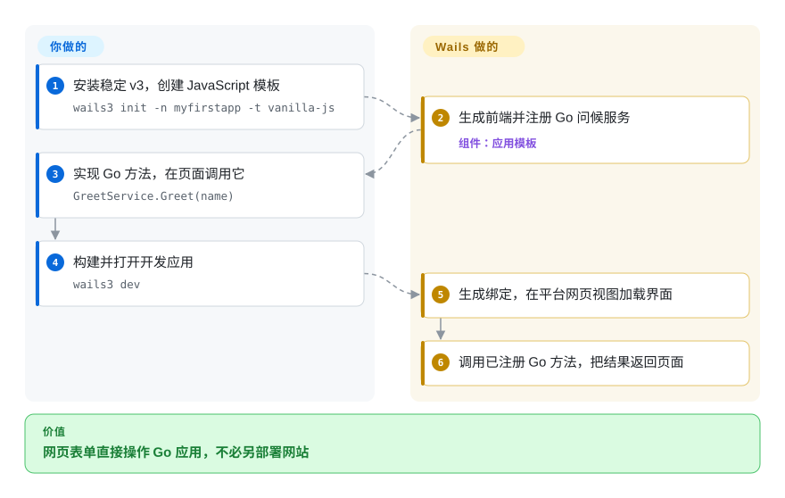
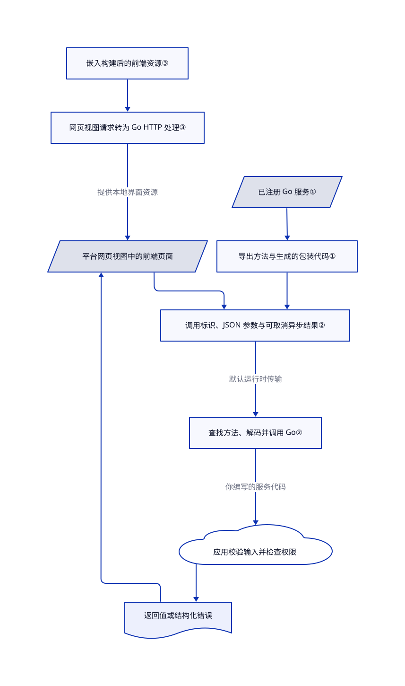

# Wails

你的 Go 工具已经能处理业务，用户却要先启动服务、再打开浏览器才能填表。Wails 把网页界面放进桌面窗口，并接到 Go 方法上；普通桌面构建不另带一份 Chromium 引擎。

## 何时使用

你维护一个导入文件、查询本地数据库或控制设备的 Go 应用。用户需要表单和表格，而不是命令行参数；你也已有 HTML、CSS、JavaScript 经验。Wails 让你保留 Go 业务逻辑，注册服务，再从前端生成的绑定代码调用导出方法。你负责界面和应用策略，它提供窗口、通信桥及构建工具。

当保留 Go、复用系统网页视图，比 Node.js 后端和统一 Chromium 渲染更重要时，选它而非 Electron。当你想继续维护 Go，而不是引入 Rust 时，选它而非 [Tauri](tauri.zh.md)。本页按桌面优先场景选型：源码有移动端目录，但本次核验的入门路径与平台约定针对 Windows、macOS 和 Linux。

## 何时不用

- **必须跨平台使用同一 Chromium，或依赖 Electron、Node 原生模块。** 选 Electron。Wails 使用各平台网页视图和 Go 后端，CSS 行为与 Node API 都不能原样照搬。
- **首要约束是显式的逐窗口能力授权。** 对比 [Tauri](tauri.zh.md)，不要把 Wails 注册服务当作授权。Wails 会暴露服务的导出方法，但排除特殊生命周期和 HTTP 方法；输入校验、文件和账号权限仍需在 Go 中实现。
- **Linux 终端无法提供所需网页视图库。** 考虑自带引擎的 Electron，或单独验证特定 Wails AppImage 包。v3 默认使用 GTK4 与 WebKitGTK 6.0；可选的 GTK3、WebKit2GTK 4.1 路径只承诺到 v3.0.x，不是永久兼容保证。
- **希望只用 Go 编写界面，不维护 HTML、JavaScript 前端。** 考虑 Fyne。Wails 刻意保留网页前端及其构建依赖；原生菜单和对话框不会把页面内容变成原生控件。
- **现有 v2 应用必须保持不变。** 先保留 v2 命令行工具和模块，再安排迁移；v3 服务示例不是 v2 `wails` 命令的教程。核验日两条线都稳定，但 API 与构建工具不同。

## 横向对比

| 替代品 | 是否收录 | 我们的评价 | 取舍 |
| --- | --- | --- | --- |
| [Tauri](tauri.zh.md) | 已收录 | 原生业务继续用 Go 维护时选 Wails；Rust 与显式能力配置更适合应用时选 Tauri。 | 两者普通桌面路径都不打包 Chromium，也都要测试各平台网页视图；后端语言和权限集成方式不同。 |
| Electron | 未收录 | Node 集成与统一 Chromium 比额外运行时更重要时选 Electron；Go 后端与系统网页视图更重要时选 Wails。 | Electron 自带浏览器和运行时；Wails 把渲染及运行时可用性交给各平台。本轮标签批次不新增该替代品。 |
| Fyne | 未收录 | 想用 Go 编写界面、不维护网页前端时选 Fyne；保留 HTML、CSS 与前端组件是决定因素时选 Wails。 | Fyne 改变界面编程方式；Wails 保留网页工具链，再连接原生 Go 逻辑。本轮标签批次不新增该替代品。 |

## 快速上手

使用稳定 v3 路径：先准备 Go 1.26 及以上版本和平台依赖，再执行 `go install github.com/wailsapp/wails/v3/cmd/wails3@v3.0.0`，用 `wails3 doctor` 检查环境。运行 `wails3 init -n myfirstapp -t vanilla-js` 后进入生成目录，修改 Go 问候服务和调用 `GreetService.Greet(name)` 的前端；模板已经注册服务。`wails3 dev` 构建并打开开发应用；`wails3 build` 在 `bin` 下生成发布程序，`wails3 package` 执行平台打包任务。Wails 负责生成绑定、传送返回值；你负责业务、错误处理、敏感方法保护、各平台网页视图测试，以及签名和分发。JavaScript 模板使用 npm、Vite，构建会获取 Go 与 npm 依赖；本次只读源码，没有安装或执行这些工具（[固定版本安装路径](https://github.com/wailsapp/wails/blob/3b1e7926996da34d3fde3d2bd5da0ceb38adb035/README.md#L91-L100)、[首个应用](https://github.com/wailsapp/wails/blob/3b1e7926996da34d3fde3d2bd5da0ceb38adb035/docs/mpress/content/getting-started/your-first-app.md#L15-L170)）。

<!-- flow-steps:begin (generated from flows/wails.json by tools/flow_card.py — do not edit) -->

流程文字版

1. **你**：安装稳定 v3，创建 JavaScript 模板 — `wails3 init -n myfirstapp -t vanilla-js`
2. **Wails**：生成前端并注册 Go 问候服务 — 组件：`应用模板`
3. **你**：实现 Go 方法，在页面调用它 — `GreetService.Greet(name)`
4. **你**：构建并打开开发应用 — `wails3 dev`
5. **Wails**：生成绑定，在平台网页视图加载界面
6. **Wails**：调用已注册 Go 方法，把结果返回页面

**价值**：网页表单直接操作 Go 应用，不必另部署网站

<!-- flow-steps:end -->

## 技术要点

<!-- mechanism:begin (generated from mechanisms/wails.json by tools/mechanism_card.py; do not edit) -->

机制文字版

- 已注册 Go 服务①
- 导出方法与生成的包装代码①
- 平台网页视图中的前端页面
- 调用标识、JSON 参数与可取消异步结果②
- 查找方法、解码并调用 Go②
- 返回值或结构化错误
- 嵌入构建后的前端资源③
- 网页视图请求转为 Go HTTP 处理③
- 应用校验输入并检查权限

- 已注册 Go 服务① → 导出方法与生成的包装代码①
- 导出方法与生成的包装代码① → 调用标识、JSON 参数与可取消异步结果②
- 平台网页视图中的前端页面 → 调用标识、JSON 参数与可取消异步结果②
- 调用标识、JSON 参数与可取消异步结果② → 查找方法、解码并调用 Go②（默认运行时传输）
- 查找方法、解码并调用 Go② → 应用校验输入并检查权限（你编写的服务代码）
- 应用校验输入并检查权限 → 返回值或结构化错误
- 返回值或结构化错误 → 平台网页视图中的前端页面
- 嵌入构建后的前端资源③ → 网页视图请求转为 Go HTTP 处理③
- 网页视图请求转为 Go HTTP 处理③ → 平台网页视图中的前端页面（提供本地界面资源）

<!-- mechanism:end -->

### 1. 注册 Go 服务，避免逐方法手写通信端点

- **解决：** 前端每调用一个原生操作，通常都要配套编写请求包装和后端分派入口。
- **做法：** 服务实例提供导出方法。Wails 记录方法全名、数字标识和反射参数类型；生成的 JavaScript 包装按标识调用，必要时重建返回模型。
- **边界：** 注册只暴露方法，不提供用户权限。每个 Go 服务类型只允许一个实例，也不支持泛型服务类型；应用层校验和并发控制仍由你负责。
- **源码：** [注册与类型检查](https://github.com/wailsapp/wails/blob/3b1e7926996da34d3fde3d2bd5da0ceb38adb035/v3/pkg/application/bindings.go#L133-L293)、[生成的包装代码](https://github.com/wailsapp/wails/blob/3b1e7926996da34d3fde3d2bd5da0ceb38adb035/v3/examples/binding/assets/bindings/github.com/wailsapp/wails/v3/examples/binding/greetservice.js#L18-L46)、[服务共享状态](https://github.com/wailsapp/wails/blob/3b1e7926996da34d3fde3d2bd5da0ceb38adb035/docs/mpress/content/features/bindings/services.md#L70-L104)。

### 2. 用可取消的异步 JSON 请求传递方法调用

- **解决：** 页面需要获得 Go 结果和错误，不能把原生调用伪装成同步 JavaScript。
- **做法：** 前端运行时创建调用标识和可取消的异步结果，再发送方法描述与 JSON 参数。默认传输向当前页面来源的 `/wails/runtime` 发起请求；Go 按名称或标识找方法，把参数解码为反射类型，执行后返回结果或结构化错误。
- **边界：** 取消操作通知 Go 上下文，业务代码必须配合，不是强行终止任务。关联标识不是认证凭据。调试日志包含调用参数和结果，传递秘密前须检查日志级别。
- **源码：** [异步结果与取消](https://github.com/wailsapp/wails/blob/3b1e7926996da34d3fde3d2bd5da0ceb38adb035/v3/internal/runtime/desktop/@wailsio/runtime/src/calls.ts#L69-L116)、[默认传输](https://github.com/wailsapp/wails/blob/3b1e7926996da34d3fde3d2bd5da0ceb38adb035/v3/internal/runtime/desktop/@wailsio/runtime/src/runtime.ts#L127-L186)、[分派与调试日志](https://github.com/wailsapp/wails/blob/3b1e7926996da34d3fde3d2bd5da0ceb38adb035/v3/pkg/application/messageprocessor_call.go#L19-L152)、[参数解码与执行](https://github.com/wailsapp/wails/blob/3b1e7926996da34d3fde3d2bd5da0ceb38adb035/v3/pkg/application/bindings.go#L340-L389)、[标识边界](https://github.com/wailsapp/wails/blob/3b1e7926996da34d3fde3d2bd5da0ceb38adb035/v3/internal/runtime/desktop/@wailsio/runtime/src/nanoid.ts#L33-L39)。

### 3. 嵌入构建后的前端，把网页视图请求交给 Go 处理器

- **解决：** 桌面界面不应只为加载自己的 HTML、JavaScript，就另部署一个网站。
- **做法：** 模板把 `frontend/dist` 嵌入 Go 程序并注册资源处理器。网页视图适配层把截获请求转换成 Go HTTP 请求，再交给同一套处理器；应用在窗口里打开本地根路径。
- **边界：** 请求采用 HTTP 形式，不代表该桌面路径必须另运维 TCP 服务。开发服务器、自定义传输和服务端构建是其他路径。嵌入资源也不等于打包全部系统库；Linux AppImage 打包可能明确带上 WebKit 及辅助进程。
- **源码：** [嵌入资源与创建窗口](https://github.com/wailsapp/wails/blob/3b1e7926996da34d3fde3d2bd5da0ceb38adb035/v3/internal/templates/_common/main.go.tmpl#L12-L68)、[网页视图请求适配](https://github.com/wailsapp/wails/blob/3b1e7926996da34d3fde3d2bd5da0ceb38adb035/v3/internal/assetserver/assetserver_webview.go#L72-L218)、[处理器路由](https://github.com/wailsapp/wails/blob/3b1e7926996da34d3fde3d2bd5da0ceb38adb035/v3/internal/assetserver/assetserver.go#L83-L129)、[AppImage 边界](https://github.com/wailsapp/wails/blob/3b1e7926996da34d3fde3d2bd5da0ceb38adb035/docs/mpress/content/guides/build/linux.md#L61-L65)。

## 技术栈

- Go 核心、原生平台集成和命令行工具；核验的 v3 模块声明 `go 1.26.0` 与 `toolchain go1.26.10`（[清单](https://github.com/wailsapp/wails/blob/3b1e7926996da34d3fde3d2bd5da0ceb38adb035/v3/go.mod#L1-L5)）。
- JavaScript、TypeScript 前端与运行时；本次 JavaScript 模板使用 Vite 和 `@wailsio/runtime`（[模板清单](https://github.com/wailsapp/wails/blob/3b1e7926996da34d3fde3d2bd5da0ceb38adb035/v3/internal/templates/vanilla-js/frontend/package.json.tmpl#L1-L18)）。
- 使用原生网页视图，而非普通打包的 Chromium 运行时；Go 嵌入构建后的前端，命令行工具分派各平台任务文件。

## 依赖

- **开发者侧：** Go 1.26 及以上、原生 C 构建环境，以及模板选择的前端工具链。macOS 需要 Xcode 命令行工具，Windows 需要 WebView2，Linux 默认需要 GCC 和 GTK4、WebKitGTK 6.0 开发包（[安装说明](https://github.com/wailsapp/wails/blob/3b1e7926996da34d3fde3d2bd5da0ceb38adb035/docs/mpress/content/getting-started/installation.md#L8-L67)）。
- **接收者侧：** 需要与实际构建匹配的平台网页视图及运行库。文档桌面基线包含 Windows AMD64、ARM64，标准构建面向 macOS 12.0 及以上，以及 Ubuntu 24.04 AMD64、ARM64。AppImage 内容和宿主库依赖仍须验证；有 Go 可执行文件不代表安装包没有依赖。
- **许可：** 根 MIT 正文署名 Lea Anthony，并要求保留声明。引入组件各自保留许可：Harry Phillips 的 MIT 文件对话框代码、ISC WebView 加载器、源自 Andrey Sitnik 的 MIT 标识生成代码，以及采用 OFL-1.1 的 Inter 字体。根 MIT 不替代这些声明，也不替代系统网页视图的分发条款（[根许可](https://github.com/wailsapp/wails/blob/3b1e7926996da34d3fde3d2bd5da0ceb38adb035/LICENSE#L1-L21)、[对话框](https://github.com/wailsapp/wails/blob/3b1e7926996da34d3fde3d2bd5da0ceb38adb035/v3/internal/go-common-file-dialog/LICENSE#L1-L21)、[加载器](https://github.com/wailsapp/wails/blob/3b1e7926996da34d3fde3d2bd5da0ceb38adb035/v3/internal/webview2/webviewloader/LICENSE#L1-L16)、[标识](https://github.com/wailsapp/wails/blob/3b1e7926996da34d3fde3d2bd5da0ceb38adb035/v3/internal/runtime/desktop/@wailsio/runtime/src/nanoid.ts#L1-L22)、[字体](https://github.com/wailsapp/wails/blob/3b1e7926996da34d3fde3d2bd5da0ceb38adb035/v3/internal/templates/_common/frontend/Inter%20Font%20License.txt#L1-L26)）。

## 运维难度

**发布桌面产品为中等。** 本页本地界面不要求托管服务，但你要维护前端依赖、Go 依赖、平台构建和网页视图兼容性。签名、安装器、更新、数据迁移和恢复仍属于应用工作。运行生成任务前先审查：环境设置可以安装平台依赖、配置 Docker 和签名；打包也会调用外部工具，并非只复制程序。

卸载命令行工具与卸载它生成的应用是两件事。不再需要工具时，从实际 Go 二进制安装目录移除对应程序；生成的 `bin`、前端构建产物和依赖目录与源文件分开处理。应用数据库、钥匙串条目、网页视图配置与缓存，需要应用自己的保留和删除策略。本次没有实测完整跨平台卸载或数据擦除。

## 健康度与可持续性

- **维护，截至 2026-10-27：** v3.0.0 于十月二十六日发布，v2.17.0 于十月十八日发布，默认分支已预览 v3.1 nightly。应固定命令行工具、模块和前端运行时版本，不把开发分支修复直接承诺给稳定版（[发布记录](https://github.com/wailsapp/wails/releases)、[发布策略](https://github.com/wailsapp/wails/blob/3b1e7926996da34d3fde3d2bd5da0ceb38adb035/docs/mpress/content/contributing/release-policy.md#L8-L61)）。
- **治理与支持：** 项目位于 `wailsapp` 组织，由社区维护；贡献者样本中 Lea Anthony 较突出，根说明展示赞助。贡献采用 MIT，不要求 CLA；这不是商业支持保证（[贡献条款](https://github.com/wailsapp/wails/blob/3b1e7926996da34d3fde3d2bd5da0ceb38adb035/CONTRIBUTING.md#L29-L42)）。
- **年龄与采用：** 仓库创建于 2018-12-15，接近八年且仍活跃，约有 3.68 万星。[推断：依据为仓库年龄与持续发布] 相比新出现的包装工具，长期持续性先验更强；但刚发布一天的 v3 稳定线，还没有积累与 v2 相同的版本历史。
- **安全与发布风险：** 安全政策支持 2.x 和 3.0.x，不支持旧 v3 alpha、beta 构建；基于 Wails 的应用仍由应用所有者负责安全。开放问题只作为目标平台测试线索，不视为本次已复现故障（[安全范围](https://github.com/wailsapp/wails/blob/3b1e7926996da34d3fde3d2bd5da0ceb38adb035/SECURITY.md#L3-L24)）。
- **机器覆盖：** 自动雷达覆盖全部六个适用维度，没有未知维度或人工复核标记。响应样本包含 29 个合格问题，首次响应中位数为 187.7 小时；提交活跃不代表支持迅速。采用度评分来自前端运行时包，不是已发布 Go 应用的普查。

## 存疑（未验证）

- [未验证：本轮禁止执行上游、安装和操作界面] 开发路径、绑定往返、打包与平台兼容性均按固定源码核对，未运行。没有实测体积、速度或内存收益。
- [推断：依据为年龄和发布历史，不是未来资金承诺] 长期持续性判断只是选型先验，不保证维护或支持。
- [未验证：未完成二进制依赖或法律权利审计] 上述组件声明是有来源的样本，不是完整第三方清单，也不是无侵权保证。
- [未验证：未创建具体应用存储或安装包] 工具卸载、生成目录清理、应用数据删除各有责任边界；完整卸载和擦除行为仍未实测。
