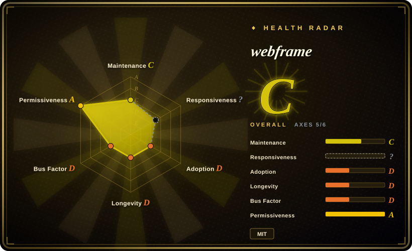
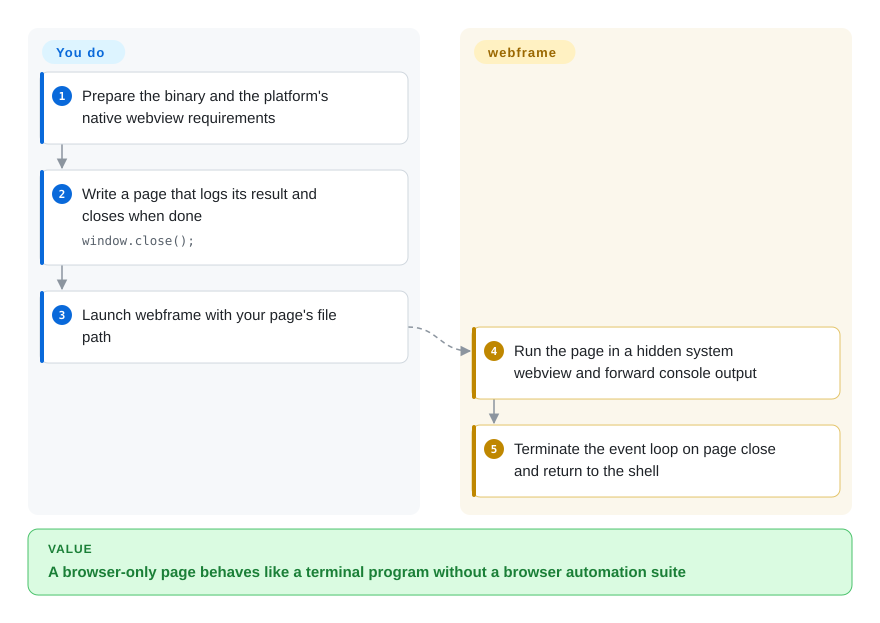
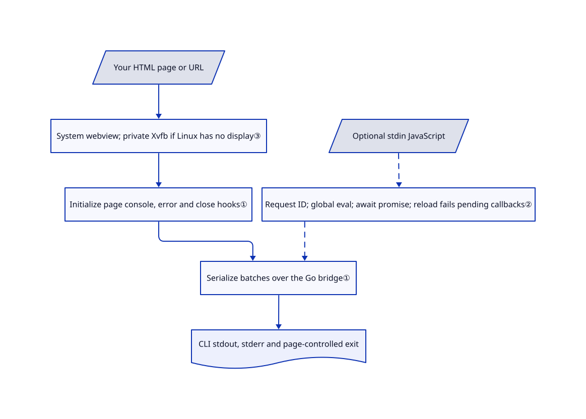

# webframe

Your script needs the browser's DOM or WebAssembly, but opening a window and installing an automation suite is too much just to run a page. webframe executes that page in the system's webview and connects its output and exit to the terminal.

## When to use

You have an HTML program that calls `document.createElement`, uses Web Audio or embeds WebAssembly. A normal JavaScript command-line runtime lacks those browser APIs, while an automation framework adds browser-management machinery you do not need. You want `console.log` on stdout, exceptions on stderr, and `window.close()` to end the process. webframe provides a hidden native webview, with optional JavaScript input over stdin.

Choose it when **the page is the program**, rather than the target of a multi-page test. It avoids bundling a browser by using macOS WebKit, Linux WebKitGTK or Windows WebView2 through glaze. This trades browser distribution for system-engine variability; it does not guarantee identical Web APIs, GPU support or timing. Choose Tauri for a packaged desktop interface, or Playwright/Puppeteer for controlled browser automation.

## When NOT to use

- **You need selectors, auto-waiting, traces and isolated test contexts.** Choose [Playwright](../../../web-automation/playwright-family/playwright.md). webframe exposes one page, callbacks and evaluation, not a test runner or browser-grid API.
- **You need screenshots, PDFs or a known Chrome build.** Choose [Puppeteer](../../../web-automation/browser-driver-frameworks/puppeteer.md). webframe uses the installed system engine and has no dedicated screenshot/PDF API in its reviewed Go surface.
- **You are shipping installers and permission-scoped native commands.** Choose [Tauri](tauri.md). Showing a webframe window does not supply desktop packaging, an updater or a capability policy.
- **Worker logs or full-speed hidden timers on every OS are essential.** Prefer [Playwright](../../../web-automation/playwright-family/playwright.md) for explicit worker/browser instrumentation and test the actual engine. webframe's release says worker consoles are not captured and throttling is disabled only on macOS. Xvfb is not evidence of accelerated WebGPU.
- **A CI success must prove every navigation and statement succeeded.** Use [Playwright](../../../web-automation/playwright-family/playwright.md) assertions. Windows does not report failed page loads; console evaluation errors print to stderr but do not trigger `-e`. Closure and interrupt/termination signals return zero, so exit status alone is not a business assertion.
- **You need fresh profiles or credentials unreadable by the page.** Use [Playwright](../../../web-automation/playwright-family/playwright.md) contexts and scoped credentials, retaining OS isolation for untrusted code. `WF_*` becomes readable `window` properties; webframe exposes no ephemeral-profile or clear-data option. Hidden is not a credential boundary.

## Comparison

| Alternative | In index | Our verdict | Tradeoff |
|---|---|---|---|
| [Playwright](../../../web-automation/playwright-family/playwright.md) | ✅ | Choose Playwright for repeatable interactions, isolated contexts and traces; choose webframe when your own page only needs browser APIs connected to terminal streams. | Playwright manages browser versions and a broad control API; webframe avoids that stack but leaves assertions, timeouts and engine compatibility to you. |
| [Puppeteer](../../../web-automation/browser-driver-frameworks/puppeteer.md) | ✅ | Choose Puppeteer for Chrome-shaped automation, screenshots and PDFs; choose webframe for a page program without a bundled browser. | Puppeteer supplies a matching browser or connects to one you manage; webframe depends on three OS-engine families with much less automation surface. |
| [Tauri](tauri.md) | ✅ | Choose Tauri to package a web UI with scoped native capabilities; choose webframe to launch and supervise a page like a command. | Both reuse system webviews, but Tauri adds Rust app tooling and installers; webframe supplies Go callbacks and terminal policy, not app distribution. |

## Quick start

Use a platform release zip, or build the pinned source with Go 1.27.1 and Make. For the source route, clone [this repository](https://github.com/tractordev/webframe), run `git checkout --detach 03155e2ba67cb9f2825cca84c7c21134ed47add3`, then run `make build` from its root. The [documented build](https://github.com/tractordev/webframe/blob/03155e2ba67cb9f2825cca84c7c21134ed47add3/README.md#L234-L250) invokes the [actual Makefile target](https://github.com/tractordev/webframe/blob/03155e2ba67cb9f2825cca84c7c21134ed47add3/Makefile#L23-L28) within the main module, preserving its [dependency `replace`](https://github.com/tractordev/webframe/blob/03155e2ba67cb9f2825cca84c7c21134ed47add3/go.mod#L5-L9). Do not use the README's version-suffixed installation route: `go help install` disallows replacements that change interpretation from the main-module build, which this module requires. This conflict is statically confirmed; installation and compilation have not been run here.

On Unix the default source build writes `./webframe`; use `./webframe examples/hello.html`, or pass your own page path to the release binary. Linux still needs WebKitGTK plus a display or Xvfb. Write a page that logs its result and calls `window.close()`, as the example does. webframe runs the page, prints console output and stops on page closure; you supply page logic, assets, credential rules, timeouts and success assertions. `-e` fails on page exceptions, while `-c` evaluates stdin lines and awaits promises, but console errors do not become failing exits. The Go package offers the same callbacks for custom policy; lock the main OS thread and keep `New` and `Run` on the main goroutine as documented.

<!-- flow-steps:begin (generated from flows/webframe.json by tools/flow_card.py — do not edit) -->

Text version of the flow

1. **You**: Prepare the binary and the platform's native webview requirements
2. **You**: Write a page that logs its result and closes when done — `window.close();`
3. **You**: Launch webframe with your page's file path
4. **webframe**: Run the page in a hidden system webview and forward console output
5. **webframe**: Terminate the event loop on page close and return to the shell

**Value**: A browser-only page behaves like a terminal program without a browser automation suite

<!-- flow-steps:end -->

## Key techniques

<!-- mechanism:begin (generated from mechanisms/webframe.json by tools/mechanism_card.py; do not edit) -->

Text version of the mechanism

- Your HTML page or URL
- System webview; private Xvfb if Linux has no display③
- Initialize page console, error and close hooks①
- Serialize batches over the Go bridge①
- CLI stdout, stderr and page-controlled exit
- Optional stdin JavaScript
- Request ID; global eval; await promise; reload fails pending callbacks②

- Your HTML page or URL → System webview; private Xvfb if Linux has no display③
- System webview; private Xvfb if Linux has no display③ → Initialize page console, error and close hooks①
- Initialize page console, error and close hooks① → Serialize batches over the Go bridge①
- Serialize batches over the Go bridge① → CLI stdout, stderr and page-controlled exit
- Optional stdin JavaScript → Request ID; global eval; await promise; reload fails pending callbacks② [optional/fallback]
- Request ID; global eval; await promise; reload fails pending callbacks② → Serialize batches over the Go bridge① [optional/fallback]

<!-- mechanism:end -->

### 1. Install an ordered message bridge before page scripts

- **Problem:** Console events and errors otherwise stay inside the hidden webview.
- **How:** The frame binds a Go callback and injects `hooks.js` at initialization. Hooks format console values, capture page errors and rejections, and send batches with only one bridge call in flight to preserve ordering.
- **Limits:** Worker consoles are outside these page hooks. The queue has no explicit capacity limit; a rejected bridge call completes without retrying its batch. The engine can still hide cross-origin or file-origin error details.
- **Source:** [Binding and initialization](https://github.com/tractordev/webframe/blob/03155e2ba67cb9f2825cca84c7c21134ed47add3/webframe.go#L75-L110), [ordered batches](https://github.com/tractordev/webframe/blob/03155e2ba67cb9f2825cca84c7c21134ed47add3/hooks.js#L5-L31), [page hooks](https://github.com/tractordev/webframe/blob/03155e2ba67cb9f2825cca84c7c21134ed47add3/hooks.js#L85-L121).

### 2. Match asynchronous evaluation results to host requests

- **Problem:** A terminal statement can return a promise or outlive its page; callers need a matched result or explicit failure.
- **How:** Evaluation stores an ID and callback, runs a global script and returns the awaited, formatted result under that ID. A new ready message fails outstanding callbacks with `ErrReloaded`; the CLI waits for one evaluation before reading the next line.
- **Limits:** There is no evaluation timeout: a promise that never settles can block the console. Ready means hooks are installed, not that application work is complete. Evaluation errors bypass the page-exception exit policy.
- **Source:** [Callbacks and reload failure](https://github.com/tractordev/webframe/blob/03155e2ba67cb9f2825cca84c7c21134ed47add3/webframe.go#L119-L164), [dispatch](https://github.com/tractordev/webframe/blob/03155e2ba67cb9f2825cca84c7c21134ed47add3/webframe.go#L183-L197), [promise handling](https://github.com/tractordev/webframe/blob/03155e2ba67cb9f2825cca84c7c21134ed47add3/hooks.js#L137-L149), [console loop](https://github.com/tractordev/webframe/blob/03155e2ba67cb9f2825cca84c7c21134ed47add3/cmd/webframe/main.go#L216-L252).

### 3. Start a private Linux display only when needed

- **Problem:** A hidden WebKitGTK view still needs display infrastructure on a headless host.
- **How:** The CLI reuses `DISPLAY` or `WAYLAND_DISPLAY`. Otherwise it starts Xvfb with an automatically chosen display, disables TCP listening, waits for readiness and ties the child to parent-thread death.
- **Limits:** Xvfb must already exist; this is not a display-free engine or a GPU guarantee. Existing displays are not owned or stopped by webframe. musl builds need cgo, unlike ordinary no-cgo cross-builds.
- **Source:** [Display and parent-death signal](https://github.com/tractordev/webframe/blob/03155e2ba67cb9f2825cca84c7c21134ed47add3/cmd/webframe/display_linux.go#L13-L47), [build distinction](https://github.com/tractordev/webframe/blob/03155e2ba67cb9f2825cca84c7c21134ed47add3/Makefile#L11-L28), [container software GL](https://github.com/tractordev/webframe/blob/03155e2ba67cb9f2825cca84c7c21134ed47add3/Dockerfile#L19-L27).

## Tech stack

Go CLI/library, embedded JavaScript hooks, glaze webview bindings and indirect purego. `go.mod` replaces `github.com/crgimenes/glaze` with `github.com/progrium/glaze` at `aa23a9a95cce`; its zero required pseudo-version is resolved by that explicit replacement. Ordinary Makefile builds disable cgo; Alpine/musl builds use cgo.

## Dependencies

- **Runtime:** OS WebKit on macOS, Edge WebView2 Runtime on Windows, WebKitGTK 4.1 or 6.0 plus a display/Xvfb on Linux. Native engine updates and APIs remain platform responsibilities, not a bundled-browser promise.
- **Build:** the checked module declares Go 1.27.1. Linux-musl cross-builds use Zig and cgo. Release zips avoid local compilation, but v0.1 macOS binaries are explicitly unsigned and unnotarized.
- **Workload:** no required model or database. Network, storage, GPU/audio capabilities and asset rights depend on your page. The v86 example uses external CDN scripts, BIOS and a separately supplied kernel, not an offline emulator bundle.
- **Optional tests:** Lima VMs and guest desktop sessions. The macOS setup enables auto-login and passwordless `launchctl`, and Windows prepares a desktop session; these are development fixtures, not normal install steps.
- **Rights:** actual root MIT text names `tractordev`; the pinned glaze fork retains MIT with original authors. OS engines, WebView2 redistribution and example assets retain separate terms.

## Ops difficulty

**Low for trusted pages on a prepared desktop; medium for unattended cross-platform jobs.** You supply native packages, process supervision, application timeouts and engine-specific tests. Hidden operation does not remove the macOS/Windows desktop-session requirement documented by the VM harness. README container-size and benchmark claims were not measured here.

To remove it, stop the page and its restarting service, then remove the binary/container. Private Xvfb is tied to parent death; an inherited display remains someone else's resource. Exit is not erasure: webframe has no profile-clear option and does not request glaze's ephemeral mode. The pinned Windows backend keeps a profile under `APPDATA` named after the executable, falling back to the temp directory; Linux persists website data and cookies. Preserve needed page data before targeted cleanup; do not delete shared engines or unrelated profiles. Removing the binary does not clear redirected logs, images/volumes, VM disks or external writes. Exact macOS residual paths and complete cleanup/recovery were not tested. Storage evidence: [Windows profile](https://github.com/progrium/glaze/blob/aa23a9a95ccefc35e0f3c1a9123036e6ea77fb2f/webview2_scheme_windows.go#L182-L201), [Linux persistence](https://github.com/progrium/glaze/blob/aa23a9a95ccefc35e0f3c1a9123036e6ea77fb2f/webview_linux.go#L1585-L1610).

## Health & viability

- **2026-10-27:** created October 24, last pushed October 25, not archived; one `v0.1` release offers eight platform/architecture zips. Three days of history is not a Lindy record.
- Contributors lists only `progrium`, with four contributions. The fixed tree has no contribution policy, security policy or CI workflow; organization ownership is not a support commitment.
- Issues and PRs are empty, so there is no response-time evidence. Smoke tests cover formatting, ordering, globals, exits and evaluation, but this intake did not run tests or VMs.
- Release notes document missing Windows navigation failures, uncaptured worker logs, platform throttling and unsigned macOS downloads. The pinned glaze fork and OS engine updates are additional compatibility dependencies.
- **[Inference: based on three days of history, one listed contributor and documented platform gaps]** Prefer reviewable local page programs and exploratory integration, not a drop-in mature automation or security-isolation platform. Verify the exact OS engine before unattended use.

## Caveats (unverified)

- [Unverified: upstream execution, dependency installation and browser use are prohibited for this intake] No build, smoke test, VM, page execution, shutdown, profile deletion or container was run; descriptions are source-backed contracts, not target-system reproduction.
- [Unverified: no target hardware or workload experiment was permitted] WebGPU/audio availability, resource use, full-speed hidden timers and benchmark/container-size claims depend on the engine and workload; upstream claims are not measurements here.
- [Unverified: targeted dependency storage paths were inspected without observing installations] Windows naming and Linux persistence are source-backed; exact macOS residual locations and complete cleanup/recovery remain untested. Exit cannot reverse remote writes or recover deleted local data.
- [Inference: based on one early release, one listed contributor and a separate native-engine dependency] Long-term maintenance and production compatibility remain unproven. An empty tracker does not establish absence of bugs.
