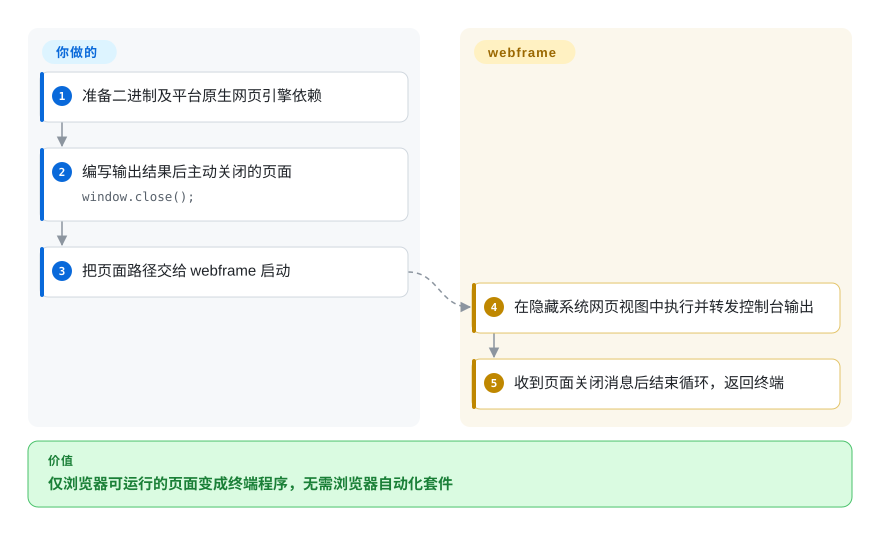
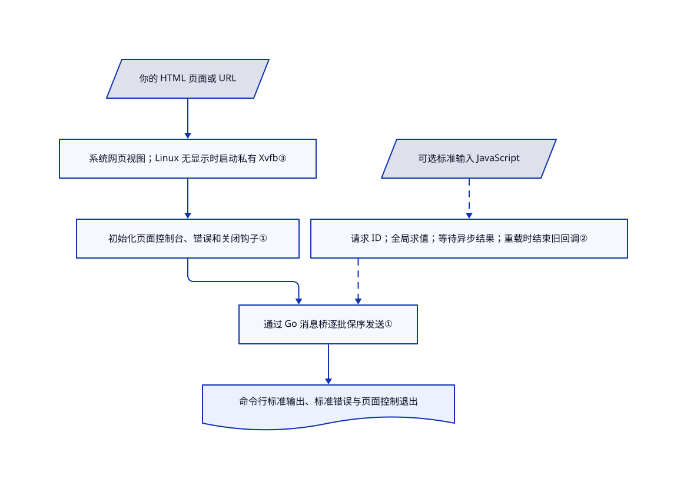

# webframe

脚本需要浏览器的 DOM 或 WebAssembly，你却不想为运行一个页面打开窗口、再装自动化套件。webframe 用系统网页引擎执行页面，把输出和退出接回终端。

## 何时使用

你有一个只在浏览器中运行的 HTML 程序：它调用 `document.createElement`、网页音频接口，或嵌入 WebAssembly。普通 JavaScript 命令行运行时缺少这些网页接口，而自动化框架的浏览器管理又不是你需要的。你只想让 `console.log` 进入标准输出、异常进入标准错误，并用 `window.close()` 结束进程。webframe 提供隐藏原生网页视图，也能从标准输入接收 JavaScript。

当**页面本身就是程序**，而不是多页面测试的操作对象时，可以考虑它。它通过 glaze 使用 macOS WebKit、Linux WebKitGTK 或 Windows WebView2，不打包自有浏览器。这省去浏览器分发，但引入系统引擎差异，不保证网页接口、GPU 能力或计时一致。桌面产品打包选 Tauri，受控浏览器自动化选 Playwright／Puppeteer。

## 何时不用

- **需要元素定位、自动等待、追踪和隔离测试上下文。** 选 [Playwright](../../../web-automation/playwright-family/playwright.zh.md)。webframe 提供单页、回调和求值，不是测试运行器，也没有浏览器集群接口。
- **需要截图、PDF 或确定的 Chrome 版本。** 选 [Puppeteer](../../../web-automation/browser-driver-frameworks/puppeteer.zh.md)。webframe 使用已装系统引擎，所读 Go 接口没有专用截图／PDF 能力。
- **要交付安装包和限定权限的原生命令。** 选 [Tauri](tauri.zh.md)。显示 webframe 窗口不等于拥有桌面打包、更新器或权限能力策略。
- **后台线程日志或所有系统隐藏页全速计时不可少。** 优先用 [Playwright](../../../web-automation/playwright-family/playwright.zh.md) 显式观测线程／浏览器，并验证实际引擎。webframe 发布说明写明不捕获后台线程控制台，关闭节流仅限 macOS；Xvfb 不证明 WebGPU 加速。
- **CI 成功必须代表每次导航和求值成功。** 用 [Playwright](../../../web-automation/playwright-family/playwright.zh.md) 断言。Windows 不报告加载失败，控制台求值错误只写标准错误，不触发 `-e`；关页、中断及终止信号返回零，退出码不是业务断言。
- **需要新建任务数据目录，或凭据不能让页面读取。** 用 [Playwright](../../../web-automation/playwright-family/playwright.zh.md) 上下文并限定凭据，不可信代码仍需操作系统隔离。`WF_*` 变成可读 `window` 属性；webframe 没有临时数据或清数据选项。隐藏窗口不是密钥边界。

## 横向对比

| 替代品 | 是否收录 | 我们的评价 | 取舍 |
|---|---|---|---|
| [Playwright](../../../web-automation/playwright-family/playwright.zh.md) | ✅ | 可复现交互、隔离上下文和追踪选 Playwright；自己的页面只需浏览器接口接终端流时选 webframe。 | 前者管理浏览器版本并提供广泛控制接口；webframe 省去这套栈，但断言、超时和引擎兼容由你负责。 |
| [Puppeteer](../../../web-automation/browser-driver-frameworks/puppeteer.zh.md) | ✅ | 面向 Chrome 的自动化、截图和 PDF 选 Puppeteer；不打包浏览器、只运行页面程序时选 webframe。 | 前者提供匹配浏览器或连接自备浏览器；webframe 依赖三类系统引擎，自动化接口少得多。 |
| [Tauri](tauri.zh.md) | ✅ | 打包网页界面并限定原生能力时选 Tauri；像命令一样启动、监督页面时选 webframe。 | 两者都复用系统网页视图，但 Tauri 增加 Rust 应用工具和安装包；webframe 提供 Go 回调和终端策略，不负责应用分发。 |

## 快速上手

使用对应平台发行包，或准备 Go 1.27.1 和 Make 构建固定源码。源码路线先克隆[本仓库](https://github.com/tractordev/webframe)，执行 `git checkout --detach 03155e2ba67cb9f2825cca84c7c21134ed47add3`，再从仓库根目录运行 `make build`。[文档构建路径](https://github.com/tractordev/webframe/blob/03155e2ba67cb9f2825cca84c7c21134ed47add3/README.md#L234-L250)使用[真实 Makefile 目标](https://github.com/tractordev/webframe/blob/03155e2ba67cb9f2825cca84c7c21134ed47add3/Makefile#L23-L28)，在主模块中保留[依赖 `replace`](https://github.com/tractordev/webframe/blob/03155e2ba67cb9f2825cca84c7c21134ed47add3/go.mod#L5-L9)。不要使用 README 的带版本后缀安装路线：`go help install` 禁止改变主模块解析含义的替换指令，而本模块依赖该指令。这是已确认的静态规则冲突，不是本轮安装或编译实测。

Unix 默认源码构建输出 `./webframe`，可运行 `./webframe examples/hello.html`；发行二进制也可接自己的页面路径。Linux 仍需 WebKitGTK 和显示服务或 Xvfb。参考例子编写打印结果后调用 `window.close()` 的页面。webframe 执行页面、打印控制台输出并在关页时结束；你负责页面逻辑、素材、凭据规则、超时和成功断言。`-e` 在页面异常时失败，`-c` 逐行读取标准输入并等待异步结果，但控制台求值错误不会变成失败退出。Go 包提供同样回调以自定策略；按文档锁定主操作系统线程，并让 `New`、`Run` 留在主协程。

<!-- flow-steps:begin (generated from flows/webframe.json by tools/flow_card.py — do not edit) -->

流程文字版

1. **你**：准备二进制及平台原生网页引擎依赖
2. **你**：编写输出结果后主动关闭的页面 — `window.close();`
3. **你**：把页面路径交给 webframe 启动
4. **webframe**：在隐藏系统网页视图中执行并转发控制台输出
5. **webframe**：收到页面关闭消息后结束循环，返回终端

**价值**：仅浏览器可运行的页面变成终端程序，无需浏览器自动化套件

<!-- flow-steps:end -->

## 技术要点

<!-- mechanism:begin (generated from mechanisms/webframe.json by tools/mechanism_card.py; do not edit) -->

机制文字版

- 你的 HTML 页面或 URL
- 系统网页视图；Linux 无显示时启动私有 Xvfb③
- 初始化页面控制台、错误和关闭钩子①
- 通过 Go 消息桥逐批保序发送①
- 命令行标准输出、标准错误与页面控制退出
- 可选标准输入 JavaScript
- 请求 ID；全局求值；等待异步结果；重载时结束旧回调②

- 你的 HTML 页面或 URL → 系统网页视图；Linux 无显示时启动私有 Xvfb③
- 系统网页视图；Linux 无显示时启动私有 Xvfb③ → 初始化页面控制台、错误和关闭钩子①
- 初始化页面控制台、错误和关闭钩子① → 通过 Go 消息桥逐批保序发送①
- 通过 Go 消息桥逐批保序发送① → 命令行标准输出、标准错误与页面控制退出
- 可选标准输入 JavaScript → 请求 ID；全局求值；等待异步结果；重载时结束旧回调②〔可选／兜底〕
- 请求 ID；全局求值；等待异步结果；重载时结束旧回调② → 通过 Go 消息桥逐批保序发送①〔可选／兜底〕

<!-- mechanism:end -->

### 1. 在页面脚本前安装保序消息桥

- **解决：** 控制台事件和错误原本留在隐藏网页视图中。
- **做法：** 视图绑定 Go 回调，并在初始化时注入 `hooks.js`。钩子格式化控制台值，捕获页面错误和异步拒绝，一次只允许一批桥接调用在途，以保留顺序。
- **边界：** 页面钩子不覆盖后台线程控制台。队列没有显式容量上限，桥接拒绝时也按完成处理，不重试该批。跨域和文件来源的错误细节仍可能被引擎隐藏。
- **源码：** [绑定与初始化](https://github.com/tractordev/webframe/blob/03155e2ba67cb9f2825cca84c7c21134ed47add3/webframe.go#L75-L110)、[保序批次](https://github.com/tractordev/webframe/blob/03155e2ba67cb9f2825cca84c7c21134ed47add3/hooks.js#L5-L31)、[页面钩子](https://github.com/tractordev/webframe/blob/03155e2ba67cb9f2825cca84c7c21134ed47add3/hooks.js#L85-L121)。

### 2. 把异步求值结果配回宿主请求

- **解决：** 终端语句可能返回异步结果，也可能活得比页面更久；调用者需要配对结果或明确失败。
- **做法：** 每次求值保存 ID 和回调，执行全局脚本，等待异步结果后用该 ID 返回格式化内容。新页面就绪时，用 `ErrReloaded` 结束旧回调；命令行等当前求值结束才读下一行。
- **边界：** 没有求值超时，永不完成的异步操作会阻塞控制台。就绪表示钩子已装，不表示应用工作完成；求值错误绕过页面异常退出策略。
- **源码：** [回调与重载失败](https://github.com/tractordev/webframe/blob/03155e2ba67cb9f2825cca84c7c21134ed47add3/webframe.go#L119-L164)、[分派](https://github.com/tractordev/webframe/blob/03155e2ba67cb9f2825cca84c7c21134ed47add3/webframe.go#L183-L197)、[异步结果处理](https://github.com/tractordev/webframe/blob/03155e2ba67cb9f2825cca84c7c21134ed47add3/hooks.js#L137-L149)、[控制台循环](https://github.com/tractordev/webframe/blob/03155e2ba67cb9f2825cca84c7c21134ed47add3/cmd/webframe/main.go#L216-L252)。

### 3. Linux 仅在必要时启动私有显示

- **解决：** 隐藏 WebKitGTK 视图在无界面机器上仍需显示基础设施。
- **做法：** 命令行复用 `DISPLAY`、`WAYLAND_DISPLAY`，否则启动自动选择显示编号的 Xvfb，禁用 TCP 监听，等待就绪，并将子进程绑定父线程死亡信号。
- **边界：** Xvfb 必须已安装；这不是无显示依赖引擎，也不保证 GPU。已有显示服务不归 webframe 所有或停止。musl 构建需要 cgo，不属于普通无 cgo 交叉构建。
- **源码：** [显示与父进程死亡信号](https://github.com/tractordev/webframe/blob/03155e2ba67cb9f2825cca84c7c21134ed47add3/cmd/webframe/display_linux.go#L13-L47)、[构建区别](https://github.com/tractordev/webframe/blob/03155e2ba67cb9f2825cca84c7c21134ed47add3/Makefile#L11-L28)、[容器软件图形驱动](https://github.com/tractordev/webframe/blob/03155e2ba67cb9f2825cca84c7c21134ed47add3/Dockerfile#L19-L27)。

## 技术栈

Go 命令行／库、嵌入 JavaScript 钩子、glaze 网页视图绑定及间接依赖 purego。`go.mod` 显式将 `github.com/crgimenes/glaze` 替换为 `github.com/progrium/glaze` 的 `aa23a9a95cce`；依赖声明里的零伪版本由此解析。普通 Makefile 构建关闭 cgo，Alpine／musl 构建使用 cgo。

## 依赖

- **运行：** macOS 的系统 WebKit、Windows 的 Edge WebView2 Runtime，或 Linux 的 WebKitGTK 4.1／6.0 加显示服务／Xvfb。原生引擎更新和接口可用性由平台负责，不是内置浏览器保证。
- **构建：** 所读模块声明 Go 1.27.1。Linux-musl 交叉构建用 Zig 和 cgo。发行包免去本地编译，但 v0.1 macOS 文件明确未签名和公证。
- **任务：** 不强制要求模型或数据库。联网、存储、GPU／音频能力及素材权利取决于页面。v86 例子使用外部 CDN 脚本、BIOS 和自行提供的内核，不是离线模拟器整包。
- **可选测试：** Lima 虚拟机与客体桌面会话。macOS 设置开启自动登录及免密 `launchctl`，Windows 也准备桌面会话；这是开发设施，不是普通安装步骤。
- **权利：** 根 MIT 正文署名 `tractordev`；固定 glaze 分支保留原作者 MIT 许可。系统引擎、WebView2 再分发和示例素材各有自身条款。

## 运维难度

**已配置桌面的可信页面低，无人值守跨平台任务中。** 你负责原生包、进程监督、应用超时和引擎差异测试。隐藏运行不抹去虚拟机框架记载的 macOS／Windows 桌面会话要求。README 中的容器体积和基准没有在本轮测量。

卸载先停页面及自动重启服务，再删二进制／容器。私有 Xvfb 绑定父进程死亡，继承的显示服务仍由原所有者管理。退出不是清数据：webframe 没有清配置数据选项，也没启用 glaze 临时模式。固定 Windows 后端在 `APPDATA` 下按可执行文件名存数据，缺失时回退临时目录；Linux 会持久保存网页数据和 Cookie。定向清理前先保留所需数据，不要删共享引擎或无关配置。删二进制不会清重定向日志、镜像／卷、虚拟机磁盘或外部写入；macOS 精确残留路径及完整清理／恢复未测。存储依据：[Windows 配置数据](https://github.com/progrium/glaze/blob/aa23a9a95ccefc35e0f3c1a9123036e6ea77fb2f/webview2_scheme_windows.go#L182-L201)、[Linux 持久化](https://github.com/progrium/glaze/blob/aa23a9a95ccefc35e0f3c1a9123036e6ea77fb2f/webview_linux.go#L1585-L1610)。

## 健康度与可持续性

- **2026-10-27：** 10 月 24 日创建，10 月 25 日最后推送，未归档；一次 `v0.1` 发布提供八个平台／架构压缩包。三天历史不构成林迪记录。
- contributors 仅列 `progrium`，贡献数为四。固定树没有贡献政策、安全政策或 CI 工作流；组织所有权不等于支持承诺。
- 问题和 PR 为空，没有响应时间证据。有格式、顺序、全局变量、退出和求值的冒烟测试，但本轮未运行测试或虚拟机。
- 发布说明记载 Windows 不报告导航失败、后台线程日志缺失、平台节流和 macOS 未签名下载。固定 glaze 分支及系统引擎更新都是额外兼容依赖。
- **[推断：依据是三天历史、单一列出贡献者和明确平台缺口]** 优先用于可复核的本地页面程序及探索集成，不当成熟自动化或安全隔离平台的直接替代。无人值守使用前应验证实际系统引擎。

## 存疑（未验证）

- [未验证：本批禁止执行上游、安装依赖和使用浏览器] 未运行构建、冒烟测试、虚拟机、页面、停止流程、配置数据删除或容器；描述来自源码契约，不是目标系统复现。
- [未验证：不允许目标硬件或任务实验] WebGPU／音频、资源占用、隐藏页全速计时及基准／容器体积取决于引擎和任务，上游说法不是本页实测。
- [未验证：只读了依赖存储路径，没有观测安装] Windows 命名和 Linux 持久化有源码依据，macOS 精确残留位置及完整清理／恢复未测。退出不能撤销远程写入或恢复已删本地数据。
- [推断：依据是一次早期发布、单一列出贡献者和独立原生引擎依赖] 长期维护和生产兼容仍缺证明，空问题列表不代表没有缺陷。
