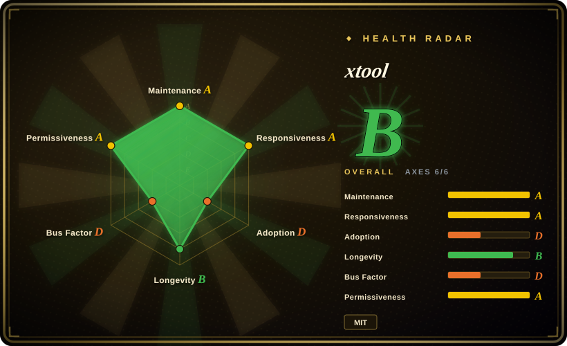
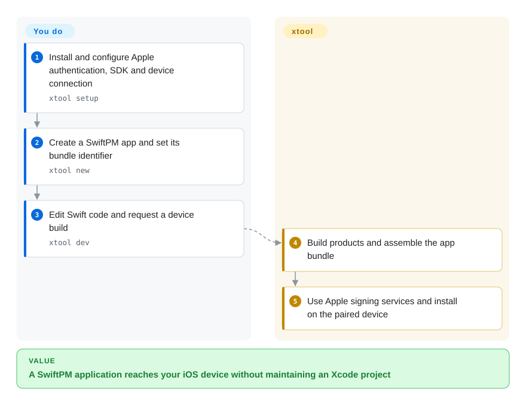
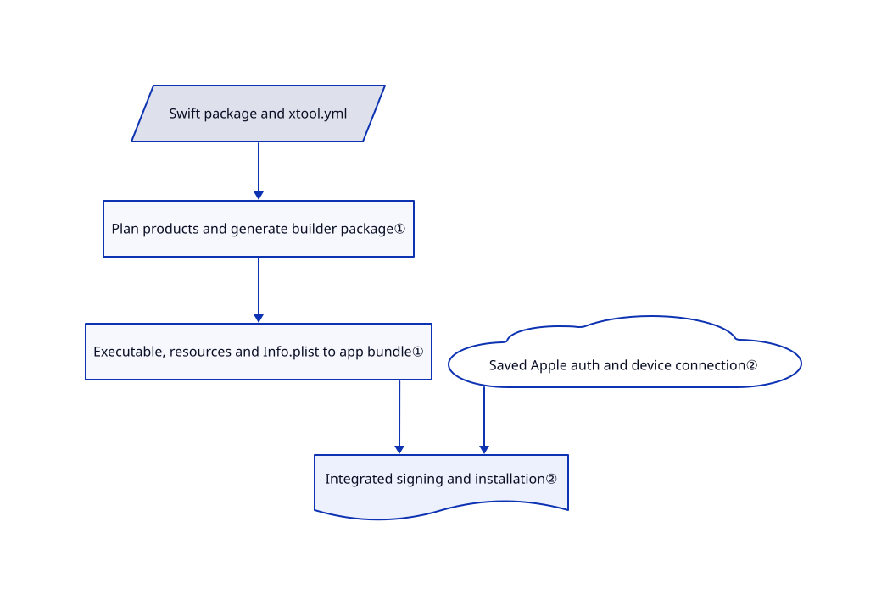

# xtool

Your iOS app is Swift code, but its build and device installation still tie you to Xcode's project workflow. xtool packages SwiftPM products as apps and coordinates signing and installation from Linux, WSL or macOS.

## When to use

You prefer editing Swift in your own IDE or work on Linux and need a declarative app build plus deployment to a real iOS device. Choose xtool when SwiftPM and a small YAML app description fit your project better than maintaining an Xcode project. The deciding boundary is a different build workflow, not freedom from Apple's SDK, account or device-trust requirements.

## When NOT to use

- For Xcode's full IDE, simulator debugging and Apple-integrated workflows, use Xcode. xtool's simulator command is macOS-only, not a Linux iOS simulator.
- If the problem is merging generated Xcode projects rather than leaving the build system, choose XcodeGen; a YAML project specification may solve it without a new packager.
- For team build caching, selective testing and build insights, compare Tuist. xtool's core value is app packaging and device deployment, not a hosted build-analytics platform.
- If you cannot accept Apple's SDK terms or authenticate with Apple, use a non-iOS target instead. The Linux guide still requires obtaining Xcode.xip, and password login uses private Apple APIs.

## Comparison

| Alternative | In index | Our verdict | Tradeoff |
|---|---|---|---|
| Xcode | not a repo | Choose Xcode for the complete Apple IDE and simulator workflow; choose xtool for SwiftPM-driven builds from your preferred editor or Linux. | Proprietary Apple product, not an OSS repository; xtool still needs Apple SDK material. |
| [XcodeGen](https://github.com/yonaskolb/XcodeGen) | not indexed | Choose XcodeGen to generate reviewable Xcode projects while keeping Xcode builds; choose xtool to package SwiftPM apps directly. | Less build-system change versus a cross-host workflow; not added in this tab batch. |
| [Tuist](https://github.com/tuist/tuist) | not indexed | Choose Tuist when team build reuse and observability dominate; choose xtool for a smaller SwiftPM-to-device path. | Broader build-platform features versus a focused app packager; not added in this tab batch. |

## Quick start

On macOS, install with `brew install xtool-org/tap/xtool`; Linux users follow the AppImage and Swift-toolchain guide, while Windows uses WSL with device passthrough. Run `xtool setup` to configure Apple authentication and SDK material. Create a project with `xtool new`, edit its Swift sources and set the bundle identifier in `xtool.yml`. Run `xtool dev` with an authorized device connected; it builds, signs and installs the app. You supply Apple credentials and SDK license acceptance, pair the device and enable Developer Mode when required; xtool does not bypass those controls.

<!-- flow-steps:begin (generated from flows/xtool.json by tools/flow_card.py — do not edit) -->

Text version of the flow

1. **You**: Install and configure Apple authentication, SDK and device connection — `xtool setup`
2. **You**: Create a SwiftPM app and set its bundle identifier — `xtool new`
3. **You**: Edit Swift code and request a device build — `xtool dev`
4. **xtool**: Build products and assemble the app bundle
5. **xtool**: Use Apple signing services and install on the paired device

**Value**: A SwiftPM application reaches your iOS device without maintaining an Xcode project

<!-- flow-steps:end -->

## Key techniques

<!-- mechanism:begin (generated from mechanisms/xtool.json by tools/mechanism_card.py; do not edit) -->

Text version of the mechanism

- Swift package and xtool.yml
- Plan products and generate builder package①
- Executable, resources and Info.plist to app bundle①
- Saved Apple auth and device connection②
- Integrated signing and installation②

- Swift package and xtool.yml → Plan products and generate builder package①
- Plan products and generate builder package① → Executable, resources and Info.plist to app bundle①
- Executable, resources and Info.plist to app bundle① → Integrated signing and installation②
- Saved Apple auth and device connection② → Integrated signing and installation②

<!-- mechanism:end -->

### 1. Turn SwiftPM products into app bundles

- **Problem:** A Swift package product is not by itself an installable iOS application bundle.
- **How:** Packer generates a temporary builder package, invokes the selected Swift build path, then gathers executables, resource bundles, dynamic frameworks and Info.plist into an app directory. Static archives are not embedded as dynamic frameworks.
- **Limits:** The app description and package plan must match supported product/resource conventions; this does not replicate every Xcode feature.
- **Source:** [Builder and bundle assembly](https://github.com/xtool-org/xtool/blob/c3c958d76016fb9a17000e6fd0b7202fec397922/Sources/PackLib/Packer.swift#L14-L211).

### 2. Separate packaging from authenticated device installation

- **Problem:** Successful compilation does not provide a certificate, provisioning profile or trusted device connection.
- **How:** DevCommand builds through PackOperation, obtains a saved auth token and connects to the chosen device before invoking IntegratedInstaller. The build-only path can omit signing; simulator installation uses macOS xcrun separately.
- **Limits:** Apple service behavior and signing entitlements remain external constraints. Public API-key login needs paid membership; the documented password path uses private APIs.
- **Source:** [Development commands](https://github.com/xtool-org/xtool/blob/c3c958d76016fb9a17000e6fd0b7202fec397922/Sources/XToolSupport/DevCommand.swift), [authentication choices](https://github.com/xtool-org/xtool/blob/c3c958d76016fb9a17000e6fd0b7202fec397922/Documentation/xtool.docc/Installation-Linux.md#L99-L134).

## Tech stack

Swift package with an ArgumentParser CLI, PackLib, XKit and XToolSupport libraries. Dependencies include device communication, signing, cryptography, YAML and Xcode archive extraction. The package tools declaration is Swift 6.2; the current Linux installation guide asks for Swift 6.4.

## Dependencies

Apple SDK/toolchain material, Apple authentication for device signing, and a real paired iOS device for the cross-host deployment path. Linux needs usbmuxd; Windows uses WSL plus a working device connection. macOS still needs Xcode installed for the SDK and tools.

## Ops difficulty

**Medium to high.** Declarative builds reduce project-file maintenance, but SDK extraction, toolchain matching, account credentials, certificates and USB pairing remain your work. Prefer the documented public API-key route when eligible; review private-API risk before password authentication.

## Health & viability

- On 2026-10-18, main had a same-day commit; 1.22.2 was released on 2026-10-14, following 1.21.0 on 2026-10-05.
- Created 2024-11-17, it has nearly two years of history and continuing development: a stronger Lindy signal than month-old wrappers, but not a guarantee against Apple changes.
- Organization-owned, yet contribution history is dominated by `kabiroberai`. MIT text credits Kabir Oberai; 12,397 stars do not establish vendor support.
- [推断：依据是单作者主导及 Apple SDK／认证依赖] Pin the toolchain and keep a fallback Mac build path for important releases.

## Caveats (unverified)

- [未验证：无授权 Apple 登录和设备操作] Setup, signing, App Store suitability and device deployment were not exercised.
- [未验证：未审计完整凭据调用图] The docs say credentials go only to Apple; that claim is not independently established by the inspected packaging modules.
- [推断：依据是单作者主导及 Apple SDK／认证依赖] Future SDK or private-API changes may require rapid upstream fixes.
