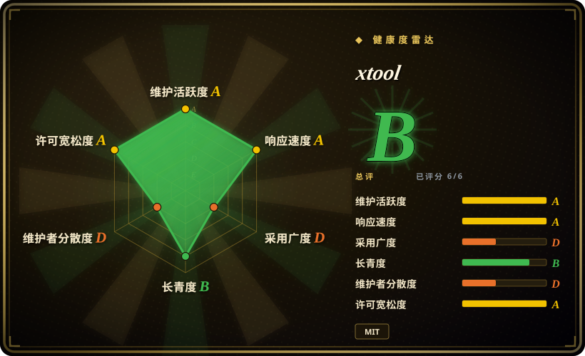
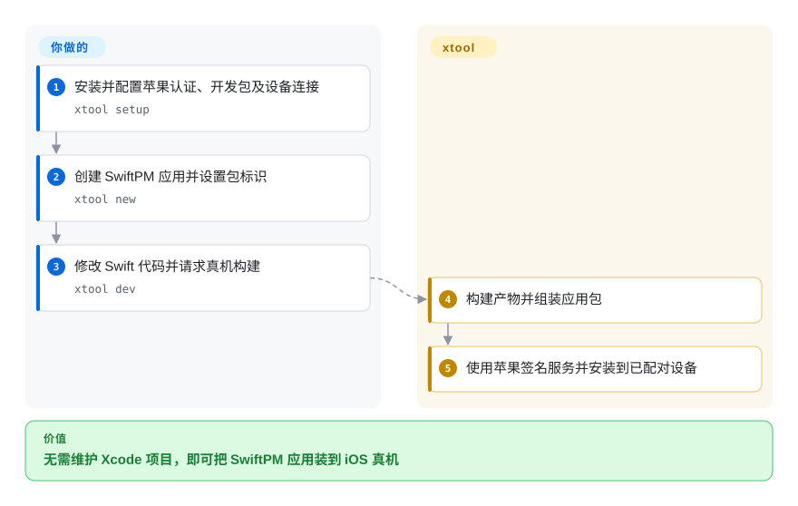
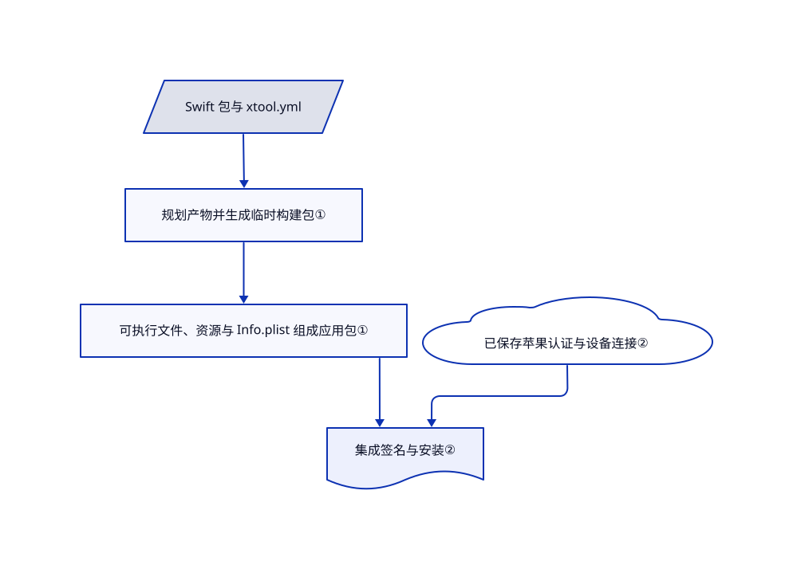

# xtool

iOS 应用虽然写的是 Swift，构建和安装却仍绑在 Xcode 项目流程里。xtool 把 SwiftPM 产物打成应用，并从 Linux、WSL 或 macOS 协调签名与安装。

## 何时使用

你想在自己的编辑器写 Swift，或在 Linux 工作，需要声明式应用构建和真机部署。若 SwiftPM 加小份 YAML 描述，比维护 Xcode 项目更适合你的工程，选 xtool。关键是更换构建流程，不是摆脱苹果开发包、账号和设备信任要求。

## 何时不用

- 要完整 Xcode 编辑器、模拟器调试和苹果集成流程，选 Xcode。xtool 的模拟器命令仅限 macOS，不是 Linux iOS 模拟器。
- 痛点只是生成项目文件的合并冲突，选 XcodeGen；YAML 项目描述可能无需更换打包器就能解决。
- 团队需要构建缓存、选择性测试和构建分析，比较 Tuist。xtool 重在打包和真机部署，不是托管构建分析平台。
- 无法接受苹果开发包条款或登录苹果时，选择非 iOS 目标。Linux 指南仍需取得 Xcode.xip，密码登录使用私有苹果接口。

## 横向对比

| 替代品 | 是否收录 | 我们的评价 | 取舍 |
|---|---|---|---|
| Xcode | 非仓库 | 完整苹果编辑器和模拟器流程选 Xcode；偏好自己的编辑器或 Linux 的 SwiftPM 构建选 xtool。 | 苹果闭源产品，不是开源仓库；xtool 仍需苹果开发包材料。 |
| [XcodeGen](https://github.com/yonaskolb/XcodeGen) | 未收录 | 保留 Xcode 构建，只生成可审查项目时选 XcodeGen；直接打包 SwiftPM 应用选 xtool。 | 更小构建体系变化，与跨宿主流程之间取舍；本批未收录。 |
| [Tuist](https://github.com/tuist/tuist) | 未收录 | 团队构建复用与可观测优先选 Tuist；较小的 SwiftPM 到真机链路选 xtool。 | 更广构建平台与聚焦打包器之间取舍；本批未收录。 |

## 快速上手

macOS 可用 `brew install xtool-org/tap/xtool`；Linux 按 AppImage 和 Swift 工具链指南安装，Windows 使用 WSL 并接通设备。运行 `xtool setup`，配置苹果认证与开发包材料。用 `xtool new` 建项目，修改 Swift 源码，并在 `xtool.yml` 设置包标识。连接获准真机后运行 `xtool dev`，它会构建、签名并安装。你负责苹果凭据、开发包许可、设备配对，以及必要的开发者模式；工具不绕过这些控制。

<!-- flow-steps:begin (generated from flows/xtool.json by tools/flow_card.py — do not edit) -->

流程文字版

1. **你**：安装并配置苹果认证、开发包及设备连接 — `xtool setup`
2. **你**：创建 SwiftPM 应用并设置包标识 — `xtool new`
3. **你**：修改 Swift 代码并请求真机构建 — `xtool dev`
4. **xtool**：构建产物并组装应用包
5. **xtool**：使用苹果签名服务并安装到已配对设备

**价值**：无需维护 Xcode 项目，即可把 SwiftPM 应用装到 iOS 真机

<!-- flow-steps:end -->

## 技术要点

<!-- mechanism:begin (generated from mechanisms/xtool.json by tools/mechanism_card.py; do not edit) -->

机制文字版

- Swift 包与 xtool.yml
- 规划产物并生成临时构建包①
- 可执行文件、资源与 Info.plist 组成应用包①
- 已保存苹果认证与设备连接②
- 集成签名与安装②

- Swift 包与 xtool.yml → 规划产物并生成临时构建包①
- 规划产物并生成临时构建包① → 可执行文件、资源与 Info.plist 组成应用包①
- 可执行文件、资源与 Info.plist 组成应用包① → 集成签名与安装②
- 已保存苹果认证与设备连接② → 集成签名与安装②

<!-- mechanism:end -->

### 1. 把 SwiftPM 产物组装成应用包

- **解决：** Swift 包的产物本身不是可安装的 iOS 应用。
- **做法：** Packer 生成临时构建包，调用选定的 Swift 构建路径，再收集可执行文件、资源包、动态框架和 Info.plist。静态归档不会被当成动态框架嵌入。
- **边界：** 应用描述与构建计划需符合支持的产物和资源约定，并不复刻全部 Xcode 功能。
- **源码：** [构建与应用组装](https://github.com/xtool-org/xtool/blob/c3c958d76016fb9a17000e6fd0b7202fec397922/Sources/PackLib/Packer.swift#L14-L211)。

### 2. 分开打包和认证后的设备安装

- **解决：** 编译成功不代表已有证书、配置描述或可信设备连接。
- **做法：** DevCommand 经 PackOperation 构建，取得已保存认证，再连接目标设备并调用 IntegratedInstaller。仅构建路线可不签名；模拟器安装另走 macOS 的 xcrun。
- **边界：** 苹果服务和签名权限仍是外部约束。公共接口密钥路线需要付费开发者资格；文档密码路线使用私有接口。
- **源码：** [开发命令](https://github.com/xtool-org/xtool/blob/c3c958d76016fb9a17000e6fd0b7202fec397922/Sources/XToolSupport/DevCommand.swift)、[认证选择](https://github.com/xtool-org/xtool/blob/c3c958d76016fb9a17000e6fd0b7202fec397922/Documentation/xtool.docc/Installation-Linux.md#L99-L134)。

## 技术栈

Swift 包，包含 ArgumentParser 命令行，以及 PackLib、XKit 和 XToolSupport 库。依赖设备通信、签名、密码学、YAML 和 Xcode 归档解包。包声明 Swift 6.2，当前 Linux 安装指南要求 Swift 6.4。

## 依赖

需要苹果开发包与工具链材料；真机签名需要苹果认证，跨宿主部署需要已配对 iOS 设备。Linux 需要 usbmuxd，Windows 使用 WSL 和可用设备连接。macOS 仍需安装 Xcode 以提供开发包与工具。

## 运维难度

**中等至高。** 声明式构建减少项目文件维护，但开发包提取、工具链匹配、账号凭据、证书和 USB 配对仍需自己负责。有资格时优先用文档推荐的公共接口密钥路线；使用密码前评估私有接口风险。

## 健康度与可持续性

- 截至 2026-10-18，主干有当天提交；1.22.2 发布于 2026-10-14，上一版 1.21.0 发布于 2026-10-05。
- 创建于 2024-11-17，接近两年且仍活跃，存续信号强于月龄包装器，但不保证抗住苹果变化。
- 组织持有仓库，贡献仍由 `kabiroberai` 主导。MIT 实文署名 Kabir Oberai；12,397 颗星不构成厂商支持。
- [推断：依据是单作者主导及苹果开发包与认证依赖] 重要发布应固定工具链，并保留 Mac 构建回退路线。

## 存疑（未验证）

- [未验证：无授权苹果登录和设备操作] 未实际测试初始化、签名、商店分发适用性和设备部署。
- [未验证：未审计完整凭据调用图] 文档称凭据仅发送给苹果，读取的打包模块不能独立证明此断言。
- [推断：依据是单作者主导及苹果开发包与认证依赖] 后续开发包或私有接口变化可能要求上游及时修复。
