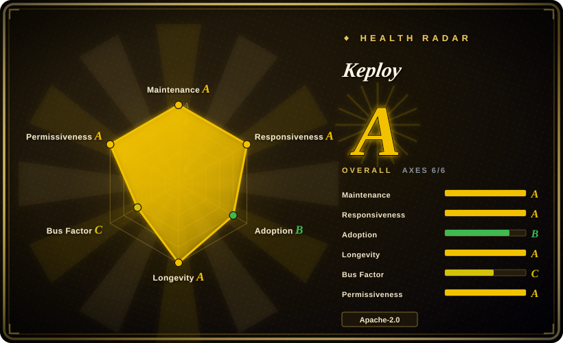
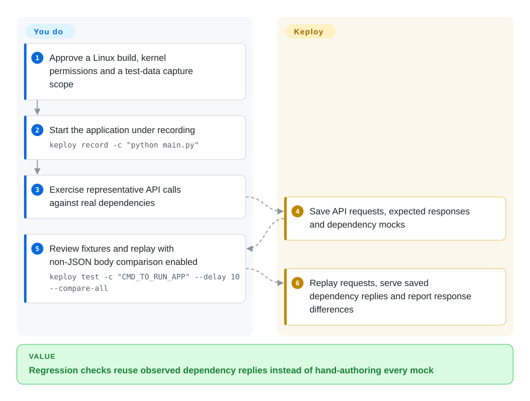
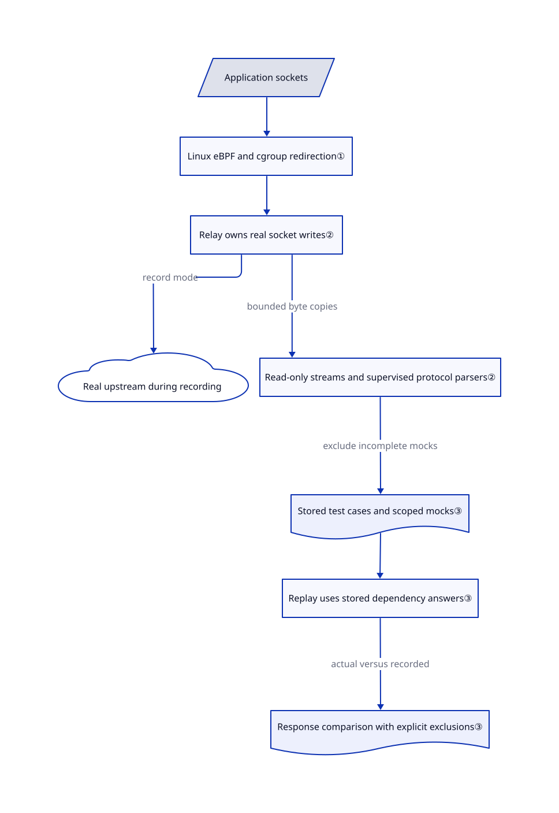

# Keploy

Your API regression test needs yesterday's database answers, but today's database has changed. Keploy records requests and dependency replies together, then replays the requests while serving the saved replies.

**License and distribution boundary:** the [public repository LICENSE](https://github.com/keploy/keploy/blob/b50e6ff38ea54bdcb50e96c259018de7e94b09b2/LICENSE#L89-L141) is Apache-2.0, copyright Keploy Inc. Redistribution must preserve the license and applicable notices, mark modifications, and respect the trademark exclusion. This does not license every component of the installed product: [release CI fetches private parsers](https://github.com/keploy/keploy/blob/b50e6ff38ea54bdcb50e96c259018de7e94b09b2/.github/actions/setup-private-parsers/action.yaml#L205-L239), and [eBPF source is private](https://github.com/keploy/keploy/blob/b50e6ff38ea54bdcb50e96c259018de7e94b09b2/.github/workflows/ebpf-objects.yml#L3-L22). The [service terms](https://keploy.io/legal/terms-of-service), sections 2.1 and 5, grant a subscription-bound internal-use license and restrict resale, sublicensing, copying, modification and reverse engineering of the Services. Those service restrictions must not be presented as replacing the public code's Apache grant. This entry is an introduction, not authorization to reuse private software or upload captured data.

## When to use

You maintain a backend whose `POST /orders` test fails whenever someone resets the shared database. Writing a mock for every query consumes more time than changing the endpoint. You can run an authorized, representative request sequence against real dependencies once, retain its recorded responses, and replay that sequence against a changed application. Choose Keploy when preserving the observed request-to-dependency interaction matters more than designing HTTP stubs by hand.

The useful starting point is a controlled Linux development or CI environment where you can approve kernel instrumentation and inspect the resulting recordings. Unlike an HTTP stub server, it intercepts the application's dependency connections without adding an SDK to its source. The price is kernel privileges, protocol-specific replay behavior and a baseline that captures existing behavior, including existing bugs.

## When NOT to use

- **Your runner forbids kernel instrumentation or elevated capabilities.** Use [WireMock](https://github.com/wiremock/wiremock) for HTTP stubs or [Karate](https://github.com/karatelabs/karate) for authored API checks. The public native capture backend requires Linux kernel 5.10 or newer and cgroup v2; an ordinary restricted container is not enough.
- **You need a fully rebuildable, all-public multi-protocol implementation.** Prefer WireMock for HTTP-only dependencies, or explicit test fixtures in Karate. The public tree contains HTTP, MySQL and generic TCP parsers, not the full PostgreSQL/MongoDB/Redis/Kafka/RabbitMQ/gRPC product surface. Enum names and README badges are not implementation evidence; private parser imports are visible in CI.
- **You need business correctness or missing-edge-case discovery.** Use Karate with explicit assertions and negative cases. Replaying a successful recording establishes agreement with its baseline, not correct business rules, unexplored paths or the README's advertised 90% coverage. Do not assume the default checks text, XML or HTML bodies: the ordinary path skips body comparison when both bodies are non-empty and non-JSON. Explicitly use the public `--compare-all` flag for those payloads, or author checks in Karate.
- **You only need to inspect and edit one client's web traffic.** Choose [mitmproxy](../debugging-proxy/mitmproxy.md). Its interactive proxy and Python addons are more direct than managing API baselines and dependency recordings.
- **You require demonstrably air-gapped use of the vendor-installed CLI.** Use a reviewed public-source build for its narrower scope, or WireMock. Current installation docs require account authentication for the installed product; local replay without live application dependencies is not a promise of no login, telemetry, image pulls or cloud calls.
- **Captured payloads cannot be stored or TLS trust cannot be changed.** Prefer synthetic WireMock fixtures. Recording can retain authorization headers, query results and personal data, while Linux native TLS interception modifies trust stores. Neither protocol interception nor the `sanitize` command grants data-processing permission.

## Comparison

| Alternative | In index | Our verdict | Tradeoff |
|---|---|---|---|
| [WireMock](https://github.com/wiremock/wiremock) | not indexed | Choose WireMock for deliberately authored HTTP failures and stable stubs on restricted runners; choose Keploy when recorded dependency exchanges are the expensive part. | WireMock supports JSON/Java/REST configuration and HTTP record/playback without Keploy's kernel path, but does not reproduce arbitrary database protocols. Not added in this tab batch. |
| [Karate](https://github.com/karatelabs/karate) | not indexed | Choose Karate when API assertions must express intended behavior and negative cases; choose Keploy for a regression baseline derived from observed calls. | Karate combines API tests, mocks and UI automation, but you author the checks rather than obtaining a complete dependency fixture from intercepted traffic. Not added in this tab batch. |
| [mitmproxy](../debugging-proxy/mitmproxy.md) | yes | Choose mitmproxy for interactive HTTPS diagnosis and Python traffic transformations; choose Keploy when the deliverable is a repeatable API regression suite. | mitmproxy exposes individual flows and programmable proxy hooks; Keploy manages test cases, saved dependency answers and comparison reports, with stronger platform constraints. |

## Quick start

First choose the distribution: the [public source](https://github.com/keploy/keploy/tree/b50e6ff38ea54bdcb50e96c259018de7e94b09b2) and the [vendor installation](https://keploy.io/docs/server/installation/) have different backend and account requirements. Review a pinned build or installer before use; the README's `source install.sh` executes downloaded shell code, and no installer or upstream application was run for this entry. On an approved Linux host, supply your application's start command, such as `keploy record -c "python main.py"`, and send representative API calls while real dependencies are reachable. Keploy writes test cases and mocks, meaning saved dependency replies, under the configured `keploy/` directory; you must review and sanitize that data before sharing it. Then run `keploy test -c "CMD_TO_RUN_APP" --delay 10 --compare-all`, substituting the same application command, to restart the application and compare replayed responses against the recordings. This example deliberately enables the [public comparison flag](https://github.com/keploy/keploy/blob/b50e6ff38ea54bdcb50e96c259018de7e94b09b2/cli/provider/cmd.go#L624-L625): its default is false, so ordinary replay does not fully compare non-JSON bodies such as text, XML and HTML. The flag does not undo explicit body exclusions or recover a body skipped during recording. You own baseline correctness, startup configuration, secrets, noise exclusions and coverage instrumentation; Keploy owns capture, dependency-response substitution and result reporting.

<!-- flow-steps:begin (generated from flows/keploy.json by tools/flow_card.py — do not edit) -->

Text version of the flow

1. **You**: Approve a Linux build, kernel permissions and a test-data capture scope
2. **You**: Start the application under recording — `keploy record -c "python main.py"`
3. **You**: Exercise representative API calls against real dependencies
4. **Keploy**: Save API requests, expected responses and dependency mocks
5. **You**: Review fixtures and replay with non-JSON body comparison enabled — `keploy test -c "CMD_TO_RUN_APP" --delay 10 --compare-all`
6. **Keploy**: Replay requests, serve saved dependency replies and report response differences

**Value**: Regression checks reuse observed dependency replies instead of hand-authoring every mock

<!-- flow-steps:end -->

## Key techniques

<!-- mechanism:begin (generated from mechanisms/keploy.json by tools/mechanism_card.py; do not edit) -->

Text version of the mechanism

- Application sockets
- Linux eBPF and cgroup redirection①
- Relay owns real socket writes②
- Real upstream during recording
- Read-only streams and supervised protocol parsers②
- Stored test cases and scoped mocks③
- Replay uses stored dependency answers③
- Response comparison with explicit exclusions③

- Application sockets → Linux eBPF and cgroup redirection①
- Linux eBPF and cgroup redirection① → Relay owns real socket writes②
- Relay owns real socket writes② → Real upstream during recording (record mode)
- Relay owns real socket writes② → Read-only streams and supervised protocol parsers② (bounded byte copies)
- Read-only streams and supervised protocol parsers② → Stored test cases and scoped mocks③ (exclude incomplete mocks)
- Stored test cases and scoped mocks③ → Replay uses stored dependency answers③
- Replay uses stored dependency answers③ → Response comparison with explicit exclusions③ (actual versus recorded)

<!-- mechanism:end -->

### 1. Redirect application connections at the kernel boundary

- **Problem:** Adding test-specific adapters to every database and HTTP client couples tests to application internals.
- **How:** The Linux backend loads embedded eBPF objects, registers the client and proxy in maps, and attaches cgroup connection hooks to redirect sockets into a userspace proxy. This avoids an application SDK, not host-level setup.
- **Limits:** Linux compatibility checks require kernel 5.10 or newer; the hooks need cgroup v2 and elevated privileges. Non-Linux public-source hooks return errors. Embedded objects are available, but their C source lives in the private eBPF repository, limiting independent rebuild and audit.
- **Source:** [Kernel and cgroup gate](https://github.com/keploy/keploy/blob/b50e6ff38ea54bdcb50e96c259018de7e94b09b2/cli/provider/compat_linux.go#L13-L35), [object loading and cgroup hooks](https://github.com/keploy/keploy/blob/b50e6ff38ea54bdcb50e96c259018de7e94b09b2/pkg/agent/hooks/linux/hooks.go#L327-L620), [non-Linux errors](https://github.com/keploy/keploy/blob/b50e6ff38ea54bdcb50e96c259018de7e94b09b2/pkg/agent/hooks/others/hooks.go#L44-L68).

### 2. Separate forwarding from fallible protocol parsing

- **Problem:** A slow or broken recorder must not become the writer that corrupts the application's real connection.
- **How:** The V2 path assigns real socket writes to a relay, which copies observed chunks to read-only fake connections. A supervisor contains parser panics, inactivity and memory pressure; protocol parsers emit mocks rather than writing to real peers.
- **Limits:** Bounded queues can lose capture while forwarding continues. Incomplete mocks are excluded and reported, but a test already saved before the loss report can lack a required mock. The proxy documentation explicitly calls kernel-hook/proxy shutdown coupling partial; this is not proof of safe production deployment.
- **Source:** [Relay and supervisor design, including capture-loss limits](https://github.com/keploy/keploy/blob/b50e6ff38ea54bdcb50e96c259018de7e94b09b2/pkg/agent/proxy/README.md#L11-L153), [V2 dispatcher implementation](https://github.com/keploy/keploy/blob/b50e6ff38ea54bdcb50e96c259018de7e94b09b2/pkg/agent/proxy/proxy_v2.go).

### 3. Compare a stored oracle, not an invented test expectation

- **Problem:** A dependency reply recorded for one interaction must not be treated as a universal answer, and changing timestamps can make valid comparisons noisy.
- **How:** Replay parsers consume scoped mock pools: per-test recordings, reusable session exchanges and connection-specific state. The HTTP matcher compares status, headers and JSON bodies against the recorded response, with explicit noise maps for excluded differences. The public `--compare-all` flag defaults to false, binds to `test.compareAll`, and reaches the matcher through `r.config.Test.CompareAll`; opt in to compare text, XML and HTML bodies.
- **Limits:** On the ordinary path, with the internal staging switch off and `compareAll` left at its false default, two non-empty non-JSON bodies skip body comparison. JSON versus non-JSON, or empty versus non-empty, is instead compared. [推断：from the skip branch, without executing replay] An equal-length text change can go unnoticed if the other checks pass. Noise exclusions still weaken the oracle even with the flag enabled. If a response body was skipped during recording, the matcher can compare its size rather than its content. A replay pass therefore does not establish full payload equality or business correctness, and generic TCP matching is not semantic support for every protocol. Use the public flag, not the internal staging switch, for the documented non-JSON comparison setting.
- **Source:** [Mock pool scopes](https://github.com/keploy/keploy/blob/b50e6ff38ea54bdcb50e96c259018de7e94b09b2/pkg/agent/proxy/integrations/integrations.go#L217-L266), [public flag and false default](https://github.com/keploy/keploy/blob/b50e6ff38ea54bdcb50e96c259018de7e94b09b2/cli/provider/cmd.go#L624-L625), [nested flag binding](https://github.com/keploy/keploy/blob/b50e6ff38ea54bdcb50e96c259018de7e94b09b2/utils/utils.go#L266-L291), [replay passes the configuration to the matcher](https://github.com/keploy/keploy/blob/b50e6ff38ea54bdcb50e96c259018de7e94b09b2/pkg/service/replay/replay.go#L7728-L7742), [HTTP body-size, default skip and noise comparison](https://github.com/keploy/keploy/blob/b50e6ff38ea54bdcb50e96c259018de7e94b09b2/pkg/matcher/http/match.go#L98-L253).

## Tech stack

- Go CLI and agent, using Cobra/Viper, Zap and YAML/JSON storage. The reviewed [module manifest](https://github.com/keploy/keploy/blob/b50e6ff38ea54bdcb50e96c259018de7e94b09b2/go.mod#L1-L74) declares Go 1.27.3, cilium/ebpf, Docker/Compose clients, protocol libraries and gitleaks; this entry did not build that toolchain.
- Public parser implementations register [HTTP](https://github.com/keploy/keploy/blob/b50e6ff38ea54bdcb50e96c259018de7e94b09b2/pkg/agent/proxy/integrations/http/http.go), [MySQL](https://github.com/keploy/keploy/blob/b50e6ff38ea54bdcb50e96c259018de7e94b09b2/pkg/agent/proxy/integrations/mysql/mysql.go) and [generic TCP](https://github.com/keploy/keploy/blob/b50e6ff38ea54bdcb50e96c259018de7e94b09b2/pkg/agent/proxy/integrations/generic/generic.go). Additional private parsers are injected during release builds; protocol constants do not mean public implementations exist.
- The installed macOS/Windows native backends are outside this public backend. Live installation docs describe Apple Silicon macOS and x86-64 Windows capture of HTTP/HTTPS, MySQL and MongoDB, with other services generally captured as raw bytes that usually do not replay. Treat this as vendor documentation, not a result reproduced from this commit.

## Dependencies

- **Public Linux record and replay:** kernel ≥5.10, usable eBPF hooks, cgroup v2, and permission to instrument the target process. The [Docker capability check](https://github.com/keploy/keploy/blob/b50e6ff38ea54bdcb50e96c259018de7e94b09b2/utils/capabilities.go#L47-L71) requires `NET_ADMIN`, `SYS_PTRACE`, `SYS_RESOURCE`, `BPF` and `PERFMON`. [Compose generation](https://github.com/keploy/keploy/blob/b50e6ff38ea54bdcb50e96c259018de7e94b09b2/pkg/platform/docker/docker.go#L1004-L1065) also adds `SYS_NICE`; channel-binding interception or mounting cgroup2 adds `SYS_ADMIN`, and the latter relaxes AppArmor. These are mode-specific requirements, not an instruction to grant all capabilities everywhere. Kernel version alone is insufficient under lockdown or restrictive security profiles; strict DNS clients also need recvmsg hooks available from 5.11.
- **Application environment:** its runtime, executable and configuration remain necessary. Recording needs real upstreams. Replay can replace captured supported exchanges, but uncaptured paths, configured real dependencies and explicitly allowed egress remain environment dependencies. Docker/Compose mode also needs an engine and images; a Linux VM is still required for its eBPF agent even when the CLI runs on another OS.
- **TLS and data:** interception needs application trust in Keploy's certificate authority, which signs replacement certificates. Linux native setup can install anchors in system, Java and NSS stores; pinned certificates can reject interception. Recordings and logs need access controls and retention rules.
- **Cloud and offline:** the public local record/test service path contains no account login gate; the current vendor install guide separately requires login or an API key. [Telemetry defaults on](https://github.com/keploy/keploy/blob/b50e6ff38ea54bdcb50e96c259018de7e94b09b2/cli/provider/service.go#L29-L43), targets `telemetry.keploy.io/analytics`, and `--disable-tele` / `disableTele: true` disables that path and resolved crash reporting. [Crash reports can include the run log](https://github.com/keploy/keploy/blob/b50e6ff38ea54bdcb50e96c259018de7e94b09b2/utils/crashreports.go#L10-L25). This is not proof that every private extension is offline; cloud replay, AI generation and mock registry must be evaluated separately.

## Ops difficulty

**Medium for a controlled Linux pilot; high for broad team rollout.** You operate privileged interception, application startup, TLS trust, test data hygiene and protocol compatibility, rather than a separate mandatory database for Keploy. Start with a small, authorized fixture corpus and fail the pilot on missing mocks, capture loss or unexplained exclusions; do not turn a production recording claim into permission to capture production traffic.

For retirement, stop capture/replay and confirm the agent and any app/Compose processes it launched are gone before removing binaries or images. [Hook cleanup](https://github.com/keploy/keploy/blob/b50e6ff38ea54bdcb50e96c259018de7e94b09b2/pkg/agent/hooks/linux/cleanup.go) detaches resources, and [native CA teardown](https://github.com/keploy/keploy/blob/b50e6ff38ea54bdcb50e96c259018de7e94b09b2/pkg/agent/proxy/tls/ca.go#L1023-L1109) attempts to remove run-specific trust anchors; crashes and cleanup errors still require inspection. Remove only this deployment's recordings, reports, debug logs and generated container resources after retention review; deleting the binary does not erase them. If using vendor services, revoke its tokens and stop its subscription separately; do not delete shared Docker volumes, trust stores or application databases indiscriminately.

## Health & viability

- **Radar scope:** A with 6/6 measured axes describes repository activity and package signals, not a grant of rights to private components. The whole `upstream` block records the stock tool's observed repository state. The source review remains pinned to `b50e6ff38ea54bdcb50e96c259018de7e94b09b2`; later HEAD changes in the snapshot have not been reviewed here.
- **Maintenance, 2026-10-30:** GitHub reports a non-archived organization repository, created 2022-01-19. Latest observed release is [v3.6.181](https://github.com/keploy/keploy/releases/tag/v3.6.181), published 2026-10-30; the reviewed default commit is `b50e6ff38ea54bdcb50e96c259018de7e94b09b2`. Multiple nearby releases show active shipping, not evidence that each protocol is stable.
- **Governance:** the root license names Keploy Inc.; [CODEOWNERS](https://github.com/keploy/keploy/blob/b50e6ff38ea54bdcb50e96c259018de7e94b09b2/.github/CODEOWNERS) assigns the tree to one named account, while [contributions require DCO sign-off](https://github.com/keploy/keploy/blob/b50e6ff38ea54bdcb50e96c259018de7e94b09b2/.github/CONTRIBUTING.md#L26-L43). A [CLA workflow](https://github.com/keploy/keploy/blob/b50e6ff38ea54bdcb50e96c259018de7e94b09b2/.github/workflows/cla.yml#L44-L61) also checks signatures; the [CLA](https://github.com/keploy/keploy/blob/b50e6ff38ea54bdcb50e96c259018de7e94b09b2/.github/CLA.md#L3-L19) grants perpetual, non-exclusive copyright and patent licenses, with sublicensing in the copyright grant, while contributors retain ownership. Contributor counts do not imply shared release authority. The README's CNCF Landscape badge is not proof of CNCF project governance.
- **Age and backing:** about 4.8 years old and still active. [推断：based on repository age and current releases] This supports a moderate durability prior for the public CLI, not an assurance that private components or cloud plans remain available.
- **Adoption and risk:** the dated snapshot has 18,912 stars and 2,437 forks, useful as interest signals rather than verified production installations. Current issues include cookie parsing and container-command edge cases; unmerged PR titles must not be treated as shipped fixes. Vendor-controlled private extensions and service terms are stronger selection constraints than the star count.

## Caveats (unverified)

- [未验证：upstream execution was explicitly excluded] No capture, replay, installer, coverage measurement or performance benchmark was run. README claims such as 90% coverage and deterministic reproduction are author claims, not independent results.
- [推断：the default non-JSON skip branch was read, not replayed] An equal-length text change can escape body comparison when the ordinary path leaves `--compare-all` off and other checks pass. This is a static risk analysis, not a reproduced test result; explicit exclusions and skipped recordings remain limits even with the flag on.
- [未验证：private repositories and installed product internals are unavailable in this public tree] Full parser behavior, native macOS/Windows interception, exact rights for private binaries and air-gapped authentication behavior cannot be established from the public Apache license. Live install/service documents were read separately; confirm the exact distribution contract before adoption.
- [推断：age plus current releases, not a longevity experiment] The public CLI's durability signal does not establish future vendor support or private-source availability.
- [未验证：static source review cannot prove crash cleanup on a target host] Hook detachment and trust-store cleanup were read, not exercised; residual trust, processes and sensitive recordings require deployment-specific inspection.
