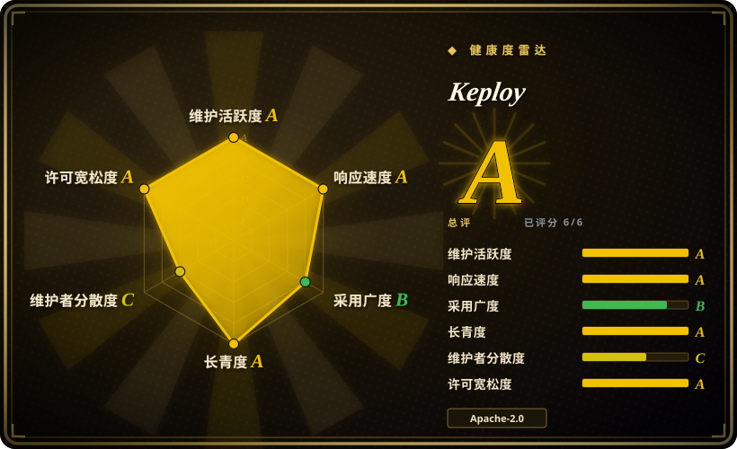
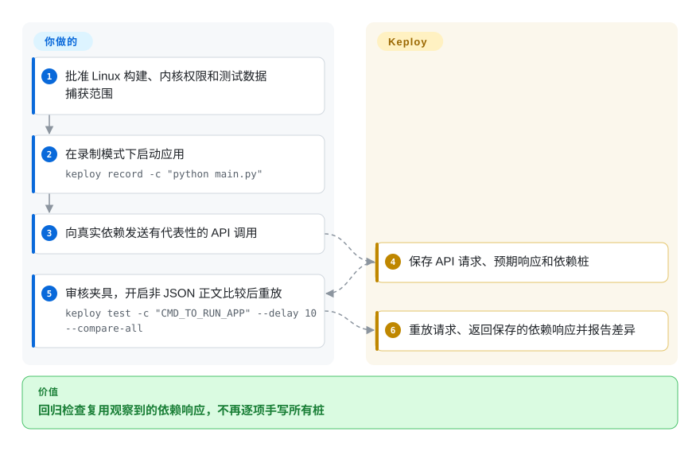
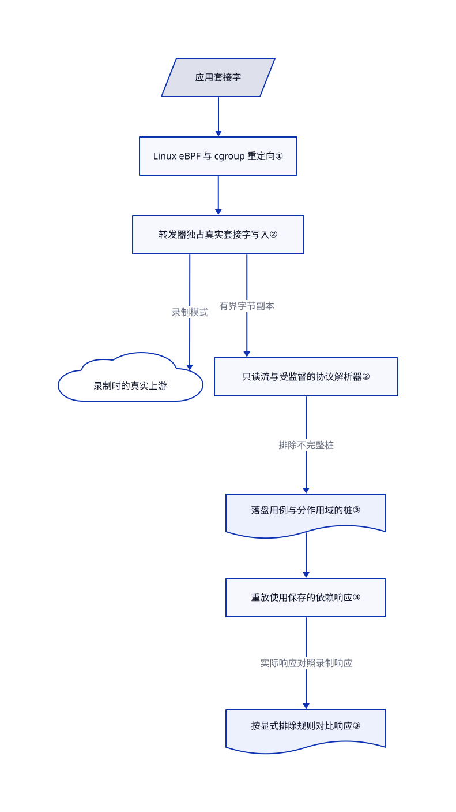

# Keploy

接口回归需要昨天的数据库响应，今天的数据却已改变。Keploy 把请求和依赖响应一起录下，重放请求时用保存的响应替代真实依赖。

**许可与发行边界：**[公开仓库的 LICENSE](https://github.com/keploy/keploy/blob/b50e6ff38ea54bdcb50e96c259018de7e94b09b2/LICENSE#L89-L141) 是 Apache-2.0，版权人为 Keploy Inc。再分发须保留许可与适用声明，标记修改，并遵守商标不授权条款。它不代表安装产品的所有组件均按此授权：[发行流水线拉取私有解析器](https://github.com/keploy/keploy/blob/b50e6ff38ea54bdcb50e96c259018de7e94b09b2/.github/actions/setup-private-parsers/action.yaml#L205-L239)，[eBPF 源码也在私有仓库](https://github.com/keploy/keploy/blob/b50e6ff38ea54bdcb50e96c259018de7e94b09b2/.github/workflows/ebpf-objects.yml#L3-L22)。[服务条款](https://keploy.io/legal/terms-of-service)第 2.1 与第 5 节只授予订阅期内的内部使用权，并限制服务的转售、转授权、复制、修改和逆向工程；不能反过来用这些服务限制覆盖公开代码的 Apache 授权。本文是介绍，不是私有软件复用或捕获数据上传的授权。

## 何时使用

你维护一个后端，只要别人重置共享数据库，`POST /orders` 的回归测试就失败。逐条手写查询桩，比改接口还费时。你能先在获准环境里，对真实依赖跑一组有代表性的请求，再把响应留作改版后的回归基线。当成本主要花在重建真实依赖交互，而不是编写 HTTP 桩规则时，可以考虑 Keploy。

先从可批准内核探测的 Linux 开发机或 CI 开始，并检查录制结果。它不像 HTTP 桩服务器那样要求你逐项设计响应，也不要求往业务源码加 SDK。代价是内核权限、逐协议的重放边界，以及会保留已有缺陷的行为基线。

## 何时不用

- **运行器禁止内核探测或提权。** HTTP 桩改用 [WireMock](https://github.com/wiremock/wiremock)，手写 API 检查改用 [Karate](https://github.com/karatelabs/karate)。公开原生捕获后端要求 Linux 内核至少 5.10，并使用 cgroup v2；普通受限容器不够。
- **要求完整多协议实现都能从公开源码重建。** 仅 HTTP 依赖选 WireMock，显式测试夹具选 Karate。公开树包含 HTTP、MySQL 和通用 TCP 解析器，不包含完整的 PostgreSQL、MongoDB、Redis、Kafka、RabbitMQ、gRPC 产品能力。枚举名和 README 徽章不是实现证据，CI 中能看到私有解析器注入。
- **要验证业务规则或发现未覆盖边界。** 用 Karate 编写明确断言与负例。录制成功后重放成功，只说明符合基线，不证明业务正确、未访问路径正确，更不证明 README 宣传的 90% 覆盖率。不要假定默认会检查文本、XML 或 HTML 正文：常规路径在双方均为非空非 JSON 时跳过正文比较。这些载荷须显式使用正式参数 `--compare-all`，或改用 Karate 编写检查。
- **只需查看并修改某个客户端的网页流量。** 选 [mitmproxy](../debugging-proxy/mitmproxy.zh.md)。交互代理和 Python 插件比管理回归基线、依赖录制更直接。
- **要求证明厂商安装版完全隔离外网。** 用经过审查的公开源码构建接受较窄能力，或选 WireMock。现行安装文档要求安装产品登录账号；应用依赖可离线重放，不等于不登录、不发遥测、不拉镜像或不访问云服务。
- **载荷不能落盘，或不允许修改 TLS 信任。** 用合成的 WireMock 夹具。录制会保留认证头、查询结果和个人数据，Linux 原生 TLS 拦截还会修改信任库。协议拦截与 `sanitize` 命令都不授予数据处理权限。

## 横向对比

| 替代品 | 是否收录 | 我们的评价 | 取舍 |
|---|---|---|---|
| [WireMock](https://github.com/wiremock/wiremock) | 未收录 | 在受限运行器上，需要主动设计 HTTP 故障和稳定桩时选 WireMock；重建已发生的依赖交互才是成本时选 Keploy。 | WireMock 支持 JSON、Java、REST 配置和 HTTP 录放，不走 Keploy 的内核路径，但不重现任意数据库协议。本标签批次不追加收录。 |
| [Karate](https://github.com/karatelabs/karate) | 未收录 | 断言必须表达预期业务行为与负例时选 Karate；需要把真实调用固化为回归基线时选 Keploy。 | Karate 整合 API 测试、桩与界面自动化，但检查由你编写，不会靠拦截流量就得到完整依赖夹具。本标签批次不追加收录。 |
| [mitmproxy](../debugging-proxy/mitmproxy.zh.md) | 已收录 | 交互诊断 HTTPS、用 Python 改流量时选 mitmproxy；交付物是可重复的 API 回归套件时选 Keploy。 | mitmproxy 暴露单条流量和代理钩子；Keploy 管理测试用例、依赖响应与对比报告，平台约束也更强。 |

## 快速上手

先选择发行形态：[公开源码](https://github.com/keploy/keploy/tree/b50e6ff38ea54bdcb50e96c259018de7e94b09b2)与[厂商安装版](https://keploy.io/docs/server/installation/)的后端、账号要求不同。使用前审查固定构建或安装器；README 的 `source install.sh` 会执行下载的脚本，本次没有执行安装器或上游应用。在批准的 Linux 主机上提供应用启动命令，例如 `keploy record -c "python main.py"`，并在真实依赖可达时发送有代表性的 API 请求。Keploy 在配置位置的 `keploy/` 目录写入测试用例与桩，即保存的依赖响应；分享前由你检查和脱敏。随后使用 `keploy test -c "CMD_TO_RUN_APP" --delay 10 --compare-all`，将占位符替换为同一应用命令，重启应用并对比录制响应。示例刻意启用[正式比较参数](https://github.com/keploy/keploy/blob/b50e6ff38ea54bdcb50e96c259018de7e94b09b2/cli/provider/cmd.go#L624-L625)：它默认关闭，普通重放不会全面比较文本、XML、HTML 等非 JSON 正文。该参数不能撤销显式正文排除，也不能恢复录制时已跳过的正文。你负责基线正确性、启动配置、秘密信息、噪声排除和覆盖率探针；Keploy 负责捕获、替代依赖响应和生成结果报告。

<!-- flow-steps:begin (generated from flows/keploy.json by tools/flow_card.py — do not edit) -->

流程文字版

1. **你**：批准 Linux 构建、内核权限和测试数据捕获范围
2. **你**：在录制模式下启动应用 — `keploy record -c "python main.py"`
3. **你**：向真实依赖发送有代表性的 API 调用
4. **Keploy**：保存 API 请求、预期响应和依赖桩
5. **你**：审核夹具，开启非 JSON 正文比较后重放 — `keploy test -c "CMD_TO_RUN_APP" --delay 10 --compare-all`
6. **Keploy**：重放请求、返回保存的依赖响应并报告差异

**价值**：回归检查复用观察到的依赖响应，不再逐项手写所有桩

<!-- flow-steps:end -->

## 技术要点

<!-- mechanism:begin (generated from mechanisms/keploy.json by tools/mechanism_card.py; do not edit) -->

机制文字版

- 应用套接字
- Linux eBPF 与 cgroup 重定向①
- 转发器独占真实套接字写入②
- 录制时的真实上游
- 只读流与受监督的协议解析器②
- 落盘用例与分作用域的桩③
- 重放使用保存的依赖响应③
- 按显式排除规则对比响应③

- 应用套接字 → Linux eBPF 与 cgroup 重定向①
- Linux eBPF 与 cgroup 重定向① → 转发器独占真实套接字写入②
- 转发器独占真实套接字写入② → 录制时的真实上游（录制模式）
- 转发器独占真实套接字写入② → 只读流与受监督的协议解析器②（有界字节副本）
- 只读流与受监督的协议解析器② → 落盘用例与分作用域的桩③（排除不完整桩）
- 落盘用例与分作用域的桩③ → 重放使用保存的依赖响应③
- 重放使用保存的依赖响应③ → 按显式排除规则对比响应③（实际响应对照录制响应）

<!-- mechanism:end -->

### 1. 在内核边界重定向应用连接

- **解决：** 给每种数据库与 HTTP 客户端添加测试适配器，会把测试绑在业务实现上。
- **做法：** Linux 后端加载内嵌 eBPF 对象，在映射中登记客户端与代理，再挂载 cgroup 连接钩子，将套接字引入用户态代理。它省掉业务 SDK，不省掉主机配置。
- **边界：** 兼容检查要求内核至少 5.10，钩子依赖 cgroup v2 和提权。非 Linux 的公开源码钩子直接报错。对象文件虽可取得，C 源码位于私有 eBPF 仓库，独立重建与审计受限。
- **源码：** [内核与 cgroup 检查](https://github.com/keploy/keploy/blob/b50e6ff38ea54bdcb50e96c259018de7e94b09b2/cli/provider/compat_linux.go#L13-L35)、[对象加载与 cgroup 钩子](https://github.com/keploy/keploy/blob/b50e6ff38ea54bdcb50e96c259018de7e94b09b2/pkg/agent/hooks/linux/hooks.go#L327-L620)、[非 Linux 报错](https://github.com/keploy/keploy/blob/b50e6ff38ea54bdcb50e96c259018de7e94b09b2/pkg/agent/hooks/others/hooks.go#L44-L68)。

### 2. 把流量转发与可失败的协议解析分开

- **解决：** 录制器迟缓或崩溃，不应变成破坏业务连接的写入者。
- **做法：** 第二代路径让转发器独占真实套接字写入，再把观察到的数据块复制给只读假连接。监督器收住解析器异常、停滞与内存压力；解析器只产出桩，不直接写真实对端。
- **边界：** 有界队列可能丢失捕获，而真实转发继续。不完整桩会被排除并报告，但丢失报告前已经保存的用例仍可能缺桩。代理文档明确说内核钩子与代理退出耦合只完成了一部分，不能据此证明生产部署安全。
- **源码：** [转发与监督设计及捕获丢失边界](https://github.com/keploy/keploy/blob/b50e6ff38ea54bdcb50e96c259018de7e94b09b2/pkg/agent/proxy/README.md#L11-L153)、[第二代分发实现](https://github.com/keploy/keploy/blob/b50e6ff38ea54bdcb50e96c259018de7e94b09b2/pkg/agent/proxy/proxy_v2.go)。

### 3. 用存下的响应判定，不凭空生成预期

- **解决：** 某次交互的依赖响应不能当成万能答案，变化的时间戳也会制造对比噪声。
- **做法：** 重放解析器从分作用域的桩池取响应，区分用例专属录制、会话可复用交互和连接状态。HTTP 比较器对照录制响应检查状态码、头和 JSON 正文，再按显式噪声配置排除差异。正式参数 `--compare-all` 默认关闭，绑定到 `test.compareAll`，再由 `r.config.Test.CompareAll` 传给比较器；比较文本、XML、HTML 正文须主动开启。
- **边界：** 常规路径在内部暂存开关关闭、`compareAll` 保持默认关闭时，跳过双方均为非空非 JSON 的正文比较；JSON 对非 JSON、空对非空则会比较。[推断：依据跳过分支，未执行重放] 若其他检查通过，同长度文本变化也可能漏过。开启正式参数后，显式噪声排除仍会削弱判定。录制时若跳过正文，比较器可能只比大小，不比内容。所以重放通过既不证明载荷完全相等，也不证明业务正确；通用 TCP 匹配也不等于理解所有协议。文档中的非 JSON 比较设置使用正式参数，不用内部暂存开关替代。
- **源码：** [桩池作用域](https://github.com/keploy/keploy/blob/b50e6ff38ea54bdcb50e96c259018de7e94b09b2/pkg/agent/proxy/integrations/integrations.go#L217-L266)、[正式参数与默认关闭](https://github.com/keploy/keploy/blob/b50e6ff38ea54bdcb50e96c259018de7e94b09b2/cli/provider/cmd.go#L624-L625)、[嵌套参数绑定](https://github.com/keploy/keploy/blob/b50e6ff38ea54bdcb50e96c259018de7e94b09b2/utils/utils.go#L266-L291)、[重放向比较器传配置](https://github.com/keploy/keploy/blob/b50e6ff38ea54bdcb50e96c259018de7e94b09b2/pkg/service/replay/replay.go#L7728-L7742)、[正文大小、默认跳过与噪声比较](https://github.com/keploy/keploy/blob/b50e6ff38ea54bdcb50e96c259018de7e94b09b2/pkg/matcher/http/match.go#L98-L253)。

## 技术栈

- Go 命令行与代理，使用 Cobra、Viper、Zap，以及 YAML、JSON 存储。[固定版本模块清单](https://github.com/keploy/keploy/blob/b50e6ff38ea54bdcb50e96c259018de7e94b09b2/go.mod#L1-L74)声明 Go 1.27.3，依赖 cilium/ebpf、Docker 与 Compose 客户端、协议库和 gitleaks；本次没有构建该工具链。
- 公开解析器实现登记了 [HTTP](https://github.com/keploy/keploy/blob/b50e6ff38ea54bdcb50e96c259018de7e94b09b2/pkg/agent/proxy/integrations/http/http.go)、[MySQL](https://github.com/keploy/keploy/blob/b50e6ff38ea54bdcb50e96c259018de7e94b09b2/pkg/agent/proxy/integrations/mysql/mysql.go)和[通用 TCP](https://github.com/keploy/keploy/blob/b50e6ff38ea54bdcb50e96c259018de7e94b09b2/pkg/agent/proxy/integrations/generic/generic.go)。其他私有解析器在发行构建时注入，协议常量不等于公开实现。
- 安装版的 macOS、Windows 原生后端不在这份公开后端中。现行安装文档描述 Apple Silicon macOS 与 x86-64 Windows 可原生捕获 HTTP、HTTPS、MySQL、MongoDB，其他服务通常只能保存原始字节，往往不能重放。这是厂商文档，不是从固定提交复现的结果。

## 依赖

- **公开 Linux 录制与重放：**内核至少 5.10，可用的 eBPF 钩子、cgroup v2，以及探测目标进程的权限。[Docker 权限检查](https://github.com/keploy/keploy/blob/b50e6ff38ea54bdcb50e96c259018de7e94b09b2/utils/capabilities.go#L47-L71)要求 `NET_ADMIN`、`SYS_PTRACE`、`SYS_RESOURCE`、`BPF`、`PERFMON`。[Compose 生成](https://github.com/keploy/keploy/blob/b50e6ff38ea54bdcb50e96c259018de7e94b09b2/pkg/platform/docker/docker.go#L1004-L1065)另加 `SYS_NICE`；通道绑定拦截或挂载 cgroup2 会加 `SYS_ADMIN`，后者还放宽 AppArmor。它们是分模式要求，不是统一授予全部权限的建议。内核锁定或严格安全策略下，仅版本达标不够；严格 DNS 客户端还依赖 5.11 才有的 recvmsg 钩子。
- **应用环境：**应用运行时、可执行文件和配置仍要准备。录制需要真实上游；重放能替代已捕获且受支持的交互，未捕获路径、配置为真实访问的依赖，以及显式允许的出网仍依赖环境。Docker、Compose 模式还需要引擎和镜像；即使命令行跑在其他系统上，eBPF 代理仍需要 Linux 虚拟机。
- **TLS 与数据：**拦截需要应用信任 Keploy 的证书颁发机构，以接受替代证书。Linux 原生配置会向系统、Java、NSS 信任库安装锚点；固定证书的应用可能拒绝拦截。录制与日志需要权限控制和保留期限。
- **云与离线：**公开本地录制、测试服务路径没有账号登录门禁；现行厂商安装指南另行要求登录或 API key。[遥测默认开启](https://github.com/keploy/keploy/blob/b50e6ff38ea54bdcb50e96c259018de7e94b09b2/cli/provider/service.go#L29-L43)，目标为 `telemetry.keploy.io/analytics`；`--disable-tele` 或 `disableTele: true` 会停用该路径及已解析的崩溃上报。[崩溃报告可能包含本轮日志](https://github.com/keploy/keploy/blob/b50e6ff38ea54bdcb50e96c259018de7e94b09b2/utils/crashreports.go#L10-L25)。这不证明所有私有扩展都离线；云重放、AI 生成和桩注册中心须另审。

## 运维难度

**受控 Linux 试用为中等，团队铺开为高。**你要维护提权拦截、应用启动、TLS 信任、测试数据卫生和协议兼容，而不是为 Keploy 必配另一套数据库。先用少量获准夹具试点；缺桩、捕获丢失或无法解释的排除，都应让试点失败。不能把“可录生产流量”的宣传当成生产抓取授权。

停用时先停止录制和重放，确认代理及它启动的应用、Compose 进程已退出，再移除二进制或镜像。[钩子清理](https://github.com/keploy/keploy/blob/b50e6ff38ea54bdcb50e96c259018de7e94b09b2/pkg/agent/hooks/linux/cleanup.go)负责解绑资源，[原生证书清理](https://github.com/keploy/keploy/blob/b50e6ff38ea54bdcb50e96c259018de7e94b09b2/pkg/agent/proxy/tls/ca.go#L1023-L1109)尝试删除本轮信任锚点；崩溃与清理报错仍需检查。审核保留要求后，只移除本部署的录制、报告、调试日志和生成的容器资源；删除程序不会抹掉它们。使用厂商服务时另撤销令牌、停止订阅，不要一并删除共享 Docker 卷、信任库或业务数据库。

## 健康度与可持续性

- **雷达范围：**机器结果为 A，测得六轴，描述仓库活跃与包信号，不授予私有组件权利。整块 `upstream` 记录未修改工具实际观测的仓库状态。源码审阅点仍是 `b50e6ff38ea54bdcb50e96c259018de7e94b09b2`；快照中更新的分支头未在本文完成增量审阅。
- **维护，2026-10-30：**GitHub 显示仓库未归档，由组织持有，创建于 2022-01-19。本次观察到的最新发布为 [v3.6.181](https://github.com/keploy/keploy/releases/tag/v3.6.181)，发布时间是 2026-10-30；审阅默认分支提交为 `b50e6ff38ea54bdcb50e96c259018de7e94b09b2`。相邻多个发布说明仍在交付，不证明各协议稳定。
- **治理：**根许可署名 Keploy Inc；[CODEOWNERS](https://github.com/keploy/keploy/blob/b50e6ff38ea54bdcb50e96c259018de7e94b09b2/.github/CODEOWNERS)把整树交给一个账号，[贡献要求 DCO 签署](https://github.com/keploy/keploy/blob/b50e6ff38ea54bdcb50e96c259018de7e94b09b2/.github/CONTRIBUTING.md#L26-L43)。另有 [CLA 流水线](https://github.com/keploy/keploy/blob/b50e6ff38ea54bdcb50e96c259018de7e94b09b2/.github/workflows/cla.yml#L44-L61)检查签署；[CLA 正文](https://github.com/keploy/keploy/blob/b50e6ff38ea54bdcb50e96c259018de7e94b09b2/.github/CLA.md#L3-L19)授予永久、非独占的版权和专利许可，其中版权许可包含转授权，贡献者保留所有权。贡献者数量不代表发布权分散。README 的 CNCF Landscape 徽章不能证明 CNCF 治理。
- **年龄与支持：**项目约 4.8 年，仍活跃。[推断：依据仓库年龄与当前发布] 这给公开命令行部分中等的延续性先验，不保证私有组件或云套餐长期可用。
- **采用与风险：**本次快照为 18,912 星、2,437 个派生仓库，只说明关注度，不是核实过的生产安装量。当前议题涉及 cookie 解析和容器命令边界，不能把未合并 PR 的标题当已发布修复。厂商控制的私有扩展与服务条款，比星数更影响选型。

## 存疑（未验证）

- [未验证：用户明确排除上游执行] 本次没有录制、重放、运行安装器、测覆盖率或跑性能基准。README 的 90% 覆盖率与确定性重现等属于作者宣传，不是独立实测。
- [推断：已读默认非 JSON 跳过分支，未执行重放] 常规路径未开 `--compare-all` 且其他检查通过时，同长度文本变化可能漏过正文比较。这是静态风险判断，不是复现实测；即使开启参数，显式排除和已跳过的录制正文仍构成边界。
- [未验证：公开树不提供私有仓库和安装产品内部实现] 无法据公开 Apache 许可确认全部解析器行为、macOS 与 Windows 原生拦截、私有二进制具体权利或隔离外网后的认证行为。已另读现行安装与服务文档，采用前仍须确认所选发行合同。
- [推断：依据年龄与发布，不是寿命实验] 公开命令行部分的延续性信号，不能证明厂商会继续支持或开放私有源码。
- [未验证：静态阅读不能证明目标主机崩溃后的清理] 已读钩子解绑和信任库清理，未实际执行；残留信任、进程和敏感录制需按部署检查。
