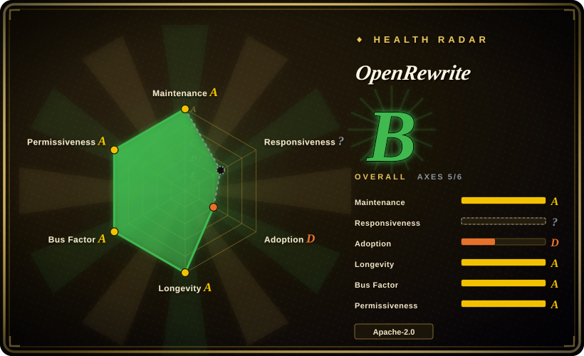
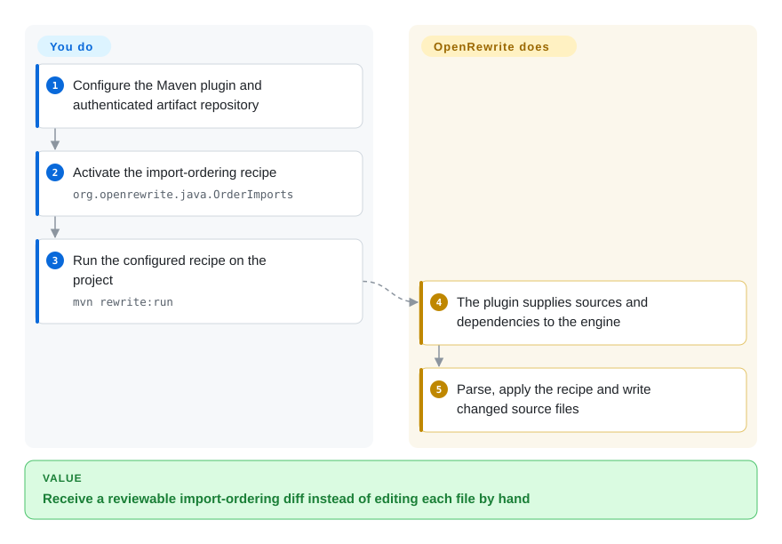
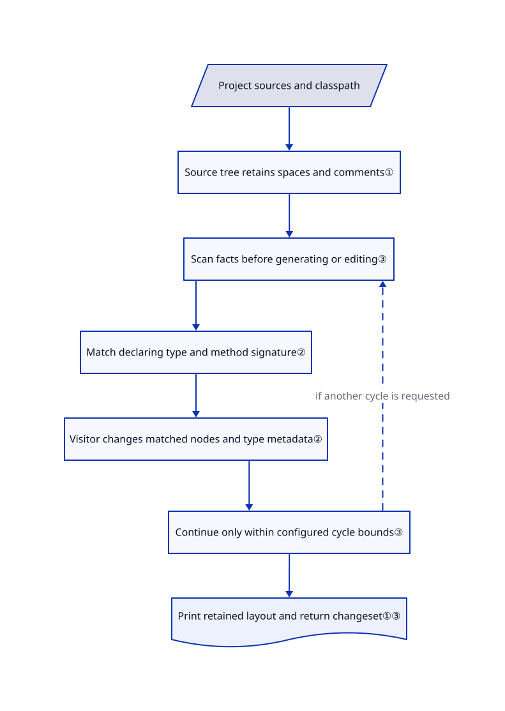

# OpenRewrite

You must rename a Java API across hundreds of callers without changing unrelated methods or reformatting every file. OpenRewrite applies reusable, type-aware editing rules while retaining source layout.

## When to use

You maintain several Java services and an API migration leaves calls such as `new B().singleArg("boo")` scattered through the source. A text replacement also catches unrelated `singleArg` methods. Choose OpenRewrite when the change needs the declaring type and argument signature, or combines source edits with Maven/Gradle dependency changes. Its recipes are reusable transformation rules; you configure existing rules or write Java visitors rather than ask a model to improvise each edit. The [method-renaming test](https://github.com/openrewrite/rewrite/blob/922d548b809dccb0b5aa22b4e23bfb083d37d00b/rewrite-java-test/src/test/java/org/openrewrite/java/ChangeMethodNameTest.java#L39-L77) supplies a concrete before/after example.

Start with the Apache-licensed core and original language modules. Framework migration recipes can live in separate repositories and have different licenses. The [README](https://github.com/openrewrite/rewrite/blob/922d548b809dccb0b5aa22b4e23bfb083d37d00b/README.md#L22-L43) distinguishes this single-repository engine from Moderne's commercial multi-repository platform; do not buy into the latter by accident when you only need local recipes.

## When NOT to use

- **You only need a small structural replacement across several languages.** Choose [ast-grep](https://github.com/ast-grep/ast-grep) when syntax patterns suffice; its tree-sitter-based command-line workflow avoids assembling a JVM recipe environment. OpenRewrite earns that setup when type attribution or composed migration rules matter.
- **You are building a custom Java analysis or transformation with your own metamodel logic.** Consider [Spoon](https://github.com/INRIA/spoon) for direct program-model manipulation; OpenRewrite is the stronger fit when reusable recipes and controlled source diffs are the main deliverable.
- **You need organization-wide dashboards, persistent prebuilt code models, or the vendor's agent MCP tools.** Evaluate [Moderne](https://www.moderne.ai/) as a commercial product. These are not bundled services of this library or its Maven/Gradle plugins.
- **Your product must redistribute every language engine under an OSI license.** For syntax-only changes, evaluate ast-grep instead. This repository's JavaScript/TypeScript, Python, C#, Go, Ruby, Scala and Android modules carry the [Moderne Source Available License](https://github.com/openrewrite/rewrite/blob/922d548b809dccb0b5aa22b4e23bfb083d37d00b/rewrite-javascript/LICENSE.md#L37-L57), which restricts third-party services and distribution of functionality; the root Apache file does not override them.
- **You require anonymous downloads of the newest artifacts.** Consider Spoon or ast-grep after checking their distribution path. The current [quickstart](https://github.com/openrewrite/rewrite-docs/blob/5d97c74fe42107579eadb784a3ad125ef27c7ff5/docs/running-recipes/getting-started.md) directs new OpenRewrite plugin/recipe downloads to the authenticated Code Genome Project repository; older Maven Central releases remain available, but are not equivalent to current releases.

## Comparison

| Alternative | In index | Our verdict | Tradeoff |
|---|---|---|---|
| [ast-grep](https://github.com/ast-grep/ast-grep) | not indexed | Prefer ast-grep for syntax-shaped multi-language edits; prefer OpenRewrite when a Java method's declaring type must decide the match. | Lightweight pattern rules versus classpath-aware recipe integration; not added in this tab batch. |
| [Spoon](https://github.com/INRIA/spoon) | not indexed | Prefer Spoon for a bespoke Java program-analysis tool; prefer OpenRewrite when you want to assemble migration recipes with narrowly scoped diffs. | Flexible Java metamodel APIs versus an existing recipe execution/testing ecosystem; not added in this tab batch. |
| [Moderne platform](https://www.moderne.ai/) | not a repo | Choose the commercial platform for coordinated changes across many repositories; choose OpenRewrite plugins for a local, single-repository run. | Hosted/commercial product, not this repository; adds persistent model reuse and fleet operations, with commercial access and licensing. |

## Quick start

For the documented Java path, add the separately released `rewrite-maven-plugin` to your project's `pom.xml`, or use the separate Gradle plugin; neither plugin is the core library itself. Follow the [pinned quickstart](https://github.com/openrewrite/rewrite-docs/blob/5d97c74fe42107579eadb784a3ad125ef27c7ff5/docs/running-recipes/getting-started.md) to configure Code Genome repository access outside version control, then activate `org.openrewrite.java.OrderImports`, a rule for ordering import statements. Run `mvn rewrite:run`; the plugin supplies project sources and dependencies, while the library parses and applies the active recipe to produce modified files. You select and pin compatible plugin, engine and recipe versions, review the diff, and run your application's build/tests; successful recipe execution is not proof of behavioral equivalence. For deeper migrations, add the required external recipe artifact and check its license rather than assume every catalog item ships in core.

<!-- flow-steps:begin (generated from flows/openrewrite.json by tools/flow_card.py — do not edit) -->

Text version of the flow

1. **You**: Configure the Maven plugin and authenticated artifact repository
2. **You**: Activate the import-ordering recipe — `org.openrewrite.java.OrderImports`
3. **You**: Run the configured recipe on the project — `mvn rewrite:run`
4. **OpenRewrite**: The plugin supplies sources and dependencies to the engine
5. **OpenRewrite**: Parse, apply the recipe and write changed source files

**Value**: Receive a reviewable import-ordering diff instead of editing each file by hand

<!-- flow-steps:end -->

## Key techniques

<!-- mechanism:begin (generated from mechanisms/openrewrite.json by tools/mechanism_card.py; do not edit) -->

Text version of the mechanism

- Project sources and classpath
- Source tree retains spaces and comments①
- Scan facts before generating or editing③
- Match declaring type and method signature②
- Visitor changes matched nodes and type metadata②
- Continue only within configured cycle bounds③
- Print retained layout and return changeset①③

- Project sources and classpath → Source tree retains spaces and comments①
- Source tree retains spaces and comments① → Scan facts before generating or editing③
- Scan facts before generating or editing③ → Match declaring type and method signature②
- Match declaring type and method signature② → Visitor changes matched nodes and type metadata②
- Visitor changes matched nodes and type metadata② → Continue only within configured cycle bounds③
- Continue only within configured cycle bounds③ → Scan facts before generating or editing③ (if another cycle is requested) [optional/fallback]
- Continue only within configured cycle bounds③ → Print retained layout and return changeset①③

<!-- mechanism:end -->

### 1. Keep whitespace and comments in the editable tree

- **Problem:** Reprinting a conventional syntax tree can create formatting noise around a small edit.
- **How:** Java's `Space` stores whitespace together with comments; the printer emits these retained spaces and comment suffixes around syntax. This is part of the lossless semantic tree, a source model that retains layout as well as meaning.
- **Limits:** Retaining layout is not a promise that a formatting recipe leaves it unchanged, nor a guarantee of correct parsing for every language/version. Comment-free spaces use shared instances; that optimization is not persistent multi-repository LST storage.
- **Source:** [Space representation and sharing](https://github.com/openrewrite/rewrite/blob/922d548b809dccb0b5aa22b4e23bfb083d37d00b/rewrite-java/src/main/java/org/openrewrite/java/tree/Space.java#L29-L82), [printer](https://github.com/openrewrite/rewrite/blob/922d548b809dccb0b5aa22b4e23bfb083d37d00b/rewrite-java/src/main/java/org/openrewrite/java/JavaPrinter.java#L29-L103).

### 2. Match method identity, not just its spelling

- **Problem:** Two unrelated classes can expose the same method name.
- **How:** `MethodMatcher` checks the declaring type, method name and parameter types. `ChangeMethodName` first checks whether the file declares or uses the method, then updates matching declarations, calls and member references, including their method-type metadata.
- **Limits:** A null method type fails the normal matcher. The separate unknown-type fallback explicitly risks false positives; correct project dependencies and before/after tests remain necessary. The rename recipe also checks for an existing sibling declaration with the target signature, not arbitrary behavioral conflicts.
- **Source:** [Typed matching and unknown-type boundary](https://github.com/openrewrite/rewrite/blob/922d548b809dccb0b5aa22b4e23bfb083d37d00b/rewrite-java/src/main/java/org/openrewrite/java/MethodMatcher.java#L306-L422), [rename visitor](https://github.com/openrewrite/rewrite/blob/922d548b809dccb0b5aa22b4e23bfb083d37d00b/rewrite-java/src/main/java/org/openrewrite/java/ChangeMethodName.java#L95-L213).

### 3. Separate scanning, generation and edits into bounded cycles

- **Problem:** A migration may need repository-wide facts before changing files, and one change can enable another rule.
- **How:** The scheduler performs scan, generate and edit phases in order. It obtains a changeset and data tables for the run, and repeats cycles subject to caller-supplied bounds and the cycle's request for another pass.
- **Limits:** Bounded iteration is not a proof of reaching the intended migration result. Recipes execute as trusted code, not in a security sandbox; callers must handle errors and validate output with their own build/tests.
- **Source:** [Run results, phase order and cycle stopping](https://github.com/openrewrite/rewrite/blob/922d548b809dccb0b5aa22b4e23bfb083d37d00b/rewrite-core/src/main/java/org/openrewrite/RecipeScheduler.java#L66-L147), [recipe execution contract](https://github.com/openrewrite/rewrite/blob/922d548b809dccb0b5aa22b4e23bfb083d37d00b/rewrite-core/src/main/java/org/openrewrite/Recipe.java).

## Tech stack

- JVM library, mainly Java, built as Gradle Kotlin DSL modules. Java parsing has version-specific modules; language availability does not imply identical maturity or licensing.
- [Core dependencies](https://github.com/openrewrite/rewrite/blob/922d548b809dccb0b5aa22b4e23bfb083d37d00b/rewrite-core/build.gradle.kts) include Jackson, SnakeYAML, Micrometer, ASM and JGit; [Java tooling](https://github.com/openrewrite/rewrite/blob/922d548b809dccb0b5aa22b4e23bfb083d37d00b/rewrite-java/build.gradle.kts) also uses ANTLR.
- [Original supported-language documentation](https://github.com/openrewrite/rewrite-docs/blob/5d97c74fe42107579eadb784a3ad125ef27c7ff5/docs/reference/supported-languages.md) lists Java/Kotlin/Groovy and configuration formats. The current [module list](https://github.com/openrewrite/rewrite/blob/922d548b809dccb0b5aa22b4e23bfb083d37d00b/settings.gradle.kts#L26-L57) also contains newer source-available language modules; do not read that as blanket Apache support.

## Dependencies

- A JDK, the appropriate parser module and resolvable application dependencies for accurate Java type information. Source-building the Java module uses a JDK 21 toolchain; this is not a universal minimum for all published plugin/engine combinations.
- Maven or Gradle for the normal Java plugin workflow. Their plugins, language modules and external migration recipes have independent coordinates/versions. An embedded library caller must supply parsing inputs and execution context itself.
- Current artifact downloads require Code Genome credentials; keep them out of project files. The [quickstart](https://github.com/openrewrite/rewrite-docs/blob/5d97c74fe42107579eadb784a3ad125ef27c7ff5/docs/running-recipes/getting-started.md) separates download entitlements from license rights: source-available/proprietary downloads can need a subscription even when source-available terms allow use on your own code.
- No database, hosted LLM or Moderne platform is required by the reviewed core execution path. Resolving dependencies can still contact registries; a local recipe run is not automatically an offline workflow.

## Ops difficulty

**Medium.** There is no daemon to operate for the local plugin path, but a migration must resolve the right classpath and coordinate engine, plugin and recipe versions. Budget heap for the in-memory source model, try representative modules first, and review both source and build-file changes. Treat recipe JARs as trusted executable dependencies; use a disposable branch and your normal test/review gates. Removing the plugin does not undo rewritten files, downloaded artifacts or credentials.

## Health & viability

- **2026-11-03 verdict:** a credible choice for repeated JVM migrations, with a commercial-boundary review before adoption. Public [release history](https://github.com/openrewrite/rewrite/releases) shows 8.97.1 on November 3 and several releases in the preceding week; it is not archived.
- **Longevity:** this repository dates to May 2020 and remains active after roughly six and a half years. [推断：based on creation metadata and current release history] That combination strengthens the durability prior for the core, not a guarantee for each newer parser or recipe.
- **Governance:** the README identifies Moderne as manager/maintainer. Multiple long-running contributors appear in the [contributor list](https://github.com/openrewrite/rewrite/graphs/contributors), and the [organization-wide contribution guide](https://github.com/openrewrite/.github/blob/fb910b3cc2349dc183dd29cc63d9cd5b671efe36/CONTRIBUTING.md#L58-L90) asks for regression tests and maintainer review; this is vendor-led, not foundation governance.
- **Ecosystem and risk:** separate build plugins and recipe modules make migration rules reusable, but also create version/license boundaries. The [licensing policy](https://github.com/openrewrite/rewrite-docs/blob/5d97c74fe42107579eadb784a3ad125ef27c7ff5/docs/licensing/openrewrite-licensing.md) and module-local licenses are more informative than GitHub's root Apache badge. The automated radar's root-license signal does not certify all modules as permissive.
- **Radar scope:** the machine collected five of six axes. Anonymous GraphQL collection failed, so responsiveness stays unknown. Adoption measures the npm package `@openrewrite/rewrite`, not Maven-wide Java usage; do not interpret its D grade as a Java adoption verdict. Grades were not manually adjusted.

## Caveats (unverified)

- [未验证：upstream execution and credential use were excluded] Installation, authenticated artifact resolution, actual migration correctness, memory needs and throughput were not tested here. Source/test inspection is not a successful migration run.
- [推断：based on dated metadata and release history, not a support commitment] Continued core maintenance is a durability signal; it does not establish future funding, support duration or parity across language modules.
