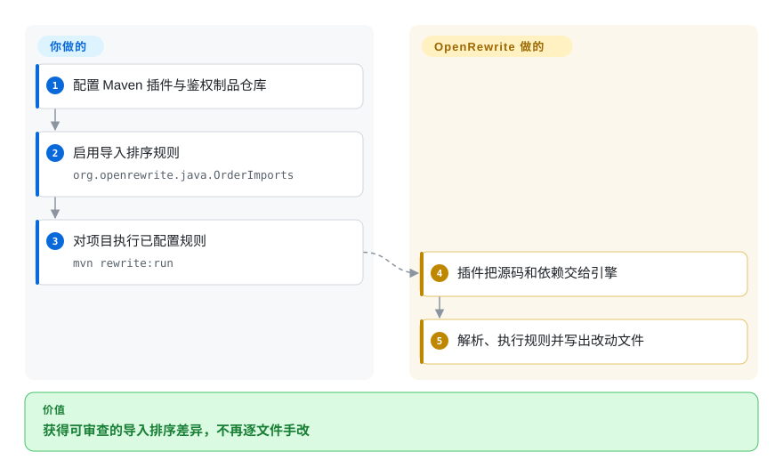
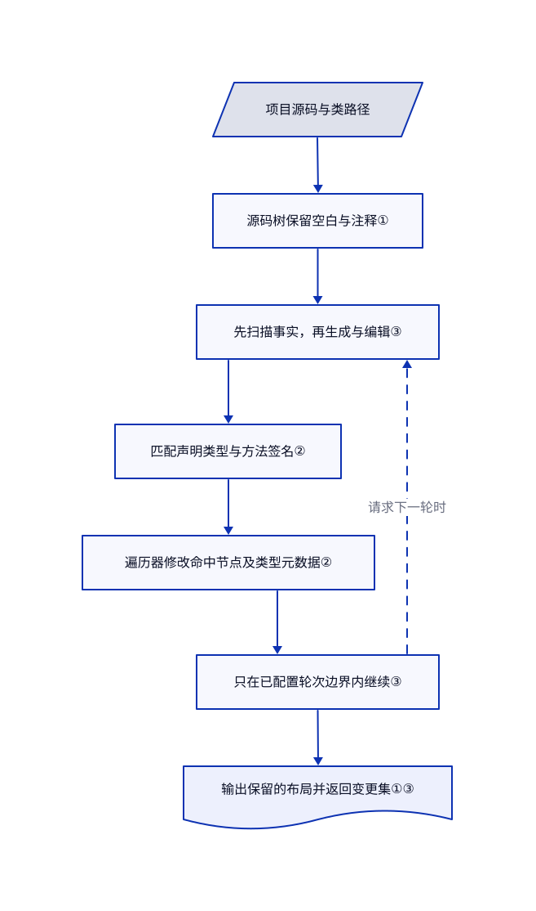

# OpenRewrite

你要改掉数百处 Java 接口调用，却不能误改同名方法或重排整份文件。OpenRewrite 按类型信息执行可复用规则，同时保留源码布局。

## 何时使用

你维护几套 Java 服务，接口迁移后，代码里散落着 `new B().singleArg("boo")` 这类旧调用。文本替换又会误伤其他类的同名方法。如果必须按声明类型和参数签名定位，或者同时调整源码与 Maven/Gradle 依赖，就该考虑 OpenRewrite。它把改动写成可重复执行的 recipe，也就是转换规则；你配置已有规则或编写 Java 遍历器，而不是让模型逐处猜改法。[方法重命名测试](https://github.com/openrewrite/rewrite/blob/922d548b809dccb0b5aa22b4e23bfb083d37d00b/rewrite-java-test/src/test/java/org/openrewrite/java/ChangeMethodNameTest.java#L39-L77)提供了具体前后对照。

优先从 Apache 许可的核心与原有语言模块入手。框架迁移规则可能来自独立仓库，许可也可能不同。[README](https://github.com/openrewrite/rewrite/blob/922d548b809dccb0b5aa22b4e23bfb083d37d00b/README.md#L22-L43)明确区分单仓库引擎与 Moderne 商业多仓库平台；只需本地规则时，不要把后者误当必需组件。

## 何时不用

- **只是跨语言做少量结构替换。** 如果按语法形状匹配已经够用，选 [ast-grep](https://github.com/ast-grep/ast-grep)；它基于 tree-sitter 的命令行路径不需要组装 JVM 规则环境。只有类型归属或组合迁移规则重要时，OpenRewrite 的接入成本才有意义。
- **要自行构建 Java 分析器或转换器。** 需要直接操纵程序模型时，考虑 [Spoon](https://github.com/INRIA/spoon)。如果交付物是可复用迁移规则和范围可控的源码差异，OpenRewrite 更合适。
- **要全组织看板、预先构建并持久复用的代码模型或厂商智能体 MCP 工具。** 应评估 [Moderne](https://www.moderne.ai/) 商业产品。这些不是本库或 Maven/Gradle 插件内置的服务。
- **产品要求所有语言引擎都能按 OSI 开源许可再分发。** 仅需语法改写时，改评估 ast-grep。本仓库的 JavaScript/TypeScript、Python、C#、Go、Ruby、Scala 和 Android 模块采用 [Moderne Source Available License](https://github.com/openrewrite/rewrite/blob/922d548b809dccb0b5aa22b4e23bfb083d37d00b/rewrite-javascript/LICENSE.md#L37-L57)，限制对第三方提供服务及功能分发；根目录 Apache 许可不会覆盖这些限制。
- **必须匿名下载最新制品。** 可在核对分发渠道后考虑 Spoon 或 ast-grep。当前[上手文档](https://github.com/openrewrite/rewrite-docs/blob/5d97c74fe42107579eadb784a3ad125ef27c7ff5/docs/running-recipes/getting-started.md)要求从需鉴权的 Code Genome Project 仓库下载新插件和规则；旧版仍在 Maven Central，但不等于当前版本。

## 横向对比

| 替代品 | 是否收录 | 我们的评价 | 取舍 |
|---|---|---|---|
| [ast-grep](https://github.com/ast-grep/ast-grep) | 未收录 | 按语法形状跨语言改写时选 ast-grep；必须按 Java 方法所属类型判断时选 OpenRewrite。 | 轻量模式规则与依赖类路径的规则接入各有成本；本轮标签批次不新增。 |
| [Spoon](https://github.com/INRIA/spoon) | 未收录 | 自建 Java 程序分析工具时选 Spoon；要组合迁移规则并控制差异范围时选 OpenRewrite。 | 灵活程序模型接口与现成规则执行、测试生态的取舍；本轮标签批次不新增。 |
| [Moderne 平台](https://www.moderne.ai/) | 非仓库 | 要协调多仓库迁移时选商业平台；只在本地处理单仓库时选 OpenRewrite 插件。 | 这是商业托管产品，不是本仓库；增加持久模型复用与批量运维，同时增加商业访问和许可条件。 |

## 快速上手

按文档中的 Java 路径，在项目 `pom.xml` 添加独立发布的 `rewrite-maven-plugin`，或选择独立 Gradle 插件；两者都不是核心库本身。按[固定版本上手文档](https://github.com/openrewrite/rewrite-docs/blob/5d97c74fe42107579eadb784a3ad125ef27c7ff5/docs/running-recipes/getting-started.md)配置 Code Genome 仓库访问，把凭据留在版本控制之外，然后启用 `org.openrewrite.java.OrderImports`，即整理导入语句的规则。运行 `mvn rewrite:run` 后，插件提供项目源码与依赖，库解析源码并执行已启用规则，输出改写文件。你负责固定相互兼容的插件、引擎和规则版本，审查差异并运行应用构建与测试；规则执行成功不代表行为等价。更复杂的迁移要额外添加对应规则制品并核对许可，不能假设目录中的全部规则都在核心库内。

<!-- flow-steps:begin (generated from flows/openrewrite.json by tools/flow_card.py — do not edit) -->

流程文字版

1. **你**：配置 Maven 插件与鉴权制品仓库
2. **你**：启用导入排序规则 — `org.openrewrite.java.OrderImports`
3. **你**：对项目执行已配置规则 — `mvn rewrite:run`
4. **OpenRewrite**：插件把源码和依赖交给引擎
5. **OpenRewrite**：解析、执行规则并写出改动文件

**价值**：获得可审查的导入排序差异，不再逐文件手改

<!-- flow-steps:end -->

## 技术要点

<!-- mechanism:begin (generated from mechanisms/openrewrite.json by tools/mechanism_card.py; do not edit) -->

机制文字版

- 项目源码与类路径
- 源码树保留空白与注释①
- 先扫描事实，再生成与编辑③
- 匹配声明类型与方法签名②
- 遍历器修改命中节点及类型元数据②
- 只在已配置轮次边界内继续③
- 输出保留的布局并返回变更集①③

- 项目源码与类路径 → 源码树保留空白与注释①
- 源码树保留空白与注释① → 先扫描事实，再生成与编辑③
- 先扫描事实，再生成与编辑③ → 匹配声明类型与方法签名②
- 匹配声明类型与方法签名② → 遍历器修改命中节点及类型元数据②
- 遍历器修改命中节点及类型元数据② → 只在已配置轮次边界内继续③
- 只在已配置轮次边界内继续③ → 先扫描事实，再生成与编辑③（请求下一轮时）〔可选／兜底〕
- 只在已配置轮次边界内继续③ → 输出保留的布局并返回变更集①③

<!-- mechanism:end -->

### 1. 把空白和注释留在可编辑的树里

- **解决：** 传统语法树重新输出源码时，可能围绕小改动制造大量格式差异。
- **做法：** Java 的 `Space` 同时保存空白和注释；输出器在语法节点周围写回这些空白与注释后缀。这是无损语义树的一部分，即同时保留源码布局与含义的模型。
- **边界：** 保留布局不代表格式化规则不会主动改布局，也不保证所有语言版本都能正确解析。无注释空白使用共享实例；这个优化不是持久化的跨仓库代码模型存储。
- **源码：** [空白表示与共享](https://github.com/openrewrite/rewrite/blob/922d548b809dccb0b5aa22b4e23bfb083d37d00b/rewrite-java/src/main/java/org/openrewrite/java/tree/Space.java#L29-L82)、[输出器](https://github.com/openrewrite/rewrite/blob/922d548b809dccb0b5aa22b4e23bfb083d37d00b/rewrite-java/src/main/java/org/openrewrite/java/JavaPrinter.java#L29-L103)。

### 2. 匹配方法身份，而不只匹配名字

- **解决：** 两个无关类可以声明同名方法。
- **做法：** `MethodMatcher` 检查声明类型、方法名和参数类型。`ChangeMethodName` 先检查文件是否声明或使用目标方法，再修改匹配的声明、调用与方法引用，同时更新方法类型元数据。
- **边界：** 常规匹配遇到空方法类型就不匹配。另行启用未知类型兜底会增加误报风险，仍需正确解析项目依赖并编写前后对照测试。重命名规则还检查目标签名是否已有同级声明，但不会排除任意行为冲突。
- **源码：** [类型匹配与未知类型边界](https://github.com/openrewrite/rewrite/blob/922d548b809dccb0b5aa22b4e23bfb083d37d00b/rewrite-java/src/main/java/org/openrewrite/java/MethodMatcher.java#L306-L422)、[重命名遍历器](https://github.com/openrewrite/rewrite/blob/922d548b809dccb0b5aa22b4e23bfb083d37d00b/rewrite-java/src/main/java/org/openrewrite/java/ChangeMethodName.java#L95-L213)。

### 3. 用有界轮次分离扫描、生成与编辑

- **解决：** 迁移可能先收集全仓库事实，前一处改动也可能触发另一条规则。
- **做法：** 调度器依次执行扫描、生成和编辑，汇总本轮变更集与数据表。是否再跑一轮取决于调用方提供的轮次边界，以及当前轮是否请求继续。
- **边界：** 有界迭代不证明已达到预期迁移结果。规则作为受信代码执行，不在安全沙箱里；调用方必须处理错误，并用自己的构建和测试验证输出。
- **源码：** [结果、阶段顺序与停止条件](https://github.com/openrewrite/rewrite/blob/922d548b809dccb0b5aa22b4e23bfb083d37d00b/rewrite-core/src/main/java/org/openrewrite/RecipeScheduler.java#L66-L147)、[规则执行契约](https://github.com/openrewrite/rewrite/blob/922d548b809dccb0b5aa22b4e23bfb083d37d00b/rewrite-core/src/main/java/org/openrewrite/Recipe.java)。

## 技术栈

- 以 Java 为主的 JVM 库，用 Gradle Kotlin DSL 组织模块。Java 解析器按版本拆分；支持某语言不代表成熟度和许可完全一致。
- [核心依赖](https://github.com/openrewrite/rewrite/blob/922d548b809dccb0b5aa22b4e23bfb083d37d00b/rewrite-core/build.gradle.kts)包括 Jackson、SnakeYAML、Micrometer、ASM 和 JGit；[Java 工具模块](https://github.com/openrewrite/rewrite/blob/922d548b809dccb0b5aa22b4e23bfb083d37d00b/rewrite-java/build.gradle.kts)还使用 ANTLR。
- [原有语言支持文档](https://github.com/openrewrite/rewrite-docs/blob/5d97c74fe42107579eadb784a3ad125ef27c7ff5/docs/reference/supported-languages.md)列出 Java、Kotlin、Groovy 与配置格式。当前[模块清单](https://github.com/openrewrite/rewrite/blob/922d548b809dccb0b5aa22b4e23bfb083d37d00b/settings.gradle.kts#L26-L57)还包含较新的源码可见语言模块，不能据此推导为全部采用 Apache 许可。

## 依赖

- 需要 JDK、对应解析器模块，以及能解析的应用依赖，才能获得准确的 Java 类型信息。从源码构建 Java 模块使用 JDK 21 工具链，但这不是所有已发布插件和引擎组合的统一最低版本。
- 常规 Java 路径使用 Maven 或 Gradle。插件、语言模块和外部迁移规则各有独立坐标与版本；直接嵌入库时，调用方要自行提供解析输入和执行上下文。
- 当前制品下载需要 Code Genome 凭据，不能写进项目文件。[上手文档](https://github.com/openrewrite/rewrite-docs/blob/5d97c74fe42107579eadb784a3ad125ef27c7ff5/docs/running-recipes/getting-started.md)区分下载权益与许可权利：源码可见条款允许处理自有代码，不代表其制品一定免订阅下载；源码可见或专有规则下载可能需要订阅。
- 所读核心执行路径不需要数据库、托管大模型或 Moderne 平台。解析依赖仍可能访问制品仓库，本地执行规则不等于自动离线。

## 运维难度

**中。** 本地插件路径没有常驻服务，但必须解析正确类路径，并协调引擎、插件和规则版本。为内存中的源码模型预留堆空间，先在代表性模块试跑，同时审查源码和构建文件差异。把规则 JAR 当作受信可执行依赖，在可丢弃分支中使用常规测试与评审门禁。删除插件不会撤销已改写文件、已下载制品或已保存凭据。

## 健康度与可持续性

- **2026-11-03 判断：** 可认真评估为重复 JVM 迁移的基础，但接入前要先审商业边界。[发布记录](https://github.com/openrewrite/rewrite/releases)显示 11 月 3 日发布 8.97.1，此前一周也有多次发布，仓库未归档。
- **存续信号：** 本仓库创建于 2020 年 5 月，约六年半后仍活跃。[推断：依据创建元数据与当前发布历史] 这提高核心长期存续的先验，不保证每个新解析器或规则都能持续维护。
- **治理：** README 明确由 Moderne 管理和维护。[贡献者列表](https://github.com/openrewrite/rewrite/graphs/contributors)有多名长期参与者；[组织级贡献指南](https://github.com/openrewrite/.github/blob/fb910b3cc2349dc183dd29cc63d9cd5b671efe36/CONTRIBUTING.md#L58-L90)要求回归测试和维护者评审。这是厂商主导，不是基金会治理。
- **生态与风险：** 独立构建插件和规则模块便于复用，也增加版本和许可边界。[许可政策](https://github.com/openrewrite/rewrite-docs/blob/5d97c74fe42107579eadb784a3ad125ef27c7ff5/docs/licensing/openrewrite-licensing.md)与各模块许可比 GitHub 根目录 Apache 徽章更有决策价值。机器雷达中的根许可信号不能证明全部模块都采用宽松许可。
- **雷达口径：** 机器取得六轴中的五轴。匿名 GraphQL 采集失败，响应速度保留未知。采用度测量的是 npm 包 `@openrewrite/rewrite`，不是 Java 的 Maven 整体使用量；不能把 D 级当作 Java 采用度结论。本轮未人工调整评分。

## 存疑（未验证）

- [未验证：本轮禁止执行上游及使用凭据] 未测试安装、鉴权制品解析、实际迁移正确性、内存占用与吞吐；阅读源码和测试不等于完成一次迁移实测。
- [推断：依据带日期的元数据和发布历史，不是支持承诺] 核心持续维护是存续信号，不能证明未来资金、支持年限或各语言模块的能力一致。
