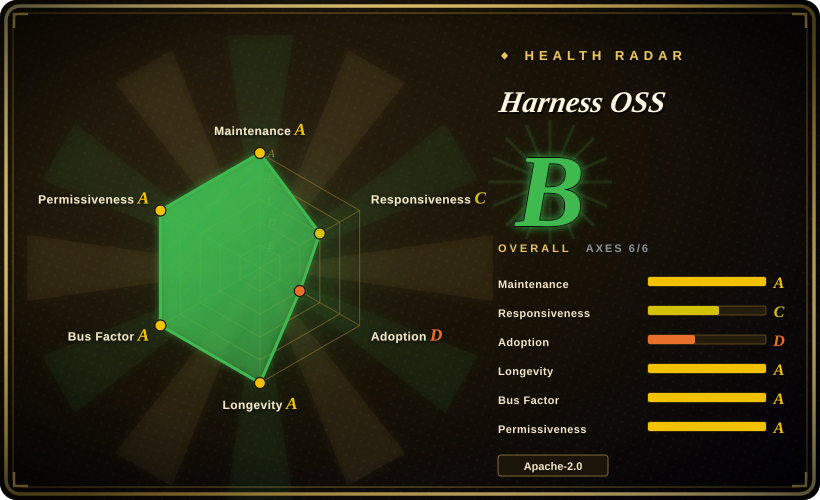
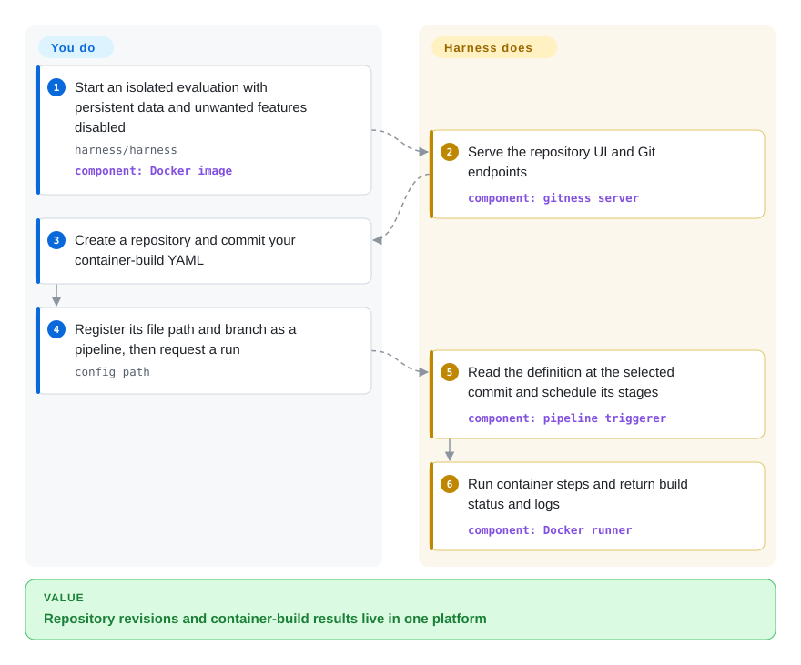
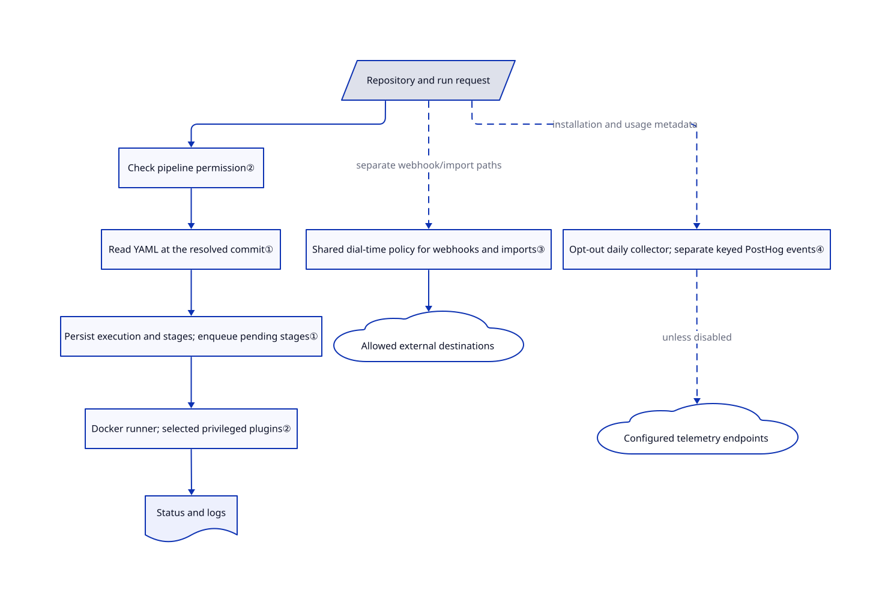

# Harness OSS

Your team hosts code in one service, runs builds in another, and manually connects their permissions and results. Harness puts Git repositories, container builds and an artifact registry behind one server; this is the DevOps platform formerly named Gitness, not an AI-agent harness.

> The radar measures repository signals, not deployment safety. Its Apache badge reflects root-license detection, not the entire mixed-license tree; see the security blockers below.

## When to use

You maintain a small team's development infrastructure. A pull request has a failing build, but its logs live in a separate CI service and someone must reconcile repository access with runner access. Consider Harness when you want the repository, pipeline definition, execution history and package storage in one self-hosted platform. Compared with adding Woodpecker to an existing forge, you accept moving more of your development workflow into Harness in exchange for fewer cross-service integrations.

Treat the reviewed snapshot as an evaluation candidate, not a public-production recommendation. Its source still contains the security-sensitive paths described below. The combined platform is the selection reason; its name is not evidence of coding-agent orchestration.

## When NOT to use

- **You need a public or mutually untrusted deployment now.** Prefer evaluating Gitea for the forge, or Woodpecker for CI on your existing forge, rather than deploying this snapshot unchanged. The wired Gitspace password resolver returns a fixed password and ignores the requested secret. The registry webhook controller also forwards a raw sort direction into SQL construction. Reports [#3725](https://github.com/harness/harness/issues/3725) and [#3724](https://github.com/harness/harness/issues/3724) remain open; the corresponding code is present at the reviewed SHA. This does not certify either substitute as vulnerability-free.
- **You expect the quick-start container to isolate hostile build code.** Use [Argo Workflows](../../workflow-orchestration/argo-workflows.md) with deliberately restricted Kubernetes workloads when cluster-level workload policy is your requirement. Harness's example mounts the host Docker socket, and its runner grants privileged execution to selected publishing plugins. Application permissions are not a host isolation boundary.
- **You already have a forge and only need CI.** Choose Woodpecker rather than adopting another repository platform. The README keeps legacy Drone on the `drone` branch and says pipeline parity is a goal, not a completed migration guarantee.
- **You need an uncomplicated permissive-license tree for redistribution.** Evaluate Gitea instead of assuming the root Apache license covers every file here. Several UI components carry PolyForm Shield headers; an engineering-operations script carries PolyForm Free Trial. Those are Harness-owned notices, not an Apache-only tree.
- **You require no unsolicited network reporting.** Prefer your existing forge plus an explicitly egress-controlled Woodpecker deployment unless you can audit Harness's configuration. Its daily collector is enabled by default and includes the first user's email, installation identity and resource counts. Disable it explicitly before evaluation; the absence of a PostHog key does not disable that separate collector.

## Comparison

| Alternative | In index | Our verdict | Tradeoff |
|---|---|---|---|
| [Gitea](https://github.com/go-gitea/gitea) | not indexed | Choose Gitea when Git hosting and GitHub-Actions-style jobs matter more than Harness's integrated Gitspaces; evaluate Harness when its combined repository, build and development-environment workflow is the actual requirement. | Gitea documents a separate action runner and an MIT root license. Harness joins more surfaces in one platform, but this snapshot has mixed file licenses and unresolved security reports. Gitea is not added in this tab batch. |
| [Woodpecker](https://github.com/woodpecker-ci/woodpecker) | not indexed | Choose Woodpecker when your forge is settled and you only need container CI; choose Harness only if replacing or consolidating the forge is also intentional. | Woodpecker separates CI server and agents and leaves source hosting to another system. Harness reduces that integration split but expands the server's authority and upgrade scope. Woodpecker is not added in this tab batch. |
| [Argo Workflows](../../workflow-orchestration/argo-workflows.md) | ✅ | Choose Argo when each job must be a Kubernetes workload under cluster policy; choose Harness when developers need repository-native builds without first operating Kubernetes. | Argo supplies a general container workflow engine, not a Git forge. Harness includes repository and review surfaces, but its embedded Docker runner is not equivalent to Kubernetes workload isolation. |

## Quick start

The [README](https://github.com/harness/harness/blob/f335f08374b83e9e4ddd54f4f47b4c6daad2fa54/README.md#L8-L23) starts the `harness/harness` Docker image with persistent `/data`, HTTP port 3000, SSH port 3022 and access to the Docker socket. Evaluate that path only on a disposable, trusted host; set `GITNESS_METRIC_ENABLED=false` and `GITNESS_GITSPACE_ENABLE=false` before starting, since the [Dockerfile](https://github.com/harness/harness/blob/f335f08374b83e9e4ddd54f4f47b4c6daad2fa54/Dockerfile#L74-L96) enables both features. In the browser, create a repository, commit your build YAML, then create a pipeline with its identifier, branch and `config_path` — the repository file that defines the build — and run it. The [pipeline form](https://github.com/harness/harness/blob/f335f08374b83e9e4ddd54f4f47b4c6daad2fa54/web/src/components/NewPipelineModal/NewPipelineModal.tsx#L59-L75) and [execution controller](https://github.com/harness/harness/blob/f335f08374b83e9e4ddd54f4f47b4c6daad2fa54/app/api/controller/execution/create.go#L29-L84) verify that path. Harness runs the container steps and returns status and logs; you supply build images, commands, credentials, storage, backups and host security. No image or pipeline was executed for this review, and the README's floating image is not proven to match this source snapshot.

<!-- flow-steps:begin (generated from flows/harness-open-source.json by tools/flow_card.py — do not edit) -->

Text version of the flow

1. **You**: Start an isolated evaluation with persistent data and unwanted features disabled — `harness/harness` — component: `Docker image`
2. **Harness OSS**: Serve the repository UI and Git endpoints — component: `gitness server`
3. **You**: Create a repository and commit your container-build YAML
4. **You**: Register its file path and branch as a pipeline, then request a run — `config_path`
5. **Harness OSS**: Read the definition at the selected commit and schedule its stages — component: `pipeline triggerer`
6. **Harness OSS**: Run container steps and return build status and logs — component: `Docker runner`

**Value**: Repository revisions and container-build results live in one platform

<!-- flow-steps:end -->

## Key techniques

<!-- mechanism:begin (generated from mechanisms/harness-open-source.json by tools/mechanism_card.py; do not edit) -->

Text version of the mechanism

- Repository and run request
- Check pipeline permission②
- Read YAML at the resolved commit①
- Persist execution and stages; enqueue pending stages①
- Docker runner; selected privileged plugins②
- Status and logs
- Shared dial-time policy for webhooks and imports③
- Allowed external destinations
- Opt-out daily collector; separate keyed PostHog events④
- Configured telemetry endpoints

- Repository and run request → Check pipeline permission②
- Check pipeline permission② → Read YAML at the resolved commit①
- Read YAML at the resolved commit① → Persist execution and stages; enqueue pending stages①
- Persist execution and stages; enqueue pending stages① → Docker runner; selected privileged plugins②
- Docker runner; selected privileged plugins② → Status and logs
- Repository and run request → Shared dial-time policy for webhooks and imports③ (separate webhook/import paths) [optional/fallback]
- Shared dial-time policy for webhooks and imports③ → Allowed external destinations
- Repository and run request → Opt-out daily collector; separate keyed PostHog events④ (installation and usage metadata) [optional/fallback]
- Opt-out daily collector; separate keyed PostHog events④ → Configured telemetry endpoints (unless disabled) [optional/fallback]

<!-- mechanism:end -->

### 1. Bind build definitions to the selected commit

- **Problem:** A build is hard to explain if its definition comes from a different revision than the code being tested.
- **How:** Manual execution resolves the branch to a commit, then the triggerer reads `ConfigPath` at that SHA. It parses the build, records execution and stages in one transaction, then schedules pending stages. Legacy Drone YAML uses a dependency graph; the newer v1 parser links stages sequentially.
- **Limits:** The two formats do not imply identical behavior. The v1 path only accepts supported CI stages, and a database transaction does not make subsequent queue insertion atomic with persistence.
- **Source:** [Resolve the commit](https://github.com/harness/harness/blob/f335f08374b83e9e4ddd54f4f47b4c6daad2fa54/app/api/controller/execution/create.go#L46-L84), [read, parse and schedule](https://github.com/harness/harness/blob/f335f08374b83e9e4ddd54f4f47b4c6daad2fa54/app/pipeline/triggerer/trigger.go#L166-L382), [sequential v1 stages and transaction](https://github.com/harness/harness/blob/f335f08374b83e9e4ddd54f4f47b4c6daad2fa54/app/pipeline/triggerer/trigger.go#L395-L530).

### 2. Separate application authorization from runner authority

- **Problem:** A person allowed to view a repository should not automatically acquire the right to execute builds or edit secrets.
- **How:** Execution checks repository state and pipeline-execute permission before resolving the commit. Secret creation checks space-level secret-edit permission and encrypts data before storage. A poller dispatches stages to Drone-derived Docker execution engines and reports their history and logs through the server.
- **Limits:** These checks do not sandbox a malicious authorized build. Selected publishing plugins receive privileged container capabilities. Gitspaces use another resolver, which currently ignores its resolution context and returns a fixed password; the encrypted-secret creation path does not repair that separate defect.
- **Source:** [Execution authorization](https://github.com/harness/harness/blob/f335f08374b83e9e4ddd54f4f47b4c6daad2fa54/app/api/controller/execution/controller.go#L73-L106), [secret authorization and encryption](https://github.com/harness/harness/blob/f335f08374b83e9e4ddd54f4f47b4c6daad2fa54/app/api/controller/secret/create.go#L48-L89), [poller](https://github.com/harness/harness/blob/f335f08374b83e9e4ddd54f4f47b4c6daad2fa54/app/pipeline/runner/poller.go#L32-L59), [runner authority](https://github.com/harness/harness/blob/f335f08374b83e9e4ddd54f4f47b4c6daad2fa54/app/pipeline/runner/runner.go#L42-L137), [Gitspace resolver](https://github.com/harness/harness/blob/f335f08374b83e9e4ddd54f4f47b4c6daad2fa54/app/gitspace/secret/password_resolver.go#L23-L36).

### 3. Reject internal destinations at connection time, but only on covered paths

- **Problem:** A user-supplied webhook or import URL can otherwise make the server contact its own private network.
- **How:** The shared network policy classifies resolved addresses, first unmapping IPv4-in-IPv6 values. Webhook and importer transports attach its check immediately before a socket connects. Private, loopback and link-local destinations require explicit opt-ins; webhook redirects are not followed.
- **Limits:** This is not a process-wide egress firewall. Gitspace feature downloading still calls unrestricted `http.Get`, and tar extraction joins entry names without a containment check at this SHA. Do not infer that the shared helper protects every downloader or external Git subprocess.
- **Source:** [Address policy](https://github.com/harness/harness/blob/f335f08374b83e9e4ddd54f4f47b4c6daad2fa54/netpolicy/netpolicy.go#L115-L223), [webhook transport](https://github.com/harness/harness/blob/f335f08374b83e9e4ddd54f4f47b4c6daad2fa54/app/services/webhook/http_client.go#L50-L85), [importer transport](https://github.com/harness/harness/blob/f335f08374b83e9e4ddd54f4f47b4c6daad2fa54/app/services/importer/base_transport.go#L34-L53), [uncovered feature path](https://github.com/harness/harness/blob/f335f08374b83e9e4ddd54f4f47b4c6daad2fa54/app/gitspace/orchestrator/utils/download_features.go#L296-L369).

### 4. Distinguish daily installation reports from keyed event analytics

- **Problem:** A locally hosted service can still report identifying operational data to external services.
- **How:** Unless `DO_NOT_TRACK=true` or metrics are disabled, the server persists an installation ID and registers a daily job. That job posts hostname, first-user email and resource counts to the configured endpoint, defaulting to `stats.drone.ci`. A separate PostHog submitter requires a key and can attach usernames and emails to events.
- **Limits:** Turning off PostHog credentials alone leaves the daily collector enabled. These source paths establish intended outbound behavior, not an observed packet capture or a complete audit of every dependency's reporting.
- **Source:** [Defaults](https://github.com/harness/harness/blob/f335f08374b83e9e4ddd54f4f47b4c6daad2fa54/types/config.go#L408-L429), [opt-out and installation ID](https://github.com/harness/harness/blob/f335f08374b83e9e4ddd54f4f47b4c6daad2fa54/app/services/metric/values.go#L35-L69), [daily payload and POST](https://github.com/harness/harness/blob/f335f08374b83e9e4ddd54f4f47b4c6daad2fa54/app/services/metric/collector_job.go#L100-L208), [keyed events](https://github.com/harness/harness/blob/f335f08374b83e9e4ddd54f4f47b4c6daad2fa54/app/services/metric/posthog.go#L51-L144).

## Tech stack

- Go server and CLI; the module retains the name `github.com/harness/gitness`. The reviewed `go.mod` requires Go 1.26.8, despite the README's older Go 1.20 guidance.
- Chi HTTP routing, SQL storage, Git HTTP/SSH services, Drone-derived Docker runners, and an artifact-registry module with distribution/OCI dependencies.
- TypeScript/React 17 UI, Webpack and Yarn; frontend dependencies include Harness UI packages. [Manifests](https://github.com/harness/harness/blob/f335f08374b83e9e4ddd54f4f47b4c6daad2fa54/go.mod) and [UI package](https://github.com/harness/harness/blob/f335f08374b83e9e4ddd54f4f47b4c6daad2fa54/web/package.json).

## Dependencies

- Docker daemon for the documented container-build path, Git in the server environment, and persistent repository/database/registry storage. SQLite and filesystem storage are defaults; PostgreSQL and Redis-backed coordination are configurable, not mandatory for the single-instance default.
- Network access for build images and configured imports, webhooks, registries or Gitspace features. CI startup also populates plugin schemas from a configurable ZIP URL, whose default points at a public GitHub branch.
- For source development, Go 1.26.8, Node/Yarn, protobuf tools and UI assets. Dependency installation can install Husky development hooks; it is not a read-only operation. [Configuration](https://github.com/harness/harness/blob/f335f08374b83e9e4ddd54f4f47b4c6daad2fa54/types/config.go#L161-L190) and [server startup](https://github.com/harness/harness/blob/f335f08374b83e9e4ddd54f4f47b4c6daad2fa54/cli/operations/server/server.go#L118-L135).

## Ops difficulty

**Medium for a trusted single-host evaluation; high for a shared production service.** Persisting `/data` gets the basic topology running, but source hosting, build execution and artifact storage concentrate valuable credentials and data. Before exposure, restrict registration and network access, configure TLS and backups, separate build authority, disable unwanted reporting, and resolve the source-confirmed security paths. The source defaults enable signup; Docker additionally enables Gitspaces. Increasing `GITNESS_CI_PARALLEL_WORKERS` from its default of two changes host load, not the trust boundary.

## Health & viability

- **Maintenance, 2026-10-19:** main is active and the repository is not archived; its latest observed push was 2026-10-16. The latest GitHub release is v2.28.2 dated 2026-04-20; its release metadata targets the legacy `drone` branch, as do the next four releases inspected. Main documents the newer platform. Do not treat that release number as the reviewed platform version or proof that a release image includes main's changes.
- **Governance:** Harness owns the organization, source copyright and contribution CLA. The contributor list contains multiple substantial contributors, but vendor ownership is not neutral-foundation governance. [Contribution policy](https://github.com/harness/harness/blob/f335f08374b83e9e4ddd54f4f47b4c6daad2fa54/CONTRIBUTING.md#L3-L22).
- **Age and adoption:** the repository was created in February 2014 and has 38,586 stars on the verification date. Its Drone history predates the integrated platform. [推断：the README's branch split shows why repository age and accumulated stars cannot establish the newer platform's production maturity.] Continued activity supports continuity, not a twelve-year track record for every present module.
- **Selection blockers:** the fixed Gitspace password, raw registry sort-order SQL path and uncovered feature downloader remain in the reviewed commit. Open fix proposals are not merged fixes. Root Apache detection in the health radar also does not account for individual PolyForm Shield/Free Trial headers, including [a UI component](https://github.com/harness/harness/blob/f335f08374b83e9e4ddd54f4f47b4c6daad2fa54/web/src/components/FavoriteStar/FavoriteStar.tsx#L1-L6) and [an operations script](https://github.com/harness/harness/blob/f335f08374b83e9e4ddd54f4f47b4c6daad2fa54/.engops/pr_source_code_changes.sh#L1-L5).

## Caveats (unverified)

- [未验证：execution was intentionally prohibited.] Installation, migration compatibility, throughput, hostile-build isolation and the exploitability of reported security paths were not reproduced. Code paths were inspected; no installer, pipeline, model or attack payload was run.
- [未验证：the README uses a floating image and no container was fetched.] Whether the distributed Docker image matches the reviewed SHA, includes pending fixes or uses different defaults is not established.
- [推断：repository metadata spans the Drone-to-Gitness-to-Harness history.] Age and stars overstate the evidence available for the current integrated platform; no independent production-user count was established.
- [未验证：upstream documentation returned HTTP 403.] The developer documentation could not be read; the usage path and configuration above come from pinned README, UI and server sources instead.
- [未验证：no legal opinion was obtained.] The scope and compatibility of file-level PolyForm notices and bundled frontend dependencies require a redistribution-specific license review; the root Apache badge is insufficient.
