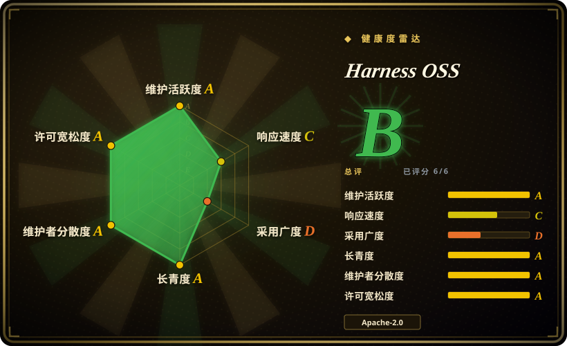
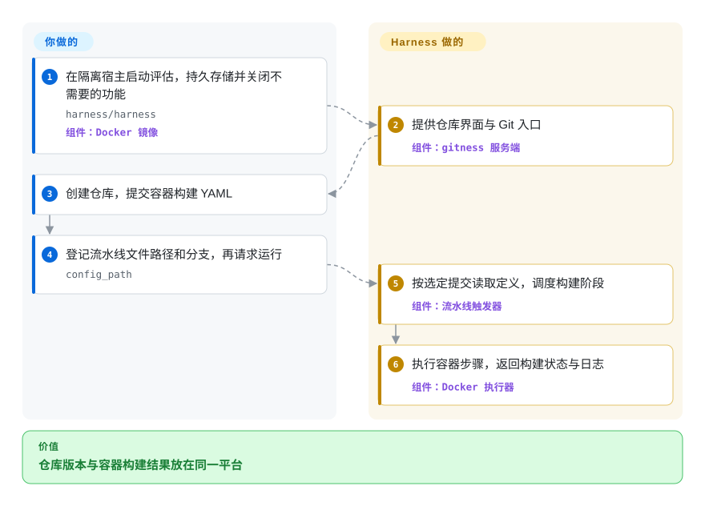
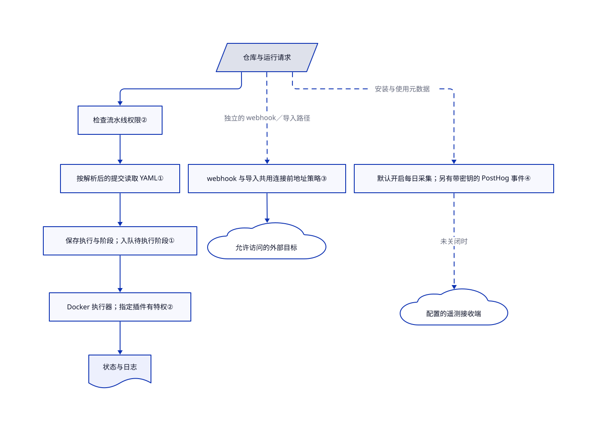

# Harness OSS

代码托管、构建和制品存储各用一套服务，你得手动对齐权限和结果。Harness 把它们放进同一个服务器；这是原名 Gitness 的 DevOps 平台，不是 AI agent 的运行框架。

> 雷达衡量仓库信号，不保证部署安全。Apache 徽章只反映根许可识别，不代表整棵混合许可源码；安全阻断项见下文。

## 何时使用

你负责小团队的开发基础设施。合并请求显示构建失败，但日志在另一个 CI 服务里，还得核对代码仓库和执行器的权限。你想把仓库、流水线定义、执行历史和制品存储放到同一个自建平台时，可以想到 Harness。相比给现有代码托管接 Woodpecker，你接受把更多流程迁进 Harness，换取少维护几条跨服务连接。

本次核验版本只适合作为评估对象，不建议直接用于公开生产服务。下文列出的安全敏感路径仍在源码里。选择理由应是平台整合，而不是名字看起来像编码 agent 的框架。

## 何时不用

- **你现在就要公开部署，或接纳互不信任的用户。** 代码托管可先评估 Gitea，已有托管平台只缺 CI 则评估 Woodpecker，不要原样部署本次快照。实际接入的 Gitspace 密码解析器返回固定密码，并忽略指定的秘密引用。制品库 webhook 控制器还把原始排序方向传进 SQL 拼接。[问题 #3725](https://github.com/harness/harness/issues/3725) 和 [问题 #3724](https://github.com/harness/harness/issues/3724) 仍开放，对应代码也仍在核验提交中。这不代表替代品已经通过无漏洞认证。
- **你指望快速启动的容器隔离恶意构建。** 若要求由集群执行工作负载策略，改用 [Argo Workflows](../../workflow-orchestration/argo-workflows.zh.md)，并明确限制 Kubernetes 工作负载权限。Harness 示例挂载宿主 Docker 套接字，执行器还给指定发布插件特权能力。应用权限不等于宿主隔离。
- **你已有代码托管，只缺 CI。** 选 Woodpecker，不必再引入一套仓库平台。README 把旧 Drone 留在 `drone` 分支，并将流水线能力对齐描述为目标，而非已完成的迁移保证。
- **你要整棵源码都便于按宽松许可再分发。** 先评估 Gitea，别假定根目录 Apache 许可覆盖这里所有文件。部分界面组件带 PolyForm Shield 声明，运维脚本还带 PolyForm Free Trial 声明。这些声明属于 Harness 自己，但整棵树并非只有 Apache 许可。
- **你不允许服务主动外发运行信息。** 除非能审查 Harness 配置，否则优先保留现有托管，并给 Woodpecker 明确设置出口限制。Harness 每日采集任务默认开启，包含首位用户邮箱、安装标识和资源数量。评估前必须显式关闭；没配 PostHog 密钥不会关闭另一个每日采集器。

## 横向对比

| 替代品 | 是否收录 | 我们的评价 | 取舍 |
|---|---|---|---|
| [Gitea](https://github.com/go-gitea/gitea) | 未收录 | 重点是 Git 托管和复用 GitHub Actions 风格任务时选 Gitea；确实要把仓库、构建和开发环境一起管理时，再评估 Harness。 | Gitea 文档明确区分托管服务与动作执行器，根许可为 MIT。Harness 整合更多界面，但本次源码含混合文件许可和未解决的安全报告。Gitea 本批不新增。 |
| [Woodpecker](https://github.com/woodpecker-ci/woodpecker) | 未收录 | 代码托管已经确定、只要容器 CI 时选 Woodpecker；也打算更换或合并托管平台时，才考虑 Harness。 | Woodpecker 区分 CI 服务端和执行代理，代码托管交给其他系统。Harness 减少连接点，却扩大单个服务器的权限和升级范围。Woodpecker 本批不新增。 |
| [Argo Workflows](../../workflow-orchestration/argo-workflows.zh.md) | ✅ | 每个任务都必须成为受集群策略约束的 Kubernetes 工作负载时选 Argo；要仓库内置构建、不想先运维 Kubernetes 时再考虑 Harness。 | Argo 是通用容器工作流引擎，不提供 Git 托管。Harness 自带仓库和评审界面，但内嵌 Docker 执行器不等于集群级工作负载隔离。 |

## 快速上手

[README](https://github.com/harness/harness/blob/f335f08374b83e9e4ddd54f4f47b4c6daad2fa54/README.md#L8-L23) 用 Docker 启动 `harness/harness` 镜像，持久化 `/data`，映射 HTTP 端口 3000、SSH 端口 3022，并连接 Docker 套接字。只应在可丢弃、可信的宿主上评估；启动前设置 `GITNESS_METRIC_ENABLED=false` 和 `GITNESS_GITSPACE_ENABLE=false`，因为 [Dockerfile](https://github.com/harness/harness/blob/f335f08374b83e9e4ddd54f4f47b4c6daad2fa54/Dockerfile#L74-L96) 会开启两项功能。在浏览器创建仓库，提交构建 YAML，再创建流水线，填写标识、分支和 `config_path`，即仓库中定义构建的文件路径，然后手动运行。[流水线表单](https://github.com/harness/harness/blob/f335f08374b83e9e4ddd54f4f47b4c6daad2fa54/web/src/components/NewPipelineModal/NewPipelineModal.tsx#L59-L75) 与 [执行控制器](https://github.com/harness/harness/blob/f335f08374b83e9e4ddd54f4f47b4c6daad2fa54/app/api/controller/execution/create.go#L29-L84) 对应这条调用路径。Harness 执行容器步骤，返回状态和日志；构建镜像、命令、凭据、存储、备份和宿主安全由你负责。本次没有运行镜像或流水线，也未证明 README 的浮动镜像对应所读源码。

<!-- flow-steps:begin (generated from flows/harness-open-source.json by tools/flow_card.py — do not edit) -->

流程文字版

1. **你**：在隔离宿主启动评估，持久存储并关闭不需要的功能 — `harness/harness` — 组件：`Docker 镜像`
2. **Harness OSS**：提供仓库界面与 Git 入口 — 组件：`gitness 服务端`
3. **你**：创建仓库，提交容器构建 YAML
4. **你**：登记流水线文件路径和分支，再请求运行 — `config_path`
5. **Harness OSS**：按选定提交读取定义，调度构建阶段 — 组件：`流水线触发器`
6. **Harness OSS**：执行容器步骤，返回构建状态与日志 — 组件：`Docker 执行器`

**价值**：仓库版本与容器构建结果放在同一平台

<!-- flow-steps:end -->

## 技术要点

<!-- mechanism:begin (generated from mechanisms/harness-open-source.json by tools/mechanism_card.py; do not edit) -->

机制文字版

- 仓库与运行请求
- 检查流水线权限②
- 按解析后的提交读取 YAML①
- 保存执行与阶段；入队待执行阶段①
- Docker 执行器；指定插件有特权②
- 状态与日志
- webhook 与导入共用连接前地址策略③
- 允许访问的外部目标
- 默认开启每日采集；另有带密钥的 PostHog 事件④
- 配置的遥测接收端

- 仓库与运行请求 → 检查流水线权限②
- 检查流水线权限② → 按解析后的提交读取 YAML①
- 按解析后的提交读取 YAML① → 保存执行与阶段；入队待执行阶段①
- 保存执行与阶段；入队待执行阶段① → Docker 执行器；指定插件有特权②
- Docker 执行器；指定插件有特权② → 状态与日志
- 仓库与运行请求 → webhook 与导入共用连接前地址策略③（独立的 webhook／导入路径）〔可选／兜底〕
- webhook 与导入共用连接前地址策略③ → 允许访问的外部目标
- 仓库与运行请求 → 默认开启每日采集；另有带密钥的 PostHog 事件④（安装与使用元数据）〔可选／兜底〕
- 默认开启每日采集；另有带密钥的 PostHog 事件④ → 配置的遥测接收端（未关闭时）〔可选／兜底〕

<!-- mechanism:end -->

### 1. 按选定提交读取构建定义

- **解决：** 构建定义和被测代码不在同一版本时，失败结果难以解释。
- **做法：** 手动执行先把分支解析为提交，再让触发器按该 SHA 读取 `ConfigPath`。触发器解析构建，在同一事务中保存执行记录和阶段，再调度待执行阶段。旧 Drone YAML 使用依赖图，新 v1 解析器则把阶段串行连接。
- **边界：** 两种格式不保证行为一致。v1 路径只接受已支持的 CI 阶段；数据库事务也不覆盖随后插入调度队列的动作。
- **源码：** [解析提交](https://github.com/harness/harness/blob/f335f08374b83e9e4ddd54f4f47b4c6daad2fa54/app/api/controller/execution/create.go#L46-L84)、[读取、解析与调度](https://github.com/harness/harness/blob/f335f08374b83e9e4ddd54f4f47b4c6daad2fa54/app/pipeline/triggerer/trigger.go#L166-L382)、[v1 串行阶段与事务](https://github.com/harness/harness/blob/f335f08374b83e9e4ddd54f4f47b4c6daad2fa54/app/pipeline/triggerer/trigger.go#L395-L530)。

### 2. 应用授权与执行器权限分开判断

- **解决：** 能看仓库，不应自动意味着能执行构建或修改秘密。
- **做法：** 执行入口先检查仓库状态和流水线执行权限，再解析提交。创建秘密时检查空间级编辑权限，加密后才存储。轮询器把阶段派给源自 Drone 的 Docker 执行引擎，并通过服务器记录历史与日志。
- **边界：** 这些检查不会把获得授权的恶意构建变成安全沙箱。指定发布插件会获得容器特权。Gitspaces 另有密码解析器，当前会忽略解析上下文、返回固定密码；前面的秘密加密流程修复不了这条独立缺陷。
- **源码：** [执行授权](https://github.com/harness/harness/blob/f335f08374b83e9e4ddd54f4f47b4c6daad2fa54/app/api/controller/execution/controller.go#L73-L106)、[秘密授权与加密](https://github.com/harness/harness/blob/f335f08374b83e9e4ddd54f4f47b4c6daad2fa54/app/api/controller/secret/create.go#L48-L89)、[轮询派发](https://github.com/harness/harness/blob/f335f08374b83e9e4ddd54f4f47b4c6daad2fa54/app/pipeline/runner/poller.go#L32-L59)、[执行器权限](https://github.com/harness/harness/blob/f335f08374b83e9e4ddd54f4f47b4c6daad2fa54/app/pipeline/runner/runner.go#L42-L137)、[Gitspace 密码解析器](https://github.com/harness/harness/blob/f335f08374b83e9e4ddd54f4f47b4c6daad2fa54/app/gitspace/secret/password_resolver.go#L23-L36)。

### 3. 连接前检查内网地址，但只保护接入的路径

- **解决：** 用户提供 webhook 或导入地址时，可能诱使服务器访问自己的私有网络。
- **做法：** 共用网络策略先还原映射到 IPv6 的 IPv4 地址，再分类。webhook 和导入传输层在套接字连接前检查实际目标。私网、回环和链路本地地址需要显式放行；webhook 也不跟随重定向。
- **边界：** 这不是全进程出口防火墙。此 SHA 的 Gitspace 特性下载仍直接调用不受限的 `http.Get`，解压时也直接拼接条目路径，未检查是否逃出目标目录。不能由共用辅助函数推断所有下载器和外部 Git 子进程都已受保护。
- **源码：** [地址策略](https://github.com/harness/harness/blob/f335f08374b83e9e4ddd54f4f47b4c6daad2fa54/netpolicy/netpolicy.go#L115-L223)、[webhook 传输层](https://github.com/harness/harness/blob/f335f08374b83e9e4ddd54f4f47b4c6daad2fa54/app/services/webhook/http_client.go#L50-L85)、[导入传输层](https://github.com/harness/harness/blob/f335f08374b83e9e4ddd54f4f47b4c6daad2fa54/app/services/importer/base_transport.go#L34-L53)、[尚未覆盖的特性下载](https://github.com/harness/harness/blob/f335f08374b83e9e4ddd54f4f47b4c6daad2fa54/app/gitspace/orchestrator/utils/download_features.go#L296-L369)。

### 4. 每日安装上报与带密钥的事件分析分开关闭

- **解决：** 服务托管在本地，仍可能向外发送带身份的运行数据。
- **做法：** 除非设置 `DO_NOT_TRACK=true` 或关闭指标，服务器会持久化安装标识，并注册每日任务。任务把主机名、首位用户邮箱和资源数量发送到配置地址，默认是 `stats.drone.ci`。另一个 PostHog 提交器需要密钥，可给事件附加用户名和邮箱。
- **边界：** 只移除 PostHog 密钥，仍会留下每日采集器。源码证明的是设计中的外发路径，不是实际抓包结果，也不代表已审完所有依赖的上报行为。
- **源码：** [默认配置](https://github.com/harness/harness/blob/f335f08374b83e9e4ddd54f4f47b4c6daad2fa54/types/config.go#L408-L429)、[退出上报与安装标识](https://github.com/harness/harness/blob/f335f08374b83e9e4ddd54f4f47b4c6daad2fa54/app/services/metric/values.go#L35-L69)、[每日载荷与发送](https://github.com/harness/harness/blob/f335f08374b83e9e4ddd54f4f47b4c6daad2fa54/app/services/metric/collector_job.go#L100-L208)、[带密钥的事件](https://github.com/harness/harness/blob/f335f08374b83e9e4ddd54f4f47b4c6daad2fa54/app/services/metric/posthog.go#L51-L144)。

## 技术栈

- Go 服务端和命令行，模块仍叫 `github.com/harness/gitness`。本次 `go.mod` 要求 Go 1.26.8，README 的 Go 1.20 指引已经落后。
- Chi HTTP 路由、SQL 存储、Git HTTP／SSH 服务、源自 Drone 的 Docker 执行器，以及依赖 distribution／OCI 的制品库模块。
- TypeScript／React 17 前端，使用 Webpack 和 Yarn，依赖 Harness 界面包。见 [Go 清单](https://github.com/harness/harness/blob/f335f08374b83e9e4ddd54f4f47b4c6daad2fa54/go.mod) 与 [前端清单](https://github.com/harness/harness/blob/f335f08374b83e9e4ddd54f4f47b4c6daad2fa54/web/package.json)。

## 依赖

- 文档中的容器构建路径需要 Docker 守护进程，服务端环境需要 Git，仓库、数据库和制品库需要持久存储。默认用 SQLite 与文件系统；PostgreSQL 和基于 Redis 的协调可选，单实例默认不强制要求。
- 构建镜像，以及所配置的导入、webhook、制品库和 Gitspace 特性需要网络。CI 启动还会从可配置的 ZIP 地址导入插件定义，默认地址指向公开 GitHub 分支。
- 从源码开发需要 Go 1.26.8、Node／Yarn、protobuf 工具和前端产物。安装依赖会涉及 Husky 开发钩子，不是只读动作。见 [配置](https://github.com/harness/harness/blob/f335f08374b83e9e4ddd54f4f47b4c6daad2fa54/types/config.go#L161-L190) 与 [启动路径](https://github.com/harness/harness/blob/f335f08374b83e9e4ddd54f4f47b4c6daad2fa54/cli/operations/server/server.go#L118-L135)。

## 运维难度

**可信单机评估为中等，共享生产服务为高。** 持久化 `/data` 就能搭起基本拓扑，但代码托管、构建执行和制品存储把大量凭据与数据集中到同一服务。对外开放前，要限制注册和网络、配置 TLS 与备份、分离构建权限、关闭不需要的上报，并解决源码已确认的安全敏感路径。源码默认允许注册，Docker 还会开启 Gitspaces。把 `GITNESS_CI_PARALLEL_WORKERS` 从默认两个调高，只会改变宿主负载，不会改善信任边界。

## 健康度与可持续性

- **维护情况，截至 2026-10-19：** main 仍活跃，仓库未归档；观测到最近推送为 2026-10-16。最新 GitHub release 是 2026-04-20 的 v2.28.2，其发布元数据指向旧 `drone` 分支，随后检查的四个发布也一样。main 文档描述的是新平台。不能把该发布号当作本次平台版本，也不能据此认定发布镜像包含 main 的变化。
- **治理：** Harness 持有组织、源码版权，并要求贡献者签署 CLA。贡献列表中有多位实质贡献者，但厂商拥有项目不等于中立基金会治理。见 [贡献政策](https://github.com/harness/harness/blob/f335f08374b83e9e4ddd54f4f47b4c6daad2fa54/CONTRIBUTING.md#L3-L22)。
- **年龄与采用：** 仓库创建于 2014 年 2 月，核验日有 38,586 star。Drone 历史早于整合平台。[推断：README 的分支分流说明，仓库年龄与累积 star 不能证明新平台的生产成熟度。] 持续活跃支持延续性判断，不代表现有各模块都有十二年履历。
- **选型阻断项：** 固定 Gitspace 密码、制品库排序方向的原始 SQL 路径，以及未受限制的特性下载，仍存在于本次提交。开放的修复提案不等于已合并修复。雷达按根目录 Apache 打分，也没有覆盖文件级 PolyForm Shield／Free Trial 声明，例如 [界面组件](https://github.com/harness/harness/blob/f335f08374b83e9e4ddd54f4f47b4c6daad2fa54/web/src/components/FavoriteStar/FavoriteStar.tsx#L1-L6) 和 [运维脚本](https://github.com/harness/harness/blob/f335f08374b83e9e4ddd54f4f47b4c6daad2fa54/.engops/pr_source_code_changes.sh#L1-L5)。

## 存疑（未验证）

- [未验证：任务明确禁止执行上游。] 未复现安装、迁移兼容性、吞吐、恶意构建隔离或报告中安全路径的可利用性。只读了调用路径，没有运行安装器、流水线、模型或攻击载荷。
- [未验证：README 使用浮动镜像，且本次没有拉取容器。] 未证明分发镜像对应本次 SHA、包含待合并修复，或使用相同默认配置。
- [推断：仓库元数据横跨 Drone、Gitness 和 Harness 历史。] 年龄和 star 会放大当前整合平台的成熟度证据；没有核实独立生产用户数量。
- [未验证：上游文档返回 HTTP 403。] 未能读取开发者文档；上文用法和配置来自固定版本的 README、界面与服务端源码。
- [未验证：未取得法律意见。] 文件级 PolyForm 声明和前端依赖的许可范围、兼容性，需要针对再分发方案另行审查；根目录 Apache 徽章不足以作结论。
