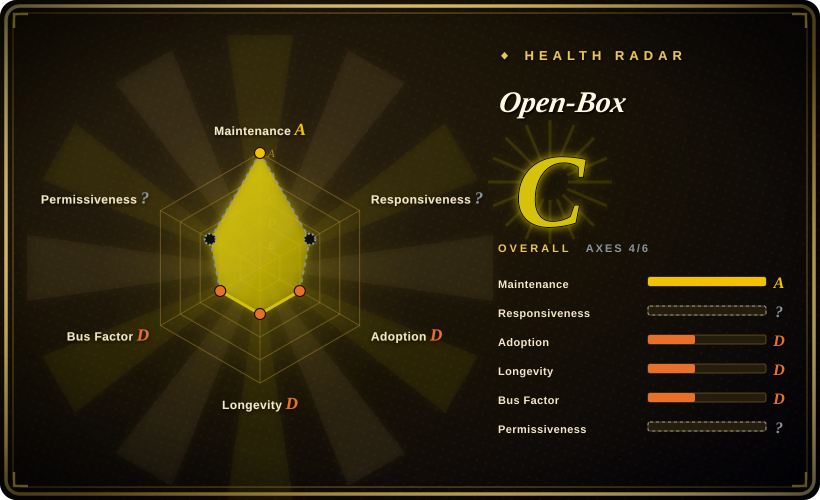
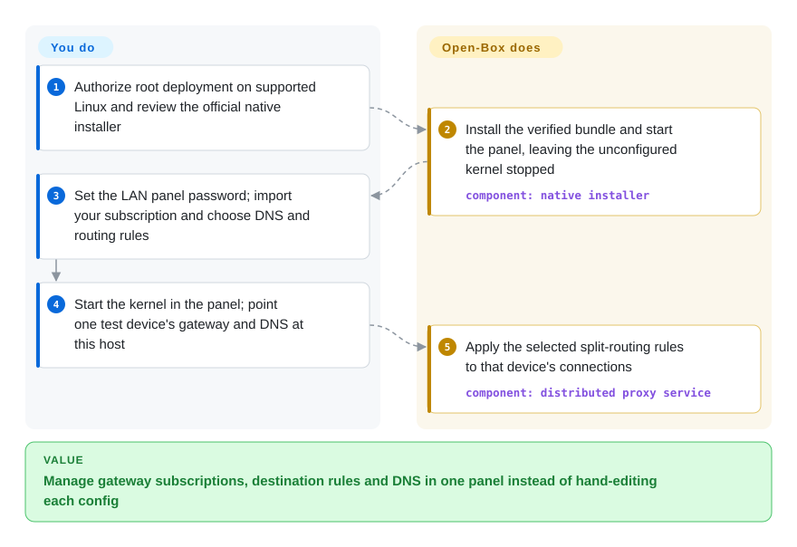
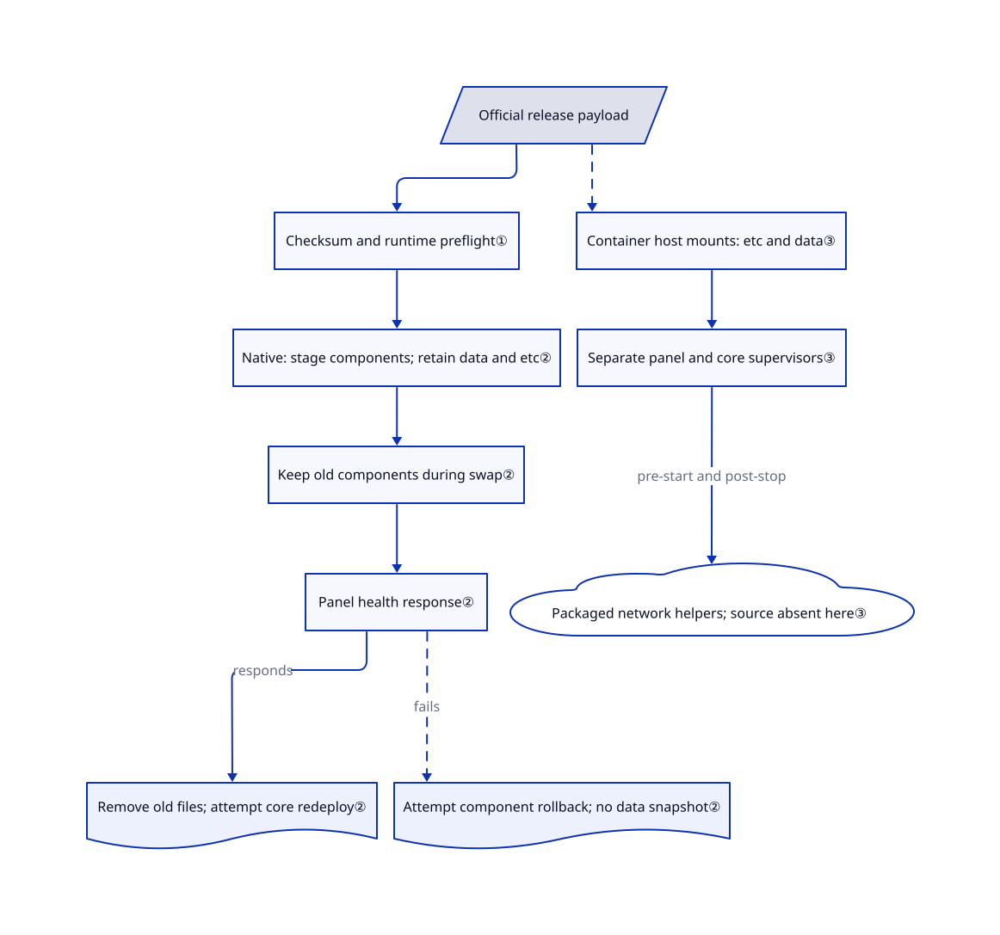

# Open-Box

Your router's subscriptions, DNS rules and phone profiles keep drifting apart. Open-Box puts them behind one browser panel and distributes paired client configurations, but its own application is proprietary.

> [!WARNING]
> **Proprietary software information exception, not an open-source recommendation.** The [license](https://github.com/liandu2024/Open-Box/blob/32b288000a923260f35ea995d65b3b58bcfd087e/LICENSE#L1-L43) permits personal-device installation, necessary local backups and deployment-script modification for your own installations. It does not grant general redistribution, repackaging or reverse-engineering rights. Third-party licenses and permissions already granted for earlier material remain intact. Root/network privileges, HTTP administration and unavailable application internals make deployment a separate trust decision. Nothing was installed or run for this page.

## When to use

You manage a home gateway on recent OpenWrt or a Debian/Ubuntu host. A subscription changes, and you now have to edit the router's DNS rules, node groups and each family device separately. You want a browser to manage subscriptions, destination rules and DNS, then pair the vendor's phone/desktop clients with that configuration. Open-Box supplies that integrated product; you supply proxy nodes, LAN addressing and the decision to trust its proprietary application.

Choose it over running sing-box alone only when the integrated panel, bundled runtime/Geo data and paired clients justify losing full application-source auditability. Choose [dae](../../networking/dae.md) when an inspectable Linux gateway configuration matters more than that product integration. The documented clients cover Android, Apple-silicon macOS, Windows and Linux; v0.1.359 has no public iOS IPA. These are documented product surfaces, not independently verified traffic behavior ([README](https://github.com/liandu2024/Open-Box/blob/32b288000a923260f35ea995d65b3b58bcfd087e/README.md#L6-L23), [release](https://github.com/liandu2024/Open-Box/releases/tag/v0.1.359)).

## When NOT to use

- **You must audit, fork or redistribute the complete gateway.** Use [sing-box](https://github.com/SagerNet/sing-box) directly or [dae](../../networking/dae.md), under their own licenses. Open-Box's public tree contains deployment and verification material, not its proprietary panel/configuration core; zashboard's MIT and sing-box's GPL do not license the whole product ([copyright scope](https://github.com/liandu2024/Open-Box/blob/32b288000a923260f35ea995d65b3b58bcfd087e/COPYRIGHT.md#L3-L14)).
- **You cannot grant network administration or expose a privileged HTTP panel even on a trusted LAN.** Prefer an IT-managed proxy or [Clash Verge Rev](clash-verge-rev.md) in explicit/System Proxy mode, without TUN. Native installation requires root; Docker still adds `NET_ADMIN`, `NET_RAW` and `/dev/net/tun`. The README says the panel runs as root over HTTP and stores a root-recoverable password. Do not expose it directly to the Internet ([security boundary](https://github.com/liandu2024/Open-Box/blob/32b288000a923260f35ea995d65b3b58bcfd087e/README.md#L159-L167)).
- **Your Docker gateway must capture IPv6 or run under Docker Desktop/rootless Docker.** Use a supported native sing-box deployment instead, after checking its routing requirements. Open-Box documents Linux Engine with macvlan/ipvlan L2 and IPv4-only capture; IPv6 goes through the main router. Stopping its kernel also stops container DNS ([limits](https://github.com/liandu2024/Open-Box/blob/32b288000a923260f35ea995d65b3b58bcfd087e/docker/README.md#L141-L158)).
- **You need a reliable current one-click Docker installer.** Prefer native deployment, or manually review/load the actual release image with the documented Compose settings. At this SHA, the installer constructs `open-box-v0.1.359-docker-linux-x64.tar.gz`, but v0.1.359 lists `open-box-docker-0.1.359-linux-x64.tar.gz`; the documented image/example defaults still reference 0.1.346. Do not assume this path works unchanged ([filename construction](https://github.com/liandu2024/Open-Box/blob/32b288000a923260f35ea995d65b3b58bcfd087e/docker/install.sh#L118-L129), [actual assets](https://github.com/liandu2024/Open-Box/releases/tag/v0.1.359)).
- **You require proven zero telemetry, no DNS leaks or complete rollback.** Prefer an inspectable sing-box deployment with your own egress and restore tests. The client privacy policy names public IP/region and latency services; its no-collection assertion is not a packet capture. Upgrade rollback preserves mutable data rather than snapshotting it, and uninstall delegates network restoration to packaged service scripts absent from this tree ([privacy](https://github.com/liandu2024/Open-Box/blob/32b288000a923260f35ea995d65b3b58bcfd087e/PRIVACY.md#L7-L20), [uninstall](https://github.com/liandu2024/Open-Box/blob/32b288000a923260f35ea995d65b3b58bcfd087e/scripts/uninstall.sh#L303-L340)).

## Comparison

| Alternative | In index | Our verdict | Tradeoff |
| --- | --- | --- | --- |
| [sing-box](https://github.com/SagerNet/sing-box) | not indexed | For a gateway whose proxy configuration and source you must control, choose sing-box directly; choose Open-Box only for its integrated panel and paired-client workflow. | You operate configuration, updates and platform integration yourself instead of accepting a proprietary application layer. Real repo not added in this batch. |
| [dae](../../networking/dae.md) | ✅ | For a Linux gateway where kernel-level direct forwarding and text-reviewed rules decide the choice, choose dae; choose Open-Box when browser administration and its matching clients decide it. | dae needs its supported BPF-enabled Linux kernel and its configuration language; it is not the same panel/client product. |
| [Clash Verge Rev](clash-verge-rev.md) | ✅ | For one Windows/macOS/Linux workstation with a Clash subscription, choose Clash Verge Rev; choose Open-Box for a headless LAN gateway managed through a browser. | A desktop GUI avoids running a shared web panel, but does not replace a router service; desktop TUN still needs privileges. |

## Quick start

After a separate deployment authorization, review the pinned [native installer](https://github.com/liandu2024/Open-Box/blob/32b288000a923260f35ea995d65b3b58bcfd087e/scripts/install.sh) and obtain the official architecture-matched release with its checksum. The documented native path runs that installer as root on supported OpenWrt or systemd Linux; it installs the application and starts the panel, not an unconfigured proxy kernel. Open the LAN-only HTTP panel, normally on port 3036, set its first-use password, and supply your subscription, node groups and DNS (name-to-address lookup)/routing choices. Start the kernel in the panel; for a side gateway, point one test device's gateway and DNS at the host before changing the wider LAN. The product applies the declared routes; you remain responsible for node costs, firewall access, recovery access and checking actual traffic. This is a source-reviewed usage path, not an installation or network test performed here ([usage](https://github.com/liandu2024/Open-Box/blob/32b288000a923260f35ea995d65b3b58bcfd087e/README.md#L133-L167)).

<!-- flow-steps:begin (generated from flows/open-box.json by tools/flow_card.py — do not edit) -->

Text version of the flow

1. **You**: Authorize root deployment on supported Linux and review the official native installer
2. **Open-Box**: Install the verified bundle and start the panel, leaving the unconfigured kernel stopped — component: `native installer`
3. **You**: Set the LAN panel password; import your subscription and choose DNS and routing rules
4. **You**: Start the kernel in the panel; point one test device's gateway and DNS at this host
5. **Open-Box**: Apply the selected split-routing rules to that device's connections — component: `distributed proxy service`

**Value**: Manage gateway subscriptions, destination rules and DNS in one panel instead of hand-editing each config

<!-- flow-steps:end -->

## Key techniques

<!-- mechanism:begin (generated from mechanisms/open-box.json by tools/mechanism_card.py; do not edit) -->

Text version of the mechanism

- Official release payload
- Checksum and runtime preflight①
- Native: stage components; retain data and etc②
- Keep old components during swap②
- Panel health response②
- Remove old files; attempt core redeploy②
- Attempt component rollback; no data snapshot②
- Container host mounts: etc and data③
- Separate panel and core supervisors③
- Packaged network helpers; source absent here③

- Official release payload → Checksum and runtime preflight①
- Checksum and runtime preflight① → Native: stage components; retain data and etc②
- Native: stage components; retain data and etc② → Keep old components during swap②
- Keep old components during swap② → Panel health response②
- Panel health response② → Remove old files; attempt core redeploy② (responds)
- Panel health response② → Attempt component rollback; no data snapshot② (fails) [optional/fallback]
- Official release payload → Container host mounts: etc and data③ [optional/fallback]
- Container host mounts: etc and data③ → Separate panel and core supervisors③
- Separate panel and core supervisors③ → Packaged network helpers; source absent here③ (pre-start and post-stop)

<!-- mechanism:end -->

### 1. Gate application payload installation on checksums and platform checks

- **Problem:** A large bundled runtime can fail on an old router or arrive incomplete through a mirror.
- **How:** The public installer checks architecture, storage and musl compatibility, reads a checksum before and after download, and permits at most three release-change rounds. It verifies the payload before unpacking, swaps in a checksum-checked glibc Node binary on systemd Linux, and tries an actual Node expression before installing services.
- **Limits:** Dependency package/module preparation happens earlier, so “nothing changed before verification” is not a whole-system guarantee. SHA256 is not a signature: checksums may fall back to the same mirror. The update-script refresh checks shell syntax/header, not a downloaded script's SHA256; review that trust path separately.
- **Source:** [Preflight and dependencies](https://github.com/liandu2024/Open-Box/blob/32b288000a923260f35ea995d65b3b58bcfd087e/scripts/install.sh#L326-L656), [checksum and runtime path](https://github.com/liandu2024/Open-Box/blob/32b288000a923260f35ea995d65b3b58bcfd087e/scripts/install.sh#L1003-L1179), [script refresh](https://github.com/liandu2024/Open-Box/blob/32b288000a923260f35ea995d65b3b58bcfd087e/scripts/update.sh#L1357-L1429).

### 2. Stage replacement components, then keep old files until panel health responds

- **Problem:** Stopping a working gateway before downloading its replacement can remove the network needed for that download.
- **How:** The updater keeps an already-running kernel available through its loopback proxy while fetching. After payload/version/runtime checks, it stops services, moves old components to `.old`, swaps in staged components and waits for the panel's health response. File-swap or panel-start failure invokes component rollback; successful panel health removes the old components and attempts to redeploy a previously running kernel.
- **Limits:** This is not a transaction over the entire system: `data` and `etc` remain in place, database migrations are not snapshotted, and kernel restart failure can leave the panel running without working routing. Later `--rollback` downloads a prior release rather than using a retained local backup. Power-loss recovery and traffic continuity were not tested here.
- **Source:** [Fetch and stop boundary](https://github.com/liandu2024/Open-Box/blob/32b288000a923260f35ea995d65b3b58bcfd087e/scripts/update.sh#L456-L549), [staging and swapping](https://github.com/liandu2024/Open-Box/blob/32b288000a923260f35ea995d65b3b58bcfd087e/scripts/update.sh#L1951-L2195), [health and old-file removal](https://github.com/liandu2024/Open-Box/blob/32b288000a923260f35ea995d65b3b58bcfd087e/scripts/update.sh#L2298-L2319).

### 3. Separate container lifecycle from persistent configuration and core supervision

- **Problem:** Replacing a container should not discard subscriptions or couple every panel restart to the forwarding process.
- **How:** Compose binds `etc` and `data` to the host and grants explicit network capabilities. The entrypoint validates TUN/forwarding settings, attempts an nftables masquerade table and restarts the panel independently. A separate shell supervisor launches sing-box and delegates network setup/cleanup to packaged Debian helpers. The installer labels containers by install directory and attempts to restore the previous container/IP after a failed replacement.
- **Limits:** Those packaged network helpers and proprietary application internals are not public at this SHA. An HTTP health check does not prove DNS/traffic correctness, and neither container deletion nor native `--purge` removes external backups, installed system packages, Docker images/networks or client-side gateway choices.
- **Source:** [Compose contract](https://github.com/liandu2024/Open-Box/blob/32b288000a923260f35ea995d65b3b58bcfd087e/docker/compose.yaml#L1-L38), [entrypoint](https://github.com/liandu2024/Open-Box/blob/32b288000a923260f35ea995d65b3b58bcfd087e/docker/bin/entrypoint#L1-L64), [core supervisor](https://github.com/liandu2024/Open-Box/blob/32b288000a923260f35ea995d65b3b58bcfd087e/docker/bin/openbox-ctl#L1-L70), [replacement rollback](https://github.com/liandu2024/Open-Box/blob/32b288000a923260f35ea995d65b3b58bcfd087e/docker/install.sh#L81-L109).

## Tech stack

- **Visible implementation:** POSIX shell deployment/lifecycle scripts, Docker Compose and an Alpine 3.23 image definition using tini, nftables and logrotate. GitHub's Shell language describes this public distribution tree, not the entire product.
- **Distributed runtime:** the v0.1.359 [x64 component manifest](https://github.com/liandu2024/Open-Box/releases/download/v0.1.359/open-box-v0.1.359-linux-x64-components.json) lists Node 24.18.0, `1.14.1-openbox-tcp30` sing-box, application and Geo payloads. The build wrapper checks a Go-native core/ESM manifest; it does not publish that core's source ([wrapper](https://github.com/liandu2024/Open-Box/blob/32b288000a923260f35ea995d65b3b58bcfd087e/scripts/build-docker.sh#L20-L36)).
- **Storage/UI:** scripts identify `data/openbox.sqlite` and `etc/config.json`. COPYRIGHT identifies zashboard-derived frontend material under its original MIT notice. Product-internal parsing, routing and security algorithms were not inferred from screenshots or documentation.

## Dependencies

- Native: x86_64/aarch64, recent OpenWrt with musl 1.2.4+ or Debian/Ubuntu with systemd; the README requires 512 MB storage and 512 MB nominal RAM. The installer checks 512 MiB free storage and `MemTotal >= 450000` KiB, not a workload capacity guarantee.
- TUN, nftables and routing support; OpenWrt dependency preparation includes tun/queue/NAT/veth modules, `ip-full` and certificates. Linux adds nftables/xz and downloads a glibc Node runtime from nodejs.org or npmmirror. Missing dependencies can warn without aborting.
- Docker: Linux Engine, x64/arm64, macvlan or ipvlan L2, an unused LAN IPv4 address outside DHCP, `NET_ADMIN`, `NET_RAW` and TUN. No Docker socket or full `privileged` flag is requested, but this is still a network-administration workload.
- Your proxy nodes/subscriptions and reachable update sources. Client region detection and latency tests contact the services named in the [client privacy policy](https://github.com/liandu2024/Open-Box/blob/32b288000a923260f35ea995d65b3b58bcfd087e/PRIVACY.md#L11-L20); self-hosting does not mean no external requests.

## Ops difficulty

**High for a trusted network boundary, despite a graphical setup.** Keep the root HTTP panel LAN-only, provide an independent recovery connection, and account for firewall, DNS, route and forwarding changes. Native upgrades preserve subscriptions/passwords; they are not backups. The documented export/import omits the panel password and offers selectable data, so it is not a full system image ([export scope](https://github.com/liandu2024/Open-Box/blob/32b288000a923260f35ea995d65b3b58bcfd087e/README.md#L109-L117)).

Native uninstall stops/disables services, removes named UCI firewall rules, service files, LuCI files and program files, but defaults to retaining `data`; `--purge` or an explicit interactive answer removes it. Service-stop errors are ignored and DNS/routing restoration depends on bundled helpers, so successful script exit does not prove full restoration. No removal of packages installed earlier appears in that script. For Docker, preserve both host mounts for recovery; removing a container leaves those mounts, loaded images and its network. If retiring the gateway, restore clients' gateway/DNS to the main router before stopping it ([uninstall](https://github.com/liandu2024/Open-Box/blob/32b288000a923260f35ea995d65b3b58bcfd087e/scripts/uninstall.sh#L303-L420), [Docker limits](https://github.com/liandu2024/Open-Box/blob/32b288000a923260f35ea995d65b3b58bcfd087e/docker/README.md#L147-L154)). No installation, traffic, privacy or restoration test was performed for this page.

## Health & viability

- **Maintenance, 2026-10-25:** unarchived; latest v0.1.359 was published 2026-10-24, with five releases on that date in the sampled release list. Frequent fixes show activity, not a stability guarantee.
- **Governance/backing:** the public repository is owned by an individual. Its contributors endpoint returns one author with one public commit; proprietary development happens outside this tree, so that endpoint cannot establish the internal team's bus factor. No governance/foundation commitment is established by the reviewed materials.
- **Age/Lindy:** created 2026-08-16, only about 70 days old at verification. The short active history and proprietary core make it a trial candidate, not a long-lived infrastructure bet. [推断：based on repository age, active releases and the proprietary source boundary]
- **Adoption:** 2,314 stars and 434 forks are dated GitHub attention signals, not verified deployments. Published verification reports are the author's evidence, not independent acceptance tests; the release-verification guide explicitly says private-source tests do not run on hosted CI ([guide](https://github.com/liandu2024/Open-Box/blob/32b288000a923260f35ea995d65b3b58bcfd087e/scripts/release-verify/README.md#L1-L12)).
- **Decisive risk:** GitHub detects the root license as `NOASSERTION`; the unchanged standard scorer reports `risk_license: ?` with `license_unparsed`, not a permissive license. Responsiveness is also unknown because its scoring window has no qualifying signal. Only 4/6 radar axes are measured; that aggregate does not override this page's source-read proprietary identifier, product redistribution restrictions or unavailable internal implementation.

## Caveats (unverified)

- [未验证：public source/document review only; no installation or proxy traffic test] Split-routing correctness, DNS-leak prevention, throughput, resource capacity and failover behavior were not reproduced. Promotional performance claims are not selection evidence.
- [未验证：proprietary application source unavailable; no packet capture or privacy audit] The client policy's no-collection assertion and password/account-handling claims were not independently established. The policy explicitly discloses public IP/region, latency and subscription requests; it is not a complete router data-retention audit.
- [未验证：no upgrade, uninstall or failure-recovery execution] Database downgrade compatibility, full DNS/firewall/routing restoration, and absence of residual files are not proven. The source confirms default data retention and delegates network cleanup to packaged helpers unavailable in this public tree.
- [未验证：release binaries/source archives were not downloaded or unpacked] Release listings and component manifests exist, but their complete third-party notice/source correspondence and binary reproducibility were not audited. Existing third-party/earlier-version rights must be checked per artifact, not replaced with the proprietary root label.
- [推断：based on a roughly seventy-day history, individual ownership and public source scope] Long-term sustainability and internal maintainer redundancy cannot be inferred from frequent releases or stars.
