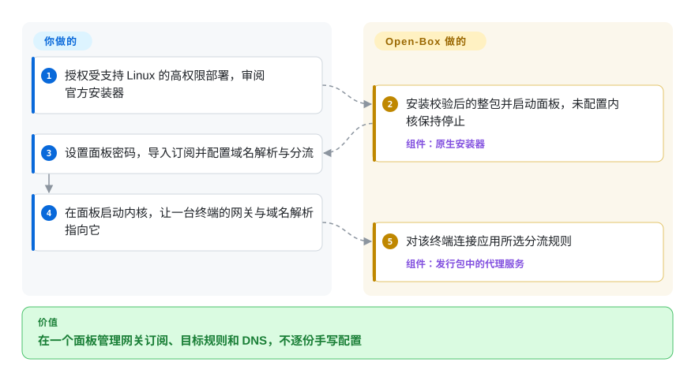
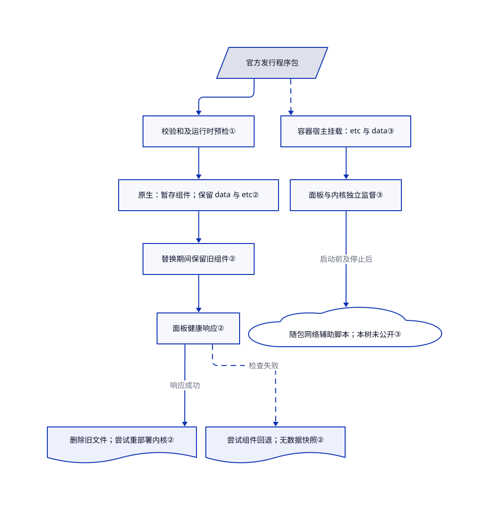

# Open-Box

路由器刚改完分流，手机配置又落后一版。Open-Box 用一个浏览器面板管理订阅、DNS 与配对客户端，但自有程序是专有软件。

> [!WARNING]
> **本页是专有软件信息例外，不是开源推荐。** [许可证](https://github.com/liandu2024/Open-Box/blob/32b288000a923260f35ea995d65b3b58bcfd087e/LICENSE#L1-L43)允许在自有设备安装、制作必要本地备份，并为自己的部署修改公开脚本，不授予一般再分发、重新打包或逆向权利。第三方原许可和早期材料已经授予的权利不撤销。部署需要单独信任其高网络权限、HTTP 管理入口和不可见自有实现。本页没有安装或运行产品。

## 何时使用

你管理家里的网关，设备是较新的 OpenWrt 或 Debian／Ubuntu 主机。订阅刚更新，你就得分别修改路由器的 DNS、节点组和家人设备的配置。你希望通过浏览器维护订阅、目标分流和 DNS，再把配置配对给同厂手机／桌面客户端。Open-Box 提供这一体化产品；节点、局域网地址和是否信任专有程序，仍由你负责。

只有集成面板、随包运行时／Geo 数据与配对客户端的便利，值得牺牲完整应用源码可审计性时，才选它而不是单独运行 sing-box。如果更看重可审查的 Linux 网关配置，选 [dae](../../networking/dae.zh.md)。文档列出 Android、Apple 芯片 macOS、Windows 和 Linux 客户端；v0.1.359 没有公开 iOS IPA。这些是文档可见产品能力，不是本页独立验证的流量行为（[产品说明](https://github.com/liandu2024/Open-Box/blob/32b288000a923260f35ea995d65b3b58bcfd087e/README.md#L6-L23)、[发行版](https://github.com/liandu2024/Open-Box/releases/tag/v0.1.359)）。

## 何时不用

- **必须审计、分叉或再分发完整网关。** 选 [sing-box](https://github.com/SagerNet/sing-box) 本体或 [dae](../../networking/dae.zh.md)，按各自许可处理。Open-Box 的公开树提供部署与验证材料，不提供专有面板／配置核心；zashboard 的 MIT 和 sing-box 的 GPL 不能替整包授权（[版权范围](https://github.com/liandu2024/Open-Box/blob/32b288000a923260f35ea995d65b3b58bcfd087e/COPYRIGHT.md#L3-L14)）。
- **不能授予网络管理权限，也不能在可信局域网运行高权限 HTTP 面板。** 选单位管理的代理，或 [Clash Verge Rev](clash-verge-rev.zh.md) 的显式／系统代理模式，不启用 TUN。原生安装要求 root；Docker 仍要求 `NET_ADMIN`、`NET_RAW` 和 `/dev/net/tun`。README 明说面板以 root 运行、使用 HTTP，并保存 root 可找回的密码。不要直接暴露公网（[安全边界](https://github.com/liandu2024/Open-Box/blob/32b288000a923260f35ea995d65b3b58bcfd087e/README.md#L159-L167)）。
- **Docker 网关必须接管 IPv6，或运行在 Docker Desktop／rootless Docker。** 改用受支持的原生 sing-box 部署，并另核对路由要求。Open-Box 文档只支持 Linux Engine 的 macvlan／ipvlan L2，仅接管 IPv4，IPv6 走主路由。停止其内核也会停止容器 DNS（[容器限制](https://github.com/liandu2024/Open-Box/blob/32b288000a923260f35ea995d65b3b58bcfd087e/docker/README.md#L141-L158)）。
- **需要当前版本可靠的一键 Docker 安装。** 优先考虑原生部署，或核对真实发行镜像后手动加载，再使用文档的 Compose 配置。此 SHA 的安装器会拼出 `open-box-v0.1.359-docker-linux-x64.tar.gz`，但 v0.1.359 的真实资产是 `open-box-docker-0.1.359-linux-x64.tar.gz`；镜像示例默认值仍是 0.1.346。不能照搬并假定可用（[文件名拼接](https://github.com/liandu2024/Open-Box/blob/32b288000a923260f35ea995d65b3b58bcfd087e/docker/install.sh#L118-L129)、[真实资产](https://github.com/liandu2024/Open-Box/releases/tag/v0.1.359)）。
- **必须证明零遥测、无 DNS 泄露或完整回滚。** 选源码可检查的 sing-box 部署，并自行验收出站流量和恢复。客户端隐私政策列了公网 IP／地区查询及测速服务；“不收集”不是抓包结果。升级回退保留可变数据而非快照，卸载把网络恢复委托给公开树缺少的随包服务脚本（[隐私声明](https://github.com/liandu2024/Open-Box/blob/32b288000a923260f35ea995d65b3b58bcfd087e/PRIVACY.md#L7-L20)、[卸载路径](https://github.com/liandu2024/Open-Box/blob/32b288000a923260f35ea995d65b3b58bcfd087e/scripts/uninstall.sh#L303-L340)）。

## 横向对比

| 替代品 | 是否收录 | 我们的评价 | 取舍 |
| --- | --- | --- | --- |
| [sing-box](https://github.com/SagerNet/sing-box) | 未收录 | 网关配置和源码必须自己掌控时，直接选 sing-box；只有一体化面板与配对客户端决定选择时才选 Open-Box。 | 配置、升级和平台整合都由自己承担，换掉不可审计的专有应用层。真实仓库，本批不扩收。 |
| [dae](../../networking/dae.zh.md) | 已收录 | Linux 网关更看重内核直连转发和文本规则审查时选 dae；浏览器管理与同厂客户端更重要时选 Open-Box。 | dae 需要支持 BPF 的 Linux 内核和专门配置语言，不提供同一套面板／客户端产品。 |
| [Clash Verge Rev](clash-verge-rev.zh.md) | 已收录 | 一台 Windows／macOS／Linux 工作站使用 Clash 订阅时选 Clash Verge Rev；无头局域网网关需要浏览器管理时再选 Open-Box。 | 桌面界面不必运行共享网页面板，但不能替代路由器服务；桌面 TUN 同样需要高权限。 |

## 快速上手

单独获得部署授权后，先审阅固定版本的[原生安装器](https://github.com/liandu2024/Open-Box/blob/32b288000a923260f35ea995d65b3b58bcfd087e/scripts/install.sh)，取得架构匹配的官方包与校验文件。文档路径是在受支持的 OpenWrt 或 systemd Linux 上，以 root 运行安装器；它安装程序并启动面板，不启动尚未配置的代理内核。通过局域网访问 HTTP 面板，通常是 3036 端口，首次设置密码，再填写订阅、节点组、DNS（域名解析）与分流规则。在面板启动内核；作为旁路由时，先只让一台测试终端把网关和 DNS 指向该主机，不立即改变全网。产品按声明的规则处理流量；节点费用、防火墙放行、救援连接与真实流量验收仍由你承担。这是源码阅读确认的使用路径，本页没有执行安装或网络测试（[部署说明](https://github.com/liandu2024/Open-Box/blob/32b288000a923260f35ea995d65b3b58bcfd087e/README.md#L133-L167)）。

<!-- flow-steps:begin (generated from flows/open-box.json by tools/flow_card.py — do not edit) -->

流程文字版

1. **你**：授权受支持 Linux 的高权限部署，审阅官方安装器
2. **Open-Box**：安装校验后的整包并启动面板，未配置内核保持停止 — 组件：`原生安装器`
3. **你**：设置面板密码，导入订阅并配置域名解析与分流
4. **你**：在面板启动内核，让一台终端的网关与域名解析指向它
5. **Open-Box**：对该终端连接应用所选分流规则 — 组件：`发行包中的代理服务`

**价值**：在一个面板管理网关订阅、目标规则和 DNS，不逐份手写配置

<!-- flow-steps:end -->

## 技术要点

<!-- mechanism:begin (generated from mechanisms/open-box.json by tools/mechanism_card.py; do not edit) -->

机制文字版

- 官方发行程序包
- 校验和及运行时预检①
- 原生：暂存组件；保留 data 与 etc②
- 替换期间保留旧组件②
- 面板健康响应②
- 删除旧文件；尝试重部署内核②
- 尝试组件回退；无数据快照②
- 容器宿主挂载：etc 与 data③
- 面板与内核独立监督③
- 随包网络辅助脚本；本树未公开③

- 官方发行程序包 → 校验和及运行时预检①
- 校验和及运行时预检① → 原生：暂存组件；保留 data 与 etc②
- 原生：暂存组件；保留 data 与 etc② → 替换期间保留旧组件②
- 替换期间保留旧组件② → 面板健康响应②
- 面板健康响应② → 删除旧文件；尝试重部署内核②（响应成功）
- 面板健康响应② → 尝试组件回退；无数据快照②（检查失败）〔可选／兜底〕
- 官方发行程序包 → 容器宿主挂载：etc 与 data③〔可选／兜底〕
- 容器宿主挂载：etc 与 data③ → 面板与内核独立监督③
- 面板与内核独立监督③ → 随包网络辅助脚本；本树未公开③（启动前及停止后）

<!-- mechanism:end -->

### 1. 用校验和与平台检查约束程序包安装

- **解决：** 大型随包运行时可能不兼容旧路由器，也可能经镜像下载不完整。
- **做法：** 公开安装器检查架构、存储和 musl 兼容性，在正文下载前后分别取校验和，跨发行变化最多重取三轮。校验通过才解包；systemd Linux 换入校验过的 glibc Node，并实际执行一句 Node 表达式后再铺服务。
- **边界：** 依赖安装和模块准备更早执行，因此“校验前无改动”不适用于整个系统。SHA256 不是签名，校验文件可能回退到同一镜像。升级脚本刷新只核对头部与语法，不核对所下载脚本的 SHA256；这条信任路径需要单独审查。
- **源码：** [预检与依赖](https://github.com/liandu2024/Open-Box/blob/32b288000a923260f35ea995d65b3b58bcfd087e/scripts/install.sh#L326-L656)、[校验与运行时](https://github.com/liandu2024/Open-Box/blob/32b288000a923260f35ea995d65b3b58bcfd087e/scripts/install.sh#L1003-L1179)、[脚本刷新](https://github.com/liandu2024/Open-Box/blob/32b288000a923260f35ea995d65b3b58bcfd087e/scripts/update.sh#L1357-L1429)。

### 2. 先暂存新组件，面板健康响应后才删除旧文件

- **解决：** 还没下载替代版本就停掉正常网关，可能把下载所需的网络也切断。
- **做法：** 更新器下载时保留已运行内核，经回环代理获取内容。包、版本与运行时检查通过后，才停服务，把旧组件移至 `.old`，换入暂存组件并等待面板健康响应。换文件或面板启动失败时调用组件回退；面板健康后删除旧组件，再尝试重新部署原先运行的内核。
- **边界：** 这不是覆盖全系统的事务；`data` 与 `etc` 原地保留，数据库迁移没有快照，内核重启失败时可能只有面板可用而路由不可用。事后 `--rollback` 重新下载旧发行版，不使用持久保存的本地备份。本页没有断电恢复或流量连续性实测。
- **源码：** [下载与停核边界](https://github.com/liandu2024/Open-Box/blob/32b288000a923260f35ea995d65b3b58bcfd087e/scripts/update.sh#L456-L549)、[暂存与替换](https://github.com/liandu2024/Open-Box/blob/32b288000a923260f35ea995d65b3b58bcfd087e/scripts/update.sh#L1951-L2195)、[健康检查与删除旧文件](https://github.com/liandu2024/Open-Box/blob/32b288000a923260f35ea995d65b3b58bcfd087e/scripts/update.sh#L2298-L2319)。

### 3. 把容器生命周期、持久配置与内核监督分开

- **解决：** 更换容器不应丢失订阅，面板重启也不应直接绑定转发进程生命周期。
- **做法：** Compose 把 `etc` 和 `data` 挂到宿主，显式授予网络能力。入口脚本校验 TUN／转发设置，尝试建立 nftables 地址伪装表，并单独重启面板。另一个 shell 监督进程启动 sing-box，把网络准备与清理交给随包 Debian 辅助脚本。安装器按安装目录给容器打标签，更换失败时尝试恢复旧容器和静态 IP。
- **边界：** 此 SHA 没有公开随包网络辅助脚本或专有应用实现。HTTP 健康响应不能证明 DNS／流量正确；删除容器或原生 `--purge` 也不会删除外部备份、此前安装的系统包、Docker 镜像／网络，或终端的网关设置。
- **源码：** [Compose 合同](https://github.com/liandu2024/Open-Box/blob/32b288000a923260f35ea995d65b3b58bcfd087e/docker/compose.yaml#L1-L38)、[入口脚本](https://github.com/liandu2024/Open-Box/blob/32b288000a923260f35ea995d65b3b58bcfd087e/docker/bin/entrypoint#L1-L64)、[内核监督](https://github.com/liandu2024/Open-Box/blob/32b288000a923260f35ea995d65b3b58bcfd087e/docker/bin/openbox-ctl#L1-L70)、[更换回退](https://github.com/liandu2024/Open-Box/blob/32b288000a923260f35ea995d65b3b58bcfd087e/docker/install.sh#L81-L109)。

## 技术栈

- **可见实现：** POSIX shell 部署／生命周期脚本、Docker Compose，以及使用 tini、nftables 和 logrotate 的 Alpine 3.23 镜像定义。GitHub 的 Shell 主语言描述的是公开发行树，不是完整产品。
- **发行运行时：** v0.1.359 的 [x64 组件清单](https://github.com/liandu2024/Open-Box/releases/download/v0.1.359/open-box-v0.1.359-linux-x64-components.json)列出 Node 24.18.0、`1.14.1-openbox-tcp30` sing-box、应用和 Geo 包。构建包装脚本核对 Go 原生核心／ESM 清单，但没有公开该核心源码（[包装检查](https://github.com/liandu2024/Open-Box/blob/32b288000a923260f35ea995d65b3b58bcfd087e/scripts/build-docker.sh#L20-L36)）。
- **存储与界面：** 脚本标出 `data/openbox.sqlite` 和 `etc/config.json`；版权文件说明前端含 zashboard 衍生材料，保留原 MIT 声明。没有根据截图或使用文档猜测产品内部解析、分流和安全算法。

## 依赖

- 原生环境为 x86_64／aarch64、musl 1.2.4 以上的较新 OpenWrt，或带 systemd 的 Debian／Ubuntu。README 要求 512 MB 存储和标称 512 MB 内存；安装器检查 512 MiB 可用存储及 `MemTotal >= 450000` KiB，并非工作负载容量保证。
- TUN、nftables 与路由支持。OpenWrt 依赖准备包括 tun／queue／NAT／veth 模块、`ip-full` 和证书；Linux 另需 nftables／xz，并从 nodejs.org 或 npmmirror 取 glibc Node。缺依赖可能只警告而不退出。
- Docker 需要 Linux Engine、x64／arm64、macvlan 或 ipvlan L2、DHCP 池外未占用的 LAN IPv4 地址，以及 `NET_ADMIN`、`NET_RAW` 和 TUN。配置不要求 Docker socket 或完整 `privileged`，但仍是网络管理工作负载。
- 自备代理节点／订阅和可访问的更新来源。客户端地区判断与测速会访问[隐私政策](https://github.com/liandu2024/Open-Box/blob/32b288000a923260f35ea995d65b3b58bcfd087e/PRIVACY.md#L11-L20)列出的外部服务；自托管不等于不发外部请求。

## 运维难度

**高，尽管初始操作图形化。** 这是可信网络边界，应把 root HTTP 面板限制在局域网，留独立救援连接，并考虑防火墙、DNS、路由和转发状态变化。原生升级保留订阅／密码，不等于备份。文档的导入导出不含面板密码，部分数据可选，也不是完整系统镜像（[导出范围](https://github.com/liandu2024/Open-Box/blob/32b288000a923260f35ea995d65b3b58bcfd087e/README.md#L109-L117)）。

原生卸载停止并禁用服务，删除具名 UCI 防火墙规则、服务文件、LuCI 文件和程序，默认保留 `data`；`--purge` 或交互明确回答才删除数据。停服务报错被忽略，DNS／路由恢复依赖随包辅助脚本，所以退出成功也不能证明完全恢复。卸载脚本没有删除此前安装依赖包的步骤。Docker 恢复要保留两个宿主挂载目录；删除容器不会一并删除挂载数据、已加载镜像和网络。退役前先把终端网关／DNS 指回主路由，再停服务（[卸载实现](https://github.com/liandu2024/Open-Box/blob/32b288000a923260f35ea995d65b3b58bcfd087e/scripts/uninstall.sh#L303-L420)、[Docker 边界](https://github.com/liandu2024/Open-Box/blob/32b288000a923260f35ea995d65b3b58bcfd087e/docker/README.md#L147-L154)）。本页没有安装、流量、隐私或恢复实测。

## 健康度与可持续性

- **维护，2026-10-25：** 未归档，最新 v0.1.359 发布于 2026-10-24；抽取的五个发行版都发布在同一天。频繁修复证明活跃，不证明稳定。
- **治理与支持：** 公开仓库由个人账户持有，贡献者接口只返回一名作者和一个公开提交；专有开发在该树之外，因此不能用此接口断言内部团队的巴士系数。已读材料不能确立基金会或正式治理承诺。
- **仓龄与 Lindy：** 2026-08-16 建仓，核验时仅约七十天。活跃历史短，核心又专有，更适合试用，不宜当成长寿命基础设施押注。[推断：依据是建仓时间、活跃发行记录和专有源码边界]
- **采用信号：** GitHub 的 2,314 星和 434 fork 是有日期的关注量，不是已核实部署。公开验收报告来自作者，不是独立验收；发布验证文档明确说私有源码测试不在托管 CI 运行（[说明](https://github.com/liandu2024/Open-Box/blob/32b288000a923260f35ea995d65b3b58bcfd087e/scripts/release-verify/README.md#L1-L12)）。
- **决定性风险：** GitHub 根许可检测为 `NOASSERTION`，标准评分器原样给出 `risk_license: ?`，原因是 `license_unparsed`，不是宽松许可。响应轴也因计分窗口无合格信号而未知。雷达只测得 4/6 轴，综合分不能覆盖本页读正文确认的专有标识、再分发限制或自有实现不可见的问题。

## 存疑（未验证）

- [未验证：只读公开源码与文档，未安装或发出代理测试流量] 未复现分流正确性、DNS 防泄露、吞吐、资源容量或故障切换。宣传性能不作为选型证据。
- [未验证：自有应用源码不可见，未做抓包或隐私审计] 未独立确认客户端“不收集”及密码／账户处理声明。政策明确披露公网 IP／地区、测速与订阅请求，不能替代路由器全量数据留存审计。
- [未验证：未运行升级、卸载或故障恢复] 数据库降级兼容、DNS／防火墙／路由完全恢复及无残留尚无证明。源码能确认默认保留数据，并把网络清理委托给公开树缺少的随包辅助脚本。
- [未验证：未下载或解包发行二进制及源码附件] 已看到发行资产和组件清单，但未审计所有第三方声明／对应源码是否完整，或二进制能否复现。第三方与早版权利须按具体材料核验，不能以专有根标识覆盖。
- [推断：依据是约七十天仓龄、个人账户持有和公开源码范围] 频繁发版或星数不足以证明长期可持续性及内部维护者冗余。
