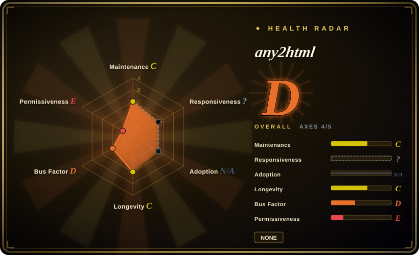
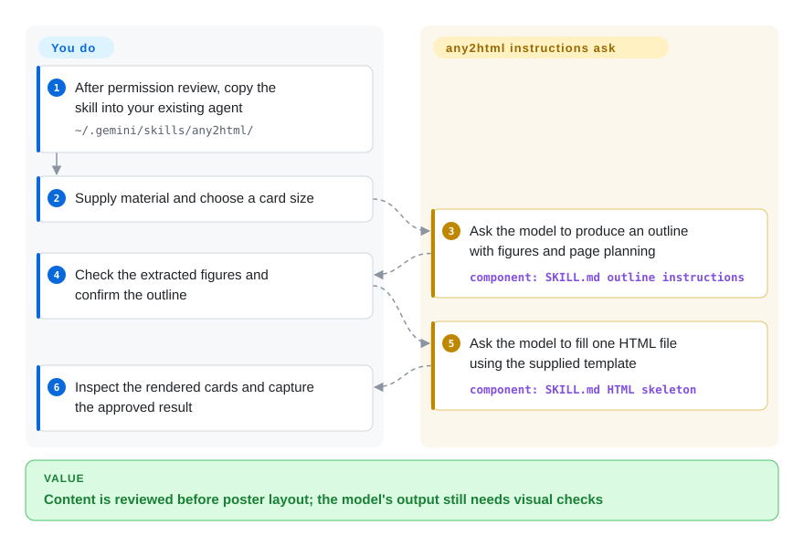

# any2html

Your long article or comparison table will not fit into a readable social-media card. any2html gives an agent an outline-review workflow and a fixed retro HTML template, so you can approve the content before it lays out the cards.

## When to use

You are turning a Chinese article with several numeric comparisons into Xiaohongshu cards or an article illustration, and a one-shot design prompt keeps dropping figures to fit one page. Choose this small skill when you want a specific retro palette and an outline approval checkpoint before HTML generation, rather than a general content-production bundle or a web slide deck. It is Markdown instructions for an existing agent, not a document-parser framework or an independent renderer.

## When NOT to use

- **You need confirmed reuse/distribution permission.** Obtain permission from the author or choose [Frontend Slides](../agent-skills/slides-ppt/frontend-slides.md) for a licensed web-deck workflow. This repo has no license file or declared grant; public readability is not an open-source reuse license.
- **You need guaranteed pagination, non-clipping output or reproducible print builds.** Choose [Typst](../typesetting/typst.md) and a reviewed template. Here the model estimates capacity; fixed height and `overflow:hidden` can hide mistakes rather than validate them.
- **You need interactive presentation slides.** Choose Frontend Slides; this skill targets screenshot-ready static posters, not presentation navigation.
- **Charts must follow one unambiguous rule.** Use your own reviewed chart template or a broader [Baoyu Skills](../agent-skills/ai-writing/content-production/baoyu-skills.md) workflow. SKILL requires ECharts in its planning/generation sections but forbids adding ECharts at the end; resolve this conflict explicitly before use.
- **Material must stay offline.** Use local text and a locally controlled model/browser/font setup instead. URL handling proposes third-party fetch services, and the HTML skeleton loads Tailwind and Google Fonts from remote hosts.

## Comparison

| Alternative | In index | Our verdict | Tradeoff |
|---|---|---|---|
| [Frontend Slides](../agent-skills/slides-ppt/frontend-slides.md) | ✅ | Choose it for browser presentations and visual direction previews; choose any2html only for its narrow retro poster workflow after resolving licensing. | Deck navigation and preview selection versus fixed poster dimensions and outline approval. |
| [Baoyu Skills](../agent-skills/ai-writing/content-production/baoyu-skills.md) | ✅ | Choose Baoyu for a broader translate/format/publish chain; choose any2html when you only need this card template and accept its permission gap. | More workflows and helper surface versus one small opinionated Markdown skill. |
| [Typst](../typesetting/typst.md) | ✅ | Choose Typst for reproducible typeset output from reviewed source; choose any2html for model-led content selection and editable HTML card drafts. | A layout compiler versus agent-generated HTML; neither automatically verifies the original article's claims. |

## Quick start

The [README installation section](https://github.com/blockpanda/any2html/blob/4aac2a1eda45e30a951ba112cd2e28d75a2010fd/README.md#L76-L81) copies the repository into an existing agent's skill directory, for example `~/.gemini/skills/any2html/`; obtain reuse permission before adopting it. Give the agent your text/table or URL, ask it to use any2html, and specify vertical, horizontal or illustration dimensions. The instructions ask it to return an outline with figures and page/chart planning, then wait for your confirmation before generating one HTML file. You supply the model/tool environment, review the figures and rendered card boundaries, replace the baked-in branding, and capture the result yourself. Model usage and optional external fetching/browser resources belong to that environment; this repository supplies no runtime or screenshot exporter. Its proposed automatic browser opening and ECharts contradiction require your explicit handling, not blind execution of the skill text.

<!-- flow-steps:begin (generated from flows/any2html.json by tools/flow_card.py — do not edit) -->

Text version of the flow

1. **You**: After permission review, copy the skill into your existing agent — `~/.gemini/skills/any2html/`
2. **You**: Supply material and choose a card size
3. **any2html**: Ask the model to produce an outline with figures and page planning — component: `SKILL.md outline instructions`
4. **You**: Check the extracted figures and confirm the outline
5. **any2html**: Ask the model to fill one HTML file using the supplied template — component: `SKILL.md HTML skeleton`
6. **You**: Inspect the rendered cards and capture the approved result

**Value**: Content is reviewed before poster layout; the model's output still needs visual checks

<!-- flow-steps:end -->

## Key techniques

- **Separate content approval from layout.** [`SKILL.md:40–84`](https://github.com/blockpanda/any2html/blob/4aac2a1eda45e30a951ba112cd2e28d75a2010fd/SKILL.md#L40-L84) instructs the model to preserve figures, estimate modules/pages and output a fixed outline before stopping for confirmation. This makes omission review possible before design, but it is a prompt-level instruction, not an enforced execution gate.
- **Plan around three explicit canvases.** [`SKILL.md:17–23`](https://github.com/blockpanda/any2html/blob/4aac2a1eda45e30a951ba112cd2e28d75a2010fd/SKILL.md#L17-L23) distinguishes vertical multi-card, growing horizontal and fixed illustration layouts; [`SKILL.md:97–107`](https://github.com/blockpanda/any2html/blob/4aac2a1eda45e30a951ba112cd2e28d75a2010fd/SKILL.md#L97-L107) prescribes page breaks and spacing. Model estimates are not pixel measurements, so manual rendering inspection remains necessary.
- **Constrain output with a supplied HTML skeleton.** [`SKILL.md:131–174`](https://github.com/blockpanda/any2html/blob/4aac2a1eda45e30a951ba112cd2e28d75a2010fd/SKILL.md#L131-L174) provides font, palette, flex layout and fixed dimensions, with remote Tailwind/fonts and hidden overflow. It reduces design choices but cannot certify visible content. The ECharts requirements at [`SKILL.md:91–96`](https://github.com/blockpanda/any2html/blob/4aac2a1eda45e30a951ba112cd2e28d75a2010fd/SKILL.md#L91-L96) conflict with the prohibition at [`SKILL.md:240–245`](https://github.com/blockpanda/any2html/blob/4aac2a1eda45e30a951ba112cd2e28d75a2010fd/SKILL.md#L240-L245).

## Health & viability

- **Maintenance (2026-10-13):** unarchived, no GitHub releases; main last changed 2026-04-26. The 173-day-old repository has gone 171 days without a main commit, so popularity does not establish active development.
- **Machine profile:** overall D (4/5 scored axes); maintenance/longevity C, governance D and license risk E. Responsiveness remains unknown under the skill-pack `type_na` rule; adoption is N/A because there is no counted install channel. These are scorer type decisions, not a successful issue-response or adoption measurement. The existing skill-pack exemption also removes the former no-license overall cap (`capped: true` → `false`); risk remains E and no reuse permission is added.
- **Backing / adoption:** personal repository with one measured active maintainer and 33 stars; no independent foundation/vendor support was identified in its three-file tree. [推断：short age, quiet main and one-maintainer evidence] Use it as a template lead rather than a durable publishing dependency.
- **Permission and output risk:** no LICENSE or declared reuse grant was found. The ECharts conflict and model-driven capacity estimates need review; hiding overflow is not proof of complete rendering.

## Caveats (unverified)

- [未验证：no agent/card generation was executed] Activation, numeric preservation, non-clipping rendering and screenshot quality were not tested; source instructions alone do not guarantee them.
- [未验证：upstream rules contradict each other] ECharts is required at SKILL lines 57 and 91–96 but prohibited at line 243; this review did not choose a hidden precedence rule.
- [推断：quiet main, 173-day age and one measured maintainer] Long-term support is unproven; obtain reuse permission rather than inferring a license from public access.
- [推断：README/SKILL are the entire functional source] The former framework type is corrected to skill-pack under the recorded phase ruling; the historical document-parsing directory is retained, not evidence of parser functionality.
